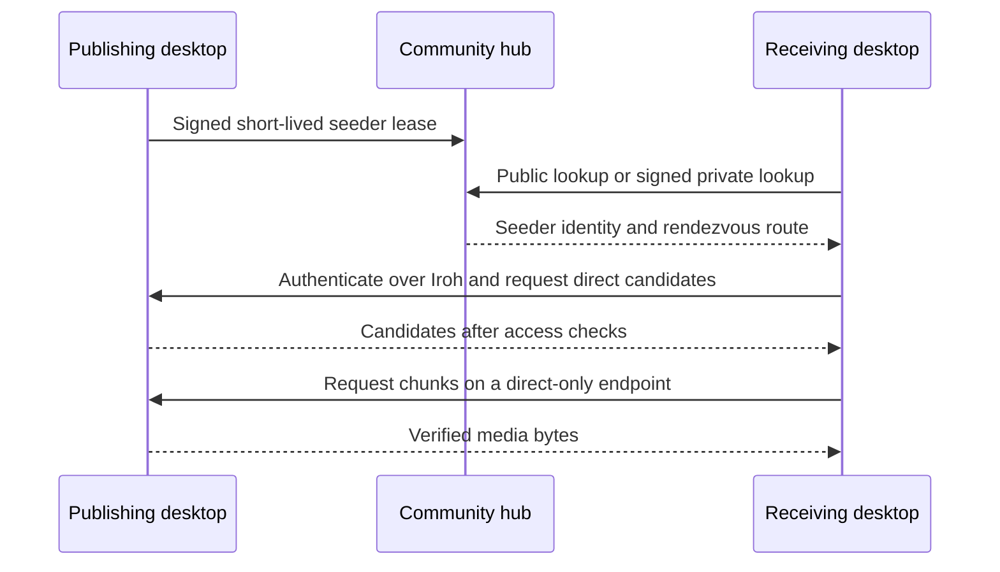

# Community hub

The Tauri beta uses one Railway service at [iroh.xnet.fyi](https://iroh.xnet.fyi/). It runs the Rust metadata registry and the Iroh relay behind one HTTPS origin. The existing Electron relay paths and admission state remain compatible.

## Sharing with a friend

1. Open **Chats** on an admitted desktop. Create a private conversation and copy its invitation. Send the complete HTTPS link to your friend.
2. With the current desktop build installed, your friend chooses **Open in xNet** on the web page, then confirms the link in the app. They can also paste it into **Open a link**. First-time devices create a local profile and enable participation. The invitation includes relay admission for up to eight devices over 23 hours. The room owner must be online.
3. In **Music** or **Discover**, choose a file and select **Everyone** or a private room you host. Public files have searchable web pages with expandable lists of seeding device keys. Room files get opaque URLs that existing room members can open.
4. Public files acquire more seeders when recipients keep a copy. The original desktop serves private files. Removing a room member stops subsequent reads, including reads using an already-issued playback ticket. A recipient can keep bytes they previously received.



Public listings contain a device and a manifest. Private leases hold an opaque handle, its owner route, expiry and per-file hashes of eligible device IDs. An operator who already knows a device ID can correlate these hashes. Private titles, manifests and room history stay on the desktops. The tracker and the seeder each check access. The receiver authenticates the seeder, verifies the signed manifest and checks each chunk. Clients renew every minute and their leases expire after three minutes. A listing is a recent claim of availability.

New messages and connection setup may use the encrypted relay. Chat history and media use a separate Iroh endpoint with relays disabled. The tracker holds no chat history, and its volume backups cannot restore a conversation. If direct connections are blocked, sending a new message can still work while reading history is unavailable.

Open a room and use **Earlier messages** to read older pages. A desktop can serve its own verified copy after checking the room owner's signed permission. While the owner is unreachable, a permission lasts at most five minutes from issuance. Both the reader and the serving member must be listed. The last known message restrictions still apply. An online refusal takes effect on the next check. A disconnected member can miss a removal until the permission expires. Previously received copies remain on recipients' devices. The owner must be online to admit new members or accept new messages.

## Operating the service

Use one replica with its volume mounted at `/data`. It holds SQLite in WAL mode, the registry signing and evidence keys, and the relay admission and budget journal. Losing the registry signing key breaks the trust pin on existing clients. Preserve the entire directory in snapshots. Railway daily volume backups are enabled on the hosted instance. To rehearse recovery, restore a backup to an isolated instance, check readiness and compare the registry policy key and a known record before routing clients to it. [Railway volume backups](https://docs.railway.com/volumes/backups)

| Setting                       | Default or purpose                                                                         |
| ----------------------------- | ------------------------------------------------------------------------------------------ |
| `HUB_MODE`                    | `both`, `tracker` or `relay`                                                               |
| `TRACKER_RELAY_URL`           | HTTPS relay origin advertised in hosted listings. Required in combined mode.               |
| `BOOTSTRAP_ENDPOINTS`         | Comma-separated trusted device public keys. Required when running a relay.                 |
| `REVOKED_ENDPOINTS`           | Device keys denied by the relay                                                            |
| `DAILY_RELAY_BYTES`           | 67,108,864 bytes per UTC day across both directions. Budget reservations survive restarts. |
| `RELAY_MAX_CONNECTIONS`       | 24 simultaneous relay sockets                                                              |
| `TRACKER_REQUESTS_PER_MINUTE` | 900 across the tracker                                                                     |
| `TRACKER_MAX_IN_FLIGHT`       | 32 concurrent tracker requests                                                             |
| `TRACKER_MODERATORS`          | Comma-separated device keys allowed to review reports                                      |
| `TRACKER_ORIGIN`              | Tracker origin for private lookup signatures when served separately from its relay         |

The tracker accepts signed JSON metadata, capped at 96 KiB per request. Its public catalog holds up to 10,000 records with 64 providers per record. The relay beta admits 32 devices. In combined mode the tracker checks relay admission on announcements. The HTTP metadata service has its own request budget. The relay byte cap does not cap metadata egress, storage, compute or the Railway bill.

Use `/hub/ready` to check all enabled components and `/healthz` for legacy relay availability. Set `XNET_COMMUNITY_REGISTRY` on the desktop to select another registry. An HTTPS registry defaults to using the same origin for its relay. `XNET_COMMUNITY_RELAY_URL` selects a separate relay or `off` for a direct-only registry. Original local profiles keep their local registry.

Build the Linux amd64 image from an allowlisted context. From the repository root, with the target Railway service and environment linked:

```sh
context=$(mktemp -d)/hub
deploy/community-hub/stage.sh "$context"
railway up "$context" --path-as-root --service iroh-relay --environment production
```

To check all three modes locally, put the built `community-registry` and Iroh 1.4.1 `iroh-relay` binaries on PATH, then run `python3 deploy/community-hub/check-modes.py "$context"`. For hosted acceptance, run the experiment's `scripts/check-hosted-hub.py` with a packaged Mac executable, an isolated profile directory and `--hub <origin>`. Enroll the public key of the test Host first. The test publishes a synthetic tone, exercises private membership and revocation, and checks two seeding devices. Its relay-only control setting isolates chat from same-LAN routing.
