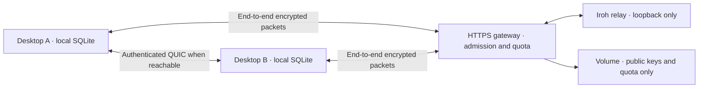

# xNet Iroh relay preview

This is an invitation-gated relay for the desktop text-chat prototype.
It is a fallback network path, **not just a lookup table**: when a direct path
cannot be established, encrypted message traffic passes through it. It does not
store messages or deliver to an offline device.



## Deployed service

- Desktop default: `https://iroh.xnet.fyi/` (DNS, ownership and TLS verified).
- Railway service address: `https://iroh-relay-production.up.railway.app/`.
- Railway project: `9c7feacb-eebd-4a44-a17c-4a0bcf08afdb`
- Production environment: `adf27fbf-a2f7-40cf-81b3-ff814d071310`
- Relay service: `dbc1e630-debd-42e9-b94e-65d4d4da0651`
- Volume: `3d5ede1c-7cee-4320-8adb-2cac027942bd`, mounted at `/data`.
- One replica; resource ceilings verified at 0.1 vCPU and 250,000,000 bytes RAM.
- Separate from the existing hub; no GitHub autodeploy or repository push.

`iroh.xnet.fyi` is configured in Vercel DNS with these records. Railway reports
propagated DNS, verified ownership and a valid certificate; HTTPS health and
real Electron invitation/message/restart flows passed on 2026-10-22.

| Type  | Name in `xnet.fyi`     | Value                                                                             |
| ----- | ---------------------- | --------------------------------------------------------------------------------- |
| CNAME | `iroh`                 | `aqzuuhoa.up.railway.app`                                                         |
| TXT   | `_railway-verify.iroh` | `railway-verify=e32b197212391c4e660edacf4b53068015d954063022550b3527e72728c3a88a` |

Use the values returned by `railway domain status iroh.xnet.fyi` if they change.
The verification token is a public DNS value, not a credential. Preserve these
and unrelated DNS records. Test HTTPS and an encrypted round trip before any
future URL change; invitations pin the relay origin, so changing it requires
new invitations. The Railway address remains available for operator diagnostics;
the desktop does not silently fall back to a different origin.

## Bounds and cost

| Resource                         | Preview limit                             |
| -------------------------------- | ----------------------------------------- |
| Admitted device keys             | 32                                        |
| New invitations per parent       | 8 unexpired admissions                    |
| Concurrent relay sockets         | 24                                        |
| HTTP requests                    | 120/minute, service-wide                  |
| Forwarded traffic                | 64 MiB/day, both directions, service-wide |
| Per-client upstream receive rate | 4 KiB/second, 8 KiB burst                 |
| App message                      | 4,000 characters; bounded encoded payload |
| App batch/frame                  | 3 signed changes / 64 KiB                 |
| App receive allowance            | 2 MiB/day per contact                     |

Quota reservations are persisted _before_ forwarding, in 512 KiB blocks. A
crash can lose unused allowance but cannot reset the day's spend. Exhaustion
closes relay traffic until the next UTC day; local messages remain queued.
Corrupt quota state fails closed. Do not delete the volume to recover a service.

At the October 2026 published rates, sustained use of the CPU/RAM ceilings is
about $4.50/month before traffic and storage. The relay traffic allowance adds
roughly $0.10/month if entirely billable egress. This is an estimate, not an
account-wide $5 spending cap: subscriptions, other services, builds and edge
traffic are separate. HTTP/TLS traffic outside the forwarded stream allowance
also costs resources. Check Railway usage before widening admission or limits.
See [Railway pricing](https://docs.railway.com/pricing).

Railway exposes this service over HTTPS/WebSockets. This configuration disables
UDP QUIC address discovery. Direct LAN paths work, but broad cross-NAT direct
connectivity has **not** been established. A UDP-capable relay/discovery host is
the next infrastructure experiment if relay use is high; adding HTTP relays
alone does not solve address discovery. See [Iroh QAD](https://www.iroh.computer/blog/qad)
and [Railway networking](https://docs.railway.com/networking/tcp-proxy).

## Security and operations

The Docker image pins upstream `iroh-relay` v1.4.1 and verifies the archive SHA256.
The desktop pins `@number0/iroh` 1.2.0, whose tested native build uses Iroh 1.4.1.
Only the gateway is public. Rust relay and admission callback bind loopback;
the gateway and relay run as the unprivileged `node` user after volume ownership
is set. HTTPS termination is supplied by Railway; peer QUIC encryption remains
end-to-end through the gateway.

`BOOTSTRAP_ENDPOINTS` contains trusted **public transport keys**, never signing
seeds. The user's current development profile is the initial bootstrap device.
A fresh installation needs an invitation from an admitted device or operator
enrollment. Registration proves possession of the endpoint key; a friend can
delegate admission with a signed, expiring, single-use nonce. The receiving
desktop separately approves the friend's xNet identity before chat sync.

Set `REVOKED_ENDPOINTS` to a comma-separated list of public keys and redeploy to
revoke compromised/test devices. Remove them from `BOOTSTRAP_ENDPOINTS` too.
Startup removes their persisted memberships and associated admissions; signed
re-registration stays denied. Revoking a parent does not automatically revoke
every previously admitted child: list those keys explicitly when needed.

The relay can observe IPs, endpoint IDs, timing and volume. Approved peers learn
each other's device identities and may learn IP addresses. This is not anonymity.
Keys and peer settings use Electron safe storage where available, otherwise the
existing owner-only local file fallback. Chat history follows xNet's existing
SQLite storage policy; this change does not add database-at-rest encryption.

Native QUIC parsers remain an attack surface. Small frames, limited streams,
timeouts and signed content reduce the exposed application surface; they are
not proof that the native dependency is vulnerability-free. Update and retest
the binding and relay together when upstream fixes land. The pinned package has
no Intel macOS binary; packaged Intel Mac support needs a separate build before
release. The module loads lazily so unsupported platforms retain the rest of xNet.

## Deploy from local files

Mount a volume at `/data`, configure `BOOTSTRAP_ENDPOINTS`, `PORT=8080`,
`RELAY_DATA_DIR=/data`, and `DAILY_RELAY_BYTES=67108864`. Keep one replica because
admission/quota are a single persisted registry. Run from this directory:

```sh
railway up . --path-as-root \
  --project 9c7feacb-eebd-4a44-a17c-4a0bcf08afdb \
  --environment adf27fbf-a2f7-40cf-81b3-ff814d071310 \
  --service dbc1e630-debd-42e9-b94e-65d4d4da0651 --detach
```

Wait for `SUCCESS`; then verify `/healthz`. It probes the actual relay process
and returns 503 when the relay is unavailable or the daily allowance is spent.
An upload or successful build alone is not deployment verification.
The current CLI warns that `railway.toml` is supported only until 2026-12-01;
migrate this service to Railway IaC before then, preserving its existing IDs and
resource limits without importing/redeploying the unrelated hub.

## Verification gates

The relay maintainer owns these manual gates before upgrading or redeploying:

```sh
# From repository root, Node 22+; no server needed.
node --test deploy/iroh-relay/gateway.test.mjs

# Verified upstream binary; local ports 3340/3341 must be free.
IROH_RELAY_BIN=/absolute/path/to/iroh-relay \
  node --test deploy/iroh-relay/transport.test.mjs
```

The wire test must exchange encrypted data, authenticate the expected remote
key, observe a relay path, and keep an unregistered outsider offline. Watchers
are stopped and all owned sockets/endpoints/children are closed. The test also
exercises the native error-first relay callback, which differs from the binding's
TypeScript declaration.

For a hosted test, set `IROH_TEST_RELAY_URL` and `IROH_TEST_KEYS_FILE` to an
owner-only temporary JSON file containing two 32-byte seed arrays. Temporarily
admit the first key in the relay bootstrap configuration. The test registers it,
delegates to the second device, then runs the same positive and negative wire
checks. Revoke both test keys after verification and remove the local seed file.
Never commit test credentials or use a person's identity seed for this test.

Desktop maintainers also run the peer protocol/service/query/policy tests and
drive two actual Electron profiles: invite → review → approve → send both ways
→ remove a message → quit one profile → send offline → restart → catch up.
Repeat on two physical devices on different networks before a public release.

## Desktop configuration

`XNET_IROH_RELAY_URL` overrides the trusted relay origin. Set it to the empty
string for direct-only operation, or a localhost HTTP URL for local development.
HTTPS is required elsewhere. There is no silent fallback to public n0 relays,
no public identity directory, and no automatic connection before the user opts
in by creating or accepting an invitation. An already-enabled profile resumes.

The local desktop preview handles text, Markdown, replies and removal in direct
chats and hosted groups. Groups can have up to eight members and sixteen channels,
all sharing the same membership. Public readers must still have a device identity
and relay admission. Attachments, calls, agent execution, extensions, an offline
mailbox and multi-device identity recovery are separate transport work. Peer
namespace records are excluded from both hub publishing and hub importing.

## Local shared-link upgrade (2026-10-23)

The new desktop supports signed, revocable contact and group links lasting 24
hours. Approval groups require host consent before history sync. Public groups
allow reading before joining; only signed members may post. Invite-only groups
retain individual one-hour invitations. Revoking a link blocks new requests;
it neither removes existing members nor withdraws an existing relay admission.

The local gateway adds `GET /capabilities` and version-2 admission signatures
with a signed `maxUses` capped at eight new device keys. Version-1 admissions
remain single-device. Existing per-parent invitation, device, rate and traffic
limits still apply. This gateway upgrade has **not been deployed**. On an older
gateway, the desktop explicitly limits a shared link to one new relay device;
already admitted devices can still use it to request group membership.

On 2026-10-23, the hosted `/healthz` returned 503 and `/capabilities` returned 404. The local desktop checks relay health separately from its connection state
and includes direct addresses in tickets. Two actual Electron profiles exchanged
channel messages and thread replies over direct connections, including after both
apps restarted. The preferred UDP port is persisted; if another process occupies
it, the app reports that a fresh link may be needed. Direct addresses reveal peer
network information to anyone who can read an invitation.

Before promising multi-device relay onboarding, deploy this gateway separately
and rerun the hosted wire gate above. Before promising public click-to-install
links or packaged Bluesky sign-in, publish the invitation landing page and OAuth
client metadata from the website work. This local pass does not deploy either.
