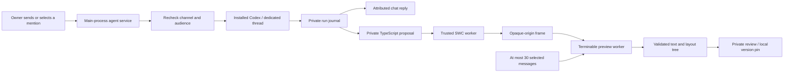
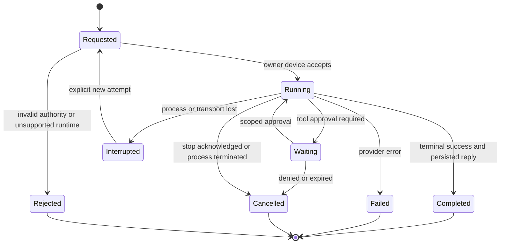
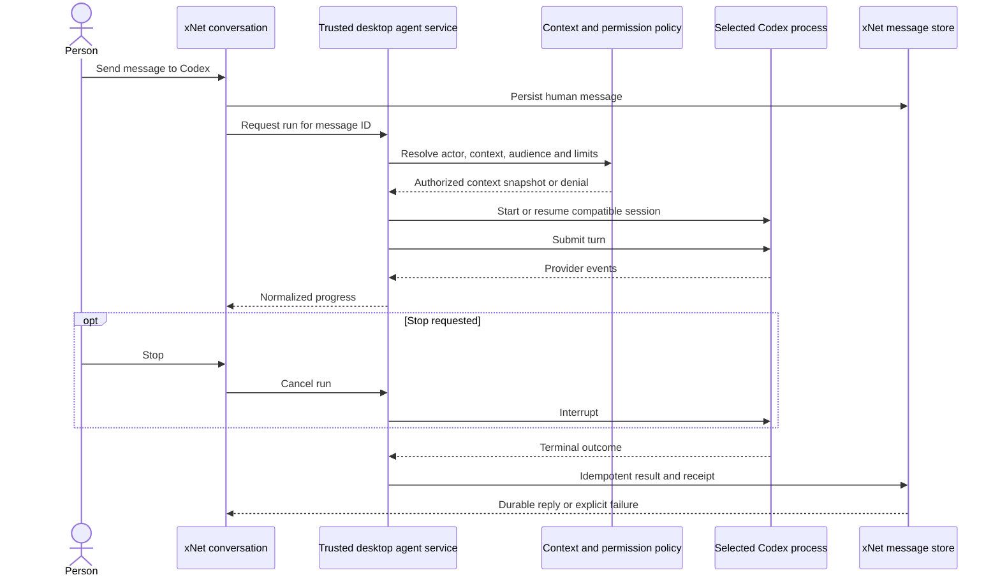
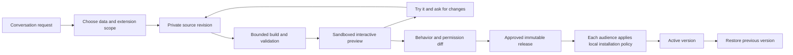
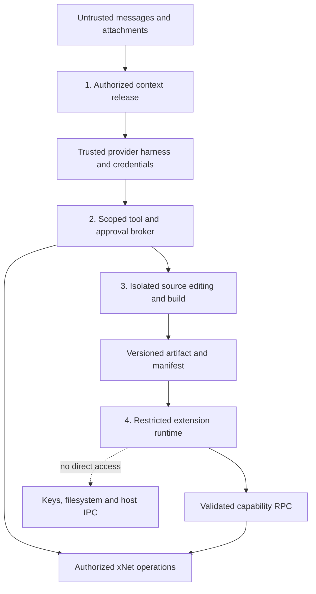

# Agents in chat and conversational extensions

> [!TIP]
> **TL;DR:** Give your installed Codex a conversation in xNet, then let a community invite a scoped agent into its conversations. Extend that same interaction into **ask → build a private preview → try it → publish a version**, using the plugin and history machinery already in the repository.

## Prototype in PR 728 — 2026-10-19

This exploration is **partially implemented** on `codex/chat-first-redesign` in
[draft PR 728](https://github.com/crs48/xNet/pull/728). Keep the PR unmerged. The
checklist below distinguishes the working desktop prototype from the remaining
private-community, retrieval, and distributed-extension work.

### Try it

1. Open the desktop community preview and choose **Your agents → Connect**.
2. Select the installed OpenAI Codex executable and connect. The unrelated npm
   `codex@0.2.3` is rejected. This preview supports the tested
   `codex-cli 0.162.0-alpha.17.2`; other versions fail explicitly.
3. Choose **This message only** for a fresh provider context, or **Recent chat +
   remembered agent conversation**. Start an agent conversation.
4. Send a message. Replies stream, survive navigation, and are saved with an
   owner/provider receipt. **Stop**, **Retry**, and **Reset agent memory** are
   separate actions. A reply over the message limit gets a preview plus a complete
   text attachment.
5. In a conversation you created, use **Conversation agent** to enable mentions.
   Select the agent from the `@` picker. Plain text mentioning a provider does not
   start a run. Only the local owner may invoke their runtime.
6. Select **Build an extension** and describe a view, such as a film watchlist.
   **Review extension → Build preview** compiles the proposed TypeScript and
   renders text/cards alongside chat. Optionally edit the source. Install a
   version locally, reopen it from **Conversation extensions**, or preview and
   restore an older revision from its history.

The connection uses the installed provider login and creates dedicated xNet
provider threads. It does not take over the coding task currently open in Codex.
Prompts go to the provider's model service. The local bridge is not a local model.

### What the implementation isolates



- The main process owns executable selection, provider session IDs, cancellation,
  quotas, and the durable journal. Its IPC accepts the main app frame only.
  Requests are deduplicated by source message; retries are new attempts.
- Reply mode disables the tested Codex build's tools, hooks, MCP servers, skills,
  plugins, web search, and workspace instructions. Unknown runtime/catalog
  shapes fail closed. Unexpected tool events abort the run. The adapter never
  treats transport EOF or partial output as successful completion.
- Context is same-channel text, at most 30 messages / 24,000 serialized characters;
  attachments are excluded. Audience/policy changes cancel active work, deny
  publication, and rotate provider context. The local owner is derived from the
  desktop identity, not supplied by an approval card.
- Extension proposals remain in the private local journal. Successful builds save
  a new personal `PluginSource` node with source, actor/run, compiler, build hash,
  and an optional base revision. The application appends revisions and verifies
  their build hash on restoration; the underlying mutable node store is not a
  cryptographically immutable release registry.
- SWC 1.15.41 compiles in a worker with a ten-second limit. Generated code executes
  in a separate worker within an opaque-origin frame, with a two-second lifetime
  and no network permission or host RPC. It receives a bounded data snapshot and
  can return only validated text/layout nodes. No arbitrary HTML reaches React.
  Installation pins a local version; source changes do not change that pin.

### Verification and remaining boundaries

Real Electron testing with the installed Codex completed a reply, remembered
follow-up, app restart/resume, and an interrupted extension request followed by
an explicit successful retry. A real Codex-generated watchlist compiled and
rendered, was installed locally, and reopened from its saved source revision.
The watchlist was changed twice through chat; its three attributed source revisions were retained and an earlier version was restored locally. The original movie requests remained available in the conversation.

In an owner-created group, a plain quoted `@Codex` did not invoke the agent; selecting the mention produced a real reply. Stop terminated an active request.

Hostile preview inputs exercised an infinite loop, network fetch, unsafe output
fields, and broken TypeScript; each failed without removing the last working
view. The web production build includes the compiler worker, WASM asset, and
isolated preview document. Adapter, policy, service-lifecycle, and render-tree
validation tests provide separate regression coverage.

Claude discovery and a constrained adapter are wired, but the installed Claude
login returned an expired OAuth session and could not refresh it. A real Claude
reply remains unverified until the owner signs in again. The UI reports this as
a sign-in failure rather than falling back to a more permissive invocation.

This is still a prototype for non-sensitive demo content. The original 0478
private-group encryption and authenticated membership prerequisites remain open.
There is no web research broker, archive search, remote invocation, cross-device
agent delegation, group plugin publication, source-conflict merge UI, writable
plugin data API, or migration approval flow. The extension surface is a readonly
view over a selected message snapshot, not the general-purpose plugin host.
Browser workers bound execution time, input/output size, and exposure to app
APIs; they do not establish a hard memory quota or replace a sandbox security
audit. Synthetic-home hook/MCP sentinel tests, broader hostile-runtime tests, and
complete privacy/latency benchmarks remain unchecked below.

The keep/change decision is **keep the chat interaction and constrained view
preview, then validate the security prerequisites before expanding authority**.
No new public identity, delegation, or wire-format contract is accepted here.

## Problem Statement

The chat redesign gives xNet a familiar starting point: people, conversations, groups, and shared media. An agent should fit into that experience. You should be able to open **Codex**, ask a question, and get a reply using your existing installation. In a group, `@Codex` should address an invited assistant. Later, “collect the videos we shared into a watchlist” should produce something useful alongside the conversation.

The difficult transition is from an agent answering to an agent changing the application. A group member's message must not become permission to run commands on someone else's laptop. Generated code must not inherit the application's access to private conversations. Live previews must not silently replace the interface everyone else is using.

The opportunity is substantial: a community could grow its own software from its conversations. A film club gets a watchlist, a family gets a shared calendar, and collaborators get a project board without moving their data into separate services. The underlying records remain usable through other interfaces.

**Original research scope.** The following analysis predates the prototype described below; it is not a security audit. Product code was inspected at chat-redesign commit `97cda2817226942a8559077760600312880a5ff7`, the head of [draft PR #728](https://github.com/crs48/xNet/pull/728) at inspection. Research is saved on the separate `codex/personal-data-foundation` branch, starting at `5d7bd656698b3e18871379ffd8c8ba4fc7cb9c4a`. Official sources and local CLI metadata were checked on 2026-10-18. No model request, authentication flow, application session, or sandbox attack was run. The proposed behavior below is unimplemented unless explicitly identified as existing code.

The review date is a two-week checkpoint to decide whether the first Codex conversation is useful enough to pursue. It is not a shipping promise. This design remains reversible; accepted identity, delegation, wire-format, or public extension contracts need an ADR with a `Tripwire:` in [the decisions document](../../site/src/content/docs/docs/architecture/decisions.mdx).

## Executive Summary

Start with **desktop, one owner, one Codex conversation, text replies, and no agent tools**. Persist the conversation in xNet, stream output into the existing message view, and make cancellation and failure visible. The first implementation should resolve the installed executable correctly, modernize the Codex adapter, and prove that its effective configuration meets the advertised restrictions.

Then add group mentions, research tools, and extension authoring as distinct increments. Each can be useful before the next exists.

| Increment | What someone can do                            | New authority it requires                                       |
| --------- | ---------------------------------------------- | --------------------------------------------------------------- |
| Talk      | Converse with their own installed Codex        | Send selected text to the configured model provider             |
| Invite    | Mention an agent in an enabled group           | Release agreed group context and use an owner's agent allowance |
| Research  | Ask for sources, images, and video links       | Issue bounded external queries and retrieve approved content    |
| Make      | Ask for a watchlist or another small interface | Create draft source and preview it against selected data        |
| Share     | Publish that extension for the group           | Activate an exact version with declared permissions             |

Three principles keep this coherent:

1. **An agent has an owner and an execution device.** “Codex · hosted by Chris” is clearer than an apparently universal bot that happens to use someone's credentials.
2. **Permissions belong to the host's enforcement layer.** A message, model response, plugin manifest, or imported document cannot grant them.
3. **Live changes happen in a preview.** Shared behavior changes at a deliberate version boundary; code inspection is available without being required for ordinary use.

This does not require a new hosted AI backend, vector database, orchestration service, or generalized multi-agent system. A local runner and small persisted state machine can support the initial experience.

## Current State In The Repository

### There is enough foundation to connect, but not enough to advertise as finished

The code graph led to the provider adapters; direct inspection established which pieces the desktop actually calls. Existing module names and comments alone are not evidence that the new chat UI uses them.

| Area                            | Status                                 | Evidence and implication                                                                                                                                                                                                                                                                                                              |
| ------------------------------- | -------------------------------------- | ------------------------------------------------------------------------------------------------------------------------------------------------------------------------------------------------------------------------------------------------------------------------------------------------------------------------------------- |
| Community chat                  | 🟡 Implemented preview                 | [ConversationPane.tsx at the inspected commit](https://github.com/crs48/xNet/blob/97cda2817226942a8559077760600312880a5ff7/packages/workbench/src/communities/ConversationPane.tsx) stores `ChatMessage` nodes. Its send path has no agent invocation and does not populate structured mentions.                                      |
| Message data                    | 🟢 Existing schema                     | [chat-message.ts](../../packages/data/src/schema/schemas/chat-message.ts) has content, attachments, thread roots, and structured mentions. Content is bounded at 10,000 characters; agent output needs a deliberate overflow policy.                                                                                                  |
| Installed-agent bridge          | 🟡 Existing, broad default             | [agent-bridge-manager.ts](../../apps/electron/src/main/agent-bridge-manager.ts) defaults to Claude, probes only `--version`, enables workspace MCP unless disabled, and uses a dedicated working directory.                                                                                                                           |
| Actual desktop Codex path       | 🟡 One-shot                            | That manager uses streaming Claude but falls back to `cliChatAgent` for other commands. The standalone Codex app-server adapter is not selected there.                                                                                                                                                                                |
| Provider framing                | 🟡 Useful abstraction                  | [chat-agent.ts](../../packages/devkit/src/chat-agent.ts), [agent-frames.ts](../../packages/devkit/src/agent-frames.ts), and [acp-agent.ts](../../packages/devkit/src/acp-agent.ts) provide streaming, sessions, tool events, and an ACP adapter.                                                                                      |
| Codex app-server                | 🔴 Needs compatibility work            | [codex-app-server.ts](../../packages/devkit/src/codex-app-server.ts) sends `newConversation` and `sendUserMessage`, and consumes older `codex/event/*` names. Its completion race can emit success after the transport ends without a terminal success event.                                                                         |
| Workspace tools and approvals   | 🟡 Existing, not scoped to a chat      | [agent-mcp-server.ts](../../apps/electron/src/main/agent-mcp-server.ts) registers workspace and plugin tools with audit/approval handling. Its audit identity is the placeholder `bridge:agent`; a pairing token is not a per-conversation delegation.                                                                                |
| Agent identity and receipts     | 🟢 Reusable primitives                 | [agent.ts](../../packages/data/src/schema/schemas/agent.ts) defines passports, sessions, actions, and approvals; [audit types](../../packages/data/src/agent-audit/types.ts) distinguish reversible, compensatable, and irreversible actions.                                                                                         |
| Draft changes                   | 🟡 Reusable with constraints           | [agent-draft.ts](../../packages/history/src/agent-draft.ts) overlays writes into drafts. It changes the store's checked-out draft and passes non-forkable schemas through; it is not isolation for concurrent chat jobs or a universal write sandbox.                                                                                 |
| Extension source and publishing | 🟢 Existing primitives                 | [PluginSource](../../packages/plugins/src/schemas/plugin-source.ts) stores files and a manifest; [hash.ts](../../packages/plugins/src/workspace-plugins/hash.ts) pins source, entry, and manifest; [publish.ts](../../packages/plugins/src/workspace-plugins/publish.ts) separates sharing from receiver consent.                     |
| Extension runtime               | 🟡 Foundation, not an audited boundary | [frame.ts](../../packages/plugins/src/workspace-plugins/frame.ts) uses an opaque-origin iframe with restrictive CSP; [store-rpc.ts](../../packages/plugins/src/workspace-plugins/store-rpc.ts) gates schema access and denies sensitive schemas. It does not itself bind grants to a particular channel or space.                     |
| Live extension UX               | 🟡 Development surface                 | [WorkspacePluginsDevView.tsx](../../packages/workbench/src/views/WorkspacePluginsDevView.tsx) mounts the runtime, but views/widgets are placeholders there, and TypeScript needs an injected transpiler. [watcher.ts](../../packages/plugins/src/workspace-plugins/watcher.ts) defaults to following source for development previews. |

### A real local discovery failure

On this machine, the first `codex` on PATH is npm package `codex@0.2.3`, described by its package metadata as a **static site and code documentation generator**. It is unrelated to OpenAI Codex. It exits successfully for `--version`, so the current bridge probe can accept the wrong program.

A second executable bundled with the desktop application reports `codex-cli 0.162.0-alpha.17.2` and supports `app-server`. Its locally generated JSON Schema includes `thread/start`, `thread/resume`, `turn/start`, and `turn/interrupt`; its generated `ClientRequest` does not include the two methods used by xNet's adapter. Claude Code reports `2.1.278` and exposes streaming and restricted-mode controls.

These are discovery and schema observations, **not proof of authentication, subscription entitlement, or a successful turn**. No credentials were read and neither installation was changed. A product should discover candidates, identify them, and retain the chosen absolute executable path; it should not bake this machine's application bundle path into the implementation.

<details>
<summary>Other boundaries that should not be inferred from class names</summary>

- [ScriptSandbox](../../packages/plugins/src/sandbox/sandbox.ts) uses AST checks and shadowed globals. That is not an OS or browser-origin boundary for arbitrary hostile code. A same-thread timeout cannot reliably interrupt a synchronous infinite loop.
- [The SES widget compartment](../../packages/dashboard/src/sandbox/compartment.ts) catches lockdown failure and returns a boolean; [its worker](../../packages/dashboard/src/sandbox/user-widget-worker.ts) does not check that result before accepting work. An untrusted-code production path should fail closed here.
- [IframeWidgetHost](../../packages/dashboard/src/sandbox/IframeWidgetHost.tsx) has sandbox flags but lacks the workspace-plugin frame's explicit CSP. It should not be treated as interchangeable with the latter for data-bearing extensions.
- Schema grants such as “read `ChatMessage`” can include every readable conversation in the underlying store. Existing user authorization does not establish the narrower boundary promised to one plugin or agent.
- A pinned source hash does not currently bind the transpiler, pinned vendor contents, and complete runtime environment. Release receipts need enough build information to identify the artifact that actually ran.

These are source-level findings and design constraints, not demonstrated exploits or an exhaustive review.

</details>

## External Research

### Provider protocols: keep a small xNet interface, use native adapters

OpenAI describes app-server as an embedding interface for rich clients with streamed events, conversation state, and approvals. Current documentation uses an initialization handshake, `thread/start` or `thread/resume`, and `turn/start`; a terminal turn event distinguishes completion from streaming. It also documents schema generation. The page currently labels the command and WebSocket transport experimental and unsupported for production workloads. That makes a version-tested desktop preview a reasonable first target, with compatibility failures made explicit. [Codex app-server](https://learn.chatgpt.com/docs/app-server)

There are client-invoked process APIs that run outside Codex's sandbox. xNet should expose a narrow chat operation to its renderer, never a generic JSON-RPC passthrough. A read-only Codex sandbox can still read files and run commands; it does not mean “no tools.” Our reply-only policy needs effective tool/configuration restrictions plus verification. [App-server process execution](https://learn.chatgpt.com/docs/app-server#process-execution), [agent approvals and security](https://learn.chatgpt.com/docs/agent-approvals-security)

Claude documents programmatic `-p` use, streamed JSON, and explicit session continuation. Its CLI distinguishes tools available to the model from tools approved without prompting: `--allowedTools` controls the latter. `--tools ""` disables built-ins, not MCP; `--strict-mcp-config` and MCP denials address separate configuration paths. Current restricted/safe modes help limit inherited customization, but need version-specific verification. Do not assume `--bare` preserves an existing personal login: its documented authentication behavior differs. [Programmatic Claude Code](https://code.claude.com/docs/en/headless), [CLI reference](https://code.claude.com/docs/en/cli-reference)

ACP provides a common client-to-agent vocabulary for initialization, sessions, updates, permissions, and cancellation. It is a useful optional adapter boundary, not proof that every provider adapter has identical capability or permission semantics. Keep native Codex and Claude adapters first; add ACP where a tested implementation expands compatibility. MCP remains the agent-to-tool boundary. [ACP overview](https://agentclientprotocol.com/protocol/v1/overview)

### Existing login is useful; inheriting an entire setup is a separate choice

Anthropic's October 7, 2026 update says SDK, `claude -p`, and third-party app usage can still use subscription limits, with additional API-credit arrangements for some plans. An older blanket claim that these integrations necessarily require API billing is stale. An API key in the environment can change the billing path, so readiness should show the configured account mode without displaying secrets. This does not establish that an owner may resell or pool a personal subscription for a whole community. [Current plan guidance](https://support.claude.com/en/articles/15036540-use-the-claude-agent-sdk-with-your-claude-plan), [Claude Code plan setup](https://support.claude.com/en/articles/11145838-use-claude-code-with-your-pro-or-max-plan)

OpenAI also documents a separate Sign in with ChatGPT integration for app-server. That is a future product option if xNet wants its own connection flow; it is unnecessary for the first installed-agent path. Keep the provider's authentication inside the trusted provider process, rather than copying credential files into xNet records or exposing them through the renderer. [Sign in with ChatGPT and app-server](https://developers.openai.com/siwc/token-sharing-open-source/codex-app-server)

### Sandboxing has several independent layers

Electron recommends renderer sandboxing, context isolation, disabling Node integration for untrusted content, and validating IPC senders. An iframe's sandbox flags alone do not establish network confinement or guaranteed process isolation. Combining scripts and same-origin access on same-origin content can defeat the intended iframe restriction. [Electron security](https://www.electronjs.org/docs/latest/tutorial/security), [iframe sandbox semantics](https://developer.mozilla.org/en-US/docs/Web/HTML/Reference/Elements/iframe#sandbox)

MCP's security guidance covers confused-deputy attacks, token audience validation, and SSRF. Applied here, a caller must receive only the authority delegated to that caller; a local tool broker must not convert a group member's request into the laptop owner's unrestricted authority. [MCP security guidance](https://modelcontextprotocol.io/docs/2025-11-25/tutorials/security/security_best_practices)

Wasmtime offers a later route for bounded compute: WASI filesystem access follows explicit capability grants. It does not solve DOM integration, unsafe host imports, or privacy after data has been passed into a program. Use it when there is an actual compute workload, not as a prerequisite for chat. [Wasmtime security](https://docs.wasmtime.dev/security.html)

## Key Findings

### 1. The contact metaphor works if the ownership is visible

The interface can be ordinary and minimal:

```text
Chats                         Codex
  Family                      Hosted by you · This computer
  Film club                   Uses your connected provider account
  Codex         AI
  Claude        AI            You: Help me organize this week's plans.
                              Codex: ...streaming response...

                              Context: This conversation
                              [Message Codex…]        [Send / Stop]
```

**New conversation → Agent → Codex** connects an installation once. Subsequent conversations behave like chats. Keep the usual message composer and search; put technical diagnostics behind the agent's details sheet. The normal view needs the owner, availability, context, and a stop button, not a terminal or tool log.

Use distinct states: **Not connected**, **Checking**, **Ready**, **Sign-in required**, **Unsupported version**, **Busy**, **Offline**, and **Failed**. “Installed,” “authenticated,” “policy compatible,” and “responded successfully” are different facts. After a CLI update, recheck compatibility rather than assuming a previously working installation is still compatible.

An agent contact is an xNet representation of an owned runtime. It is not a verified public identity of OpenAI or Anthropic. Linking a social account through exploration 0479 also does not confer agent execution authority.

### 2. Being in a group is not permission to use someone's computer

An admin can permit agents in a room. The runtime owner separately decides whether other members may invoke their agent and what budget they may consume. A member can ask; only the relevant authority can grant access to data, execution, or publication.

| Action                                | Who can authorize it?                                             | Default                                         |
| ------------------------------------- | ----------------------------------------------------------------- | ----------------------------------------------- |
| Start a personal agent conversation   | Runtime owner                                                     | Allowed after connection and context disclosure |
| Enable an agent for a group           | Group policy/admin plus runtime owner                             | Off until both agree                            |
| Invoke the owner's agent              | Owner or explicitly authorized members                            | Owner only initially                            |
| Release conversation history          | Applicable group policy and authorized sender; visible to members | Selected context since enablement               |
| Read another space or local directory | Holder of that authority, with a target-specific grant            | Denied                                          |
| Publish an extension for the group    | Group's publisher role                                            | Explicit version approval                       |

An invited agent does not listen to every message. In a group, use a structured mention selected in the composer. Quoted `@Codex`, an email address, imported text, and an agent's own message must not start a run. A mention addresses a specific agent instance, not every installation named Codex. In a direct agent conversation, sending the message is the invocation.

Begin group support with the owner invoking their own agent. Opening invocation to other members is a later step with per-member quotas, host-owner consent, revocation, and clear provider-account eligibility. Do not build a public bot atop assumed personal-subscription sharing rights.

### 3. Context sharing is the first security boundary

> [!IMPORTANT]
> An installed agent can run its controller locally while sending prompts to a remote model provider. A private xNet conversation does not remain exclusively between its human members once its content is sent to that provider.

Show what the agent receives: **This question**, **This thread**, or **Selected messages and attachments**. A group should see which agent is enabled, which provider processes context, and when that policy changed. For the first group pilot, require existing members to acknowledge the new processing policy before releasing their earlier messages; an administrator enabling a bot should not silently upload the archive. Later membership terms can make the ongoing policy explicit.

Build a context snapshot from the invocation, authorized history, and explicitly selected resources. Bound it by message count, tokens, and attachment bytes; show omissions. A useful starting limit is the selected thread plus the latest 30 eligible messages, bounded by a configurable token budget. This is a proposed UX default, not a measured optimum. Older material can be retrieved through explicit scoped search later.

The host owner's broader access is not the group's access. If Chris has a private finance space and a public film club, a film-club request cannot read finance records even though the same laptop stores both. Before placing a response into a group, the context must be suitable for that response audience. Otherwise the answer belongs in a private conversation or must exclude that source.

Provider session state is also context. Bind a session to the xNet conversation, agent instance, owner, destination audience, policy version, and history boundary. After membership or authority changes, discard the resumable binding and construct a new authorized context. Reset summaries, retrieved-result caches, and long-term memory under the same rules. Removing a message locally cannot retract copies already sent to a provider.

### 4. The chat record and the agent execution are different objects

Keep ordinary messages in `ChatMessage`. Keep the run's lifecycle, local provider session identifier, context receipt, usage information, and approvals separately. Stream partial text ephemerally and save a bounded final result; avoid making every token a signed synced database change.

For the first desktop version, xNet's main process owns the run and the renderer subscribes to it. Navigating to another conversation should not cancel or duplicate work. A process crash should leave a visible interrupted run. Retrying creates a new attempt linked to the original request.



A durable reply ID derived from the run/attempt makes message publication idempotent. It does not make provider computation exactly once. For the MVP, nominate one execution device per agent instance and serialize its turns. A future failover scheme needs leases with fencing and reconciliation; disconnected peers cannot promise exactly-once execution through eventual sync alone.

If the host is asleep, show **Chris's computer is offline**. Do not leave a typing indicator spinning. Initially require an explicit retry when it returns; later queues need expiry and a fresh authority check before execution. A community host could eventually run an agent, but that makes the host an authorized processor of plaintext and introduces its own account and operating costs.

## Options And Tradeoffs

| Choice                                      | Benefit                                                    | Cost                                                                 | Recommendation                                   |
| ------------------------------------------- | ---------------------------------------------------------- | -------------------------------------------------------------------- | ------------------------------------------------ |
| Installed native provider adapters          | Uses an existing harness and familiar account; rich events | CLI drift, inherited settings, desktop lifecycle                     | Start with Codex, then Claude                    |
| ACP for every provider                      | Common session vocabulary                                  | Adapter availability and semantics vary; another compatibility layer | Optional after native paths work                 |
| Direct model APIs                           | Stronger control over tool loop and environment            | New credentials/billing and more harness work                        | Optional provider, not required onboarding       |
| Community-hosted runtime                    | Available when laptops sleep                               | Plaintext processing trust, operations, funding                      | Later opt-in host role                           |
| Fully on-device model                       | Can avoid remote inference                                 | Hardware, model quality, distribution, resource use                  | Preserve adapter compatibility; don't require it |
| Arbitrary generated React in the app        | Broad UI freedom                                           | Shares trusted renderer authority and failure domain                 | Reject for chat-generated code                   |
| Declarative views plus sandboxed extensions | Smaller initial surface; inspectable data and grants       | Some features need new stable contribution points                    | Preferred growth path                            |

The product should not force people to understand these choices at first launch. “Use installed Codex” is the primary path. Advanced settings can expose alternatives as they become useful. No new xNet revenue lane is proposed here.

## Recommendation

### A. First, make one Codex conversation real

Add a narrow agent service consumed by the shared community UI. Keep process spawning, account handling, and provider protocol code in Electron/main or a separately paired local runner. Web can later use that runner through an authenticated bridge; a browser page cannot directly launch a local CLI. Mobile can address an explicitly paired host later. No public listener is needed for the first milestone.



Reuse the frame abstraction, but add typed terminal outcomes, cancellation, provider capabilities, and structured compatibility errors. Select adapters by a verified provider kind, not by checking whether the command string equals `claude`. An absolute path to Claude must still get the Claude adapter.

Use the generated protocol schema from each supported Codex version to validate fixtures. Complete the handshake and resume protocol, normalize current events, and reject unknown permission requests. Record the supported version range. The modern protocol names were confirmed in the locally installed binary; this does not eliminate the need for a real streamed-turn test.

**Reply only must be an enforced mode.** Disable built-in execution and filesystem tools, unrelated MCP servers, inherited plugins/hooks, and automatic subagent work where the supported provider allows it. Use an application-owned working directory, bounded environment, and a verified effective configuration. Reusing login does not mean importing every capability from the person's coding environment. If a compatible no-tools posture cannot be established, report that limitation and block group use; do not describe a read-only coding sandbox as tool-free.

The harness itself remains trusted code with access to its authentication and provider connection. Untrusted tool execution belongs in a separate restricted environment. Do not put credential-bearing environment variables into that environment merely because they were available to the harness.

The first mode needs no broad xNet MCP access. The host already has the selected message text and can pass that snapshot in. This sharply reduces the amount that must work before the first useful reply.

Keep agent startup off the ordinary chat startup path. Probe when someone connects an agent, and lazily start a compatible process when needed. Measure cold and warm turns separately before deciding how long to keep an idle process alive. Bound queued work, concurrent runs, stored logs, and tool output; a busy agent should not make human conversations slower. The owner's subscription or API account still has limits. Display provider-reported usage when available, distinguish unknown usage from zero, and avoid inventing a dollar cost from subscription token counts.

### B. Use one policy decision across all entry points

Agent invocation, tool calls, and publication should resolve authority through the same host service whether they arrive from the chat UI, an authenticated local bridge, or a later remote host. A renderer should not be able to supply an arbitrary operator DID, executable, directory, or tool grant and have it trusted.

Conceptually, effective authority is the intersection of:

```text
invoker's authority for this task
∩ owner's delegation to this agent instance
∩ conversation's processing and audience policy
∩ runtime's enforceable capabilities
∩ any explicit approval for this exact action
```

An approval narrows or activates an allowed capability; it cannot exceed that ceiling. A signed chat message can establish who requested something, but text saying “approved” is not a permission grant. Use an authenticated host-rendered approval card bound to run, action, target, arguments hash, policy version, and expiry. The agent cannot render its own trusted approval chrome or approve itself.

Give each run a dedicated scoped tool facade. Read checks must cover specific resources and fields, not just schema names. Write checks must validate the existing target and the proposed destination, so changing a `channel` or `space` property cannot move data across boundaries. Queries, relation traversal, attachments, search indexes, and derived views all need the same audience restrictions.

Prefer small named operations such as “search this conversation” or “create a draft extension.” Do not offer a general store proxy and rely on the model to honor a prompt. Recheck policy when a tool executes and when a result is posted; revocation during a long run must take effect.

<details>
<summary>Conceptual records and an adapter-neutral interface</summary>

These are design sketches, not proposed public exports or final schema IRIs. Reuse `AgentPassport`, `AgentSession`, and `AgentAction` where their semantics fit, rather than introducing a second audit system.

```typescript
type AgentTurn = {
  runId: string
  conversationId: string
  triggerMessageId: string
  contextSnapshotId: string
  policyVersion: string
  signal: AbortSignal
}

type AgentOutcome =
  | { status: 'completed'; text: string; providerSessionId?: string }
  | { status: 'cancelled' }
  | { status: 'interrupted'; detail: string }
  | { status: 'failed'; code: string; detail: string }

type AgentAdapter = {
  inspect: () => Promise<RuntimeCapabilities>
  run: (
    turn: AgentTurn,
    context: AuthorizedContext,
    emit: (event: AgentEvent) => void
  ) => Promise<AgentOutcome>
}
```

`RuntimeCapabilities`, `AuthorizedContext`, and `AgentEvent` are placeholders for validated internal contracts. The host resolves authorization before calling the adapter; an adapter does not decide its own scope.

| Record                | Persist or sync?                                                        | Sensitive boundary                                            |
| --------------------- | ----------------------------------------------------------------------- | ------------------------------------------------------------- |
| Agent participant     | Group-visible label, owner, capabilities, availability summary          | No executable path, credential, or local session ID           |
| Local runtime binding | Local encrypted/private application state                               | Selected binary, provider account mode, session mapping       |
| Invocation/run        | Minimal conversation-visible lifecycle plus private operational details | Context and tool logs may be more restricted than the chat    |
| Context receipt       | Authorized audience, message/version references, retention policy       | A hash is not anonymization; avoid leaking private membership |
| Agent reply           | Ordinary message plus verifiable run attribution                        | Renderer labels must follow signed evidence                   |
| Extension revision    | Immutable source/artifact references and attribution                    | Distribution of source does not confer execution trust        |

For first-party replies, do not forge `createdBy` to make a human-signed node look agent-signed. Use an existing delegated agent identity only after its channel authorization is proven. Otherwise label the result honestly as posted by the owner using Codex, with a signed host receipt. That receipt establishes what the host asserts happened; it is not cryptographic proof from the model provider. A proper agent participant identity can follow once its public semantics have an ADR.

</details>

### C. Add research without turning every URL into an execution path

The next useful toolset is small: search the permitted conversation, search the web with an explicit query, read selected pages, and propose source cards. A result card should contain a title, canonical URL, source, retrieved time, and an optional image or media reference. Separate a found video from an imported copy and from generated media.

Fetching and displaying are distinct permissions. External search can disclose the query; loading a thumbnail or embedded player can disclose network information to its host. Start with links and click-to-load media, with a visible way to save a permitted copy into xNet. Large video processing should use the media pipeline, not arbitrary shell commands created by the chat agent.

Broker retrieval with scheme and destination checks, including redirects and DNS resolution, to reject local services and private-network targets. Limit response size, MIME types, decompression, redirects, execution time, and concurrency. Parse external content as untrusted data; do not execute returned HTML in the application origin or follow instructions embedded in search results. Keep existing attachment/media safeguards in force.

For a 50,000–100,000-item personal archive, the agent should query bounded indexes and receive selected records. It should not enumerate the whole archive into a prompt. Search must enforce scope before returning snippets or counts; a fast global index with post-filtered results can still leak information or produce misleading omissions.

Source cards and tool receipts should be useful without exposing every raw tool result or internal reasoning trace. A short “Searched three sources” disclosure and expandable citations usually belong in the chat; full operational logs belong in a restricted diagnostic view.

### D. Make conversational extensions a preview workflow

Consider a film club:

> **Chris:** Make a watchlist from the videos shared in this thread. Let us vote and mark what we watched.
>
> **Codex:** I've made a preview with the eight shared videos. It reads this thread and keeps votes in the film club. It doesn't contact external sites.
>
> **Preview:** Working watchlist, with **Try**, **Changes**, and **Publish to film club**.
>
> **Chris:** Put unwatched videos first and make the thumbnails smaller.
>
> **Preview:** Updates after the new version validates. The previous working version remains available.

This is the point where xNet becomes malleable without asking the user to become a software maintainer. The agent changes a small contribution to the app; the trusted shell continues to own navigation, identity, permissions, recovery, and security indicators.

Offer three levels, in order:

| Level                     | Examples                                               | Execution                                      |
| ------------------------- | ------------------------------------------------------ | ---------------------------------------------- |
| Declarative composition   | Filtered gallery, sorted watchlist, form, saved search | Trusted components interpreting validated data |
| Sandboxed extension       | New interaction, calculator, custom visualization      | Existing plugin runtime, hardened and scoped   |
| Native application change | New signing behavior, privileged device feature        | Conventional repository review and app release |

Prefer declarative composition when it expresses the request. Do not make the model generate a package, dependency tree, and custom renderer just to sort a list. For custom code, TypeScript is the initial authoring language because the repository already has that path. A later WASM compute contract can admit Rust without requiring arbitrary Rust binaries or a second UI framework. Swift remains a native host concern, not a requirement for community-authored features.



Keep the preview beside the conversation on desktop and in an explicit preview route on a small screen. It uses sample data or a narrowly authorized snapshot by default. Trying a vote should write to a draft or test dataset until publication. The source editor is an optional **Code** tab; manual edits enter the same revision, validation, and attribution flow.

Hot reload should swap complete successful builds, not execute half-written files. An invalid build keeps the last working preview visible with a concise error. “Live” can mean hundreds of milliseconds after a small validated edit; it does not require evaluating every streamed token. Measure rebuild and swap latency separately from model generation time.

### E. Separate four security boundaries



**Context release** controls what is disclosed to the model. A restrictive code sandbox does not undo a prompt containing private records.

**Tool execution** controls what the harness may do. For richer coding tasks, use an application-owned source directory and a separately restricted execution process or VM. An isolated Git worktree protects version history and concurrent editing; it is not a security sandbox. Do not mount the home directory, credential stores, SSH agent, Docker socket, or unrestricted local API into the builder. Network and resource budgets apply here too.

**Build** must not execute arbitrary project scripts or package installation hooks on the host. Start with the repository's existing source-map/transpiler model and a pinned vendor set. Expanding beyond that needs an isolated build environment, dependency integrity checks, explicit dependency changes, and a reproducible artifact receipt. Compiler and parser bugs remain part of the threat model; cap inputs and keep toolchains current.

**Extension execution** should reuse and harden the opaque-origin frame and host-mediated RPC. Deny ambient network by default, including indirect image/media loads and navigation routes. An iframe alone is not a reliable CPU/memory quota; use a terminable worker for computation and stronger process isolation where the platform can provide it. Revalidate frame messages, sizes, operations, and invocation bindings on the host. SES lockdown failure must prevent execution. AST filtering is an additional check, never the central containment mechanism.

Permissions should be readable: **Reads videos in Film club; writes Film club votes; no external connections.** Combine a schema allowlist with space/channel/resource/field constraints and per-operation limits. Even a legitimate allowed network destination can receive data the extension reads. A read grant plus egress permission therefore deserves a combined disclosure, not two reassuring independent checkboxes.

### F. Version behavior, permissions, and data consequences

Each proposed change should record the requester, editing actor, agent runtime/model when reported, run ID, base revision, resulting source and artifact hashes, dependency/build versions, manifest, validation results, and the human who approved publication. Keep raw prompts and logs restricted; a public extension must not accidentally publish the private conversation that produced it.

Present the user with a behavioral summary, a screenshot or working preview, a permission difference, and a data-change summary. Offer source diffs and tests for people who want them. The agent's prose is explanatory; verified manifests, executed checks, and the actual preview determine what is being approved.

Source nodes can continue to sync through xNet, but releases should reference immutable snapshots. A CRDT/LWW merge of concurrent source edits is not automatically a valid program or an authorized release. Require an explicit base revision; concurrent human and agent changes become separate proposals to reconcile. Content sync must never activate a newly received version by itself.

Separate the developer's `follow-source` preview from installed `enforce-pin` behavior. Scope any preview grant to a single private authoring session and a fixed permission ceiling; if a new revision requests more authority, stop before activation. Reusing the dev hot-reloader across a live group would defeat the version boundary.

Publishing for a group selects a recommended version. Each receiver's install policy still determines whether it may execute locally. A moderator's community role does not automatically authorize new filesystem or network permissions on every member's device. Incompatible clients keep the ordinary chat and show the contribution as unavailable; the underlying data must remain accessible without the extension.

> [!WARNING]
> Restoring an earlier plugin version does not reverse a message sent to someone, information disclosed externally, or an incompatible data migration. Record those effects separately. Start with additive schemas and isolated draft writes; require a specific migration/recovery plan before allowing destructive transformations.

## Risks And Open Questions

| Risk                                                    | Required response                                                                               | What remains uncertain                                                     |
| ------------------------------------------------------- | ----------------------------------------------------------------------------------------------- | -------------------------------------------------------------------------- |
| Prompt injection in chat or retrieved content           | Enforce host capabilities regardless of instructions; separate trusted control messages         | Model behavior remains fallible within granted authority                   |
| Group member turns an owner's agent into a remote shell | Explicit invocation delegation; no execution tools in group reply mode                          | Provider configuration surfaces need version-specific testing              |
| Context leaks across conversations                      | Bind sessions, summaries, caches, and results to audience and policy                            | Provider retention cannot be reversed by local deletion                    |
| Inherited hooks, MCP, or environment credentials        | Inspect effective configuration; deny unapproved customization; limit child environment         | Account reuse without broad config inheritance must be proven per provider |
| Plugin reads all records of an allowed schema           | Enforce resource and field scope in the broker, including queries and writes                    | Existing authorization plumbing needs a dedicated integration review       |
| Generated code bypasses the apparent sandbox            | Harden the actual execution path; negative tests; separate credentials from untrusted execution | Browser/runtime vulnerabilities cannot be eliminated by this design        |
| Competing devices duplicate work or spend               | One designated host initially; idempotent publication and explicit retries                      | Strong failover semantics require additional coordination                  |
| Publisher silently changes what runs                    | Immutable releases, local consent, artifact-bound permissions                                   | Dependency and runtime changes must be included in reproducibility policy  |
| Private group foundations are incomplete                | Keep the pilot personal; gate group rollout on access-control and encryption work               | PR #728 is a preview, not proof of private-community security              |

The central product question is whether the first agent conversation is useful enough to become a daily entry point. The first extension benchmark should be the film-club watchlist or a small view over Chris's saved-media archive. Both exercise real data and visible value without requiring an app-wide rewrite.

## Implementation Checklist

### Phase 1 — Personal Codex conversation

- [ ] Define the desktop-only reply mode and its enforceable no-tools requirements; resolve any unsupported provider configuration before claiming that mode exists.
- [x] Discover provider candidates, reject the unrelated `codex` package, store an explicit executable selection, and distinguish compatibility, authentication, policy, and availability states.
- [x] Update the app-server adapter against generated schemas for a tested version range; implement initialization, start/resume, streaming, terminal errors, and cancellation.
- [x] Wire the adapter into Electron's actual bridge/service selection instead of the one-shot Codex fallback; preserve distinct Claude handling for absolute executable paths.
- [x] Add an agent conversation to the community UI with context disclosure, streaming, stop, retry, and clear failure states; keep runs alive across navigation.
- [x] Persist human messages, idempotent agent results, and run attribution; keep provider credentials, session mappings, and detailed logs out of shared records.
- [x] Define long-answer behavior for the 10,000-character message limit, such as a bounded reply with an explicitly saved text attachment; never silently truncate a successful answer.
- [x] Demonstrate a real installed-Codex exchange and a follow-up after restarting xNet, then make the keep/change decision before expanding scope.

### Phase 2 — Claude and group invocation

- [ ] Verify a constrained Claude adapter against the installed CLI; do not conflate tool availability with auto-approval flags.
- [x] Add typed agent mentions and explicit owner/admin enablement; start with owner-only group invocation and prevent agent-to-agent trigger loops.
- [x] Implement context selection, history boundaries, audience checks, and provider-session rotation when policy or membership changes.
- [x] Reuse `AgentSession`/`AgentAction` with human-owner attribution. This prototype introduces no new public passport or delegation contract.
- [ ] Add cancellation authority, quotas, stale-request expiry, designated-host behavior, and explicit offline state before allowing other members to invoke an owner-hosted runtime.
- [ ] Complete and verify the private-group access/encryption prerequisites before presenting group agent support as suitable for private communities.

### Phase 3 — Research and media

- [ ] Expose only conversation-scoped retrieval and bounded external research operations through a per-run broker.
- [ ] Add cited source cards, click-to-load media, and explicit import actions using the existing attachment pipeline.
- [ ] Harden retrieval against local-network access, redirects, oversized/decompression-heavy content, hostile markup, and cross-audience search results.
- [ ] Test the archive workflow using bounded indexed retrieval over 50,000–100,000 synthetic records, with no full-history prompt upload.

### Phase 4 — Conversational extension preview

- [ ] Deliver one declarative watchlist over existing records before adding unrestricted custom-code authoring.
- [x] Connect draft `PluginSource` edits, a TypeScript transpiler, and actual view/widget rendering to a private preview beside chat.
- [x] Replace global draft checkout assumptions with run-scoped data access, or serialize and restrict draft use until that isolation exists.
- [ ] Enforce resource-level plugin grants and a fixed preview permission ceiling; harden frame/worker lifecycle, message validation, and SES failure handling.
- [x] Build with pinned dependencies and bounded resources; keep untrusted code and build scripts away from host credentials and native APIs.
- [ ] Capture immutable revisions, behavioral and permission diffs, build receipts, source attribution, and optional manual code edits.
- [x] Separate preview hot reload from published version activation; preserve a working preview on errors and support restoring an installed version.
- [ ] Require explicit publication, receiver installation policy, and separate approval/recovery for data migrations or external effects.

## Validation Checklist

These are future acceptance tests, not results of this research. Follow the repository's rule: core policy/protocol logic gets unit tests; verify UI by driving the real Electron app.

- [x] Put the unrelated `codex@0.2.3` ahead of the real CLI on PATH; discovery reports the collision instead of advertising a working agent.
- [ ] Run against each claimed supported binary version. Unknown versions/configurations produce an actionable incompatibility state without loosening permissions.
- [x] Complete a real reply, follow-up, restart/resume, cancellation, and retry in the new chat UI. Capture the runtime version and terminal outcome, not credentials.
- [x] Adapter regression tests cover partial-output EOF and cancellation; service restart tests reconcile an unfinished run to interrupted. A real app shutdown interrupted an extension attempt without publishing it.
- [ ] In a synthetic home/config fixture, install a benign hook, extra MCP tool, secret-file sentinel, and execution sentinel. Reply mode must not execute the hook, expose the extra tool, read the sentinel, or run a command. Negative controls prove the fixture would detect each forbidden action.
- [ ] Exercise typed mentions, quoted mentions, imported text, stale messages, edits, duplicate delivery, and agent-generated mentions. Only authorized deliberate invocations start work.
- [ ] Revoke membership or delegation during a run. Later tool calls and publication are denied; resumed context cannot include the old audience's material.
- [ ] Put canary records in another channel, space, private summary, search index, and attachment. Neither prompts nor replies nor tool results expose them.
- [ ] Try forged approver identities, replayed approval cards, changed arguments, expired grants, and another group's run ID. The host rejects all cases.
- [x] Start duplicate requests and restart the designated host mid-run. Reconcile to one published result per attempt without claiming that provider computation ran exactly once.
- [ ] Bound and measure local dispatch overhead, rendering under streamed output, cancellation acknowledgment, and memory use. Separate provider latency from xNet latency; select budgets from actual measurements.
- [ ] Fetch a synthetic URL that redirects to loopback, private IPs, a huge body, or a misleading MIME type. The broker stops before unsafe retrieval/display.
- [ ] Run a hostile extension fixture attempting host IPC, identity/schema-denylist access, another channel's records, self-modification, network exfiltration, forged RPC, CPU exhaustion, and permission escalation. Verify explicit denial and recoverability.
- [ ] Make SES lockdown fail and make a plugin emit malformed or oversized messages. Untrusted execution stops; the application remains responsive.
- [ ] Break a build, create conflicting edits, and request wider permissions. The previous working version remains; changes cannot bypass review through hot reload.
- [ ] Publish a version, receive it on another client, edit its source afterward, and restore the prior version. Receiving source alone never activates it; code rollback does not falsely report data/external-effect rollback.
- [x] Create the watchlist through conversation, change it twice, inspect its attributed history, and use its data without the extension. The native preview completed this workflow; whether it feels simpler remains a user evaluation.

## References

Repository predecessors are context, not proof that their proposals shipped:

- [0194 — agent bridge](./0194_[_]_AGENT_BRIDGE_CLAUDE_CODE_CODEX_AND_ANY_AGENT_IN_XNET.md): the earlier installed-agent direction; provider-policy claims require current verification.
- [0474 — personal data foundation](https://github.com/crs48/xNet/blob/58042ff2c/docs/explorations/0474_%5B_%5D_PERSONAL_DATA_FOUNDATION_FOR_AGENT_BUILT_APPS.md): shared data across small agent-built applications.
- [0478 — private communities](https://github.com/crs48/xNet/blob/58042ff2c/docs/explorations/0478_%5B_%5D_PRIVATE_COMMUNITIES_ON_XNET.md): audiences, hosts, and private sharing.
- [0479 — social sign-in and SSO](https://github.com/crs48/xNet/blob/58042ff2c/docs/explorations/0479_%5B_%5D_SOCIAL_SIGN_IN_SSO_AND_LINKED_IDENTITIES.md): separate public identity links from data ownership and authority.

Official external sources are linked beside the claims they support. Provider capabilities and account policies should be rechecked at implementation time; the local schema and help observations above are a dated compatibility snapshot.
