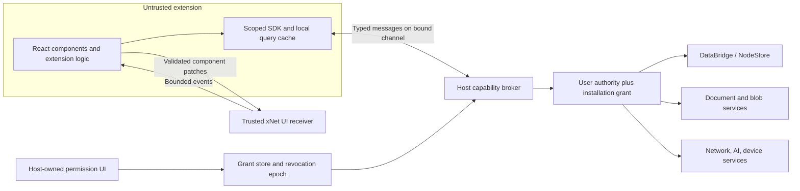
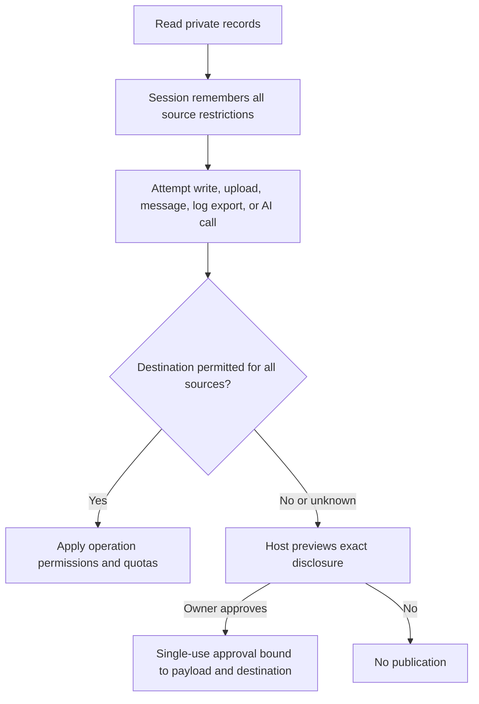
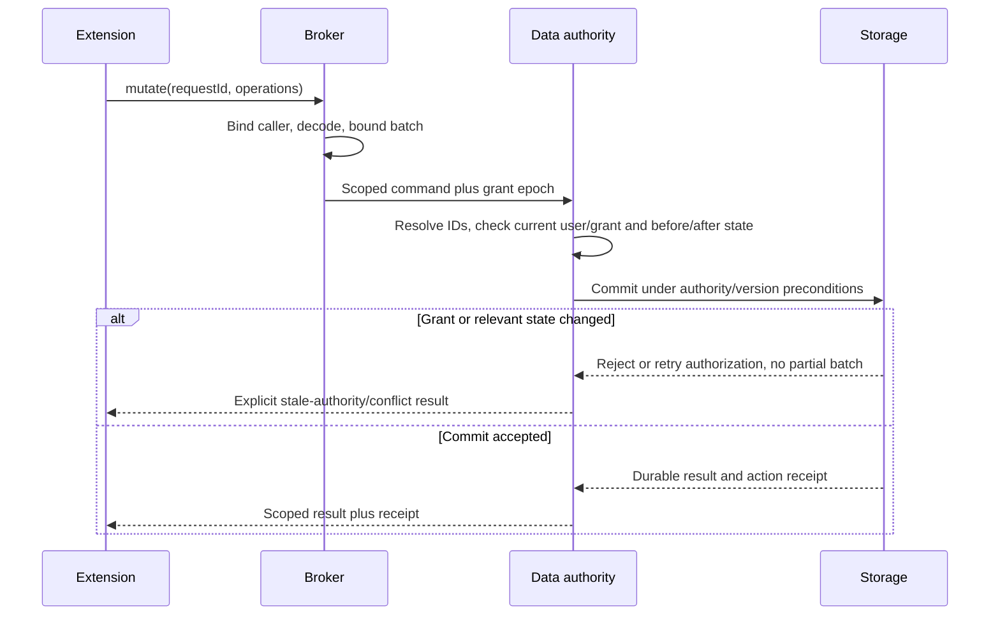
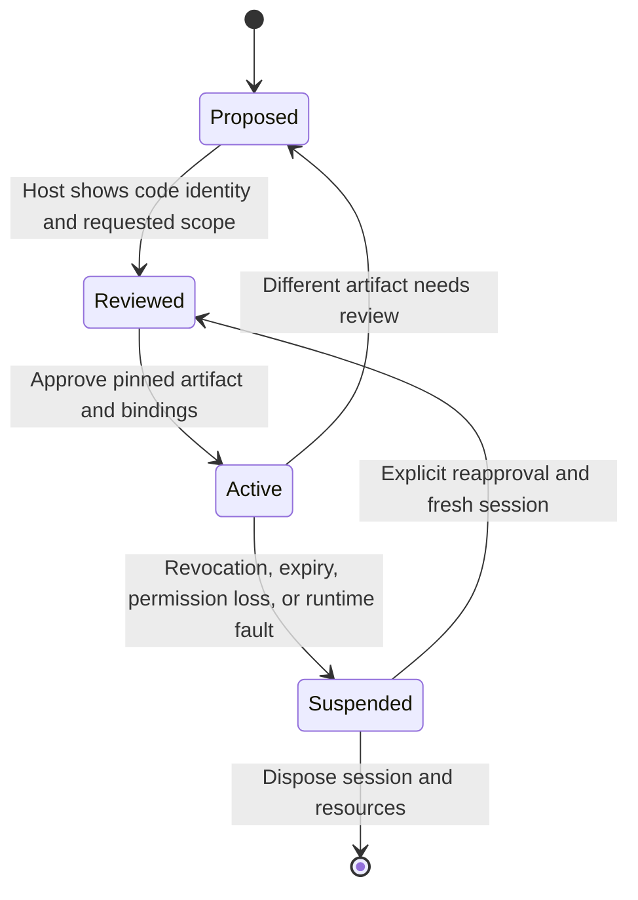

# The full xNet API inside scoped extensions

> [!TIP]
> Give extensions the functionality of xNet through a **scoped client SDK**, backed by a host-owned capability broker. Keep real React hooks and xNet primitives wherever their contracts fit. Keep stores, credentials, sync transports, and permission administration behind the broker. The next useful milestone is an interactive task extension with scoped reads, writes, and undo.

This proposal was grounded in local commit `406e95e04` on `codex/chat-first-redesign`. The October 19 local implementation now supports interactive private tasks, durable local approvals, scoped conversation queries, and read-only documents; the full API design remains **partially implemented**. Publishing a stable extension SDK still requires the broader authority model and an independent review. The filename marks this as partially implemented; references point to the updated name.

## Local implementation evidence — October 19

The host now mounts real React in an isolated worker and reuses `useQuery` and `useMutate` through a restricted DataBridge. A closed command broker supports selected private-task fields, separately approved creation and deletion/restoration, durable replay receipts, and undo that refuses later edits. Memory and supported SQLite paths check structured snapshots, optional change heads, and deadlines within the committing batch. Unsupported adapter/index/document guards fail explicitly. ADR-49 records this conditional-write primitive without accepting the complete extension protocol.

The closed query/mutation/undo registry now carries operation deadlines, strict decoders,
and structured errors across the worker boundary. Each host-bound port limits
outstanding work, aborts pending validation on teardown, and drops late responses.
Cancellation does not undo an already accepted storage transaction; receipts let a
new session recover that outcome. Regression tests cover cancellation before and
after commit, queue deadlines, caller forgery, deeply nested messages, UTF-8 limits,
and error tags through the real React hook in a mounted worker.

The export inventory covers every declared entrypoint of the five SDK packages below, including legacy plugin services. Unapproved modules and named exports fail explicitly. [Scoped extension reference](../reference/scoped-extensions.md) records the working imports, limits, and remaining boundaries.

Verified in the real apps:

- Web query follow-up: navigate distinct pages from 65 messages, receive an outside edit live, install, reload, recover the approved page, revoke, and reload with zero projected messages and no active grant.
- Electron query follow-up: approve a 235-message conversation, navigate distinct 20-message pages, receive an outside edit live, install, reload and restore the page, revoke, reload again, and verify no active grant or projected message remains.

- Electron document follow-up: approve selected Page text, observe a live Yjs edit, install, restart the complete app, recover approval and content, revoke, reload, and verify no document view or active grant remains.
- Electron: approve one task, edit it, undo, create a task, receive an outside edit live, and revoke (the iframe is removed).
- Local Codex: generate **Friday Tasks** conversationally, approve it, edit and create through the generated controls, and install that version locally.
- Web document follow-up: approve one Page separately from conversation data, install the real hook/view example, reload with browser storage, recover the approval and text, revoke, and reload with access still denied.
- Web: start with creation permission and no selected records, create/edit/undo a task through browser storage, revoke, reload, select the persisted task with read-only access, and verify a further edit is denied.
- Unit/integration coverage: conditional native IPC commits and complete rollback on stale snapshots; missing/expired guards; temporary-ID rejection; index limitations; out-of-scope and mixed commands; protected fields; revoke during validation and drain during commit; undo permission and conflict checks; field masks; actual worker React lifecycles and hooks; unavailable named exports.
- Inventory verification: `node scripts/extensions/inventory.mjs --check` and its in-memory export negative control (`--selftest`).

The durable-authority core commit passed all 102 affected build/typecheck tasks and 3,334 tests (one skipped) in its hook run. The earlier interactive app commit passed 65 changed-file tests. A broader related-test run hit the existing fresh-profile demo-seed timeout; the same timeout reproduced on unchanged commit `3e13d3711`. The focused extension, bridge, and conditional-storage checks passed. This does not establish a fully green repository-wide test suite.

The local authority now persists an installation epoch, approved scope, created-record IDs, and command/undo receipts in device-local storage. A conditional commit compares the current approval and writes its receipt in the same database transaction as the record edits. Reopening recovers created-record scope and the last undo receipt; changing an artifact or reapproving creates a separate epoch. Revocation rejects later commits and drops pending deliveries. Memory, browser SQLite, and native IPC tests cover rollback, lost responses, restart recovery, and revocation at the commit boundary. ADR-50 records this local primitive.

Selected Page text now has a separate read permission. The real extension React runtime exposes `useDocument` and a host-rendered `DocumentView` with opaque session handles. The projection omits attributes, embedded resource contents, and deleted Yjs history, and observes live document changes. It does not expose raw Yjs, awareness, or document writes. Shared document acquisition is reference-counted in Electron; the main-thread bridge loads persisted content and releases failed acquisitions.

Queries now request bounded pages from the host instead of copying whole selected
conversations into the worker. Filtering and sorting can use only readable fields;
unknown totals stay unknown. Opaque cursors are bound to the approved session and
query. The real `useQuery` hook shares a live page cache with twenty active
subscriptions; scoped change notifications coalesce before reloading. The host
checks current records and authority before delivery, rejecting stale redacted or
reparented message projections. Tests cover guessed IDs, hidden fields, cursor
reuse across queries and approvals, revocation during reads, cancellation, and
read-scope monotonicity with generated inputs.

A native SQLite benchmark on Apple M1 Max / Node 22.16.0 held 100,000 messages,
with only 250 in the approved conversation. It traversed those 250 across thirteen
pages without duplicates or private-channel rows; the largest response was 6,982
bytes. The first host page took 31.91 ms; twenty warm samples had median 1.05 ms
and p95 1.67 ms. A reopen run passed the same scope checks and cleanup. These
measurements exclude IPC, worker startup, React and encrypted storage; they do
not establish end-to-end UI latency. The reproducible manual check is
`scripts/benchmark-extension-queries.ts`.

This is still not the final grant authority. Cross-device revocation, additional container policies, and a general destination/disclosure proof remain open. Editable document handles need commits coordinated with the document persistence owner; writing a renderer snapshot beside a grant check could race live edits or an older background flush. Richer components, schemas, assets, external effects, and background jobs also remain unavailable. These gaps keep the corresponding items below unchecked.

## Problem and intended experience

“Build a film club planner from these messages” should produce a useful application: checkboxes, task creation, notes, attachments, and shared views. An extension should use the same underlying data as the rest of xNet. It should not need a parallel database or a miniature imitation of the xNet SDK.

The user should be able to say:

> Read Film Club messages, create tasks in Film Club, and let me edit their title and status. Keep it local to this community.

The host turns that into specific, reviewable authority. Once approved, ordinary edits within that authority work without a prompt for every click. Asking for more data, publishing outside the community, installing another version, or starting an external service is a separate decision.

“Whole API” needs a precise definition. It can mean **coverage of product capabilities**: queries, mutations, documents, schemas, files, collaboration, history, plugins, and agents. It cannot safely mean giving arbitrary code the application’s actual `NodeStore`, signing keys, Electron preload, or a generic function that invokes anything in the host. Those objects include the ability to bypass the very restrictions the user approved.

## Recommendation at a glance

| Area                     | Recommended direction                                                                           |
| ------------------------ | ----------------------------------------------------------------------------------------------- |
| Developer experience     | A typed extension SDK; reuse actual hooks through an extension-specific provider and bridge     |
| Data boundary            | Record/container, field, operation, and destination scopes enforced by the host                 |
| Interactive UI           | Persistent worker producing an allowlisted remote component tree; events return to that worker  |
| Rich documents           | Host-owned editor first; explicit whole-document capabilities for a later Yjs bridge            |
| Identity and native APIs | Public metadata or narrow host operations; no credential or raw-handle export                   |
| Writes                   | Validate before and after state, commit against current authority, record extension attribution |
| Privacy                  | Treat synced writes, AI requests, logs, and exports as possible disclosure channels             |
| Evolution                | Add capability families behind one policy model; unknown operations remain denied               |

## Baseline before this implementation

This section records the read-only prototype at `406e95e04`; the local implementation evidence above supersedes its runtime and mutation limitations. These are source-level observations, not a completed security audit. The older prototype description in [0480](./0480_[_]_AGENTS_IN_CHAT_AND_CONVERSATIONAL_EXTENSIONS.md) predates the scoped React implementation; [ADR-48](../../site/src/content/docs/docs/architecture/decisions.mdx#adr-48-render-chat-extensions-against-explicitly-granted-xnet-records) records the current boundary.

| Surface                    | Status                        | Relevant code and implication                                                                                                                                                                                                                                                                                                           |
| -------------------------- | ----------------------------- | --------------------------------------------------------------------------------------------------------------------------------------------------------------------------------------------------------------------------------------------------------------------------------------------------------------------------------------- |
| Real query hook            | ✅ Present                    | [Lean provider](../../packages/react/src/context/data-bridge-context.ts), [query entrypoint](../../packages/react/src/queries.ts), and [useQuery](../../packages/react/src/hooks/useQuery.ts) let a host supply a bridge without booting identity or sync                                                                               |
| Chat extension grants      | ✅ Read-only prototype        | [extension-data.ts](../../packages/workbench/src/communities/extension-data.ts) selects conversations and individual own Task/Page records before data enters the worker; it strips document bytes and denies mutation methods                                                                                                          |
| Isolated rendering         | ✅ Bounded preview            | [Runtime worker](../../packages/workbench/src/communities/extension-runtime.worker.tsx), [sandbox](../../packages/workbench/src/communities/extension-sandbox.ts), and [frame](../../packages/workbench/src/communities/extension-preview-frame.html) use real React server rendering, a closed import map, and a validated output tree |
| Grant lifecycle            | ✅ Local prototype            | [ChatExtensionPanel](../../packages/workbench/src/communities/ChatExtensionPanel.tsx) binds approval to owner, conversation, and source/compiler/runtime hash; subscribes to approved data; cancels and clears on revocation                                                                                                            |
| Bridge operations          | 🚧 Useful underlying contract | [DataBridge](../../packages/data-bridge/src/types.ts) already defines query subscriptions, mutations, transactions, document acquisition, and status. It also contains compatibility escape hatches that must not enter an extension client                                                                                             |
| Mutation hook              | 🚧 Adaptable                  | [useMutate](../../packages/react/src/hooks/useMutate.ts) already routes through DataBridge, but imports provider, tracing, and telemetry contexts that need a lean extension environment                                                                                                                                                |
| Document hook              | 🚧 Refactoring required       | [useNode](../../packages/react/src/hooks/useNode.ts) combines documents, persistence, sync, awareness, direct store access, and mutations; merely replacing one context is insufficient                                                                                                                                                 |
| Permission hook            | 🚧 Different subject          | [useCan](../../packages/react/src/hooks/useCan.ts) checks the user through a store. An extension needs the intersection of user authority and its own grant                                                                                                                                                                             |
| Existing workspace plugins | 🚧 Reuse selectively          | [store-rpc.ts](../../packages/plugins/src/workspace-plugins/store-rpc.ts) has named operations and protected-schema denials, but its normal scope is schema-wide rather than selected records/fields                                                                                                                                    |
| Legacy plugin context      | 🛑 Not the untrusted boundary | [ExtensionContext](../../packages/plugins/src/context.ts) exposes a NodeStore and host registrations. [guardStore](../../packages/plugins/src/ecosystem/capability-guard.ts) wraps only some writes when configured; reads and other methods pass through, and absent constraints can return the original store                         |

The current preview sends at most 200 records per selection and 500 total, with a `JSON.stringify(...).length` ceiling of 256,000 JavaScript string units; rendering has a two-second deadline. That input check is not a UTF-8 byte measurement. These are deliberate prototype limits, not an architecture for the user’s 50,000–100,000-item personal index. The proposed protocol below measures actual encoded bytes.

Current imports expose four schemas, `useQuery`, and `Badge`. Rendering to static markup does not support an ordinary mounted React application’s stateful event/effect lifecycle. Making a checkbox work requires a persistent component runtime, not just adding `useMutate` to the import map.

## Research and useful precedents

| Primary source                                                                                                                                                                    | Finding                                                                                                                                                                                                                        | Implication for xNet                                                                            |
| --------------------------------------------------------------------------------------------------------------------------------------------------------------------------------- | ------------------------------------------------------------------------------------------------------------------------------------------------------------------------------------------------------------------------------ | ----------------------------------------------------------------------------------------------- |
| [Shopify remote rendering](https://shopify.engineering/remote-rendering-ui-extensibility)                                                                                         | Extension logic and host-rendered components communicate across a message boundary; Shopify describes hosts on multiple platforms                                                                                              | Keep application logic isolated while sharing native-looking xNet controls                      |
| [Remote DOM](https://github.com/Shopify/remote-dom)                                                                                                                               | Supports worker-based environments, React examples, component/event bridging, and explicit receiver element/member allowlists. Its documentation warns that omitting the element restriction leaves element names unrestricted | Prototype a restricted receiver; do not equate library installation with a security policy      |
| [Tauri runtime authority](https://v2.tauri.app/security/runtime-authority/) and [capabilities](https://v2.tauri.app/security/capabilities/)                                       | Core checks the caller and command, then supplies applicable scopes; capabilities attached to a webview combine                                                                                                                | Put enforcement in the operation dispatcher and review composed permissions                     |
| [Electron context isolation](https://www.electronjs.org/docs/latest/tutorial/context-isolation) and [process sandboxing](https://www.electronjs.org/docs/latest/tutorial/sandbox) | Context isolation is not sufficient if the bridge exposes unrestricted IPC; sandboxed renderers still consume CPU and memory                                                                                                   | Validate operations and sender identity; maintain the Electron security update path             |
| [SES](https://github.com/endojs/endo/blob/master/packages/ses/README.md)                                                                                                          | Compartments and lockdown constrain authority, but guest code can still run indefinitely and allocate memory                                                                                                                   | Optional hardening inside an interruptible environment; never a substitute for execution limits |
| [Yjs document updates](https://docs.yjs.dev/api/document-updates)                                                                                                                 | Binary updates synchronize document state; state vectors identify missing updates. Update merging does not itself garbage-collect deleted content                                                                              | Treat raw document replication as a broader capability than reading a text projection           |
| [Wasmtime security](https://docs.wasmtime.dev/security.html) and [interruption](https://docs.wasmtime.dev/examples-interrupting-wasm.html)                                        | WASI uses explicit filesystem capabilities; fuel and epoch mechanisms can interrupt Wasm execution                                                                                                                             | A later compute runtime can share the broker contract without sharing host filesystem access    |
| [MCP security guidance](https://github.com/modelcontextprotocol/modelcontextprotocol/blob/main/docs/docs/2026-07-28/tutorials/security/security_best_practices.mdx)               | Describes confused deputies, token audience validation, token passthrough, and SSRF                                                                                                                                            | Agent calls and connectors need explicit delegation and their own egress checks                 |

The architecture below is an inference from these mechanisms and the local code, not a claim that any cited project supplies a complete xNet sandbox. In particular, Remote DOM solves communication and rendering, not xNet authorization, and Wasm does not make unsafe host imports safe.

## Threat model and promises

Assume an extension’s source, dependencies, manifest, arguments, and every message it sends can be malicious. An AI-generated extension belongs in the same category. Reading a malicious chat message must not grant the agent or extension new authority.

Trust the installed xNet application, its broker, its policy store, and its vetted rendering components. Browser/OS compromise, a malicious trusted xNet build, and a compromised device owner are outside this boundary. Engine vulnerabilities and dependency bugs remain reasons to patch and audit, not reasons to call arbitrary guest code trusted.

The private-community encryption and authenticated-membership prerequisites recorded in 0480 remain separate work. A correct extension boundary cannot compensate for incorrect underlying group authorization or missing transport/content confidentiality. Sensitive community deployment requires both layers.

The intended guarantees are:

- No unapproved record, field, document, or resource is deliberately delivered through a host API.
- No unapproved operation commits merely because the user could have performed it themselves.
- Grant revocation stops subsequent local delivery and authorization; stale async results cannot revive access.
- UI, imports, native operations, and background jobs cannot bypass that policy.
- Permission failures are explicit and distinguishable from an empty result, missing feature, or completed operation.

> [!IMPORTANT]
> Revocation cannot make code forget data already delivered, undo an already published message, or instantly reach an offline peer. A Worker does not provide a hard per-extension memory ceiling. Do not promise those properties as consequences of scoped APIs.

## Architecture: one broker, several clients



The broker is trusted code colocated with the data authority where possible: the desktop main/data service, the web application’s trusted data host, or a server service. A web implementation still depends on the integrity of its own origin. A localhost port is not intrinsically a trusted boundary.

Use one operation registry with request/response codecs, required permissions, quotas, and compatibility versions. Generate SDK types and documentation from it. Never dispatch by walking arbitrary property paths, calling `Reflect.get` on the store, or exporting a generic Electron IPC sender. Unknown operation names, unsupported versions, and unknown privileged fields fail closed.

Each channel is bound by the host to an installation, artifact hash, user/profile, workspace, session, and current grant epoch. A guest-provided `pluginId` or `owner` is descriptive input, not identity. A capability reference is opaque and session-bound; guessing another installation’s reference or copying one onto a different port confers nothing. Remote agents later require a separately authenticated, audience-bound delegation mechanism.

For each operation:

```text
allowed = user can perform operation now
       AND this installation was granted this operation and resource scope
       AND this session/runtime supports it
       AND field, destination, freshness, and quota constraints hold
```

The manifest requests authority. Only host consent creates it. Reuse the existing user authorization evaluator, but evaluate extension restrictions in addition to it. A frontend `useCan` result is a convenience for disabling buttons, never authorization for the eventual write.

## An explicit map of the API

Maintain a machine-checkable coverage ledger for SDK exports: reusable implementation, broker adapter, host-rendered component, host-only, or not implemented. New exports must be classified before they become available to extensions. Coverage means every supported product capability has an intentional route, not that every internal method is remotely callable.

| API family                                                        | Extension-facing behavior                                                  | Enforcement or adaptation                                                                                          |
| ----------------------------------------------------------------- | -------------------------------------------------------------------------- | ------------------------------------------------------------------------------------------------------------------ |
| Pure schemas, types, parsers, utilities                           | Reuse approved implementations locally                                     | Pinned module graph; no host imports or dynamic network resolution                                                 |
| `useQuery`, infinite queries, search, relations                   | Scoped subscription and pagination                                         | Filter authority before counts, ordering, pagination, joins, and projection; relation targets need their own scope |
| `useMutate`, create/update/delete/restore                         | Familiar async functions backed by broker commands                         | Separate operation grants, field masks, target and resulting-state checks                                          |
| Transactions and bulk import                                      | Bounded atomic local batches with explicit receipts                        | Validate every operation and resolved temporary ID; no partial success disguised as atomic success                 |
| `useNode` and document editing                                    | Record properties plus a document capability                               | Refactor host dependencies; do not claim the existing raw `Y.Doc` contract is preserved by a text-only adapter     |
| Database, canvas, editor, forms                                   | Host-rendered xNet components with scoped resource handles                 | Every component-internal query and write uses the same restricted bridge                                           |
| Presence, reactions, messaging, calls                             | Explicit channel operations and subscriptions                              | Audience membership, rate limits, device consent, and send/publish authority                                       |
| History, diff, undo, restore                                      | Scoped history queries and attributed action receipts                      | Historical values need permission; undo is a new authorized mutation, not an unlimited rewind                      |
| Files, thumbnails, video, exports                                 | Opaque resource handles and bounded streams                                | Resolve through approved records; validate media; separate byte access, rendering, saving, and upload              |
| Identity and accounts                                             | Approved public identity/profile information                               | No private keys, refresh tokens, credential files, or generic signing oracle                                       |
| Sharing and membership                                            | Request a host-owned share/invite flow                                     | Protected control-plane operations; ordinary data writes cannot mint grants                                        |
| Custom schemas and migrations                                     | Register declarative definitions in an owned namespace; propose migrations | Host validates structure and authorization policy; explicit migration plan and rollback                            |
| UI contributions                                                  | Register commands, tabs, widgets, safe blocks, and remote views            | Namespace ownership, no host callbacks from guest code, cleanup on unload                                          |
| Network, connectors, AI                                           | Named broker services with destination and budget grants                   | Credentials remain in host; outbound data policy applies even to model prompts                                     |
| Clipboard, files, camera, microphone                              | Scoped host operations and resource pickers                                | Device/user-action requirements; no blanket filesystem or media permission                                         |
| Background jobs and storage                                       | Cancellable jobs and quota-limited installation storage                    | Current authority at every step; stored data retains its disclosure restrictions                                   |
| `useXNet`, raw store/storage/sync, middleware, provider lifecycle | Host-only internals                                                        | Offer narrower functional equivalents; never make unrestricted fallback available                                  |

The current `Identity` type contains public information. The risk is exporting the surrounding provider and internal context, which also owns much broader services and signing state. Audit actual object graphs rather than banning an API because its name includes “identity.”

### Reusing real React hooks

Build an extension-side `DataBridge` client that keeps immutable local query snapshots and implements `subscribe`/`getSnapshot`. Requests and updates cross the channel; synchronous React reads use the scoped cache. Keep loading, error, pagination, and completeness metadata intact. This is the same useful separation already represented in [DataBridge’s query contract](../../packages/data-bridge/src/types.ts).

Extract bridge-only dependencies from `useMutate` and reuse its state/transaction behavior. Hooks that reach into `useNodeStore`, `useSyncManager`, provider internals, network credentials, or instrumentation need deliberate adapters. Telemetry must not copy private arguments or query results to an external collector.

Proposed package entrypoints such as `@xnetjs/extensions/react` and `@xnetjs/extensions/ui` make the boundary explicit. They do not exist yet. A later build alias can accept familiar `@xnetjs/react` imports only if it resolves to the reviewed extension export map and reports unsupported imports clearly. Do not silently substitute weaker semantics while claiming complete compatibility.

## Grant model: resource, operation, and destination

The host should store grants outside extension-writable nodes. Bind each grant to the installed artifact, not merely an extension name or source URL. Pin source, dependencies, compiler, runtime/SDK ABI, and requested capabilities in a build receipt. The current source/compiler/runtime hash is a useful starting point; it is not a full portable release protocol.

Represent grant selectors declaratively:

- **Exact records:** selected IDs, with separate readable and writable fields.
- **Container membership:** selected space/channel/collection and supported schema types; descendants and future records are explicit choices.
- **New records:** permitted schema, forced destination, allowed initial fields, size/rate quota, and host-created provenance.
- **Documents and assets:** exact resource handles tied to their authorizing records.
- **External effects:** named destination/service, operation, account, budget, and any user-action requirement.

Avoid arbitrary JavaScript permission predicates. Avoid broad schema wildcards in the initial untrusted path. Saved query text alone is not a grant: users editing a saved view must not accidentally expand an extension’s access. Resolve a selected container’s authoritative membership rather than scanning whatever records happen to be loaded into a UI list.

An example permission sheet could say:

| Permission        | Approved scope                           |
| ----------------- | ---------------------------------------- |
| Read messages     | Film Club; includes future messages      |
| Read tasks        | Film Club tasks; title, status, due date |
| Create tasks      | Film Club only                           |
| Change tasks      | Title and status only                    |
| Run               | While this extension is open             |
| External services | None                                     |

Field restrictions include filters and aggregates. Otherwise `where: { privateSalary: { gt: ... } }` or a count can reveal a field that the response omits. Queries must run against the authorized projection/scope; they must not fetch a global page and discard forbidden rows afterward. Shared caches and cursors must be partitioned by authority and grant epoch.

Protected fields include ownership, security home, visibility, grant references, author attribution, and reserved system metadata. Moving a record between spaces or making it public is a named operation with separate authority, not an incidental `update` of a string. Custom schemas cannot redefine those protections away.

## The privacy trap: writes are also an outbound channel

Disabling `fetch` is insufficient. An extension allowed to read Family notes and write a public chat can copy those notes into the chat. It can also leak through an uploaded filename, a notification, an agent prompt, an image URL, or debug logs forwarded to a coding agent.

For the initial writable runtime, keep a conservative **session disclosure policy**: every source exposed to the session constrains where that session can send data. A destination must be no broader than every source policy, or the host must approve a specific disclosure. If the broker cannot prove that relationship, deny or show a host-owned export/share preview.



This intentionally over-restricts some harmless computations. It does not try to track individual JavaScript values through arbitrary code. Split unrelated work into separate sessions when practical. Permission checks account for current group audiences, not only old recipient lists. A change in audience can invalidate an existing output permission.

The policy must survive caches, plugin-private storage, background jobs, and restarts. Otherwise the extension can save private data, reopen under a public-write grant, and leak it. Stored extension state carries conservative source restrictions; a new version cannot relabel it. Disabling external logging and controlling output components are part of the same design.

This is a proposed policy boundary, not a proof of information-flow noninterference. Timing and resource side channels, user copying rendered text, and all browser/OS effects are not eliminated. A grant that deliberately permits transmitting private data to a model or remote service must say so plainly.

## Writes, transactions, and attribution

The host validates input shape and size, resolves the canonical schema, obtains current records, and computes proposed after-states. It checks both states against the grant: an allowed update must not move a record outside its authorized container, change its audience, alter protected metadata, or introduce an unauthorized referenced resource.

Authorization must remain valid at the commit point. [NodeStore.transaction](../../packages/data/src/store/store.ts) already performs user authorization and batch work, but no extension grant/version is part of its current signature. The new path needs an explicit integration with the storage authority, not a check in the renderer followed by an unrestricted async write.



Implement this with transactionally checked policy revisions or a correctly serialized authority/commit boundary on the data owner. A mutex in a UI component is insufficient across clients and processes. Include relationship and membership dependencies in invalidation, not just the modified node’s version. Schema middleware, derived writes, and scheduled follow-on work must preserve or explicitly reevaluate the originating authority.

Idempotency keys bind installation, request ID, canonical operation payload, and execution scope. A retry with a different payload fails. If transport fails after commit, report an unknown outcome and allow receipt lookup; never blindly repeat a create. Revocation cannot cancel a commit that already linearized, but it can prevent a subsequent one. Recheck response visibility before returning a write result.

Local atomic batches do not establish a global atomic transaction across disconnected CRDT replicas. Peers still enforce their own signed-change and access policies. Do not advertise immediate remote revocation or all-peer rollback.

Receipts should identify the acting user, extension installation, artifact hash, grant revision, operation, affected resources, and result. The host supplies those fields. Keep sensitive values out of routine audit logs. A receipt creates useful attribution; it is not automatically a new cryptographic actor in the existing sync wire format. A future delegated-signing protocol needs its own design.

Undo uses the receipt to propose a compensating change, checks current authority and concurrent edits, and refuses destructive conflicts. It must not restore every field of a record when the extension was allowed to edit only `status`.

## Interactive primitives without host code execution

Replace one-shot static rendering with a persistent worker runtime and a controlled component protocol. Start with `Stack`, `Text`, `Button`, `Checkbox`, `TextField`, lists, and the existing Badge appearance. The host owns the actual xNet components; the extension owns state and event handlers in its isolated runtime.

Remote DOM is the leading library candidate for this spike. Its React support and event protocol can save substantial plumbing. Configure the receiver’s element, property, attribute, event, and method allowlists explicitly. React-specific compatibility still needs testing: focus, controlled input, effects, context, error boundaries, accessibility, and portals are not established by importing the package.

Event callbacks are session-local identifiers, not function references evaluated in the host. Limit payload sizes, event frequency, render nodes, depth, and outstanding calls. Do not pass native event objects, arbitrary refs, HTML strings, scriptable URLs, CSS URLs, unrestricted SVG, or host DOM handles. Network-capable media and links use broker-resolved handles.

Complex host components are especially dangerous deputies. A `<TaskTable>` receiving a scope handle must use that scope for its autocomplete, relation lookup, menu actions, exports, and undo—not obtain the root application bridge from a surrounding provider. A private extension panel also must not be streamed or published into a group conversation merely because it appears beside that conversation.

The permission sheet and any confirmation of an external effect remain outside the extension’s render surface. A guest cannot forge a trusted click token by sending an event-shaped message. A click grants only the exact host-approved action; it does not authorize every call that happens afterward.

### Proposed authoring example

This is illustrative API design, not code that runs today. The SDK would reuse the existing query/mutation hook implementations after their context dependencies are separated. `TaskEditor` and `useExtensionContext` below are proposed names.

<details>
<summary>Illustrative TypeScript task editor</summary>

```tsx
import { TaskSchema } from '@xnetjs/data'
import { useQuery, useMutate, useExtensionContext } from '@xnetjs/extensions/react'
import { Stack, Text, Checkbox } from '@xnetjs/extensions/ui'

export default function TaskEditor() {
  const { bindings } = useExtensionContext()
  const {
    data: tasks,
    loading,
    error
  } = useQuery(TaskSchema, {
    where: { space: bindings.communityId },
    limit: 50
  })
  const { update, isPending } = useMutate()

  if (error) return <Text>{error.message}</Text>
  if (loading) return <Text>Loading tasks…</Text>

  return (
    <Stack>
      <Text>Showing up to 50 tasks in this community</Text>
      {tasks.map((task) => (
        <Checkbox
          key={task.id}
          label={task.title}
          checked={task.status === 'done'}
          disabled={isPending}
          onChange={(checked) => update(TaskSchema, task.id, { status: checked ? 'done' : 'todo' })}
        />
      ))}
    </Stack>
  )
}
```

</details>

The host binds `communityId` and grants access. The `where` clause is only query intent; deleting it from the code must not reveal other communities. A production example should display pagination/completeness and mutation errors through the normal SDK status components.

## Documents need a separate capability

Keep three distinct document operations:

1. **Read a projection:** current plain text, selected blocks, or a rendered preview. No raw Yjs state is sent.
2. **Render a trusted editor:** mount xNet’s editor for a scoped document handle; its broker has the approved read/edit authority. The extension need not receive raw document state merely to place an editor in its layout.
3. **Replicate and edit a whole document:** a later explicit capability creates an extension-local Y.Doc and exchanges validated, bounded updates with a host-owned provider.

A replicated Y.Doc is not a safe way to expose only one authorized paragraph. Its shared types, retained structure, and updates have document-level semantics. State vectors reduce transfer size; they do not express permission. For block-level access, use a projection/command API or separately secured documents. Whether deleted content remains depends on garbage collection and retained history; do not promise a sanitized “current view” from a raw state update.

Inbound raw updates need isolated decoding, limits on bytes and expansion/work, whole-document write authority, allowed structure validation, and current policy checks before application. Do not use extension-supplied Yjs transaction origins or client IDs as authenticated authorship. Read-only clients can modify their own copies; the host must refuse their writes.

Awareness/presence is another permission and another outbound channel. A read grant does not implicitly publish a user’s cursor, name, or online status. Revocation detaches the provider, rejects stale updates, and destroys the session copy; it cannot recall prior bytes.

## Assets, services, and background execution

**Files and media:** grant resource handles through approved records or a host picker. Knowing a CID is not authorization. Render-only thumbnails should be possible without exposing original bytes to the guest. Downloads and uploads are explicit operations with destination, byte, MIME, duration, and decoding limits. Keep complex media parsing/transcoding in patched, constrained services. Do not allow arbitrary filesystem paths or URLs through a convenient image component.

**Network and connectors:** keep direct guest network access disabled and route requests through a broker. Enforce scheme, origin, method, path, redirects, credential mode, response size, timeout, and account scope. Desktop/server brokers must address loopback/private-address access and DNS rebinding; browser brokers must enforce the checks their platform supports and reject unsupported policy modes. An allowlisted hostname does not prove that sending private data to it is appropriate. Host-injected connector credentials are never returned to the extension.

**AI:** creating an extension does not authorize the coding agent to read all data later granted to that extension. Query samples, logs, screenshots, and document contents sent for debugging require their own disclosure decision. An extension’s model call needs an approved provider/account, input scope, budget, and tool set. A model output cannot enlarge its tool grants. Dedicated scoped agent sessions should be used instead of inheriting the owner’s unrestricted CLI workspace.

**Background jobs:** default to foreground-only. Additional permission can authorize a named job, resource scope, runtime budget, rate, expiry, and device. Recheck authority before each unit of work and external effect. Persist restart-safe job state as data with the originating grant and disclosure restrictions; do not add a workflow engine to client packages. Crashes and expired authority stop work visibly. Background execution on mobile must respect the host platform’s actual lifecycle; desktop behavior is not a portable guarantee.

**Extension development:** a plugin may propose its next source revision, tests, and migration plan. A trusted build service handles compilation without arbitrary package-manager lifecycle scripts or host filesystem imports. The proposal cannot edit its own grant, substitute the installed artifact, or install another extension. Host-owned review selects a pinned result. Rollback of code never restores revoked authority.

## Revocation, updates, and offline behavior



Revocation first closes authorization at the broker and increments the grant epoch. Then it rejects queued operations, detaches subscriptions/documents, cancels jobs and streams, drops undisclosed results, clears host-managed views/caches as appropriate, and terminates the runtime. Every response and subscription patch carries an epoch/session identity; late work from an old session is discarded. Restart defaults to closed until the current artifact and grant are validated.

Permissions on one device should not automatically follow a synced source node. Initial grants stay local. A later cross-device grant requires an authenticated authority record and an explicit policy for receiving devices; source replication alone is not consent.

Offline devices cannot learn an immediate remote revocation. Separate local owner-controlled data from group-sensitive operations that require a fresh lease or online validation. Existing offline policy in [packages/data/src/auth/offline-policy.ts](../../packages/data/src/auth/offline-policy.ts) is an integration point, not proof that extension revocation is already solved. Until freshness semantics are specified and tested, deny offline group publication requiring fresh authority; do not claim a short lease removes the remaining revocation window.

## Options and tradeoffs

| Option                                            | Strength                                                             | Cost or boundary                                                                                        | Decision                                                          |
| ------------------------------------------------- | -------------------------------------------------------------------- | ------------------------------------------------------------------------------------------------------- | ----------------------------------------------------------------- |
| Import the application SDK in the host realm      | Maximum immediate compatibility                                      | Ambient authority, global hooks, shared mutable objects, and UI-thread execution                        | Reject for untrusted extensions                                   |
| Wrap a raw store in a Proxy                       | Small implementation                                                 | Missing methods and new exports can bypass checks; realm and CPU isolation unsolved                     | Useful only for trusted code conventions                          |
| DOM iframe with scoped RPC                        | Broad compatibility with browser libraries                           | Larger render/network surface; iframe isolation alone does not ensure a separate process or bounded CPU | Consider later for explicit advanced surfaces                     |
| Worker with remote xNet components and scoped RPC | Real React interaction, controlled UI, shared web/desktop vocabulary | Adapter work; no arbitrary DOM libraries; browser memory isolation remains limited                      | Recommended first path                                            |
| SES inside an isolated worker                     | Reduces guest ambient authority and mutable-intrinsic hazards        | Compatibility work; no CPU/memory bound by itself; lockdown must fail closed                            | Evaluate as defense in depth                                      |
| Wasmtime or another constrained compute host      | Stronger compute accounting and language options                     | No native React/DOM experience; host calls still require exactly the same policy                        | Later for Rust/compute workloads                                  |
| Native extension code with device-owner authority | Integrates native SDKs deeply                                        | Equivalent to installing trusted application code                                                       | Separate explicit trust tier, never the default AI-generated path |

Do not build all runtimes first. The shared broker protocol is the portability investment. TypeScript is the first client; Rust/Wasm can use data and compute operations later; Swift/native clients can host the protocol and render trusted components. This does not imply that arbitrary Swift code can safely run as an untrusted in-process iOS plugin.

## Performance and limits

Move from sending the whole selected set to scoped queries, bounded pages, subscriptions, and incremental UI patches. For the 100,000-record personal index, keep filtering/search and graph-neighborhood selection near storage. Virtualize tables and graphs; thumbnail/video handles stream separately. Reading a page of 50 tasks must not clone 100,000 records into the worker.

Provisional budgets for the first spike—not measured performance claims:

| Resource                      | Starting budget or acceptance target                                                                    |
| ----------------------------- | ------------------------------------------------------------------------------------------------------- |
| Record page                   | 100 records and 256 KiB encoded response; continuation reports more results explicitly                  |
| Active query subscriptions    | 20 per foreground installation                                                                          |
| Mutation batch                | 100 operations and 256 KiB input; enforce before expensive resolution                                   |
| Foreground update traffic     | Backpressure and coalescing; sustained floods suspend the extension                                     |
| Event execution               | Two-second watchdog; host control remains responsive and worker termination is verified                 |
| Host UI work                  | Bounded patch size/depth/node count and per-frame work; never recursively render unlimited guest output |
| First useful task page        | Target p95 under 200 ms after runtime warm-up on a recorded reference device                            |
| Toggle-to-visible task update | Target p95 under 150 ms locally, with authority checks included                                         |

Measure cold startup, transferred bytes, query count, host-thread stalls, and memory with one and several concurrent extensions. The warm targets are design acceptance criteria to revisit with evidence. Browser workers provide a deadline/termination mechanism, not a hard heap limit; a memory stress test may still expose an app-wide denial of service. If that is unacceptable for a target audience, use a runtime with enforceable memory accounting and a suitable process/OS boundary before enabling that workload. An unsandboxed Node utility process alone is not the answer.

## Implementation checklist

### Phase 1: interactive, scoped task application

- [x] Inventory public SDK exports and existing plugin entrypoints; create the coverage ledger and reject unclassified exports in the untrusted loader.
- [x] Define a versioned operation registry, codecs, structured `TaggedError` failures, caller binding, quotas, cancellation, and grant epochs.
- [x] Persist authoritative device-local grants and a host permission sheet for exact own records and selected conversations; fail closed on unavailable policy state.
- [ ] Extend container permissions beyond selected conversations, including nested membership and reparenting checks.
- [x] Implement a scoped DataBridge client with live query cache, honest pagination, field-aware filtering, and authority-partitioned cursors.
- [x] Refactor bridge-only hook dependencies; reuse actual `useQuery` and `useMutate` through the extension provider.
- [x] Prototype Remote DOM with a closed xNet component/event receiver; verify React compatibility before committing to it as a public API.
- [x] Add create and field-limited update commands, authority checks at commit, idempotent receipts, and conservative destination policy.
- [x] Add scoped delete/restore and receipt-based undo with conflict handling once create/update meet the same checks.
- [x] Convert the task example to interactive controls and have Codex generate an equivalent extension without a mode dropdown.

### Phase 2: documents and application features

- [ ] Add host-rendered editor, database, and canvas components whose entire internal behavior uses scoped authority.
- [x] Add bounded document projections and explicit read-only host view handles with separate permission and revocation.
- [ ] Add editable document handles with authority-aware document commits; specify whole-document Yjs capabilities separately before exposing raw updates.
- [ ] Add asset handles, upload/export controls, private storage restrictions, and sanitized debugging feedback.
- [ ] Add declarative custom schemas, namespace ownership, and separately approved migration previews.
- [ ] Migrate the workspace-plugin RPC onto the same policy service; keep trusted legacy contexts unavailable to sandboxed code.

### Phase 3: deliberate external effects

- [ ] Add connector/AI brokers, audience-aware disclosure approvals, budgets, and SSRF-resistant native/server transports.
- [ ] Add delegated, cancellable background jobs with persisted authority and explicit offline/freshness semantics.
- [ ] Specify remote installation/delegation, release receipts, and receiving-peer enforcement before cross-device authority transfer.
- [ ] Run an independent security review of the expanded boundary before describing it as suitable for sensitive third-party code.
- [ ] Accept the stable public contract in a new ADR with a tripwire; keep ADR-48 as the historical read-only decision.

## Validation checklist and negative controls

Keep implementation items unchecked until fresh evidence establishes them. Core policy/protocol tests belong in unit/integration suites; UI behavior is verified by driving the real Electron/web app, following repository guidance.

| Attack or failure                                                               | Decidable expected result                                                                         |
| ------------------------------------------------------------------------------- | ------------------------------------------------------------------------------------------------- |
| Remove query filters or guess another record ID                                 | No extra data, metadata, counts, or relation target is disclosed                                  |
| Filter/sort on a field not granted for reads                                    | Rejected before query execution                                                                   |
| Forge owner, installation, operation name, or another session’s handle          | Rejected by bound caller and strict decoder                                                       |
| Add a newly exported store method to guest code                                 | Import/operation denied until classified and explicitly implemented                               |
| Update an allowed task’s space, visibility, or ownership                        | Denied as a protected transition; task remains unchanged                                          |
| Batch with one forbidden operation or resolved temp-ID escape                   | Entire local batch rejected; no partial writes                                                    |
| Revoke during async validation, query, commit preparation, or response delivery | No operation commits after the local revocation boundary; no newly forbidden response is released |
| Retry after a committed response was lost                                       | One durable effect; receipt lookup recovers outcome                                               |
| Read private notes then publish public output                                   | Denied or exact host-owned disclosure approval, including after restart/cache reuse               |
| Inject a malicious link/image/style or flood UI patches                         | No unbrokered request; bounded work; extension can be stopped                                     |
| Call component autocomplete/export outside its resource scope                   | Denied by the component’s scoped bridge                                                           |
| Send a raw Yjs update under read-only or expired authority                      | Host document unchanged; stale session terminated                                                 |
| Change a dependency/runtime while preserving source text                        | Artifact verification changes; previous approval does not silently authorize new code             |
| Send private debug output to the coding agent                                   | No provider call without the applicable disclosure permission                                     |
| Infinite loop, allocation storm, oversized/deep payload, or subscription flood  | Deadline/quota behavior measured; platform memory limitations recorded explicitly                 |
| Roll back code after revoking a grant                                           | New execution remains unauthorized                                                                |

- [ ] Run policy property tests: reducing authority cannot increase observable data or permitted effects; effective authority never exceeds the user’s authority.
- [ ] Fuzz request decoding, selectors, relations, render patches, schema definitions, and document updates under bounded test inputs.
- [ ] Add in-memory negative controls that deliberately omit a scope check, epoch check, or destination check; the relevant suite must fail.
- [ ] Exercise self-owned data, group membership expiry, nested containers, reparenting, concurrent edits, deleted records, and inaccessible relation targets.
- [ ] Drive actual Electron and web flows: approve, interact, update data elsewhere, revoke, restart, edit source, and decline a permission expansion.
- [x] Benchmark 100,000 records with small authorized subsets; verify scoped queries and pagination before judging throughput.
- [ ] Test offline publication and revocation windows with two devices; document precisely which actions require connectivity.
- [x] Record unsupported hooks/components and runtime limits in generated SDK documentation; do not make unavailable features look successful.

If a CI gate is introduced, the named consumer is the extension-runtime release decision, its pass condition is the policy suite plus its negative controls, and it must have a documented invocation. Do not add an advisory gate that cannot go red.

## Decisions still open

1. Can Remote DOM preserve the React behavior needed by xNet’s real components at acceptable startup and event latency? Resolve with the task editor, then one complex component.
2. Which storage-level mechanism can atomically couple extension authorization revisions to commits across supported adapters? This is a prerequisite for writable sensitive data, not a later optimization.
3. How much session-wide disclosure restriction is tolerable before users need finer compartmentalization? Start conservative; make the blocked destination understandable.
4. Which document workflows actually require raw Yjs replication rather than a trusted editor or projection? Avoid paying for the most powerful interface without a concrete use case.
5. When do memory isolation requirements exceed what the browser runtime can honestly provide? Decide from hostile workloads and intended users, not from a “sandboxed” label.

The immediate recommendation is to build the **interactive Film Club task extension** with real hooks, scoped write authority, live updates, receipts, and revocation. That establishes the reusable boundary. Documents, connectors, and richer plugins then extend the same model rather than each inventing a different exception to it.

## References

- [0480: Agents in chat and conversational extensions](./0480_[_]_AGENTS_IN_CHAT_AND_CONVERSATIONAL_EXTENSIONS.md)
- [0331: Developing xNet from inside xNet](./0331_[x]_DEVELOPING_XNET_FROM_INSIDE_XNET_SPEC_TO_PLUGIN_LOOP.md)
- [0455: Cordis lessons for xNet plugin composition](./0455_[-]_CORDIS_LESSONS_FOR_XNET_PLUGIN_COMPOSITION.md)
- [DataBridge contract](../../packages/data-bridge/src/types.ts), [NodeStore](../../packages/data/src/store/store.ts), and [authorization API](../../packages/data/src/auth/store-auth.ts)
- [Current chat extension grants](../../packages/workbench/src/communities/extension-data.ts), [runtime](../../packages/workbench/src/communities/extension-runtime.worker.tsx), and [examples](../../packages/workbench/src/communities/agent-extension.ts)
- External primary sources are linked at the claims they support in the research table above. Retrieved October 19, 2026.
