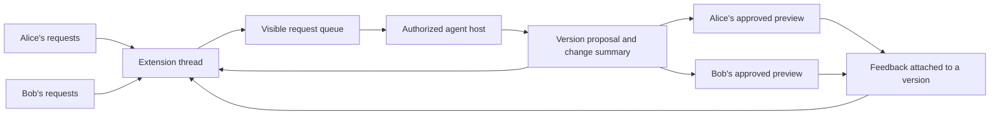
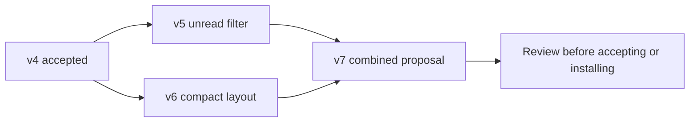
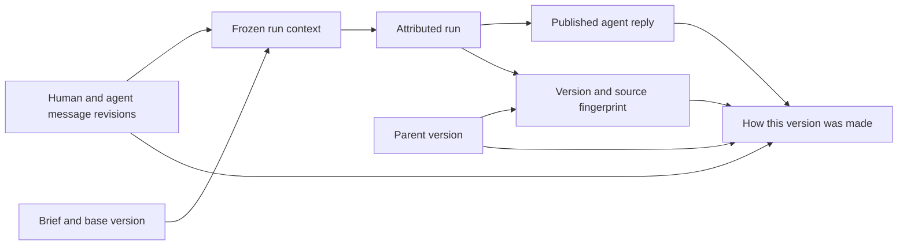

# Collaborative extensions in chat

> [!TIP]
> Give an extension a shared home in a conversation: a brief, version history, feedback, and visible agent requests. Start with one explicitly authorized agent host and a queue. Everyone can contribute; each person controls which version runs on their device and what data it can access.

A local prototype on `codex/chat-first-redesign` now supports shared projects, delegated requests, branches, combined proposals, manual edits, and version-specific conversation history. [The integration record](../testing/0482-shared-extension-integration.md) documents two real Electron profiles, eight versions, and the remaining release checks. ADRs 54 and 55 record the durable contracts. The design discussion below describes the broader target; unchecked retention and security work is still unfinished.

## What collaborating should feel like

Alice and Bob open a shared chat and work on a reading-list extension.

1. Alice: “@Codex build a reading list from the links we share here.”
2. A single extension card appears, with its preview alongside the conversation.
3. Bob: “Add a filter for unread links.” Alice: “And group them by source.”
4. The agent announces: “Updating v3 with Bob’s unread filter and Alice’s source groups.”
5. While it works, Bob adds: “Keep the filters visible when I scroll.” That message shows **Queued for the next update**, rather than silently disappearing into context.
6. Version 4 arrives with a short change summary. Both can try it, leave feedback attached to v4, or compare it with v3.
7. Bob chooses **Make a variation** to try a compact layout. That creates a branch. Alice can try Bob’s version without replacing her installed version.
8. Alice opens **How this version was made** on either branch. The conversation shows the requests, agent replies, and feedback that led to that version, with earlier versions available inline.

No build/reply mode selector is needed. An explicit mention in the extension thread, or a direct message to its agent, becomes a request. Ordinary discussion remains discussion. A queued request can be edited or withdrawn before it starts; once started, it has a frozen, inspectable scope.

The preview shows **Viewing v4 · Current shared version v4**. Someone who stays on v3 sees **v4 ready to try**. “Current shared version” is the group’s recommendation; **Use this version** is a separate local choice. A collaborator’s update must not replace running code or discard an unfinished form.



The shared object is the extension project. Messages, runs, versions, and previews all point to it. Today, the UI mostly offers individually reviewed source snapshots; a project gives those snapshots a common purpose and identity.

## Baseline before this implementation

| Area                          | State                    | Relevant behavior                                                                                                                  |
| ----------------------------- | ------------------------ | ---------------------------------------------------------------------------------------------------------------------------------- |
| Chat threads                  | ✅ Primitive exists      | `ChatMessage.inReplyTo` points to a flat thread root; `Channel.target` can associate a channel with a node.                        |
| Shared source and remixes     | 🚧 Foundation exists     | Bounded source attachments, author validation, fingerprints, single-parent versions, manual edits, and local branch history exist. |
| Other people's feedback       | 🚧 Context only          | Selected context can include other members' messages, but the invoking message must belong to the local runtime owner.             |
| Runtime connection            | 🚧 Owner restricted      | The preview requires the channel creator; a space channel additionally requires community-owner authority.                         |
| Version under discussion      | ❌ No common project     | Local history, selected revision, and installed version are not a shared project with an agreed current version.                   |
| Shared agent requests         | ❌ Missing               | There is no delegated peer-request queue or replicated run lifecycle.                                                              |
| Extension data approval       | ✅ Local boundary exists | Device-local approval is bound to the owner, channel, and version/build identity. It is not transferred with the source.           |
| Real two-device collaboration | ❌ Unverified            | Prior integration work exercised a signed peer fixture, not two separately running clients exchanging the complete flow.           |

The key code seams are:

- [Agent policy](../../apps/electron/src/main/community-agent-policy.ts): creator-only binding, own-message invocation, freshness, and bounded context.
- [Agent service](../../apps/electron/src/main/community-agent-service.ts): community authority, audience checks, local runtime sessions, run lifecycle, and one active local run at a time.
- [Selected extension context](../../apps/electron/src/main/community-extension-context.ts): the edited base must currently be an owned, reviewed local source record from the same channel.
- [Extension panel](../../packages/workbench/src/communities/ChatExtensionPanel.tsx): review, preview, local history, editing, installation, and sharing.
- [Version envelope](../../packages/workbench/src/communities/extension-versions.ts): strict version-1 decoding, source fingerprint, author binding, and a single parent.
- [Local extension authority](../../packages/workbench/src/communities/extension-authority.ts): durable grants, revocation epochs, and mutation receipts.
- [ChatMessage](../../packages/data/src/schema/schemas/chat-message.ts) and [Channel](../../packages/data/src/schema/schemas/channel.ts): thread references and space-based authorization.
- [Recorded integration passes](../testing/0481-integration-passes-3.md): what the local remix tests actually established.

The extension UI preserves version snapshots, but the underlying source records are mutable nodes. A collaborative version contract needs validated content identity and explicit rules for amendments; UI convention alone is not immutability.

Chat messages already have an xNet schema, authorship, thread links, edit markers, and redaction. That supplies the conversation objects, but message IDs and their current contents alone do not establish which historical revision an agent consumed. The current local agent journal also resumes provider sessions; those sessions must not become an invisible source of development history.

## Useful precedent

GitHub's Copilot cloud agent accepts requests through comments on an existing pull request, keeps that artifact as the context, and restricts invocation to users with repository write access. That is a useful pattern: feedback, work, and attribution share one durable location, while mentioning an agent does not grant everyone execution rights. xNet can adopt that interaction without adopting GitHub's hosting model. [GitHub documentation](https://docs.github.com/en/copilot/how-tos/use-copilot-agents/cloud-agent/use-cloud-agent-on-github)

Liveblocks documents contextual AI chat that understands and modifies application state. The relevant product idea is keeping the conversation next to the thing being changed, with a concrete application context. This does not establish that its authority or persistence model fits xNet. [Liveblocks AI Copilots](https://liveblocks.io/docs/products/ai-copilots)

Yjs separates transient awareness from persisted document state. Awareness is useful for “Bob is looking at v4” and cursors. Our architectural inference is to keep authorization, request ownership, and version decisions out of that transient presence channel. [Yjs awareness documentation](https://docs.yjs.dev/getting-started/adding-awareness)

## Options

| Approach                                                   | Benefit                                                    | Cost                                                                                   | Recommendation                      |
| ---------------------------------------------------------- | ---------------------------------------------------------- | -------------------------------------------------------------------------------------- | ----------------------------------- |
| Share and remix independent copies                         | Uses the existing foundation                               | People must reconstruct which copy and feedback belong together                        | Keep as an escape hatch             |
| Shared project, one designated agent host, queued requests | Simple attribution, predictable cost, easy joint iteration | New runs wait when that host is unavailable                                            | **Build first**                     |
| Shared project, multiple agent hosts proposing branches    | More availability and parallel experimentation             | Duplicate work, competing results, more coordination and spending controls             | Add after the two-person loop works |
| Simultaneous source editing with Yjs                       | Useful for people who want a code editor                   | Text convergence does not guarantee valid code or resolve conflicting product requests | Optional later layer                |

“Two people build together” does not require both agents to edit the same source buffer simultaneously. Shared feedback and reviewable versions deliver most of the value first.

## One agent host, several collaborators

Alice enables her local Codex for this extension and permits Bob to request work. The first peer request asks Alice to accept it. She can then allow a bounded session for named collaborators, scoped to this extension and conversation, with an expiry and request limit. The interface always identifies whose runtime is being used.

A run reads a frozen context manifest: the exact base version, brief revision, request messages, and explicitly included supporting material. It emits a version proposal and a small shared activity record:

> Requested by Bob · Built with Alice's Codex · Based on v4
>
> Adding an unread filter · 2 follow-up requests queued

The activity record exposes useful progress and outcomes, not private reasoning, credentials, raw provider events, or the full local runtime journal. The existing adapter aborts unsupported tool calls and permission requests; shared runs must not silently acquire terminal, filesystem, or arbitrary network capabilities.

```mermaid
sequenceDiagram
  participant B as Bob
  participant T as Shared extension thread
  participant A as Alice's host
  participant C as Local Codex
  B->>T: Request unread filter, based on v4
  T->>A: Authenticated request
  A->>A: Check delegation, membership, limits, base
  A->>T: Accepted; request scope frozen
  A->>C: Bounded shared context and v4 source
  B->>T: Follow-up: make the filter sticky
  T-->>B: Queued for next update
  C-->>A: Proposed source
  A->>A: Validate output and current authority
  A->>T: Publish v5 proposal and change summary
  T-->>B: v5 ready to try
```

The shared brief, versions, and feedback are the durable memory. A provider's local session is only an optimization. Another authorized host can reconstruct the work without receiving Alice's provider credentials or session identifiers.

If Alice goes offline, show **Waiting for Alice's device**. Bob can explicitly take over using his own connected runtime if project policy allows it. Taking over cannot guarantee that an already submitted provider request stops or incurs no cost. Completed duplicate attempts remain attributable proposals.

The current service serializes all local agent work. The first implementation can retain that limit and expose waiting clearly; supporting independent concurrent projects can be a separate improvement.

## Keep four permissions distinct

| Permission                             | Who grants it                                           | What it permits                                                                                      |
| -------------------------------------- | ------------------------------------------------------- | ---------------------------------------------------------------------------------------------------- |
| Participate and publish in the project | Authorized community/project administrators             | Read the shared project, contribute feedback, propose versions, or accept versions according to role |
| Invoke a person's runtime              | That runtime owner                                      | Request bounded work using that person's device and provider account                                 |
| Send data to the model                 | An authorized person for the data and intended audience | Include approved context in a provider request                                                       |
| Run an extension against local data    | Each local user                                         | Read or mutate specifically approved records through the scoped broker                               |

> [!IMPORTANT]
> Sharing an extension does not share access to the author's private data. Granting a preview access to a page does not automatically authorize sending that page to Codex or to other collaborators.

Start with a shared, sanitized sample dataset so both people can reproduce the same behavior. For real data, each person's preview uses their own grants. Common live data is possible only where both already have the necessary authority. The current private-task mutation support must not be presented as support for jointly editing shared tasks.

Generated source may itself contain private information copied from a prompt. Validate and bound the transport, show the publication audience, and require explicit approval before publishing artifacts derived from private context. Do not claim a source scanner can prove the absence of secrets.

Delegation must bind the project, requester identities, permitted context, runtime, expiry, limits, and a revocation epoch. Check it before dispatch and again before publishing. Peer requests must remain authenticated and bounded untrusted input; room membership alone is insufficient permission to spend another person's account quota.

Removing someone prevents future requests and disclosures after the change is observed. It cannot recall code they already received or data already sent to a provider. Channel member lists are also not a substitute for validating the underlying space authorization and encrypted delivery path.

## Versions, concurrency, and “the same extension”

Use a stable project identity with attributed version proposals. Distinguish:

- **Shared current version:** the version the project has accepted.
- **My preview version:** what I am evaluating.
- **My installed version:** the code I have chosen and approved locally.

Each feedback message names its version. Each run names its base. A result built from an older base becomes a branch rather than silently replacing later work. The UI can offer **Compare** and eventually **Combine these changes**; combining is a new, reviewable proposal, not a promise that merging text preserves intent.



The final two-parent step is a future format requirement. The current envelope supports one parent and rejects unknown fields. Keep its version-1 contract intact; introduce separate authenticated project references initially, and explicitly version any future multi-parent envelope.

A local transaction can serialize one host's queue. It cannot give a peer-to-peer system a globally atomic current-version pointer. Likewise, a lease or presence signal cannot prevent two disconnected hosts from thinking they are the executor.

Preserve immutable request/attempt identities and proposal fingerprints. Represent acceptance as attributable events referencing the previously observed acceptance events. Concurrent acceptances remain visible until an authorized participant resolves them. Do not silently resolve different code choices by a last-writer-wins field.

<details>
<summary>Conceptual records for a prototype</summary>

These are responsibilities to validate, not accepted public schema names:

| Record     | Minimum information                                                                                  |
| ---------- | ---------------------------------------------------------------------------------------------------- |
| Project    | Stable ID, channel/thread reference, brief, role/policy references                                   |
| Request    | ID, requester, project, base version, selected message revisions, audience and delegation epoch      |
| Attempt    | Request ID, executor, attempt ID, lifecycle, bounded activity, result or failure                     |
| Version    | Project, source fingerprint, parent reference, publisher, request/attempt references, change summary |
| Acceptance | Version, authorized actor, previously observed acceptance events, policy revision                    |

Do not duplicate the entire transcript or provider history in each record. Retain the smallest authorized context needed to explain an attempt; if source context was redacted, retries must revalidate availability instead of silently resurrecting it. An edited request requires a new revision and acceptance.

Bind claims such as “requested by Bob” to authenticated request records. A source attachment signed by Alice is not proof that Bob requested it.

</details>

## Reassemble the conversation behind any version

The conversation is part of the development record. Human messages and published agent responses belong in xNet, with versions linked to the messages and attempts that produced them. The history viewer should work for an authorized reader after the original agent host goes offline; it must not depend on that host's private journal.

Every version gets **How this version was made**. The default view reads like an ordinary chat, grouped by iteration:

- The request and relevant discussion, with each speaker identified.
- The agent's published clarification questions, replies, and useful progress updates.
- The resulting version, change summary, and feedback used by the next iteration.
- A visible branch point when another person took the work in a different direction.

Offer **This update** and **From the beginning**. The first shows the attempt or manual edit that produced this version. The second follows its ancestors and assembles their development conversations. Later feedback appears separately as **Discussion after this version**, so it cannot be mistaken for an input that created the artifact.



### Record the relationships when the work happens

Do not infer causation later from timestamps or every message before a version. A busy channel can contain unrelated discussions, and feedback can arrive while a run is already working.

For each attempt, retain an authenticated context manifest that identifies the base source version, brief revision, triggering request, and ordered message revisions actually included. A message reference needs its ID plus a verifiable revision/change reference and content digest. Attachments, excerpts, and summaries need their own version references; a summary must identify the source revisions it summarizes. Digests detect mismatches but cannot recover missing content.

Keep immutable, access-controlled revisions or explicitly retained snapshots available under the conversation's retention policy. Reuse those records across attempts instead of copying the whole transcript into every version. Retention and replication must cover the referenced revisions and supporting blobs, not just the version record. This is a proposed contract; the existing edit flag is not sufficient evidence that old text remains recoverable.

Link the output source fingerprint, published response, and attempt outcome together. If an output arrives before its history has synced, show **History syncing**. If its history was never provided, is inaccessible, or was removed, show that state explicitly. Do not label an incomplete history as complete or block independently reviewing the code.

Manual code edits get an attributed edit event with the base version, resulting version, diff, and optional explanation. Failed attempts can remain in the development conversation with their outcome, but are not labeled as producing a version. Existing imported extensions may have only an author and source; do not invent a conversation for them.

### Development history and model input are different views

The default history explains what people said and what was built. An expandable **Input used for this update** shows the permitted context manifest, including selected messages, excerpts, summaries, and omissions. Related discussion can appear in the default history while being labeled **Not included in this run**.

For shared runs, start with fresh provider sessions and an explicit bounded input assembled from xNet. Later, session reuse can be an optimization only when its explicit prior inputs and outputs are accounted for. The current audience-scoped provider session does not by itself provide that accounting. If a provider applies hidden compaction or other opaque state, mark the input record as partial.

Record the prompt-template version, available model/settings metadata, and permitted external inputs alongside the manifest. Keep credentials, private runtime journals, and private reasoning out of the shared record. An executor's signed account establishes who reported the run; it does not independently prove the provider consumed that exact input.

Reading history is deterministic where the retained records are available. Running the same model request again need not generate the same code. Preserve the actual source artifact and its dependencies/build identity separately; the transcript is an explanation and a useful starting point for a new branch, not a substitute for the saved artifact.

### Follow branches without rewriting their history

To assemble the history, traverse the selected version's parent graph, gather linked attempts and message revisions, enforce access and redaction, and deduplicate shared ancestors. Use recorded causal relationships and input order; timestamps are display hints. Show parallel branches as parallel work rather than inventing a single causal sequence.

When two branches are combined, retain both histories and the new combining request. Following **Start from here** creates a new request based on the selected version, with visible, freshly authorized context. Viewing old history alone must never execute code, restore old grants, or send content to a provider.

### History follows its own access and retention rules

Sharing an extension with another group does not automatically share the conversation that created it. A recipient can see **Development history not shared** and still review the source. Exporting authorized development history is a separate, explicit choice.

Check permissions for every referenced record and attachment. Do not leak private message IDs, authors, excerpts, or guessable content hashes into a broader audience's manifest; use an opaque withheld-context marker where necessary. Retaining a revision must not create a second access path around the original conversation's authorization.

If a message is redacted, the history viewer honors that redaction and shows an unavailable entry rather than recovering its text from a hidden snapshot. Apply retention/removal rules consistently to snapshots and derived context copies. Unaffected history remains useful, while completeness is visibly reduced. As with chat itself, copies already received by someone else cannot be recalled.

## First useful milestone

Two actual people, on separate Electron profiles and devices or processes, can build one extension in one chat using one person's local Codex. Either person can submit feedback; accepted requests are queued visibly; both receive the same attributed proposal; each can try it with independently approved data.

Reuse the existing version viewer, scoped hooks, sandbox, and approval flow. Add project identity, thread context, delegated requests, shared activity, and review of the proposed current version. Do not make live code coediting, arbitrary agent tools, or collaborative data writes prerequisites.

Include the first history slice in that milestone: either person can open a version and see the retained request, agent response, exact base, and included feedback after the agent host goes offline.

## Implementation checklist

- [x] Define project roles and the separate host-delegation contract; record any accepted durable authorization/wire changes in the [ADR register](../../site/src/content/docs/docs/architecture/decisions.mdx), with tripwires.
- [x] Add a stable extension project attached to a thread, with a brief and accepted-version history.
- [x] Associate source proposals, feedback, and edit requests with that project and exact base versions.
- [ ] Persist message-revision references, bounded context manifests, published agent responses, and manual-edit events with explicit retention and access rules.
- [x] Build version-specific development history with this-update/ancestry views, branch deduplication, and explicit incomplete-history states.
- [x] Use explicit fresh-session inputs for shared runs until provider-session context can be accounted for.
- [x] Replace creator-only invocation assumptions with verified project authority plus explicit host delegation; preserve the existing local-owner path.
- [x] Persist bounded requests and attempts with replay protection, cancellation, restart recovery, and explicit waiting states.
- [x] Publish useful activity and validated results to the authorized audience; keep private journals and provider sessions local.
- [x] Show queued feedback, changes included in each run, preview/current/installed versions, and branches without replacing an active preview.
- [ ] Preserve per-user, per-version data approvals and add shared sanitized fixtures.
- [x] Support explicit host handoff and visible competing results without promising globally exactly-once execution.
- [x] Implement acceptance conflict detection and resolution before allowing independent publishers to change the shared current version.

## Validation checklist

- [x] Drive the complete flow in two separately running Electron clients with different identities, profiles, and stores over real message/blob transport. A directly injected signed fixture is not sufficient.
- [x] Have Bob request a change using Alice's delegated runtime; verify request attribution, frozen context, common source fingerprint, and independently approved previews.
- [x] Submit feedback during a run; verify it appears as queued and is included in a later acknowledged request.
- [ ] Start competing requests from the same base, including during a partition; retain both results and surface conflicting acceptance decisions.
- [ ] Exercise offline hosting, crash/restart, explicit takeover, duplicate delivery, cancellation, and late provider output.
- [ ] Reject unauthorized members, edited/replayed requests, cross-project bases, expired delegation, and publication after observed membership revocation.
- [ ] Use distinct private-data canaries to check shared messages, bundles, activity, logs, and persisted records for unintended disclosure.
- [x] Verify that receiving or accepting a version never transfers local data grants or silently installs code.
- [x] Keep a form open while another version arrives; preserve the selected version and unsaved input.
- [ ] Reproduce the same extension behavior using shared fixtures, then verify differing local datasets are clearly identified.
- [ ] Reassemble an older version's conversation after later messages, edits, restart, and the original agent host going offline; verify exact retained revisions and included/excluded context.
- [x] Traverse a fork and combined result without duplicating shared ancestors or attributing later feedback to an earlier run.
- [ ] Redact a referenced message and restrict a history audience; verify that snapshots, manifests, derived copies, and exports do not bypass those restrictions.
- [ ] Exercise missing blobs, partial sync, imported code without history, manual edits, and opaque provider context; show honest completeness states.

## Relationship to the existing explorations

[0480: Agents in chat](0480_[_]_AGENTS_IN_CHAT_AND_CONVERSATIONAL_EXTENSIONS.md) provides the conversational entry point. [0481: Scoped extensions](0481_[-]_THE_FULL_XNET_API_INSIDE_SCOPED_EXTENSIONS.md) provides the data boundary. This proposal adds the missing collaboration unit: one shared project with several contributors and explicit execution authority.

The recommended next step is the two-person, one-host milestone. It tests the experience the user wants while keeping execution ownership, private data, and competing versions understandable.
