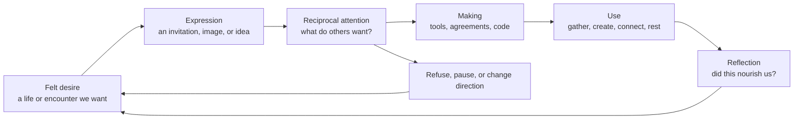
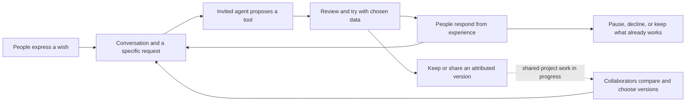

# What desire builds

> [!TIP]
> **The essay's centre:** software can begin in the desire to feel, make, and meet each other. The emerging direction for xNet makes that passage concrete: people talk, invite an agent to help, try what it makes, and shape it together. The test is whether those tools make room for a fuller life, including the parts nobody records.

This is a researched blog exploration with a substantial draft, not a product specification. The proposed title is **What Desire Builds**, with the subtitle **Eros, temple culture, and the software we make for each other**. The intended audience includes existing xNet readers and people curious about embodied community who do not write software.

The review date is an editorial checkpoint one month from now: decide whether the argument feels true enough to develop for publication. It is not a release date. The decision is reversible, and the exploration makes no new architectural commitment.

## What this adds to the conversation

The pirate gives xNet a language for freedom. The forest gives it a language for interdependence and cultivation. Temple culture brings us close enough to ask what happens between people: attraction, touch, vulnerability, pleasure, and the wish to make something together.

The missing question is positive and intimate. What do we want freedom _for_? A person can own every byte of their data and still feel untouched by their life. The next essay can ask what kind of life makes the effort of building this infrastructure worthwhile.

Sexuality belongs inside that question. Moving straight from sex to a vague appreciation of creativity would lose the charge of the idea. Stay with the bodily realities of wanting, being wanted, feeling uncertain, asking, and discovering what another person wants. Then follow what those experiences might teach a maker.

This does not make sexual expression a condition of creativity or belonging. Some people find this language revealing; others, including some asexual people, will not describe their creative life through Eros. They do not need a different label imposed on them to have a place here.

## The argument to try

**Software emerges from Eros when felt desire helps set its purpose, reciprocal attention shapes its making, and people retain authority over what they give to it.**

There are three related meanings here. Desire can be an origin: a wish for a kind of gathering or relationship that current tools make difficult. It can shape the work itself: listening, improvising, noticing pleasure and discomfort, revising together. And it can become a criterion for the result: does this tool help people pursue the lives they actually want?

The chat direction makes the second meaning especially tangible. A person can express a wish where other people can answer it, and an invited agent can help turn a shared idea into something they can try. Using the result gives them something more specific to discuss. Desire remains plural throughout this process: the first request, the generated code, and the loudest participant cannot stand in for everybody's wishes.

This is a philosophical and design argument. It does not require a claim that sexual energy is a measurable fuel for programming. The connection to electrons is material and poetic: people translate felt possibilities into symbols and executable instructions, implemented by physical machines. There is no established scientific claim here that a spiritual force passes into a processor.

This is a proposed creative process, not a psychological law. The return path matters: feeling alive at the start does not prove that the thing we built serves anyone well.

## Research and intellectual debts

### Enki: the invitation and its unresolved tension

Enki's [On an Emerging Temple Culture](https://medium.com/@enkiislove/on-an-emerging-temple-culture-59130efbb14e), dated 21 March 2024, proposes community organised around expanded consciousness, erotic aliveness, and emotional expression. It links creative desire with sexuality and acknowledges the responsibilities of leadership. Treat this as one contemporary spiritual proposal, not a definition of all temple traditions or evidence that these practices reliably produce healing.

The essay's emphasis on taking responsibility for one's experience needs a companion principle: people must be able to name another person's harmful conduct and seek accountability. A community can welcome grief or anger while still setting limits on behaviour. Belonging cannot depend on treating a violation as a lesson one should have transcended.

### Audre Lorde: pleasure as knowledge about work

In [Uses of the Erotic: The Erotic as Power](https://www.haverford.edu/sites/default/files/Center/HCAH/Audre-Lorde-Poetry-is-Not-a-Luxury.pdf#page=7), delivered in 1978 and collected in _Sister Outsider_, Lorde connects felt joy with the quality of work and shared life. Her argument comes from a Black lesbian feminist account of power and oppression. Preserve that context rather than turning her into a source of productivity advice. The scan contains the essay on printed pages 53–59.

### adrienne maree brown: enough, and who gets to enjoy it

In her [Pleasure Activism excerpt](https://www.bostonreview.net/articles/pleasure-activism/), brown asks how pleasure and liberation belong together, with attention to people most affected by oppression. Her distinction between enough and excess is useful here. A software business can keep a person wanting indefinitely; an erotic ethic can ask whether that person gets to feel satisfied and stop. This is a political proposition, not a measured product outcome.

### Betty Martin: attend to who benefits

The official [Wheel of Consent account](https://www.wheelofconsent.org/wheel) distinguishes who performs an action from whose enjoyment it serves. Its authors also describe applications beyond touch. Our application to software is an inference: when a tool asks for attention or disclosure, whose desire does that action serve? A maker's excitement is worth examining alongside the wishes of the people who will use the result.

### Consentful Tech: this bridge already has builders

Una Lee and Dann Toliver's 2017 [Building Consentful Tech](https://www.consentfultech.io/wp-content/uploads/2019/10/Building-Consentful-Tech.pdf) explicitly connects bodily consent with technology, including its development, data practices, and community accountability. It treats consent as ongoing and applies freely given, reversible, informed, enthusiastic, and specific consent to digital systems. Credit this work; xNet is entering an existing conversation. Its aspiration to reversibility also exposes a hard limit: withdrawing access cannot erase copies another person already made.

The [Design Justice Network principles](https://designjustice.org/read-the-principles) add a practical discipline: people affected by a design should help shape it, and its impact matters more than the designer's intent. For this essay, a beautiful founder story earns its place by remaining answerable to other people's experience.

### Lewis Hyde: what a work can give

Fable's exploration led to [Hyde's introduction to _The Gift_](https://lewishyde.com/wp-content/uploads/2021/11/GIFT-Introduction-1.pdf). On printed pages xxxii–xxxiii, art takes part in both market and gift economies: a work can matter in ways its price does not describe. Applying this to software is our analogy, with no obligation to work unpaid or repay a gift with access to oneself.

### Christopher Alexander and collaborators: degrees of privacy

Pattern 127 in _A Pattern Language_, [Intimacy Gradient](https://patternlanguage.cc/Patterns/Intimacy-Gradient-%28127%29), arranges spaces from public to increasingly private. The [Alexander archive](https://christopher-alexander-ces-archive.org/record/intimacy-gradient-pattern-original/) records its earlier collaborative formulation. The pattern text was read in transcription. Applying it to digital spaces is our proposal: a shared entrance can lead to distinct invitations, each with its own audience. More disclosure need not be the goal.

## Where this meets xNet today

The repository was inspected on 22 October 2026. These are source-level observations, not a fresh security audit or a claim that every library primitive has a complete app experience. Graphify was used for initial navigation; the passages and code cited below were then read directly. Research used the existing graph, and the commit hook subsequently refreshed it. No paid semantic extraction was requested.

| Grounding                             | What exists                                                                                                                                                                                                                | What the essay can honestly draw from it                                                                                                                                                                                          |
| ------------------------------------- | -------------------------------------------------------------------------------------------------------------------------------------------------------------------------------------------------------------------------- | --------------------------------------------------------------------------------------------------------------------------------------------------------------------------------------------------------------------------------- |
| 📝 Existing body of writing           | [A Great Pirate Age](../../site/src/pages/blog/a-great-pirate-age.astro), [Data Should Work Like Soil](../../site/src/pages/blog/data-should-work-like-soil.astro), and [Timeout](../../site/src/pages/blog/timeout.astro) | Extend the existing metaphors. _Timeout_ already places the embodied person before their digital representation. Avoid reusing its personal disclosures as invented scenes.                                                       |
| 📝 A positive cultural direction      | [The Feel of xNet](../VIBE.md), especially the scene's ownership of its culture                                                                                                                                            | A temple community could shape its own space. The platform need not prescribe a spiritual or sexual culture to everyone.                                                                                                          |
| 📜 Commitments with identified checks | [Charter §§3 and 6](../CHARTER.md) and [humane-pattern rules](../../scripts/check-humane-patterns.mjs)                                                                                                                     | Calm, no rent on introductions, and no relationship health or closeness scores are existing commitments. Identifier-based checks do not prove every possible design respects them.                                                |
| 🧩 Local matching primitives          | [Profile schemas](../../packages/social/src/connect/schemas.ts) and [wave helpers](../../packages/social/src/connect/wave.ts)                                                                                              | Profiles default to disabled/private. A helper checks reciprocal interest within the same intent. This supports a design vocabulary of invitations; it does not establish consent to touch, sex, or any later encounter.          |
| 🔎 A tension worth keeping visible    | [Affinity derivation](../../packages/social/src/connect/affinity.ts) and [matchmaker](../../packages/social/src/connect/matchmaker.ts)                                                                                     | Inputs can include saved titles and project briefs; matching uses numerical ranking. The charter's intimacy rule is not a ban on all candidate scores. Whether intimate contexts should use these mechanisms is still a question. |
| 🧩 Exit infrastructure                | [Portable bundle writer](../../packages/data/src/portability/write.ts) and [Charter §2](../CHARTER.md)                                                                                                                     | There is code for exporting scoped signed records. The charter still distinguishes that infrastructure from a single complete exit flow. Export also raises questions about other people represented in one's records.            |

> [!IMPORTANT]
> **The revealing design question:** would a saved essay about sexuality become material for a discoverable profile? The affinity helper can accept saved titles; that alone does not establish how a current UI selects them. The proposed standard is explicit choice of source material, preview of the result, and separate permission to share it. Do not describe that complete standard as already shipped.

The same restraint applies to the wave's hash commitment. A helper that produces a salted hash is not an end-to-end privacy guarantee. The schema also holds sender, recipient, and intent fields; what reaches a relay depends on storage and transport. The blog should say there are mutual-interest primitives, without claiming an audited anonymous introduction service.

### A confidentiality concern Fable was right to raise

Fable points to finding 5 in the July [auth comparison](0343_[x]_XNET_AUTH_VS_KEYHIVE_COMPARISON.md). A limited source review on 22 October found that the relevant paths remain: [the client token provider](../../packages/react/src/provider/use-hub-auth-token.ts) includes resource-wildcard permissions for signalling and relay; [capability matching](../../packages/hub/src/auth/capabilities.ts) accepts that wildcard; and [room authorisation](../../packages/hub/src/ws/authorize.ts) can allow those capabilities before consulting document grants. Expiry and explicit revocation-denial checks precede that allowance.

This supports retaining the concern about overly broad room access. It is not a new end-to-end security test or a finding about every deployment. Access by the hub operator and access by another member are also separate questions. Fable's proposed shorthand about being private from the platform but not one's neighbours conflates them. Local storage alone establishes neither claim. The candidate essay now acknowledges the unresolved access issue; no charter or implementation change is made in this editorial pass.

### The chat-first branch changes the centre of the essay

The second checkout was inspected read-only at `/Users/crs/.codex/worktrees/chat-first-redesign/xNet` on 22 October. Its committed baseline was `a0870dc23` on `codex/chat-first-redesign`. The working tree was also changing during this review: shared-project, request-queue, and development-history code was present as uncommitted work. Committed sources were checked separately with `git show` so those layers were not mistaken for the same state. The links in this subsection open that checkout; they are local research references, not public release links.

This is a change in the application's starting point. [The Electron entry](/Users/crs/.codex/worktrees/chat-first-redesign/xNet/apps/electron/src/renderer/App.tsx) opens `CommunityApp`; the previous workspace is a secondary surface. [The web home route](/Users/crs/.codex/worktrees/chat-first-redesign/xNet/apps/web/src/routes/__root.tsx) mounts the same community shell. [CommunityApp](/Users/crs/.codex/worktrees/chat-first-redesign/xNet/packages/workbench/src/communities/CommunityApp.tsx) organises people, messages, groups, communities, and calls. The agent connection is supplied by the desktop host. A shared shell does not establish that the browser can run a locally installed agent.

| Layer                                                          | Evidence inspected                                                                                                                                                                                                                                                                                                                                                                                                                                                                                                                                                                                     | What it supports in the essay                                                                                                                                                                              |
| -------------------------------------------------------------- | ------------------------------------------------------------------------------------------------------------------------------------------------------------------------------------------------------------------------------------------------------------------------------------------------------------------------------------------------------------------------------------------------------------------------------------------------------------------------------------------------------------------------------------------------------------------------------------------------------ | ---------------------------------------------------------------------------------------------------------------------------------------------------------------------------------------------------------- |
| **Committed prototype: conversation**                          | [ConversationPane](/Users/crs/.codex/worktrees/chat-first-redesign/xNet/packages/workbench/src/communities/ConversationPane.tsx) saves messages and invokes an enabled agent from a direct conversation or an explicit mention action.                                                                                                                                                                                                                                                                                                                                                                 | An invitation can become a request for help in the place people are already talking. Ordinary discussion need not trigger work.                                                                            |
| **Committed prototype: an accountable agent host**             | [Agent policy](/Users/crs/.codex/worktrees/chat-first-redesign/xNet/apps/electron/src/main/community-agent-policy.ts) accepts the local owner's invocation; [the service](/Users/crs/.codex/worktrees/chat-first-redesign/xNet/apps/electron/src/main/community-agent-service.ts) bounds context, rechecks audience, and supports cancellation.                                                                                                                                                                                                                                                        | An agent uses a particular person's runtime and provider account. Peer messages can be context; the committed baseline does not let every peer invoke that runtime.                                        |
| **Committed prototype: try and revise**                        | [ChatExtensionPanel](/Users/crs/.codex/worktrees/chat-first-redesign/xNet/packages/workbench/src/communities/ChatExtensionPanel.tsx) compiles proposals, opens a preview beside chat, supports source editing, and passes a selected version back to the agent.                                                                                                                                                                                                                                                                                                                                        | Conversation can produce a working interface, then continue around what people discover by using it. Installation pins a local choice.                                                                     |
| **Committed prototype: scoped data**                           | [Local extension authority](/Users/crs/.codex/worktrees/chat-first-redesign/xNet/packages/workbench/src/communities/extension-authority.ts) binds approval to owner, channel, and artifact; [the scoped API reference](/Users/crs/.codex/worktrees/chat-first-redesign/xNet/docs/reference/scoped-extensions.md) describes selected reads and separately approved private-task and page writes.                                                                                                                                                                                                        | Trying code need not grant it access to everything. These private writes are not proof of collaborative editing of shared community records.                                                               |
| **Committed prototype: attributed remixes**                    | [Version handling](/Users/crs/.codex/worktrees/chat-first-redesign/xNet/packages/workbench/src/communities/extension-versions.ts) validates source fingerprints and author attribution, preserves a parent reference, and includes version identity in approval identity.                                                                                                                                                                                                                                                                                                                              | People can change and pass along a tool while retaining a record of its origin. Sharing source transfers neither installation nor data permissions.                                                        |
| **Proposal with implementation in progress: a shared project** | [Exploration 0482](/Users/crs/.codex/worktrees/chat-first-redesign/xNet/docs/explorations/0482_[_]_COLLABORATIVE_EXTENSIONS_IN_CHAT.md) <!-- exploration-link-ignore --> proposes named collaborators, queued requests, shared versions, and development history. Uncommitted [ExtensionProjects](/Users/crs/.codex/worktrees/chat-first-redesign/xNet/packages/workbench/src/communities/ExtensionProjects.tsx) and [development records](/Users/crs/.codex/worktrees/chat-first-redesign/xNet/packages/workbench/src/communities/extension-development.ts) begin wiring these into the conversation. | The longer-term image is several people building together with an invited agent. The presence of this code is not a verified two-person experience or evidence that every requirement in 0482 is complete. |

The progression matters more to this essay than the growing API surface:

This diagram joins the implemented personal workflow to the proposed shared one; it is not an assertion that the complete loop has passed a multiplayer test. The [chat redesign verification record](/Users/crs/.codex/worktrees/chat-first-redesign/xNet/docs/plans/0478-chat-redesign-preview.md) reports messages, attachments, and calls between two Electron profiles. The later [extension integration record](/Users/crs/.codex/worktrees/chat-first-redesign/xNet/docs/testing/0481-integration-passes-3.md) reports actual Codex generation, iteration, branching, permissions, and restart checks, but uses a signed synthetic peer fixture for receiving a remix. That does not verify two people building one extension across devices. These are earlier recorded results, not tests rerun for this essay. The chat plan also explicitly leaves private-community security work open.

Exploration 0482 makes four decisions visible: joining the making, using someone's agent account, sending context to a model provider, and letting an extension access local data. They can have different decision makers. A group invitation cannot settle them all. The baseline's owner and audience checks are useful constraints, but they do not by themselves establish every participant's consent to provider disclosure. Running the bridge on one's laptop does not mean inference stays there.

The development-history proposal is particularly useful for the blog. “How this version was made” could connect a result to the requests and feedback that shaped it, making contributions visible and disagreements intelligible. That history needs its own audience and retention choices. A useful tool should be shareable without exporting every vulnerable conversation behind it. Nor does a retained transcript prove exactly what a model used or guarantee that replaying it produces the same code. The exploration distinguishes a readable account of the work, captured model inputs, and the saved artifact.

**Editorial consequence:** give conversation and collaborative making the central xNet example. Keep matching as supporting research rather than the product's implied destination. The new direction lets a community reshape its tools as it learns what it wants; sexuality contributes an account of attention, invitation, response, and pleasure to that making. An AI agent can help make a proposal tangible. Its output cannot establish another person's desire or consent.

### Possible uses, expressed as invitations

Imagine an adult community organising a dance, a shared meal, or a consent workshop. A tool could help the hosts describe the invitation, share practical access needs, and coordinate the work. Attendees would choose separately whether to become visible to others. A request to stay in touch could remain specific to the kind of contact offered.

Or imagine two people making something together over a distance: a reading group, a song, an exchange of letters. Digital intimacy can be real intimacy. Disability, geography, illness, and preference make that worth saying plainly. Embodiment does not mean everyone must meet in one room or put down a device.

These are possible applications of the thesis. The chat prototype offers a more concrete way to explore them: a community could discuss a need and gradually make a small tool around it. That does not establish a finished event platform, an intimate messaging service, or a consent-management product.

## Editorial directions

| Direction                       | What it offers                                                           | What could go wrong                                                   | Decision                                                  |
| ------------------------------- | ------------------------------------------------------------------------ | --------------------------------------------------------------------- | --------------------------------------------------------- |
| **What Desire Builds**          | Follows sexuality and felt desire into creative work and community tools | Could become abstract unless it stays with ordinary bodily experience | **Recommended.** Gives the original question room.        |
| **A Temple Made of Electrons**  | A vivid image that brings spiritual and digital life together            | Could imply the software is sacred or confuse metaphor with physics   | Keep as an alternate title or section image.              |
| **The Right to Want**           | Centres self-knowledge, boundaries, and consent                          | Overlaps with the existing refusal and exit essays                    | Use as a thread inside the larger piece.                  |
| **Software That Helps Us Meet** | Makes practical use easy to picture                                      | Could collapse into another dating-app critique                       | Save for a later product essay if actual use warrants it. |

Lead with desire, let consent arise inside the encounter, and reach xNet through the choices that follow. Keep the sharper technical caveats in the research notes unless the public draft makes the claim they qualify. No new revenue lane is proposed.

### What this revision takes from Fable

Fable's exploration 0482, _The Temple and the Treadmill_, was supplied from the `xnet-temple-culture-c8ab7a` worktree and read on 22 October. Three ideas strengthen this draft. The treadmill turns a maker's excitement into a question about whose desire a tool serves. The threshold and intimacy gradient give selective sharing a spatial, human meaning. Hyde's account of the gift helps describe how creative work reaches another person. These now appear within the candidate essay, alongside the narrower confidentiality caveat above.

Keep **What Desire Builds** as the title and creative work as the centre. The claim that software has always emerged from Eros is too broad, and the proposed history of adult media would need its own research. Equating every feed with Lorde's account of the pornographic would also turn an interpretation into a verdict. The named misconduct cases would pull this essay towards a different reporting task; the responsibility of hosts remains explicit without them. Finally, software can support real connection across distance, so embodiment cannot be reduced to making the screen go quiet. Those parts of the parallel exploration are not adopted.

---

## Candidate essay

_Proposed author voice for revision. The opening is an imagined ordinary encounter, not an account of Chris's life or a claim about a particular gathering._

### What Desire Builds

A body can want something before it can explain it.

Someone catches your eye across a room. You feel curious. There is a small change in your breathing, a wish to move closer, perhaps a little fear. Nothing has happened between you yet. You don't know what they want. But a possibility has arrived, and the room has changed for you.

I want to follow that moment into an unlikely place: the software we build.

We've talked about xNet as a pirate internet, a way to sail under your own flag, and about data as soil we might cultivate. Those images make room for freedom, shared life, and care. Lately I want to bring the question closer to the skin. What are we making all that room for?

Part of the answer is sexual. There is pleasure in being a body, in desire, in touching and being touched when the wanting is shared. There is vulnerability in letting someone know what you want. These belong to the life our tools are meant to serve, even when they are awkward to mention on a software blog.

Enki's [essay on an emerging temple culture](https://medium.com/@enkiislove/on-an-emerging-temple-culture-59130efbb14e) brought this question into focus. It imagines a community with room for erotic life, emotional expression, and spiritual experience. What interests me is the possibility of bringing more of ourselves into the same room, without making any one way of being the price of admission.

For some people, sharing touch has a spiritual dimension: a sense of reverence, presence, or connection with something larger than themselves. That meaning can matter without becoming everyone's belief. A shared room needs space for the person who wants to dance alone, too.

### Let desire have a say

Audre Lorde gives this inquiry a deeper root. In [Uses of the Erotic](https://www.haverford.edu/sites/default/files/Center/HCAH/Audre-Lorde-Poetry-is-Not-a-Luxury.pdf#page=7), she asks what the knowledge of deeply felt joy demands of the rest of our lives, including our work. She writes as a Black lesbian feminist about reclaiming power under oppression. Her account of the erotic reaches into making and thinking while remaining grounded in feeling. Read alongside software, it prompts an uncomfortable question: how much of our working life have we agreed to spend without really wanting to be there?

There are times when making something feels like a response to desire. You can almost feel the thing before it exists. A group of friends needs a way to keep a shared project alive, and you start to picture how it could work. You try something, listen, and try again. The work has a pull.

Sexuality can teach us something about that attention. Wanting is particular. It has timing, hesitation, surprise. It changes as we learn what another person wants, and sometimes what we thought we wanted changes with it. Bringing that quality of attention to making seems more interesting to me than treating desire as fuel to burn through another late night.

The people doing the work still need rest, wages, solitude, and the freedom to find it boring some days. Nobody owes a project their passion, much less their sexual life. A culture of making can welcome feeling without demanding that people reveal themselves.

### The distance between wanting and meeting

Back in the room, your desire belongs to you. Moving closer would involve someone else.

That gap is where the encounter becomes interesting. You might ask them to dance. They might smile and decline. Perhaps they want to talk instead. If either of you has to keep performing enthusiasm to preserve your place in the room, something important has already been lost.

Consent gives desire a way to meet another desire. It makes an invitation possible because the answer can change what happens. A sincere no tells us something we need to know. A yes has meaning within the question that was asked; accepting a dance does not answer every question that might follow it.

Betty Martin's [Wheel of Consent](https://www.wheelofconsent.org/wheel) makes a useful distinction between who is doing something and whose enjoyment it serves. I want to carry that question into the workshop. When I build a feature, whose wish am I answering? Can the person using it recognise their own purpose in what it asks them to do?

A tool can begin in desire and still work against the person using it. The maker may want a growing audience; someone at the screen may want one good conversation. If the business depends on keeping that person searching, satisfaction becomes a problem for the business. This is the treadmill worth watching for: a tool that needs us to remain unsatisfied.

There is already a body of work making this connection. Una Lee and Dann Toliver's [Building Consentful Tech](https://www.consentfultech.io/wp-content/uploads/2019/10/Building-Consentful-Tech.pdf) treats consent as something that belongs throughout a technology's making and use. It is a useful place to begin asking better questions about the invitations a piece of software makes.

An invitation to share a document should make its audience clear. Changing your mind should have a useful consequence. Sharing one part of your life should leave you able to keep another part private. These are ordinary acts of consideration, expressed through design.

Christopher Alexander and his collaborators describe an [intimacy gradient](https://patternlanguage.cc/Patterns/Intimacy-Gradient-%28127%29) in buildings: a sequence from public spaces towards more private rooms. I can imagine a digital space with that quality. An invitation to a gathering could open its shared plans without exposing everyone's private reflections. Two people might later choose a conversation of their own. Each invitation would be specific, and staying in the common room would remain a complete way to belong.

Those choices have limits once information is shared. A person can copy a message they were allowed to read. Taking away their access later cannot reach into their memory or erase their screenshot. A tool earns trust by telling you where its power ends.

### What passes into the machine

So how does software emerge from Eros?

Someone feels a wish for a life that has no ready form. They find words for it, bring it to other people, and discover which parts are shared. An idea becomes a sketch, then a set of instructions, then a tool people can use. Somewhere in that process, a wish becomes an arrangement of matter that can help us do something together.

The electrons are real. So are the hands on the keyboard, the mined materials in the machine, and the bodies keeping its infrastructure running. These physical tools can carry choices shaped by desire, which is what I mean by an erotic origin. The metaphor doesn't need to become a theory of electricity to matter.

### Making a room we can change together

A new direction taking shape in xNet brings this passage into the conversation itself. People can talk to each other and invite an AI agent to help make something. In the desktop prototype, a person can ask for a small tool, try it beside the chat with chosen data, and ask for a revision. Versions can be kept and shared. The next step, being developed now, is a shared project where several people can contribute requests and feedback around the same evolving tool.

Imagine where that could lead. A few friends are planning a gathering with dancing, food, and room to rest. Someone asks the agent for a little board showing the work they have agreed to share. They try it. One person wants help arranging rides; another notices that a list of unclaimed tasks makes the evening feel like an obligation. They change the invitation, leave some things optional, and try again.

The important discovery may come from someone who never touches the code. They know what it feels like to arrive tired, to want company while being unable to offer much, or to be excited about dancing and nervous about being touched. That knowledge can shape the gathering and the tool. The people closest to those experiences need ways to speak, influence the result, and keep some things to themselves.

This is where the connection to Eros becomes concrete for me. A wish becomes something we can encounter together. Making it reveals things we couldn't articulate at the start. Someone's response changes what another person imagines. The pleasure can be in that exchange: feeling an idea take form between us and recognising something of ourselves in what emerges.

An agent can help give a request a form people can examine. Its fluent answer cannot tell us whether somebody wants touch, feels welcome, or is ready to share. Those answers belong to the people involved. A finished preview still needs their response, including from the person who takes longer to find words. Silence in a busy chat is an uncertain basis for deciding that everyone likes the plan.

The invitations to the machine need care too. An agent connected on my computer may send selected conversation to a model service. Letting a local tool read a note is a separate decision. So is letting someone use my agent account. The emerging design treats these as distinct choices; a community still has to understand and agree on what it asks of its members.

There is also a proposal to let people see how a version was made: the requests, revisions, and contributions that led to it. I like the possibility of remembering whose observation changed the work. That memory should have boundaries of its own. Passing a useful tool to another group need not expose the whole conversation in which it was born.

Plenty of what happens at the gathering may never need to become data. The tool has done something worthwhile if it helps people make room for an experience they want to have.

Making for other people brings a particular pleasure: something you cared about becomes useful to someone else. In [The Gift's introduction](https://lewishyde.com/wp-content/uploads/2021/11/GIFT-Introduction-1.pdf), Lewis Hyde describes art received as a gift even when money changes hands. A tool might carry that quality too. Someone takes it into a life you don't control and finds a use you hadn't imagined. Being paid can help the making continue; gratitude still leaves the recipient free.

### What xNet can contribute

This is one reason xNet's commitment to keeping a primary copy of your work on your own device matters to me. There is room to make something privately, decide what to share, and retain a life beyond a particular host. The existing [charter](../CHARTER.md) connects that architecture to the right to leave, calm design, and a refusal to charge rent on introductions.

Keeping a copy at home is only part of that promise. An earlier [review of xNet's access model](0343_[x]_XNET_AUTH_VS_KEYHIVE_COMPARISON.md) identified overly broad permissions on a shared hub, and the chat prototype leaves private-community security work open. Those boundaries need to be resolved and tested before this vision can become a promise about keeping intimate records private.

The charter also rejects relationship health scores and closeness rankings. That commitment matters just as much in a room full of conversation and capable agents. More information about people does not entitle a tool to decide what their relationships mean. We can make something together without turning our closeness into another thing to measure.

I want xNet to be useful to people forming their own kinds of community. A temple gathering and a quiet exchange of letters could both find a place here. The same infrastructure should leave room for people whose spiritual lives, sexual lives, and ideas of intimacy differ from mine.

That ambition has to survive disappointment and conflict. A person should be able to name harm, seek support, or leave without being told their boundary shows a lack of openness. Software can support access choices and preserve work. The people holding a community still have to do the work of care and accountability.

In [Pleasure Activism](https://www.bostonreview.net/articles/pleasure-activism/), adrienne maree brown asks us to consider enough: pleasure that allows satisfaction, with attention to who has been denied it. I find that a useful question for a network. Could someone get what they came for and feel free to go? Could a conversation continue online because that is where the people involved can meet, without the platform continually asking for more?

The earlier essay [Timeout](../../site/src/pages/blog/timeout.astro) placed the person before their digital representation. This feels like a next step in that thought. Let the body have a say in what we make. Let our desire for each other influence the rooms we build, and let the answer from the other side matter.

The pirate wanted freedom, and the garden needed tending. Somewhere among the things we might grow is a place where someone can ask, quietly and without pressure, whether you'd like to dance.

---

## What the next revision should resolve

The draft is most distinctive when it stays with the _making_ of software. Its consent argument is important, but a long inventory of privacy features would pull it back into territory the blog already covers. Keep the emotional centre in the movement from wanting to creating together.

The chat branch gives that movement a practical setting. Keep the invitation, trial, response, and revision visible in the public essay. Avoid a catalogue of agent capabilities or an implication that code generation resolves social disagreement. The next publication review should follow one actual collaborative project and distinguish the people speaking, the person hosting the agent, and each person's choice to try the result. The imagined gathering above is an illustration, not a report of such a test.

The candidate above predates Chris's personal accounts. On 22 October he supplied the bath, sauna, and standing-desk experiences now used in the [blog draft](../../site/src/pages/blog/what-desire-builds.astro). The bath's date remains uncertain, as he described it. The gathering remains explicitly imagined. Existing autobiographical material in _Timeout_ is context, not permission to manufacture a new story around it.

The spiritual language needs the same precision. Use “temple culture” for the contemporary invitation under discussion. Do not suggest that Hindu or Buddhist Tantra, ancient temple institutions, modern retreats, and queer chosen families form one interchangeable tradition. This exploration has not researched those histories. It also makes no claim that sex, spiritual practice, or xNet treats trauma or loneliness.

The important product questions now include whose requests shape a shared tool, which conversations can go to a provider, and who can see the history behind a version. Selective disclosure and leaving shared records behind remain relevant, as does the scope of any profile derivation. These are observations for later work, not a request to build a sexuality feature or collect more intimate data. An enthusiasm for connection should leave room for not being known.

## Editorial follow-through

These are future steps toward a published essay; producing this exploration does not complete them.

- [x] Choose whether the final piece should retain this reflective voice or include a real personal account from Chris. His supplied accounts ground the separate blog draft.
- [x] Revise the essay around that choice, preserving its explicit discussion of sexuality and its attention to people who do not share the frame. The blog page now moves from bathing and felt Eros into community and collaborative making.
- [ ] Recheck any current xNet capability claimed in the publication draft against its actual app flow.
- [ ] Revisit the chat branch's shared-project implementation and real two-person verification before describing collaborative extension building as a completed experience.
- [ ] If Chris chooses outside feedback, invite a consent practitioner and a reader unfamiliar with temple culture to respond; no outreach has been sent.
- [ ] If publication is requested, adapt the chosen draft to the blog, resolve local links to public destinations, and add the appropriate changelog entry.

## Validation record

Local verification after the chat integration on 22 October 2026: all 36 local references resolved, including 15 paths into the other checkout, and brand casing was clean. The candidate essay's prose scan found no mirrored sentence pairs. Sentence-length variation remained below the scanner's heuristic threshold; the rhythm was reviewed in context rather than rewritten to meet a number. A readability score cannot decide whether the essay honours its sources or speaks honestly about desire.

The earlier repository-wide exploration-link check did **not** pass: it reported 175 existing broken references elsewhere, including nested worktrees, agent memory, and an existing output directory. That broad scan was not repeated for this revision; the document's links were checked separately. No application code changed, and application tests were not run for this research document.

- [ ] Before publication, verify every quotation against its source and retain the named intellectual debts.
- [ ] Before publication, remove any product claim that has only a helper function or design document behind it.
- [ ] Before publication, read for the implied social demand: nobody must disclose, touch, feel spiritual, or want sex to belong.
- [ ] Before publication, read for pleasure and possibility; the essay should still answer why we might want to make something together.

## References

External sources are linked at the claims they support above. All were accessed on 22 October 2026. The argument connecting those sources to xNet is this exploration's synthesis, not an endorsement of xNet by their authors.

The main sources are Enki's _On an Emerging Temple Culture_; Audre Lorde's _Uses of the Erotic_; adrienne maree brown's _Pleasure Activism_ excerpt; Betty Martin's official _Wheel of Consent_ account; Una Lee and Dann Toliver's _Building Consentful Tech_; the _Design Justice Network Principles_; Lewis Hyde's introduction to _The Gift_; and the _Intimacy Gradient_ pattern in Alexander and collaborators' _A Pattern Language_. Fable's parallel exploration supplied the three editorial leads recorded above; the two added literary sources and the relevant access-control paths were checked separately.

Local antecedents also include [The Matchmaker and the Meter](../../site/src/pages/blog/the-matchmaker-and-the-meter.astro), which distinguishes local matching work from a complete federated service, and [A Ship of Your Own](0472_[_]_A_SHIP_OF_YOUR_OWN.md), which gives communities room to shape the places they inhabit.

The chat revision additionally draws on explorations 0480–0482 and the implementation and testing records in `codex/chat-first-redesign`, at the baseline and working-tree state identified above. These supplied the shift from tools for connection toward tools made within conversation; they do not establish a public release or complete multiplayer validation.

## Blog production — 22 October 2026

The [Astro post](../../site/src/pages/blog/what-desire-builds.astro) is the current essay; the candidate in this exploration remains the earlier research draft. Chris's accounts supply the shift from maintaining his body to relating to it, the warmth of a naked sauna, the felt hum he calls sacral energy, and the movement of his body while speaking. His account of Eros includes grief, pain, longing, laughter, and creativity. The blog treats this as personal experience, without adding a physiological explanation or a therapeutic claim.

The initial review version used `draft: true` and an authoring timestamp. Chris subsequently requested publication. The release version removes the draft flag, records the release date, and retains the 11-minute reading estimate and byline naming crs48 with Codex. It includes the page, artwork, and a changelog fragment. Production deployment and live verification follow the repository's release workflow.

The [large cover](../../site/public/blog/covers/what-desire-builds.webp) and [small cover](../../site/public/blog/covers/what-desire-builds-800.webp) were generated with the built-in image tool and exported as 1600×800 and 800×400 WebP assets. The cover is an illustration, not a depiction of Chris. Exact generation prompt:

> Use case: illustration-story. Asset: wide 2:1 editorial cover for a thoughtful personal essay titled What Desire Builds (do not put text in the image). Paint an intimate close view of two adult hands resting and gently moving in warm bath water, ripples catching soft late-afternoon window light, a small portion of the worn pale ceramic bath rim and a folded linen towel visible. Only hands and a little forearm are in the composition; no faces or other body parts. The feeling is curiosity, tenderness, warmth and bodily ease, an ordinary act of bathing becoming a moment of reconnection. Quiet, richly textured painterly editorial illustration, muted terracotta, amber light, deep desaturated teal water, tactile brushwork, understated and human rather than glossy spa advertising. Compose generously for a 1600 by 800 landscape crop with the hands and ripples in the central safe area. No text, lettering, logos, mystical symbols or electronics. This is an illustration, not a claimed depiction of the author.

The prose scan measured 2,264 words, with no mirrored sentence pairs. Its sentence-variation and repeated-opener heuristics still warn; the paragraphs were reviewed for voice rather than rewritten to satisfy those numbers. Desktop and phone screenshots show the page in light and dark themes; at 1440px and 390px the page has no horizontal overflow and its images load. The separate reading copy and screenshots are local review artifacts under `output/`, outside the commit.

The complete site build passed using the installed native ARM64 Node 22 runtime, producing 137 pages; the distribution validator found all 53 expected static pages. The four internal article links returned HTTP 200, the browser reported no errors, and the generated social image is 1200×630. A separate check confirmed the draft is absent from the blog index and RSS feed. All 40 local research references resolved. Application tests were not run for this blog change; the other worktree's collaborative flow was not retested.
