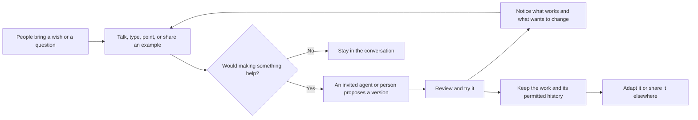
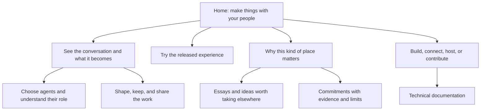

# People, language, and a place to make things

> [!TIP]
> Lead the next xNet story with people making things together through conversation. Explain ownership, history, and open foundations through what they let those people do. Prepare the story now; write the launch essay and change the website when the released experience can support it.

This is an editorial and positioning exploration, not the next blog post or a website implementation. Chris asked to hold the essay for the chat prototype's release. The review date is a point to reconsider the framing against a moving prototype, not a launch date or a scheduled reminder. Revisit it earlier if a release candidate is ready.

## The reframe

Chris's starting point is people and agents in conversation, seeing what they can create together. A keyboard or a voice gives an idea somewhere to go. It might become a piece of software, an image, a shared project, or a clearer understanding between friends. He describes xNet as the water, soil, or substrate through which that movement happens.

That changes the first question the website answers. The current homepage introduces documents, databases, canvases, and a personal library under “A workspace you own.” Those remain useful capabilities. The new invitation starts with someone you want to spend time with and something you might like to make.

**Proposed positioning: xNet is a place for your people, your agents, and what you make together.**

The relationship gives a tool its purpose. A group can discover what it wants while trying things, revising them, and talking about the result. Ownership matters because the work and its useful history should remain available as the group changes. Open foundations matter because another tool, community, or maintainer should be able to contribute.

The phrase “seeing what you build together” leaves room for surprise. Keep that room. A person needn't arrive with a product idea, a business plan, or the right vocabulary for a prompt. There should also be room to talk without producing anything.

The intended first audience is a small group with some existing trust: friends, collaborators, a club, or people around a shared interest. That is an editorial assumption for this exploration, not a restriction on who may use xNet. It offers a concrete first scene without requiring a stranger to understand the whole platform.

## Language gives an idea somewhere to go

“Transmutation” captures the delight of a thought becoming something people can touch and change. It belongs in Chris's account of what draws him to this work. The public explanation should also show the ordinary steps: somebody says what they want, another person changes the idea, an agent proposes something, and the group tries it.



This is a proposed experience model. The voice and outward-sharing paths need their own release evidence; the diagram does not establish that every path ships today.

### Mostly through language

Language can be the main way in without becoming the only way to act. A person might say “closer to this,” point at a layout, adjust a value, or edit the source. Looking at a result often teaches us what we meant. Requiring a perfect verbal specification would put a new barrier in front of the people this framing hopes to welcome.

Voice also contains several different promises. Calling a friend, dictating a message, asking an agent aloud, and turning a recorded discussion into a project are separate experiences. The prototype contains a call interface and a text composer. This review did not establish a working speech-to-agent creation flow. The launch copy should name the voice experience that is actually available.

“Anything you might want” describes the horizon. The first release needs a few understandable examples. An image, a shared plan, and a small application have different generation, review, storage, and sharing needs. Demonstrating one does not prove all three.

### Making is a shared activity

The distinctive scene has more than one human point of view. One person notices a need; another recognises an awkward assumption; someone else changes the wording or tries an alternative. An agent can make a proposal while those relationships remain visible.

This also gives “your agents” a useful meaning: agents you choose to involve, with a visible provider, audience, and scope of work. They can take part in the creative process without being presented as people or as authorities over what a group ought to want. Choosing a local bridge does not make a remotely served model local.

## What the prototype now supports

For this review, the chat checkout was inspected read-only on 22 October 2026 at commit `ea430f7e723f352ee1a7d405cc38d3601bb1b1cd`, on `codex/chat-first-redesign`. The earlier Eros exploration had inspected `a0870dc23` before the shared-project work was committed. Commit `1465aba5f` now contains that prototype, and `ea430f7e7` adds the current Claude integration alongside Codex.

The checkout was changing during this review. Chat-history virtualisation files, the conversation component, package manifests, and the lockfile had uncommitted changes by the end. Those changes are excluded from the evidence below. This exploration uses the committed implementation and its recorded integration pass; it does not claim to have repeated that pass.

| Capability                               | Evidence and state                                                                                                                                                                     | What the future story can build on                                                                                  |
| ---------------------------------------- | -------------------------------------------------------------------------------------------------------------------------------------------------------------------------------------- | ------------------------------------------------------------------------------------------------------------------- |
| People and messages are the entry point  | 🚧 Both app entries mount `CommunityApp`; the previous workspace remains available. [C1]                                                                                               | Conversation can organise the experience while documents and other tools remain useful within it.                   |
| People can involve their own agents      | 🚧 Desktop settings discover and connect supported Codex and Claude installations. The record describes overlapping replies from the two runtimes. [C2]                                | An agent is a chosen participant with a known host. Browser chat does not establish browser-hosted agent execution. |
| Several people can develop one tool      | 🧪 The integration record describes two Electron processes with different identities and stores, shared requests, queued work, branches, combined proposals, and manual edits. [C3–C4] | There is a concrete collaborative-making story, beyond a solo prompt-and-response demo.                             |
| Versions retain useful context           | 🧪 The record follows eight versions and reads ancestry after the original host and hub close. The code links versions to requests, responses, parents, and retained input. [C3–C5]    | People can inspect how a version came about and continue from a chosen starting point.                              |
| A shared proposal preserves local choice | 🧪 The recorded walkthrough distinguishes the shared current version, the open preview, local installation, and each person's data approval. [C3–C4]                                   | A collaborator's new version needn't replace what someone is trying or grant access to their records.               |
| Spoken collaboration                     | 🚧 A voice/video call interface exists; the composer inspected is text-based. [C6]                                                                                                     | Keep voice in the vision, with precise launch claims after testing the actual input path.                           |
| Open-ended media creation and departure  | ⏳ A complete image-making flow, general development-history export, and use of an exported project in another system were not established here. [C3]                                  | These are candidate demonstrations and future work, not current headline features.                                  |

### The strongest scene already on record

The local integration exercise created a community task board. One participant requested a first version; another proposal added search; a later version combined branches. A collaborator then changed the source manually, and an agent continued from that edit. The collaborator eventually selected its own agent host and continued while the original host and hub were closed. The original host later received that version.

That sequence gives the essay a structure: a wish becomes a proposal, several people change it, and the result retains a history they can revisit. The value is in those transitions. A large count of generated applications would explain less.

The exercise used two profiles driven locally, including one named Morgan Prototype. It is not a customer testimonial or evidence that an independent community adopted the tool. Its hub used anonymous development authentication. Separate authenticated relay tests are recorded, but encrypted delivery and broader retention work remain release checks. A launch story should either label this demonstration honestly or replace it with an observed group experience whose participants agree to publication.

<details>
<summary>Source map and how to revisit the evidence</summary>

`chat:` below means the separate checkout at `/Users/crs/.codex/worktrees/chat-first-redesign/xNet`, pinned to `ea430f7e723f352ee1a7d405cc38d3601bb1b1cd`. These are source paths, not public URLs. Read committed versions with `git show` when the working tree has moved.

| Ref | Sources                                                                                                                                                                                           |
| --- | ------------------------------------------------------------------------------------------------------------------------------------------------------------------------------------------------- |
| C1  | `chat:apps/electron/src/renderer/App.tsx`; `chat:apps/web/src/routes/__root.tsx`; `chat:packages/workbench/src/communities/CommunityApp.tsx`                                                      |
| C2  | `chat:packages/workbench/src/communities/AgentSettings.tsx`; `chat:apps/electron/src/main/community-agent-runtime.ts`; the Claude/Codex follow-up in C3                                           |
| C3  | `chat:docs/testing/0482-shared-extension-integration.md`, including its limits and follow-up sections                                                                                             |
| C4  | `chat:packages/workbench/src/communities/ExtensionProjects.tsx`; `chat:packages/workbench/src/communities/ConversationPane.tsx`; `chat:packages/workbench/src/communities/ChatExtensionPanel.tsx` |
| C5  | `chat:packages/workbench/src/communities/extension-development.ts`, especially `readDevelopmentEntry`, `acceptedDevelopmentHeads`, and `developmentAncestry`                                      |
| C6  | `chat:packages/workbench/src/communities/CallPanel.tsx`; the text composer and agent controls in `ConversationPane.tsx`                                                                           |

```sh
git -C /Users/crs/.codex/worktrees/chat-first-redesign/xNet show \
  ea430f7e723f352ee1a7d405cc38d3601bb1b1cd:docs/testing/0482-shared-extension-integration.md
```

The public-site source was inspected at `origin/main`, commit `5047089db0d8e8b9c505e505bf3b3bc9a8e9139b`: `site/src/pages/index.astro`, `site/src/components/sections/Hero.astro`, `TheApp.astro`, `Nav.astro`, and the `workspace`, `agents`, and `why` pages. This avoids treating the current chat branch or this older authoring branch as the deployed website.

The graph queries in both checkouts returned older community, history, and mention-related material rather than the new implementation. Direct source reads supplied the current evidence. No new graph relationships were inferred from those results.

</details>

## Why choose xNet?

The desired answer is that a group can shape its tools, understand its work, and keep its choices open. “The most flexible” is a comparative claim this research cannot support. It also leaves the reader to guess which freedom matters. Show a specific change people can make, and what survives that change.

| Chris's value            | A concrete reader question                                              | Evidence needed for the release wording                                                                                              |
| ------------------------ | ----------------------------------------------------------------------- | ------------------------------------------------------------------------------------------------------------------------------------ |
| Flexibility              | Can we change this to fit how we live and work?                         | A group revises a working tool, including a change the original builder did not anticipate.                                          |
| History                  | Can I understand why this version exists and return to an earlier idea? | A legible version history, its authors and bases, and honest missing-history states.                                                 |
| Sovereignty              | Which decisions remain ours?                                            | Visible controls for providers, data access, installation, hosting, and taking work away; describe each supported choice separately. |
| Pluggability             | Can another tool or person contribute?                                  | A named, working extension or integration with its limits shown.                                                                     |
| Playing well with others | Can our work travel somewhere useful?                                   | A demonstrated export, import, or continuation in a named destination. Open source alone does not prove this journey.                |

“You don't have to choose xNet” should be a practical commitment. A useful essay, a documented format, or a reusable component can help someone who never installs the app. A person should be able to use another tool without being treated as disloyal. When a connection or export is unfinished, saying so protects the invitation from becoming a promise of freedom that takes work to recover.

Source sharing and portability also differ. The current extension envelope can share source without its development transcript or permissions. A source file that depends on the xNet runtime does not thereby become a standalone application for every other environment.

### History should help people continue

The conversation, the model input, and the resulting artifact have related but different histories. A version can preserve the source that actually ran, even when a later model would answer differently. The human record can explain a choice without disclosing every private conversation behind it.

Keep that distinction in the story. “Your history” should mean history you have authority to retain and see. It must not imply that every participant owns an irrevocable copy of every disclosure, or that removing a message recalls copies already received. The prototype explicitly records unfinished retention work and no hard-erasure guarantee. [C3]

## An ecology worth contributing to

Chris's words “humanity,” “soul,” and “heart” express the kind of relationship he wants with his tools. The site can carry that warmth through its scenes and choices. People should be able to recognise their own wishes in what they make, feel welcome while learning, and leave a conversation with more room to act.

“Wholesome” needs room for different people. A serious working group, a playful circle of friends, and a provocative artistic scene may want quite different surroundings. The [existing vibe document](../VIBE.md) already gives the scene authority over its character. xNet should offer the conditions for that variety rather than certify one approved way of being human.

The wider ecology includes people who maintain small tools, teach, translate, document mistakes, host a group, write essays, or help someone express an idea. Some contributions will be paid. A refusal to exploit people should not become an expectation that contributors work without support.

This exploration proposes no new pricing or revenue lane. It carries forward the [charter's commitments](../CHARTER.md): charge for useful work and services, keep exit available, and avoid turning relationships or access to people's own work into rent. If the launch later introduces a commercial offer, assess that offer separately against the charter's improvement, alternative, and disappearance tests.

A useful editorial test is whether a paragraph offers people something they can use, including when they choose another system. Success could include a tool remixed by another community, a project that continues after its first host leaves, or a reader adapting an idea without joining xNet. These are questions for demonstrations and conversations with participants, not a proposal to collect more behavioural data.

## Precedents that sharpen the argument

These sources inform the framing; they do not endorse xNet or establish its capabilities.

Douglas Engelbart's 1962 framework treats human capability as a relationship among people, language, tools, methods, and training. That offers a useful ancestry for the language-centred direction: changing software also changes what people can express and work through together. Our editorial inference is to show the surrounding human practice, not just the generated result. [Augmenting Human Intellect](https://www.dougengelbart.org/content/view/138/)

Ink & Switch's account of malleable software argues for tools people can adapt and for communities making and maintaining shared solutions. It also recognises different levels of skill and the value of direct manipulation. This supports leaving several ways into creation, including help from a more experienced peer. [Malleable Software](https://www.inkandswitch.com/essay/malleable-software/)

The local-first paper connects collaboration with continued access and control over one's work. Use those as questions the launch demonstration must answer. A local copy of some records is a foundation; a person's ability to keep working is the experience that matters. [Local-first Software](https://www.inkandswitch.com/essay/local-first/)

The Matrix Foundation explicitly values an open communications ecosystem that does not privilege a single participant. It is useful evidence that this ambition has company. Naming such work makes the invitation more credible than claiming xNet alone cares about these freedoms. This is a comparison of commitments, not a claim that the xNet prototype interoperates with Matrix. [About Matrix](https://matrix.org/foundation/about/)

## Positioning options

| Lead                             | What it makes clear                            | What it leaves out                                         | Recommendation                                                              |
| -------------------------------- | ---------------------------------------------- | ---------------------------------------------------------- | --------------------------------------------------------------------------- |
| A workspace you own              | Familiar tools and control over data           | Why people would gather and make something together        | Retain as a supporting promise and a description of the existing workspace. |
| Chat with your people and agents | The main interaction and who is there          | What grows from the conversation                           | Use to explain the product quickly.                                         |
| Make things together             | Shared purpose, possibility, and participation | Needs a concrete image to explain the software             | Lead with this and immediately show the conversation-to-tool journey.       |
| A medium for transmutation       | Chris's sense of creative possibility          | Too abstract for a first-time visitor to predict an action | Develop in the future essay after a concrete scene.                         |

The recommended order is **people → conversation → something you can try → freedom to shape and keep it → the wider ecology**. This keeps the positive invitation in front while giving its promises substance.

### Small copy directions to test later

These are positioning samples, not a drafted blog post or approved website copy.

**Homepage candidate:** “Make something together.”

**Supporting sentence:** “A place for your people and your agents. Talk an idea through, try what takes shape, and make it your own.”

**Deeper promise:** “Keep the work, understand how it grew, and choose where it goes next.” This wording earns its place only when the history and departure paths shown beside it are real.

**Future essay working title:** “See What We Make.” A more descriptive alternative is “When a Conversation Becomes a Tool.” Choose after the release scene exists; the title should fit what happened.

## Reframing the website

The website should let a visitor answer, in order: who is this for, what could we do together, what does that look like, and why would we trust this place with our work?

### A homepage sequence

Begin with people in a recognisable conversation beside the thing they are trying. Show a human correction and a second version. Keep the agent's contribution and the person's choice visible. The first example should be small enough to understand without a narrated feature tour.

Then show where the work goes: its useful history, the ability to change it, and a proven way to carry or share it. Follow with the broader foundations and other ways to contribute. The essays can give depth to the invitation while remaining worthwhile to people who have no intention of installing the app.

Use one dominant metaphor per page. “A place” is an accessible introduction; soil can explain how durable shared material supports many tools; water can suggest ideas moving between people. “Substrate” belongs in the technical explanation after the reader knows what it does. Combining all three in the hero would make the visitor do the explanatory work.



The diagram groups reader needs, not mandatory new routes. Reuse existing pages and preserve links while deciding which navigation labels deserve to change.

| Existing surface                           | Direction at the chat release                                  | What needs to accompany the new framing                                                                                         |
| ------------------------------------------ | -------------------------------------------------------------- | ------------------------------------------------------------------------------------------------------------------------------- |
| `/` and `Hero.astro`                       | Lead with people and shared making                             | Actual chat-and-artifact footage, a release label, and a CTA that reaches that build.                                           |
| `TheApp.astro` and `/workspace`            | Explain the full journey through conversation and useful tools | Keep documents, databases, library, and canvas discoverable; explain their place in the new starting experience.                |
| `/agents`                                  | Introduce choosing and involving agents in conversation        | Separate desktop runtime connection from the existing CLI, vault, and MCP developer paths. Preserve those working instructions. |
| `/why` and `/commitments`                  | Connect the ecology to practical freedoms                      | Evidence for history, control, maintenance, and exit; acknowledge unfinished promises.                                          |
| `/build-with`, `/plugins`, and docs        | Show how outside people and tools can contribute               | Specific supported interfaces and examples; make no universal compatibility claim.                                              |
| `/download`, browser entry, and `/roadmap` | State what is available on each surface                        | Do not send a chat-oriented CTA to an older workspace demo without explaining the difference.                                   |
| `/blog`, metadata, and social previews     | Introduce the release essay when the experience is ready       | A title, description, images, and links consistent with the actual launch scope.                                                |

This is a shift in the site's explanation and order of evidence. It does not require discarding the existing visual design or adding a new route for every concept. A later visual exploration can compare actual layouts once a stable release build supplies honest screenshots.

## The future essay, held for release

[What Desire Builds](https://xnet.fyi/blog/what-desire-builds) asks how desire and bodily attention might shape software. The next essay can follow that impulse into a shared, visible process. It should stand on its own for someone who has not read the earlier post.

| Movement                  | Material to collect before drafting                                        | Purpose                                                 |
| ------------------------- | -------------------------------------------------------------------------- | ------------------------------------------------------- |
| A wish between people     | An observed moment when someone wanted to change how a group did something | Give the reader a human reason to care.                 |
| Finding words for it      | The question, examples, and disagreement that made the wish clearer        | Show that language is part of discovery.                |
| Something appears         | A small artifact and the first attempt to use it                           | Give “transmutation” a concrete referent.               |
| Someone changes the idea  | A peer's contribution, a manual edit, or a different branch                | Show the group shaping the work.                        |
| The work can continue     | A useful history view and a demonstrated choice of version or host         | Make the freedom tangible.                              |
| An invitation beyond xNet | Ways to use, adapt, contribute, or take an idea elsewhere                  | End with an ecology people can join on their own terms. |

Hold the prose until this material is available. The current two-profile demonstration is a candidate source, clearly labelled as such. A real group trying to make something it cares about would add the personality that a polished walkthrough cannot supply. Ask permission before using a participant's words or likeness publicly.

## Release decisions and validation

> [!IMPORTANT]
> A scoped chat preview can be described honestly before every long-term ambition is complete. Choose the claims the release can support, then show their limits beside the relevant action. Unfinished voice creation, universal interoperability, or complete history export need not become promises just to make the launch sound larger.

### Before drafting the post

- [ ] Choose the release audience and a real, small making-together journey.
- [ ] Record the exact build, platforms, runtime requirements, and supported agent configurations.
- [ ] Capture a second participant contributing, trying, and revising a result; distinguish independent use from an operator-driven demonstration.
- [ ] Show which history remains useful after the originating host goes offline, including unavailable entries.
- [ ] Decide what “voice” means for this release and show that particular flow before mentioning it as available.
- [ ] Check every history, sharing, and exit claim against an actual journey; narrow the copy where an export or destination is unfinished.
- [ ] Resolve or explicitly scope the prototype's recorded delivery, retention, access, and cancellation limits for the intended audience.
- [ ] Ask participants which moments felt playful, difficult, surprising, or worth continuing, and secure permission for any public account.

### Before changing the website

- [ ] Test the proposed opening with readers unfamiliar with xNet: can they describe who it is for and what they could do next?
- [ ] Select a stable release scene and use actual screenshots or recordings with accurate labels.
- [ ] Align the homepage, product tour, agents page, download path, roadmap, and social metadata around the same availability.
- [ ] Preserve access to existing workspace tools, developer instructions, published essays, and technical documentation.
- [ ] Replace unsupported superlatives with demonstrated choices; name integrations and export destinations precisely.
- [ ] Verify that all CTAs reach the promised experience on the stated platform.

## Recommendation

Develop the next launch around a small group making one useful thing through conversation. Let the reader see how the group changes both the result and its understanding of what it wants. Explain history, sovereignty, and open foundations through the choices the group can make along the way.

Keep the wider aspiration generous: other tools, people, and ideas can thrive alongside xNet. The website can invite someone to build with their friends while the essay explores why that feels worth doing. The next step is to gather a convincing release scene and decide its scope; the post and website revision follow that evidence.

## Validation record

This exploration is based on the source snapshots and primary references named above, accessed on 22 October 2026. Integration results are attributed to the chat branch's testing record. Application tests and live collaboration flows were not rerun for this document. This pass produced only this research document. Document checks verified six local links and eleven source paths at the pinned chat commit; both Mermaid diagrams parsed successfully. The prose was reviewed separately from tables and source listings.

Related local work: [the website's current positioning](0470_[x]_A_WORKSPACE_OF_YOUR_OWN_MARKETING_REDESIGN.md), [the Eros exploration](0483_[_]_WHAT_DESIRE_BUILDS_TEMPLE_CULTURE_EROS_AND_XNET.md), [the humane charter](../CHARTER.md), and [the feel of xNet](../VIBE.md).
