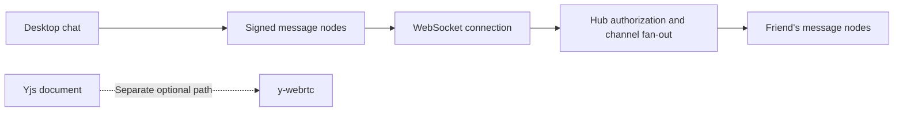
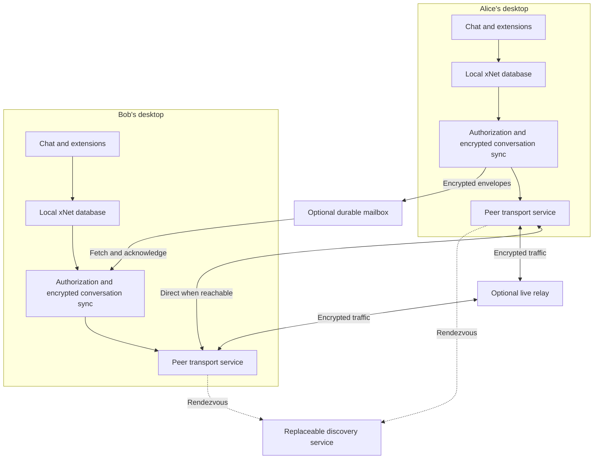

# Desktop first, peer-to-peer chat

> [!TIP]
> Make the desktop app the main xNet product for now. Build chat around locally owned history, direct connections where possible, and replaceable encrypted relay and mailbox services where necessary. Users should be able to invite a friend without becoming server administrators.

This is a proposal grounded in the local `codex/chat-first-redesign` prototype at `9e84e735a`, plus upstream documentation reviewed on October 22, 2026. It does not change the website or implement a new transport. Revisit the decision on November 19 after a two-computer connectivity experiment: desktop focus is reversible; publishing a new security or wire contract requires a separate ADR and tripwire.

## The product to focus on

The strongest near-term experience is: **a place on your computer to talk with people and agents, and build things together.**

Desktop gives us a coherent environment for the local database, files, installed Claude Code and Codex integrations, notifications, and extension execution. Concentrating on one client also reduces the number of authentication, storage, packaging, and lifecycle paths that need to work before a friend can use the product.

There are two qualifications:

- Electron is a runtime; the product should be described as **xNet for desktop**. Keeping shared TypeScript data and protocol packages independent of Electron preserves future clients.
- A local database gives us more control over durability, indexing, backup, and permissions. It does not automatically provide encryption at rest or make native code safer. A local agent CLI can also send selected context to its model provider; “runs from your computer” does not mean all inference stays there.

The cost of desktop focus is real: friends must install an app, and many conversations start on phones. Optimize for a small group collaborating on computers first. Reopen mobile priority when an otherwise successful group cannot participate because members primarily use phones.

### What to change on the website

Make **Download xNet** the primary action. Describe the current desktop preview accurately, including local agent integration once it is present in the downloadable build. Move browser and mobile experiments out of the primary product navigation and acquisition flow. Preserve their URLs with explicit experimental status and preserve the source packages.

The inspected site currently advertises both desktop and browser in `site/src/components/sections/Hero.astro`; it links browser and mobile demos from `site/src/components/sections/Footer.astro`, `site/src/pages/download.astro`, and `site/src/pages/workspace.astro`. Those are the first places to edit. Historical blog posts and SDK documentation need no blanket removal.

This is a smaller and more reversible decision than deleting `apps/web` and `apps/expo`, breaking existing links, or promising desktop features that still exist only on this prototype branch.

## Do we need hubs?

**A pair of reachable, online computers can chat directly without a hub. Reliable chat between arbitrary friends needs more help.**

Three separate problems often get called “the server”:

| Function                 | What it does                                                          | Why direct connections alone do not replace it                                       |
| ------------------------ | --------------------------------------------------------------------- | ------------------------------------------------------------------------------------ |
| Discovery and rendezvous | Helps two devices find each other and exchange connection information | An identity or invite does not reveal a device's current reachable address           |
| Relay                    | Forwards traffic when a direct connection cannot be established       | Some NATs, firewalls, VPNs, or network policies prevent direct reachability          |
| Mailbox                  | Stores encrypted messages until a recipient retrieves them            | If sender and recipient are never online together, a third device must retain a copy |

STUN helps discover network mappings; TURN relays traffic. Neither by itself is a durable offline mailbox. WebRTC also needs a way to exchange signaling information. These functions can use small self-hosted services, community infrastructure, or other reachable peers. A distributed network still has infrastructure. [WebRTC signaling](https://webrtc.org/getting-started/peer-connections), [TURN](https://webrtc.org/getting-started/turn-server).

| Situation                                                | Can chat work without an application server? | Remaining requirement                                                       |
| -------------------------------------------------------- | -------------------------------------------- | --------------------------------------------------------------------------- |
| Two computers on a reachable LAN                         | Yes                                          | Local discovery or exchanged addresses, firewall permission, authentication |
| Two reachable Internet endpoints                         | Yes                                          | Known current addresses and authenticated transport                         |
| Two ordinary home networks                               | Sometimes                                    | Rendezvous and NAT traversal; fallback for failed attempts                  |
| Restrictive network blocks direct traffic                | Often needs a permitted relay route          | No stack can promise connectivity through every network policy              |
| Alice sends, then closes her laptop before Bob opens his | Only if another peer kept the message        | A mailbox can be a friend's device, home server, or hosted service          |
| Every copy is offline or lost                            | No                                           | Software cannot deliver unavailable bytes                                   |

Manual exchange of connection offers can avoid a dedicated signaling service for an experiment. It is cumbersome, becomes stale as networks change, and does not solve offline delivery. LAN discovery also fails across guest-network isolation and many VPNs; treat it as one path, not a guarantee.

The right target is **no mandatory xNet-operated server**, with a useful direct-only mode. Requiring zero infrastructure for every scenario would make the first chat less reliable.

## What is actually wired today

The following is a code-path review, not a new Internet connectivity test.

| Area                        | State                              | Evidence and implication                                                                                                                                                          |
| --------------------------- | ---------------------------------- | --------------------------------------------------------------------------------------------------------------------------------------------------------------------------------- |
| Local chat data             | ✅ Present                         | `packages/data/src/schema/schemas/chat-message.ts`: individual signed message nodes, channel relation, attachments, edits, development records, and inherited authorization       |
| Desktop storage             | ✅ Present                         | `apps/electron/src/data-process/data-service.ts` uses the Electron SQLite adapter; key storage is separate in `apps/electron/src/main/identity-seed.ts`                           |
| Structured chat replication | ✅ Hub path present                | `apps/electron/src/renderer/lib/ipc-sync-manager.ts:connectNodes` attaches `NodeStoreSyncProvider` to a WebSocket `ConnectionManager`                                             |
| Channel delivery            | ✅ Hub fan-out present             | `packages/hub/src/services/node-relay.ts:fanOutToShareRoom` inspects message/channel properties and places authorized changes into share rooms                                    |
| Direct document transport   | 🚧 Separate, gated path            | Renderer `setupWebRTCProvider` creates a y-webrtc provider for acquired Yjs documents when enabled; this does not transport the structured chat nodes                             |
| Utility-process transport   | 🚧 WebSocket only                  | `data-service.ts:startSync` explicitly falls back from other requested strategies with `webrtc_unavailable_in_utility_process`                                                    |
| libp2p components           | 🚧 Building blocks                 | `packages/network/src/node.ts` configures WebSocket, circuit relay, optional WebRTC, Noise, and optional DHT; the default bootstrap list in `types.ts` contains no active entries |
| End-to-end private chat     | 🚧 Not established by this path    | `node-store-sync-provider.ts:serializeChange` includes `payload`; the hub reads those properties. This path is signed and authorized, but content is readable by the hub          |
| Crypto primitives           | ✅ Present, integration incomplete | `packages/crypto/src/envelope.ts` implements recipient-wrapped content keys and encrypted envelopes. Its existence does not make every sync path encrypted                        |
| Calls                       | 🚧 Distinct path                   | `packages/workbench/src/communities/call-transport.ts` sends call signaling through channel awareness; media connectivity and offline chat delivery remain different problems     |



> [!IMPORTANT]
> Switching a transport setting to WebRTC will not make this chat hub-independent. The hub currently performs meaningful routing and access work, and the existing document peer path is not the chat protocol.

A direct implementation must move the necessary authorization, scoped synchronization, and recipient selection into the endpoints. It must also avoid leaking private content through the existing author-room publish path while adding an encrypted channel path.

## Relevant prior art

| Option                                | What it offers                                                       | Cost or limitation for xNet                                                                                 | Recommendation                                                      |
| ------------------------------------- | -------------------------------------------------------------------- | ----------------------------------------------------------------------------------------------------------- | ------------------------------------------------------------------- |
| Existing hub plus new opaque delivery | Closest to current runtime; a predictable route for offline delivery | Existing semantic fan-out cannot simply inspect encrypted properties; needs a separate ciphertext contract  | Keep as the reliability path while introducing encryption           |
| WebRTC data channels                  | Chromium support, direct data, a future browser path                 | Signaling and TURN still needed; native background lifecycle and structured chat integration require work   | Best fallback candidate if native transport packaging fails         |
| libp2p                                | Modular discovery, relays, identity and hole-punching protocols      | Existing imports do not prove a configured, deployed network; more components to operate and tune           | Reuse if a spike demonstrates lower total complexity                |
| Iroh                                  | Key-addressed QUIC connections, NAT traversal and relay fallback     | Native dependency, distribution and binding validation; no application mailbox or chat permissions supplied | First desktop transport experiment                                  |
| Hyperswarm / HyperDHT                 | JavaScript-oriented discovery and encrypted peer streams             | Bootstrap infrastructure, privacy choices, native dependencies and separate future-client assessment        | Credible alternative; do not add it alongside another new stack now |
| Briar and SimpleX                     | Different examples of infrastructure choices for private messaging   | Neither is a drop-in xNet data transport                                                                    | Borrow product lessons rather than importing their entire protocols |

Iroh documents direct connection attempts with relay fallback. Its FFI repository currently documents Node.js, Swift, Kotlin, and Python bindings; higher-level blob/document/gossip protocols are outside that binding surface. Treat this as a reason to try a narrow transport adapter, not proof that Electron packaging or every future client will work. Retain xNet's data model. [Iroh](https://github.com/n0-computer/iroh), [bindings](https://github.com/n0-computer/iroh-ffi).

libp2p's DCUtR coordinates direct connection attempts through a relay; decentralizing that role does not eliminate it. The inspected xNet node setup is not evidence that this full procedure is active in desktop chat. [libp2p hole punching](https://docs.libp2p.io/concepts/hole-punching).

Hyperswarm exposes Noise-encrypted streams and a peer firewall callback. HyperDHT documents configurable bootstrap nodes and at least one persistent node for a fully operational isolated network. A public DHT is not required for private friend discovery if we choose another approach. [Hyperswarm](https://github.com/holepunchto/hyperswarm), [HyperDHT](https://github.com/holepunchto/hyperdht).

Briar demonstrates contact-link exchange and device synchronization over Wi-Fi, Bluetooth, or Tor; its manual explicitly describes waiting for both contacts to be online. Its Mailbox helper addresses the offline case. SimpleX demonstrates a different useful separation: private client history and limited relay responsibilities. These are distinct privacy designs, not equivalent claims about anonymity. [Briar manual](https://briarproject.org/manual/), [Briar Mailbox](https://www.briarproject.org/mailbox/), [SimpleX design](https://simplex.chat/docs/simplex.html).

## Proposed architecture



The live relay and durable mailbox have different contracts even if one operator hosts both. An Iroh relay is not automatically an xNet hub or mailbox. The existing WebSocket hub is not automatically an Iroh relay either. Keep these roles explicit; avoid disguising a second infrastructure stack behind the word “hub.”

### First contact

1. Alice chooses **Invite a friend**. The app produces a short-lived link or QR carrying a signed invitation, inviter identity binding, narrowly scoped invitation capability, and usable rendezvous information.
2. Bob opens it in xNet and sees who invited him and what accepting shares. Installation can precede redemption; do not consume a capability through a web link preview.
3. The devices prove possession of their device keys and verify the binding to the expected identity. A transport public key, DID, or OAuth handle on its own is not evidence that these are the same person.
4. Alice approves Bob, or the invitation's explicit recipient policy authorizes him. Anonymous possession of a forwarded link must not silently grant group history.
5. The clients establish conversation membership and keys, synchronize the agreed history, and show the connection state.

Use unguessable rendezvous tokens, expiry, replay protection, and rate limits. Avoid putting bearer secrets in request paths, analytics, or logs; parsing a link must not execute shell commands or fetch arbitrary local-network URLs. A fragment can reduce ordinary HTTP leakage, but does not make a shared link non-secret. Offline redemption requires an available mailbox/service and a designed invitation protocol; otherwise explain that the inviter must return online.

### Transport and synchronization

Run networking outside the React component lifecycle, with a narrow IPC boundary. A native transport belongs in a supervised process or utility service; process separation alone is not an OS sandbox. Closing a conversation or reloading its renderer should not stop delivery. Quitting the app or sleeping the computer still stops local service unless another device takes over.

Store messages locally before attempting delivery. Prefer direct routes, but allow a relay promptly while direct negotiation proceeds. Do not make the user wait through a long direct-only timeout before discovering that fallback is needed. Track which path actually carries data.

Scope replication to authorized conversations and their dependency closure: required membership records, message history, approved extension versions, documents, and attachment manifests. Never exchange an entire personal NodeStore merely because two people share one chat. Membership does not authorize arbitrary linked private documents.

Direct and mailbox delivery may race. Deduplicate by authenticated change/envelope identity and acknowledge only after durable commit. Recover after reconnect with bounded missing-change reconciliation. Do not assume that one maximum Lamport timestamp proves all authors' changes have arrived; partitions and out-of-order delivery require detecting holes. Reuse validated xNet change semantics while designing peer-specific cursors and reconciliation separately from the current hub watermark.

For the first experiment, use a small group, such as eight active participants. A full mesh has $n(n-1)/2$ connections: 28 at eight, 4,950 at one hundred. Larger communities need bounded fan-out, selective replication, or designated available peers. Signed authorship must survive forwarding. Peer retransmission rights must be explicit, especially for history and attachments.

### Offline delivery and retention

```mermaid
sequenceDiagram
  participant A as Alice
  participant DB as Alice's local database
  participant M as Chosen mailbox
  participant B as Bob
  A->>DB: Commit message and pending delivery
  A->>M: Store opaque recipient envelope
  M-->>A: Durable storage acknowledgement
  Note over A,B: Alice goes offline; Bob later returns
  B->>M: Fetch pending envelopes
  M-->>B: Ciphertext
  B->>B: Authenticate, decrypt, authorize, commit
  B->>M: Recipient acknowledgement
  M-->>A: Deliver acknowledgement when Alice returns
```

The mailbox needs byte quotas, expiry, idempotent writes, explicit retention acknowledgements, and per-device retrieval semantics. It must distinguish stored, expired, rejected, and temporarily unavailable. Retrieval by one device must not erase the only pending copy for another intended device. History transfer to a newly added device is a separate authorized operation.

A friend's always-on computer can act as a mailbox, but must opt in to disk, bandwidth, retention, and availability obligations. “Keep a copy” should be a clear product action, not an invisible responsibility assigned to every chat member. Mailbox delivery is also not a backup promise: backup requires its own retention, restore, and key-recovery guarantees.

## The security boundary

> [!WARNING]
> Private membership, signed messages, TLS, and end-to-end encryption are separate properties. We should not market private chat as unreadable by its host until the exact messages, attachments, history catch-up, and backup paths demonstrate that property.

**Content encryption must precede the choice of route.** The same private content should remain unreadable to a hub, live relay, or mailbox. A hub serving this role accepts opaque envelopes and bounded routing capabilities, not decrypted chat content. Clients perform semantic authorization after decryption. This changes how existing hub indexing, search, mention fan-out, and validation work; local search remains available.

**Membership must control keys as well as UI visibility.** Define device additions, revocation, history sharing, and removal during partitions. Rotating future keys cannot retract plaintext already received. Updates authored under an obsolete membership epoch need an explicit accept/quarantine policy; wall-clock time or ordinary field-level LWW cannot establish security order. Concurrent membership changes need a protocol that converges safely, potentially with an explicitly designated coordinator for the prototype.

**Evaluate a maintained messaging protocol before inventing a group ratchet.** MLS specifies asynchronous group key establishment with forward secrecy and post-compromise security, but still needs application identity, delivery, commit ordering, and history policies. Existing xNet envelopes are useful primitives; they do not by themselves establish those messaging guarantees. Choose and review the protocol before making such claims. [MLS, RFC 9420](https://www.rfc-editor.org/rfc/rfc9420.html).

**Durable history changes the threat model.** A local searchable archive intentionally retains messages. Transport forward secrecy does not protect a compromised plaintext archive or a backup containing its decryption keys. Decide separately how to protect the local database, attachment files, WAL, temporary files, exports, and backups. The current identity seed's use of Electron `safeStorage` is not database encryption.

**Direct peers learn network addresses.** Offer a relay-only privacy setting that suppresses direct candidates and direct probing, rather than merely preferring a relay after disclosing addresses. Verify each chosen transport can enforce that policy. Relays still observe connection metadata; ciphertext does not imply anonymity. Do not publish a public contact graph or predictable conversation topics for private groups.

**Receiving content must not execute it.** Bound frames, decompression, attachments, concurrent requests, and disk use. Validate signatures and schema before applying changes. Keep remote HTML, extension code, and native capabilities separated; use a narrow allowlisted IPC interface. Follow Electron's sandbox, isolation, navigation, and update guidance. [Electron security](https://www.electronjs.org/docs/latest/tutorial/security).

**Chat access is not agent-host access.** Keep 0481's scoped extension permissions and 0482's explicit agent delegation. A friend's message cannot become an unrestricted command for local Codex or Claude Code. Requests should identify the host, allowed context, selected project, and external model provider. An incoming extension version remains a proposal until the local user accepts it and its data permissions.

## What the user should see

The main chat should stay quiet. A compact connection label can read **Direct**, **Via relay**, or **Waiting for Alex**. Expand it for peer identity, selected services, and diagnostic details. Avoid a permanent stack of protocol alerts.

Message state should distinguish:

| Label                      | Meaning                                                                 |
| -------------------------- | ----------------------------------------------------------------------- |
| Saved on this device       | The local transaction committed                                         |
| Waiting for Alex           | No recipient acknowledgement or durable mailbox copy yet                |
| Stored for delivery        | A mailbox confirmed retention under its stated policy                   |
| Delivered to Alex's device | An authenticated recipient device confirmed durable storage             |
| Read                       | An optional explicit reading receipt, not inferred from synchronization |

Connection state and delivery state are independent: a message may be safely stored while its recipient is offline. A failed relay upload must not make a locally saved message disappear or show a successful delivery checkmark.

Default to automatic connection assistance. Advanced choices can separately control discovery, live relays, and offline storage. Direct-only mode should plainly say: “Delivery waits until a reachable recipient is online.” The user can change services without replacing their identity or losing local history.

## Cost and future clients

Text chat is unlikely to be the dominant bandwidth cost compared with attachments and calls. Measure it rather than promise a server price now. A useful capacity model is:

$$
\text{relayed bytes} \approx \text{relay fraction} \times \text{transferred bytes}
$$

$$
\text{mailbox storage} \approx \text{daily encrypted bytes} \times \text{retention days} \times \text{stored copies}
$$

Account separately for group fan-out, retries, framing, replication, monitoring, and provider billing. A small rendezvous service can be cheap while a heavily used media relay is expensive. Keep message envelopes and large encrypted blob transfers separate so text is never blocked behind a video upload. Availability of the text does not imply the attachment is cached.

For future mobile clients, design optional opaque wake-up notifications and mailbox retrieval. Apple explicitly says background notifications are low priority and delivery is not guaranteed. A phone cannot be assumed to remain a continuously reachable peer. Push is a hint to synchronize, not the source of message truth. [Apple background updates](https://developer.apple.com/documentation/usernotifications/pushing-background-updates-to-your-app).

Browser and mobile clients should speak the same authorized data protocol even if their transports differ. A future browser can use an encrypted relay path without requiring us to solve its direct networking today. Calls remain a separate WebRTC/TURN concern unless a later experiment justifies a change; adopting a native data transport is not a video-call implementation.

## Recommended next work

Keep the working hub path as a baseline. Build one bounded two-computer experiment that proves authenticated, conversation-scoped direct delivery and shows where fallback occurs. Iroh is the first candidate because desktop is now the focus; packaging, lifecycle, and connectivity evidence decide whether it stays. Do not adopt several competing stacks in production.

Then establish the encrypted delivery contract and a minimal mailbox role. Route private content exclusively through that contract before testing it with sensitive conversations. Existing trusted-hub sync may remain available for other workloads, but its trust model must remain visible.

The acceptance demo should be concrete: **I send you an invite; we chat and build an extension; we unplug the hub and keep chatting directly; I then send a message while you are away and it reaches you through our chosen mailbox when you return.** Each sentence needs independent evidence.

### Implementation checklist

- [ ] Make desktop the website's primary product path, matching the actual downloadable release; mark retained web/mobile pages experimental.
- [ ] Define recipient/device identity binding, invitation redemption, and conversation history policy before publishing an invite format.
- [ ] Extract a conversation-scoped sync boundary without changing the existing public wire format implicitly.
- [ ] Prototype Iroh in two real Electron installations: authenticated device binding, direct path, self-hosted relay path, native packaging, process restart, and sleep/wake.
- [ ] Compare the spike with the existing WebRTC/libp2p components; select one production direction and document the result.
- [ ] Select and review the content-encryption and group-membership protocol, including partitioned membership changes, history retention, and device recovery.
- [ ] Add opaque live delivery and mailbox storage, with quotas, retention, per-device acknowledgements, and no parallel plaintext publish path.
- [ ] Add scoped encrypted attachment delivery, resume, integrity checking, and independent availability status.
- [ ] Expose compact route and delivery states plus optional direct-only and relay-only settings.
- [ ] Verify agent-host delegation and extension permissions on every receiving device.
- [ ] Record accepted identity/wire/security decisions in the architecture ADR file with tripwires before stabilizing them.

### Validation checklist

The next implementation pass owns this matrix. These are proposed pass conditions, not test results from this exploration.

- [ ] Two distinct physical machines and identities exchange chat on a reachable LAN with hub and Internet access disabled; no hidden same-machine broadcast path counts.
- [ ] Test separate home networks, a mobile hotspot, UDP-blocked networking, and an available relay. Report direct, relayed, and failed attempts separately with attempt counts and latency; do not infer a universal success rate.
- [ ] Drop the rendezvous/hub after establishing a direct path: existing chat continues, and failure to establish a fresh path is reported honestly.
- [ ] Verify relay-only mode emits no direct probes or address candidates to peers; an unavailable relay produces a clear failure rather than a privacy downgrade.
- [ ] Send while Bob is offline, stop Alice, then start Bob: retrieval succeeds from the mailbox alone. Repeat without a mailbox and verify the UI does not claim delivery.
- [ ] Deliver duplicates and out-of-order changes through direct and mailbox routes; all authorized messages converge exactly once, including same-Lamport and missing-range cases.
- [ ] Restart during send and during acknowledgement; no acknowledged durable write is lost and no undelivered write gains a delivery badge.
- [ ] Remove a member while devices are partitioned; new keys, old-epoch edits, rejoining, and history access follow the documented policy.
- [ ] Use an unauthorized peer, a forwarded invite, forged author binding, replayed invitation, and altered ciphertext as negative controls; each is rejected without broad data disclosure.
- [ ] Inspect relay/mailbox traffic, storage, logs, attachment manifests, and error telemetry for known private canary content. Confirm no legacy plaintext sync route carries it; this is a leak check, not a substitute for cryptographic review.
- [ ] Exercise eight participants, bounded history catch-up, a large attachment, network switching, and laptop sleep/wake; record memory, queued bytes, and recovery time.
- [ ] A remote collaborator can propose an extension and an agent request but cannot execute local code, widen data permissions, or spend the host's agent credentials without the applicable authorization.

<details>
<summary>Questions to decide from the experiment</summary>

- Which device-to-account binding survives transport key rotation and account recovery?
- Does the chosen native binding package cleanly for the desktop platforms we actually support?
- Can we self-host every connectivity role without a vendor account or proprietary control plane?
- How do clients resolve concurrent membership commits and authenticate state received after a long absence?
- How much metadata must a mailbox retain, and what is its deletion/expiry policy?
- Is keeping a background desktop service desirable enough to justify its CPU, memory, battery, and update lifecycle?
- When does the lack of a mobile companion become the largest obstacle to inviting friends?

</details>

## References

Repository paths in this document refer to the inspected prototype checkout. Related local designs are [scoped extension APIs](0481_[-]_THE_FULL_XNET_API_INSIDE_SCOPED_EXTENSIONS.md) and [collaborative extensions](0482_[-]_COLLABORATIVE_EXTENSIONS_IN_CHAT.md).

External sources are linked beside the claims they support. No transport library was installed, no network success benchmark was run, and no website or application code was changed for this exploration.
