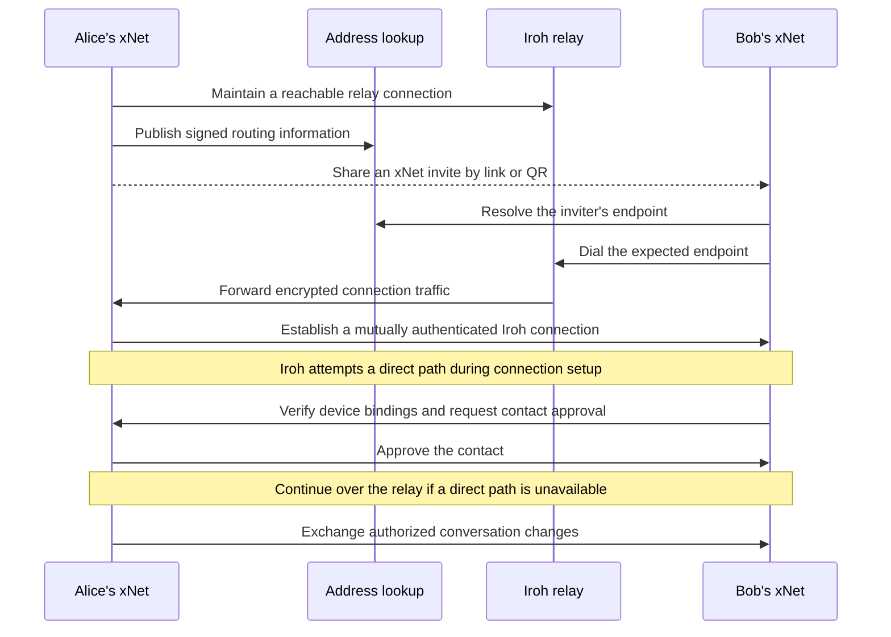
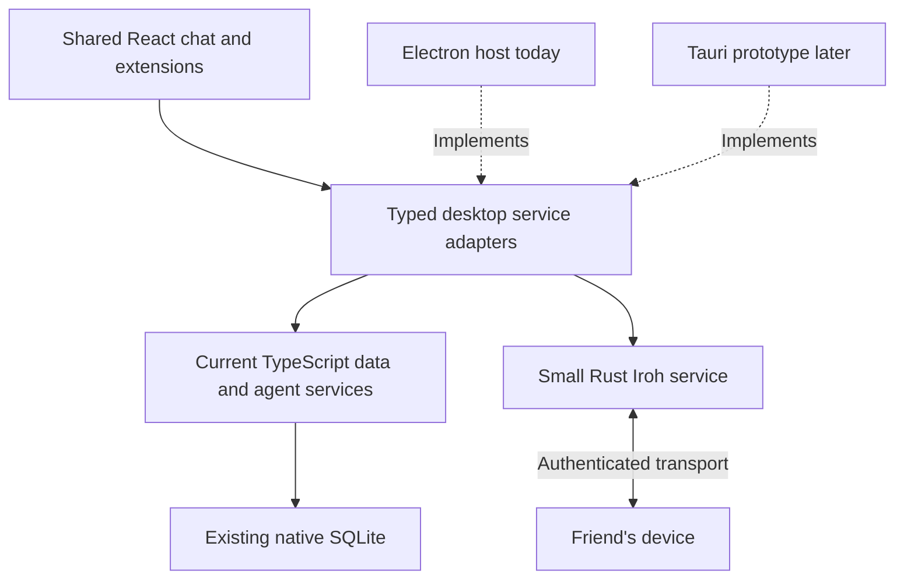

# Iroh invites and the Tauri decision

> [!TIP]
> Build the friend-invite experience around Iroh endpoint discovery, authenticated contact approval, and optional encrypted offline delivery. Keep Electron working while testing a small Rust transport service. Evaluate Tauri with one representative slice of the real application before committing to a shell migration.

This follows [0485: Desktop first, peer-to-peer chat](./0485_%5B_%5D_DESKTOP_FIRST_PEER_TO_PEER_CHAT.md). Repository observations refer to the local `codex/chat-first-redesign` branch at `8fd5e9eb6`; external documentation was checked on October 22, 2026. This is a proposal, not an implemented transport or a measured Electron/Tauri comparison. Review on November 5 to choose the next experiment, with connectivity and application compatibility evidence if available. Any accepted public identity or wire contract needs its own ADR and tripwire.

## The experience to build

**Yes: a friend should be able to connect by opening a link.** No IP addresses, port forwarding, relay selection, or cryptographic keys should appear in the ordinary flow.

1. Alice chooses **Invite a friend**. xNet offers **Copy link**, **Show QR code**, and **Copy invite code**.
2. Bob opens the link. If xNet is installed, he chooses **Open in xNet**; otherwise the page explains installation and preserves a way to copy the invite afterward.
3. The app previews the invitation: who created it, whether it is a contact request or a particular community invitation, and what accepting will share.
4. Bob accepts. Alice approves the new contact unless the invitation was explicitly restricted to Bob's already-known identity.
5. The conversation opens. Connecting and pending approval have distinct states. Once contact establishment succeeds, subsequent connections use saved identities and refreshed addresses, without another invite.

Illustrative routes, **not existing handlers**:

```text
https://xnet.fyi/invite#<encoded-invitation>
xnet://invite/<encoded-invitation>
```

The HTTPS route is a helpful installation and handoff page; the custom scheme and pasted code give an installed client another entry point. Putting a capability in the fragment keeps it out of the initial HTTP request, but page JavaScript and the service used to send the link may still see it. The handoff page should have no third-party scripts or analytics, no automatic redemption, and no secret-bearing logs. An unfurler opening the page must never consume an invitation. A human-readable short code would need a lookup service or an interactive pairing protocol; it is a separate convenience, not a free property of Iroh.

## How the devices find each other

Iroh supplies a stable, key-based endpoint identifier and ways to resolve it to current connection information. Its documented default address lookup publishes signed Pkarr records and resolves them over DNS or HTTPS. Additional options include LAN mDNS and opt-in DHT lookup. We can select the deployment and disclosure policy instead of treating a public DHT as mandatory. [Iroh address lookup](https://docs.iroh.computer/concepts/address-lookup).

For the first contact, the invitation carries endpoint IDs and initial relay hints alongside xNet's own invitation fields. Iroh tickets are a convenient encoding of connection information; they can become stale and are reusable. They do **not** supply single-use contact authorization. xNet must implement expiration, approval, recipient binding, and redemption state. Avoid including direct IP addresses in shareable invitations by default. [Iroh tickets](https://docs.iroh.computer/concepts/tickets).



The diagram is a common Internet path, not a promise that discovery or relay access is required for every connection. Known reachable addresses can permit direct dialing. Iroh handles NAT traversal and live relay fallback; the relay does not store application history. Its public relays are documented for development/testing, with rate limits and no uptime guarantees. A production deployment needs an explicit self-hosted or managed capacity plan. [Iroh relays](https://docs.iroh.computer/concepts/relays).

The standard flow can use a replaceable DNS/Pkarr service and community-operated relays. There is no need for a global searchable directory of people. Publishing endpoint routing information should not publish a person's name, contacts, group memberships, or activity status. Endpoint identifiers and routing metadata still permit correlation; encrypted content is not anonymity. Direct peers learn network addresses when communicating directly.

### Availability, presence, and offline delivery

These need different meanings in the UI:

| Signal                                 | What it actually establishes                      | Proposed presentation                |
| -------------------------------------- | ------------------------------------------------- | ------------------------------------ |
| Address record found                   | There is a possibly stale route to try            | Internal connection detail           |
| Authenticated connection established   | A particular device is reachable now              | Connected; direct/relayed in details |
| Recent friend-only presence lease      | A contact has opted to report availability        | Available, away, or unknown          |
| Message stored locally                 | The sender has a durable copy                     | Queued                               |
| Optional mailbox acknowledged custody  | A service accepted ciphertext for later retrieval | Waiting for recipient                |
| Recipient acknowledged durable storage | A recipient device saved the message              | Delivered                            |

Presence should be an authenticated, expiring application message sent only to authorized contacts. A missed lease means **unknown/unreachable**, not proof that someone is deliberately offline. Suspend background activity when appropriate; do not expose a public heartbeat feed or wake a laptop continually to preserve a green dot.

If Alice sends and closes her laptop before Bob opens his, delivery requires another online holder of the encrypted message. That can be an authorized home device, community mailbox, or hosted mailbox. Without one, the message stays queued until an eligible copy and Bob overlap online. No presence service or transport protocol can deliver bytes from a sleeping device.

For private chat, use an application encryption envelope for offline/group delivery and authenticate membership at the receiving endpoint. Iroh's encrypted connection does not automatically encrypt data sent through the existing WebSocket hub, define group-key rotation, or implement history access after membership changes. Those remain the unfinished security work identified in 0485.

### Contact identity and account devices

Keep three objects separate: a person's xNet identity, their authorized devices, and each device's transport endpoint key. Bind endpoint keys to device authorization with signed, versioned records. Authenticate the current endpoint against that binding before sharing data. Cache previously accepted bindings and treat unexpected replacement as a verification event.

**Invite a friend** grants a relationship or named conversation membership. **Add my device** grants access to the same account and may unlock existing private history. The latter should require approval from an existing device or an explicit recovery procedure, and can use an interactive QR challenge. Never implement both as an indistinguishable bearer link.

An invite received through an ordinary messaging service inherits the trust in that channel. A self-signed display name does not prove who a stranger is. Offer a short verification fingerprint for sensitive pairing. Acceptance must not grant arbitrary database access, execute extensions, start an agent, or change the user's configured infrastructure silently. For an initial single-use implementation, make one inviter device authoritative for redemption; multi-device offline redemption needs a deliberate consistency policy.

## What a Tauri migration actually touches

Tauri hosts the frontend in an OS WebView and uses a Rust core. The web engine is WebKit on macOS/Linux and WebView2 on Windows; this is not the user's chosen default browser. WebView versions and update mechanisms vary by platform. [Tauri process model](https://v2.tauri.app/concept/process-model/), [WebView versions](https://v2.tauri.app/reference/webview-versions/).

The React/TypeScript UI can stay. The cost is replacing native boundaries and verifying browser behavior, not rewriting every component in Rust.

| Area in this prototype            | Repository evidence                                                                                    | Migration implication                                                                                                                                          |
| --------------------------------- | ------------------------------------------------------------------------------------------------------ | -------------------------------------------------------------------------------------------------------------------------------------------------------------- |
| Shared UI and navigation          | `packages/workbench/src/platform.ts`                                                                   | Useful existing boundary, but it currently describes navigation and capability flags, not all desktop services                                                 |
| Native bridge                     | `apps/electron/src/preload/index.ts`                                                                   | Storage, local agents, files, recording, imports, and other namespaces need supported replacements                                                             |
| Local database and CRDT execution | `apps/electron/src/data-process/data-service.ts`                                                       | TypeScript NodeStore/Yjs run with native SQLite outside the renderer; Tauri cannot just execute this in its Rust core                                          |
| Efficient binary IPC              | `apps/electron/src/main/data-process-manager.ts`, `apps/electron/src/renderer/lib/ipc-sync-manager.ts` | Electron MessagePorts must become a suitable streaming/batched interface; large JSON commands would be a regression                                            |
| Existing agent integrations       | `apps/electron/src/main/community-agent-runtime.ts`                                                    | Codex stdio and Claude streaming adapters use Node process/filesystem APIs; preserve cancellation, environment filtering, protocol validation, and permissions |
| Identity storage                  | `apps/electron/src/main/identity-seed.ts`                                                              | Electron safeStorage needs an equivalent platform adapter and a verified migration/recovery path                                                               |
| Deep links                        | `apps/electron/src/main/deep-link.ts`, `apps/electron/src/main/index.ts`                               | Existing handlers cover connect/share; friend invites need a new validated handler in either shell                                                             |
| Extension isolation               | `packages/workbench/src/communities/extension-sandbox.ts`                                              | Opaque-origin frame, worker, WASM compilation, MessageChannels, termination, and grant checks must work on each supported WebView                              |
| Rich media                        | `packages/workbench/src/communities/ChatAttachment.tsx`, `apps/electron/src/main/chat-media-fetch.ts`  | Revalidate PDF preview, media codecs, embeds, blob handling, and safe metadata fetching                                                                        |
| Packaging and feedback loop       | `apps/electron/package.json`, `apps/electron/AGENTS.md`                                                | Signed builds, updates, protocol registration, native binaries, logs, and real-app automation need parity                                                      |

SQLite is already native here. Changing the host will not automatically improve query plans, CRDT materialization, a 100,000-item graph, or React rendering. Rust may help measured compute-heavy paths, but the shell swap itself is not that optimization.

The strongest expected Tauri benefit is removing the bundled Chromium runtime from the application package. Startup and memory may improve, but neither is measured for xNet. Include the full process tree, OS WebView dependencies, Node sidecars, native libraries, and optional model files in comparisons. An empty-window binary is not a representative product benchmark. [Tauri app size](https://v2.tauri.app/concept/size/).

### Tooling and permissions deserve their own experiment

Current Tauri documentation supports macOS automation through WebdriverIO's embedded WebDriver service. The standalone `tauri-driver` path remains Windows/Linux-only; alternative routes exist. Our working Electron CDP workflow would need adaptation and a development-only automation boundary. Saying “Tauri cannot be automated on macOS” would now be incorrect. [Tauri WebDriver](https://v2.tauri.app/develop/tests/webdriver/).

Tauri capabilities control native command access by window/WebView. They complement xNet's per-extension grants; they do not replace checks on individual conversation, document, and node operations. Its documentation also notes that registered application commands are broadly callable by default unless configured otherwise. Make the trusted host's command exposure explicit, and keep untrusted extensions away from raw native invocations. [Tauri capabilities](https://v2.tauri.app/security/capabilities/).

## Options

| Path                                      | Benefit                                                                                | Cost                                                                      | Assessment                                                  |
| ----------------------------------------- | -------------------------------------------------------------------------------------- | ------------------------------------------------------------------------- | ----------------------------------------------------------- |
| Electron + Iroh Node bindings             | Smallest host change; retain TypeScript development                                    | Validate native packaging and binding coverage                            | ✅ Credible first connectivity spike                        |
| Electron + narrow Rust networking service | Use native Iroh directly; reusable across future shells; process lifecycle is explicit | Ship and supervise another binary; design bounded IPC                     | ✅ Preferred if building a reusable Rust transport boundary |
| Tauri + Node data/agent sidecar           | Keep much of the current backend while dropping bundled Chromium                       | Two runtimes and rewritten native bridge; Node packaging still counts     | 🚧 Useful migration prototype                               |
| Tauri + Rust backend, TypeScript UI       | Coherent long-term native implementation                                               | Largest port: data semantics, agent adapters, migration, platform testing | 🚧 Consider after evidence, not the next wholesale rewrite  |

The Iroh FFI repository documents Node.js bindings to endpoints, connections, paths, tickets, relays, and services. Higher-level blobs/docs/gossip protocols are outside that documented binding scope. We do not need to adopt a different document model to use its transport. Pin and validate actual library/binding versions in the spike. [Iroh FFI](https://github.com/n0-computer/iroh-ffi).

Tauri explicitly supports bundled external binaries, including a Node runtime, with per-target packaging. Keeping a temporary Node service is a supported architecture, though it reduces some of the simplicity and footprint gains. Replacing the SQLite binding alone would not port the TypeScript CRDT/store behavior. [Tauri sidecars](https://v2.tauri.app/develop/sidecar/).

## Recommended sequence

**Start accepting the Rust boundary now; decide the shell with evidence.** That addresses the concern about accumulating Electron dependence without simultaneously rebuilding networking, persistence, agents, and the UI host.



This is a target boundary, not a claim that the existing `PlatformPort` already implements it. Introduce typed data, identity, agent, and peer-service adapters where new work needs them. Avoid a generic “invoke anything” API. Keep UI-facing xNet hooks and extension authorship in TypeScript. Network transport carries bounded byte streams; receiving application code still verifies signatures, membership, and scope before importing changes.

The Rust service should hold only the keys and capabilities it needs. Prefer inherited pipes or an authenticated local socket over an unauthenticated localhost API. Use bounded frames, streaming/backpressure for attachments, cancellation, protocol version checks, and explicit crash recovery. A separate process provides crash isolation; filesystem privileges and an OS sandbox are additional decisions. Do not give it the user's whole database or agent credentials merely because it is native.

1. **Prove the connection product in Electron.** Two physical computers on different networks: invite, approve, direct message, relay fallback, restart, network change, sleep/wake. Keep the existing hub path as a comparison, with its current privacy limits clearly identified.
2. **Measure the current app.** Record signed artifact size, startup-to-usable-chat, idle memory/CPU across all processes, large-history interaction latency, and attachment throughput. Use a fixed dataset and machine configuration.
3. **Run one Tauri compatibility slice.** Reuse the actual chat UI, existing data-service semantics, one installed agent, one permission-scoped extension, and rich media. No empty-window benchmark and no second product backlog.
4. **Decide from a written comparison.** Migrate when footprint/startup gains matter to installation or everyday use, required capabilities work, and the remaining work is a finite list. Stop or defer if it requires a speculative CRDT rewrite, weakens extension isolation, or breaks the real-app iteration loop.

Pre-agree a meaningful gain before measuring—for example, a 50% smaller complete installer or 25% lower idle process-tree memory, with no material latency regression. Those are proposed decision thresholds, not predicted results. Even a smaller gain can justify migration if measured installation failures make it important; a large empty-shell saving does not suffice.

My pushback is on coupling the entire migration to getting friends connected. If Iroh succeeds and the Tauri slice passes, moving earlier in the prototype's life is reasonable. If either fails, the shared adapters and measured bottlenecks still improve Electron. Do not promise that waiting is free: every new direct `window.xnet*` call adds another host-specific seam to migrate.

## Open decisions and experiments

<details>
<summary>Infrastructure and lifecycle questions to resolve before a broader rollout</summary>

- Which address records are public, and can a contacts-only policy preserve reconnection without publishing direct addresses?
- Who operates the first production relay and encrypted mailbox, with what bandwidth, storage, retention, and abuse limits?
- How are relay clients admitted without embedding an operator-wide secret in a downloadable application? Audit the chosen provider's actual credential model before integrating it.
- Which device approves contact invites and device additions? What happens if it is lost before a pending request completes?
- What are the group membership and history-sharing semantics, and when do removed devices stop receiving new keys?
- Which OS versions must support PDF previews, calls, extension workers, and local agents? Browser-engine differences need a real matrix.
- Does a persistent background helper justify its energy and permission costs, or should closing the app explicitly make this device unavailable?
- Can a packaged Tauri build preserve identity, existing SQLite data, encrypted settings, and recovery without silently forking a user's account?

</details>

## Implementation checklist

- [ ] Define a contact invitation and distinct account-device pairing flow; validate sizes, expiry, signature, audience, and redemption state.
- [ ] Add safe invite handoff/paste support without consuming links in previews or logs.
- [ ] Implement device-to-endpoint bindings, revocation, and contacts-only presence leases.
- [ ] Choose and pin one Iroh integration; expose authenticated transport through a bounded native-service contract.
- [ ] Integrate authorized, encrypted conversation exchange; preserve the current data model and distinguish the existing readable hub path.
- [ ] Make offline custody optional and explicit, with separate queued/mailbox/delivered acknowledgments.
- [ ] Add host adapters for the representative Tauri slice and preserve TypeScript extension hooks.
- [ ] Document the measured shell decision; write an ADR with a tripwire before accepting a public security/wire contract.

## Validation checklist

- [ ] Invite between real computers on different networks; test direct connectivity and forced relay fallback separately.
- [ ] Verify reconnect after network changes and sleep/wake; stale address records must not produce a false online state.
- [ ] Reject expired, replayed, tampered, revoked, and wrong-recipient invitations without leaking history.
- [ ] Prove contact acceptance cannot add an account device, invoke an agent, or install an extension automatically.
- [ ] Demonstrate offline delivery with a mailbox and honest queuing without one; verify ciphertext on the custody path.
- [ ] Compare signed release builds using the same data and workflows; include all auxiliary processes and runtime dependencies.
- [ ] Drive the real Tauri application on macOS and every claimed platform; verify local agents, scoped extensions, large chats, and rich media.
- [ ] Exercise malformed IPC, service crashes, cancellation, update, recovery, and identity/data migration before replacing the working shell.

## References

- [0485: Desktop first, peer-to-peer chat](./0485_%5B_%5D_DESKTOP_FIRST_PEER_TO_PEER_CHAT.md).
- [Iroh tickets](https://docs.iroh.computer/concepts/tickets), [address lookup](https://docs.iroh.computer/concepts/address-lookup), [relays](https://docs.iroh.computer/concepts/relays), and [FFI bindings](https://github.com/n0-computer/iroh-ffi).
- [Tauri process model](https://v2.tauri.app/concept/process-model/), [WebView versions](https://v2.tauri.app/reference/webview-versions/), [app size](https://v2.tauri.app/concept/size/), [sidecars](https://v2.tauri.app/develop/sidecar/), [capabilities](https://v2.tauri.app/security/capabilities/), and [WebDriver](https://v2.tauri.app/develop/tests/webdriver/).
