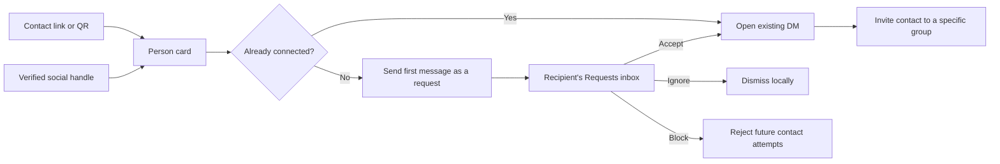

# Contact links, message requests, and group invitations

> [!TIP]
> Give everyone one reusable **contact link**. Opening it shows a person; sending the first message requests a conversation; accepting creates a contact and a DM. Verified social handles resolve to that same person. Group invitations are a separate, explicit grant.

This is a design proposal for the local `codex/chat-first-redesign` prototype, including its uncommitted Iroh integration. It follows [0486: Iroh invites and the Tauri decision](./0486_%5B_%5D_IROH_INVITES_AND_THE_TAURI_DECISION.md). Code and primary-source documentation were inspected on October 22, 2026. Nothing here claims that contact links, discovery, offline requests, or encrypted peer groups have been implemented.

The review date is two weeks away so we can choose the next slice after trying the contact flow. The product proposal is reversible; accepted public link, proof, and membership formats require an ADR with a tripwire before implementation freezes them.

## The experience

The central object should be a **person**, independently of which conversation, device, relay, or social account led us to them.

### Share yourself

Your profile has **Share contact**. It offers **Copy link** and **Show QR code**, with the explanation:

> People with this link can ask to message you.

Copying the link again gives the same link. It survives app restarts and transport address changes. **Reset link**, inside its options, disables the previous address without disconnecting existing contacts. **Turn off new requests** closes this door without closing existing conversations.

An illustrative URL is `https://xnet.fyi/c#<contact-code>`. This is a proposed route, not a working URL or finalized encoding. The user does not need to choose an xNet username, name a conversation, or copy a DID. A QR code carries the same link.

### Open a link and say hello

1. Maya opens Chris's contact link.
2. The landing page offers **Open in xNet** and **Get xNet**. After installation, the page still offers the link/code to copy; deferred app handoff is not assumed to happen automatically.
3. The app shows Chris's contact card: chosen name, optional picture, and any verified social accounts. A signed card proves control of an xNet key; a familiar display name alone does not prove a real-world identity.
4. Maya writes “Hey Chris, it's Maya from the reading group” and presses **Send request**.
5. Chris sees one entry under **Requests**, with **Accept**, **Ignore**, and **Block**.
6. Accepting opens their DM, preserves Maya's opening message, and adds each person to the other's contacts once the acceptance is received. There is no second “add friend” ceremony.

For an existing contact the card offers **Message** and opens the existing DM. Reopening a link, retrying a request, or finding the same person through another social handle must not create another conversation.



### Keep the chat calm

Use one request card and one small status line, not a sequence of system alerts. Technical connection details belong in **Connection details**. Suggested states:

| What happened                                 | Sender sees                        | Recipient sees                         |
| --------------------------------------------- | ---------------------------------- | -------------------------------------- |
| Request saved only on sender's device         | Waiting to send                    | Nothing yet                            |
| Request service durably accepted ciphertext   | Request sent · awaiting acceptance | A request once fetched                 |
| Recipient accepted, response not yet received | Awaiting acceptance                | Conversation ready · acceptance queued |
| Both sides have the accepted relationship     | Normal DM                          | Normal DM                              |
| Ordinary message has no reachable recipient   | Waiting for their device           | Nothing yet                            |
| Recipient saved an ordinary message           | Delivered                          | Message                                |
| Request expired without acceptance            | Request expired                    | Expired request cannot be accepted     |

Ignore and Block do not send a rejection/read signal to a stranger. A request contains a short plain-text introduction, not live Markdown embeds, remote images, files, calls, or executable attachments. Initials are enough for an unknown sender; a later avatar implementation needs a bounded, sanitized image path. No link unfurling, presence, typing indicators, or read receipts before acceptance.

## What exists today

| Area                                    | Status                              | Evidence and implication                                                                                                                                                                          |
| --------------------------------------- | ----------------------------------- | ------------------------------------------------------------------------------------------------------------------------------------------------------------------------------------------------- |
| Peer approval and signed device binding | 🚧 Prototype                        | `apps/electron/src/main/peers/protocol.ts` and `service.ts` implement a signed DID-to-endpoint binding and explicit approval. Reuse these checks.                                                 |
| Shareable peer invitation               | 🚧 Per conversation                 | `createInvite()` creates a new channel, an hour-long invitation, and a single-use relay admission delegation. This cannot become a reusable public contact link merely by removing expiry.        |
| Contact representation                  | 🚧 Coupled to channel               | `packages/workbench/src/communities/peer-contract.ts` gives each `PeerContact` a channel, one endpoint binding, and a status. A person can currently appear as several channel-specific entries.  |
| Connection UI                           | 🚧 Technical                        | `PeerSettings.tsx` asks for a conversation name and exposes invitation text, DIDs, and relay state. Move ordinary connection actions into person cards and Requests.                              |
| Profile                                 | ✅ Schema present                   | `packages/data/src/schema/schemas/profile.ts` stores a subject-authored profile, optional handle, and ATProto binding references. Its handle is workspace-local, not a global name.               |
| Social links in the messaging UI        | 🚧 Self-declared                    | `ProfileDialog` in `dialogs.tsx` writes private `SocialActor` records and explicitly labels links unverified. These must not authorize discovery.                                                 |
| ATProto proof building blocks           | 🚧 Present but not the contact flow | `packages/identity/src/atproto/binding.ts` signs `fyi.xnet.identity.binding`; `packages/hub/src/services/atproto-binding.ts` fetches it from the canonical PDS and checks the xNet signature.     |
| ATProto sign-in ceremony                | 🚧 Injected contract                | `packages/react/src/onboarding/atproto-ceremony.ts` defines a host-provided OAuth ceremony and binding writer. This is not a working social-link flow in the chat profile dialog.                 |
| Community invitations                   | 🚧 Broad grant                      | `InviteDialog` directly creates `SpaceMembershipSchema` and updates channel members. Its copy warns that this grants the whole community, including history. It has no recipient-acceptance step. |
| Join by conversation ID                 | 🚧 Separate hub flow                | `JoinConversation.tsx` asks for a conversation ID and the same configured host. It does not grant permission.                                                                                     |
| Offline requests                        | ❌ Missing in peer flow             | `deploy/iroh-relay/` routes live traffic and controls admission; it does not retain application requests.                                                                                         |
| Encrypted peer groups                   | ❌ Missing                          | The peer protocol admits one remote identity per conversation and validates text-message changes only. Existing community UI is not proof of peer group security.                                 |

The ATProto verifier also needs work before handle discovery: it reads a handle from the DID document but does not perform the reverse handle-to-DID check in that service. Its network fetches need bounded responses, timeouts, redirect validation, and private-address/SSRF protection before accepting arbitrary discovery input. It trusts the canonical PDS over HTTPS plus the xNet signature; it is not an independent verifier of repository commit/inclusion proofs. Preserve that distinction in the trust model.

`SocialIdentityClaimSchema` in `packages/social/src/schemas/actor.ts` records observations and confidence for imported data. It is useful context, not an authority for connecting accounts or granting access.

## Prior art worth adopting

Signal demonstrates a close fit: a shared URL or exact username starts a message request, and changing a contact link need not disrupt established chats. This supports separating the address used to find someone from the relationship established afterward. Adopt that interaction pattern without claiming that xNet already has Signal's protocol or privacy properties. [Signal usernames](https://support.signal.org/hc/en-us/articles/6712070553754-Phone-Number-Privacy-and-Usernames), [link changes and existing chats](https://support.signal.org/hc/en-us/articles/6829998083994-Phone-Number-Privacy-and-Usernames-Deeper-Dive).

Signal also keeps group links separate, with reset/disable controls and optional administrator approval. A personal contact link and a group invitation should therefore have different previews and permissions even if their UI shares components. [Signal group links](https://support.signal.org/hc/en-us/articles/360051086971-Group-Link-or-QR-code).

ATProto distinguishes mutable handles from persistent DIDs and requires bidirectional resolution. Its OAuth profile returns the account DID and requires checking its relationship to the authorization server; a string in an OAuth response is insufficient on its own. [ATProto handles](https://atproto.com/specs/handle), [ATProto OAuth](https://atproto.com/specs/oauth).

Iroh's relay provides NAT traversal and encrypted live forwarding. It does not store application data. Reliable asynchronous requests need another storage function even if it runs on the same machine. [Iroh relays](https://docs.iroh.computer/concepts/relays).

## Three separate permissions

| Action                            | What it permits                                                 | What it does not permit                                                                  |
| --------------------------------- | --------------------------------------------------------------- | ---------------------------------------------------------------------------------------- |
| Share a contact link              | Submit a bounded message request                                | Read messages, view presence, use the person's device, join groups                       |
| Accept a message request          | Establish a contact relationship and a DM                       | Add account devices, invoke local agents, install extensions, access other conversations |
| Accept a group/channel invitation | Join the named scope with the displayed role and history policy | Join sibling channels, the entire organization, or access unrelated documents            |

Do not combine these with account recovery. Linking a social account makes someone easier to recognize and find; it does not automatically make the provider an xNet recovery authority. Losing a social account must not silently transfer an existing xNet identity or its conversations.

## Reusable links need a new contact layer

### Address, identity, and route

A contact link locates a **signed contact descriptor**. It should bind the recipient's xNet identity to a versioned request address, a request-encryption public key, selected profile fields, and the contact policy. Short-lived device routes are obtained separately after acceptance. A public card does not need to include a direct IP address or a transport ticket.

The link/code must pin the intended xNet public identity, or a cryptographic commitment to it, as well as the lookup location. Otherwise a compromised lookup service can substitute its own signed card. A signature without a trusted expected signer does not solve that problem. Exact encoding and length are implementation decisions; readable vanity URLs are optional aliases with an additional resolver trust boundary.

Keep descriptor versions monotonic, expire routing data, and remember the highest accepted version. Reject identity changes rather than silently switching the contact. A first-time client cannot independently detect every replay of an older, still-valid descriptor; short validity windows and live revocation checks bound that exposure. Existing contacts retain their pinned identity and authenticated routes when a public link resets.

**The current relay admission token is not part of this reusable link.** It is single-use, expires, and grants use of a resource-limited relay. Publishing an unlimited delegation would undermine the deployed relay's capacity controls.

The first scalable contact flow should send requests over HTTPS without requiring a fresh stranger to have Iroh relay admission. Acceptance can then issue a short-lived, recipient-endpoint-bound admission grant subject to capacity limits. Failure to obtain admission is a connection/capacity error, not a falsely delivered message. Supporting another relay later needs authenticated route negotiation; never silently replace the user's configured trusted relay because a link asks for it.

### A small request service, not an entire new chat backend

Recommend a replaceable service for signed descriptor lookup and encrypted request/acceptance envelopes. This is new work; do not add it to the live relay implicitly.

```mermaid
sequenceDiagram
  participant M as Maya's desktop
  participant S as Contact service
  participant C as Chris's desktop
  participant R as Iroh relay
  M->>S: Fetch descriptor named by contact link
  M->>M: Verify pinned identity, signature and policy
  M->>S: Store encrypted request and restricted reply address
  S-->>M: Durable custody receipt
  Note over C: Chris may open xNet later
  C->>S: Authenticated inbox retrieval
  C->>C: Decrypt, verify sender and choose Accept
  C->>S: Store encrypted acceptance and route information
  M->>S: Retrieve and verify acceptance
  M->>R: Obtain bounded admission, if needed
  M->>C: Authenticate peer and synchronize authorized DM
  Note over M,C: Direct path when available; encrypted relay otherwise
```

The request and acceptance must both survive restarts; a sender can also be offline when the recipient accepts. Use a request-bound reply inbox, not a service that forwards to arbitrary callback URLs. Sender signatures, recipient identity, request ID, link generation, expiry, and reply address must be authenticated by the envelope. Acceptance binds both identities and the agreed DM identifier.

This requires an explicit asynchronous encryption design using reviewed primitives/protocols and separate encryption keys. Iroh transport encryption does not protect bytes after they are deposited at an HTTPS service. Existing primitives in `packages/crypto/src/envelope.ts` and `asymmetric.ts` are candidates for review, not evidence of a complete asynchronous messaging protocol. Long-lived inbox keys alone do not provide forward secrecy for old stored requests. Key rotation, deletion, replay defense, and the limits of a first version must be specified before calling this private offline delivery.

Proposed initial limits: a 500-character introduction, 8 KiB encrypted envelope, 64 pending requests per inbox, seven-day expiry, one outstanding request per sender/recipient pair, and explicit service-wide storage/traffic ceilings. These are proposed limits to test, not measured capacity. Enforce global, destination, and source budgets; arbitrary users can create new keys, so per-DID limits alone cannot stop spam. Capacity exhaustion should return an explicit retryable error without evicting accepted envelopes silently.

The service can see request timing, network addresses, and routing identifiers. It must not see introduction text, contacts, chat history, or signing keys. This is content privacy, not anonymity. Do not advertise exact-match lookup as private against its operator either. Reads/deletes require recipient authentication; transport metadata and diagnostics need short, explicit retention.

An ordinary user gets the default provider when they enable sharing, with a short explanation that it holds encrypted requests for seven days. A self-hosted provider or live-only exchange remains possible in advanced settings. No provider means requests stay queued on the sender until both devices can communicate. Contact acceptance does not magically make subsequent messages deliver while either desktop is offline; a full ciphertext mailbox is a later, separate feature.

Before acceptance, do not initiate peer connections or disclose the recipient's direct address to strangers. After acceptance, direct peers can learn network addresses. Keep that fact in connection/privacy settings rather than making every chat a networking tutorial. A “hide my IP from contacts” option must wait for a tested transport policy that actually enforces relay-only operation.

## Find people through social profiles

**New message** gets one input: “Name, social handle, or contact link.” Existing contacts match locally by name. Exact external lookup happens on submission, not on each keystroke. A profile URL disambiguates its provider; a bare ambiguous `@name` needs a small provider choice instead of silently querying every network. There is no public full-text people directory in the first version.

Linking an account and enabling discovery are separate choices:

1. **Connect Bluesky** authenticates the account and shows which identity was proven.
2. **Let people find me with this handle** publishes the necessary binding/contact address with explicit consent.
3. Disabling discovery removes the current lookup publication. Existing contacts continue working. Public records may have been copied; unlinking cannot erase those copies.

### Bluesky first

Reuse `fyi.xnet.identity.binding`, not a second competing identity proof. Its existing signed fields do not contain contact routing or discovery consent. Add a separate, versioned, subject-signed discovery record that points to the contact descriptor; design its public format through an ADR.

The resolution is:

```text
exact Bluesky handle
  → bidirectionally verified ATProto DID
  → canonical PDS binding record
  → verified xNet DID
  → explicitly published, signed contact descriptor locator
  → the same person card and message-request flow
```

Use the official OAuth client flow, including PKCE/PAR/DPoP and issuer-to-DID validation. Authentication can request only the `atproto` scope; publishing the binding/discovery records requires narrowly scoped write access and a visible publication choice. Do not ask for social DM, posting, or archive access to connect a contact. [ATProto OAuth](https://atproto.com/specs/oauth), [permission sets](https://atproto.com/guides/permission-sets).

The current canonical-PDS verification model trusts the resolved PDS as the account's record authority over HTTPS. Reuse it with bounded secure fetching and fresh reciprocal handle checks; if we later require independently verifiable repository proofs, implement and label that additional guarantee explicitly. OAuth success in somebody else's desktop is not portable proof to a third party.

This path can resolve an exact Bluesky handle without xNet operating a global handle database. A cache may help availability, but it cannot invent a missing opt-in record. On lookup failure show “No discoverable xNet contact found. Ask them for their contact link,” with a distinct retry state for service failure. Never infer an account binding from an imported archive or matching display name.

### X and other providers

X exposes an OAuth-protected `/2/users/me` response with an account ID and username. Bind to the account ID; treat its handle as a changing lookup/display value. App access, available scopes, limits, and cost must be verified with the actual registered application before enabling this adapter. [X user lookup](https://docs.x.com/x-api/users/get-my-user).

Unlike a publicly verifiable account record, local OAuth success does not give every other xNet user a proof they can inspect. A discovery provider can conduct a challenge-bound verification and issue a short-lived signed attestation of `(provider, stable account ID, xNet DID, expiry)`. That service becomes a named trust dependency. Bind the challenge to the xNet signing key and authenticated provider subject; do not accept screenshots or the desktop's assertion that OAuth succeeded. Keep tokens in the verifying host's secure credential storage, out of public records, and discard them when continuing access is unnecessary.

General OIDC providers fit a similar adapter using `(issuer, subject)` after token validation. A Google sign-in need not publish a Gmail address or enable email lookup. Do not ship arbitrary-provider login, SAML, or email enumeration merely to deliver the first contact flow.

Handle changes cannot reassign an existing contact. Refresh the external handle-to-account mapping on discovery, revalidate the xNet binding, and stop on conflict. A recycled handle may now refer to a different account; it must not reopen the previous owner's DM as though they were the same person. A provider outage should affect discovery, not existing peer chats.

## Contacts become useful group invitees

Once someone is a contact, **New group** lets you choose people by name. Each gets a group invitation in the existing DM or Requests inbox. **Invite to…** on a contact offers only destinations where you have authority to invite. No DID entry is required.

A recipient sees the inviter, group/channel name, role, and history scope before **Join**. For a private group, use **messages from joining onward** by default. Sharing earlier history is a separate visible choice approved by the group's policy. A group link offers **Request to join**, with admin approval by default; inviting an already-known contact may pre-authorize membership but still requires that person's acceptance.

| Destination           | Grant presented to the recipient                  | Implementation requirement                                           |
| --------------------- | ------------------------------------------------- | -------------------------------------------------------------------- |
| Standalone group chat | This group, stated role and history boundary      | Group roster, authenticated membership transitions and key lifecycle |
| One channel           | This channel only                                 | Channel-scoped authorization on every sync/storage path              |
| Community             | Named community and its included channels/history | Explicit broad consent and the community's membership policy         |

> [!IMPORTANT]
> The current `InviteDialog` grants whole-space membership. A channel-only label over that code would expose more data than the user selected. Build the narrower authorization boundary before offering the narrower invitation.

For a first group prototype, use a dedicated Space containing one group conversation and disclose any existing history behavior honestly. Do not market “from joining onward” until earlier updates and keys are actually inaccessible, including through sync replay, backups, attachments, and extension context.

Encrypted peer groups require more than sending the same changes to several contacts. Membership changes must be authenticated and ordered consistently, removed devices must stop receiving new epochs/keys, and offline members must reconcile without reviving removed members. MLS is an established candidate for asynchronous group key management, but it does not supply xNet's roles, discovery, history policy, or delivery service. Evaluate a maintained implementation rather than designing a group ratchet here. [MLS, RFC 9420](https://www.rfc-editor.org/rfc/rfc9420.html).

Blocking a person should reject future DMs, requests, and their invitations by identity, even after a link reset. It cannot retract data already delivered. If the two people remain in a shared group, the block does not cryptographically exclude the other member from that group's messages; the UI must offer leaving the group or asking an admin to remove them.

## Data and migration

Keep durable user-facing records in xNet's local database, with explicit replication policy. A schema being an xNet node is not permission to publish it into the current readable hub transport.

| Concept                 | Purpose                                                                             | Visibility                                                          |
| ----------------------- | ----------------------------------------------------------------------------------- | ------------------------------------------------------------------- |
| Contact descriptor      | Share-selected profile fields and request address, signed by its subject            | Link holders; publicly discoverable only when opted in              |
| Contact relationship    | Pinned person identity, acceptance evidence, DM reference, local alias/block policy | Account-private; only required acceptance evidence goes to the peer |
| Message request         | Bounded introduction, sender, recipient, expiry and decision                        | The two participants; ciphertext while held by the service          |
| Device authorization    | Person-to-device binding, expiry/revocation and endpoint                            | Account and approved peers as needed                                |
| Conversation invitation | Inviter authority, recipient, destination, role and history boundary                | Invitee and authorized group administrators                         |

Do not sync another user's local contact notes or personal block labels back to them. Keep secrets and provider tokens in the native credential boundary. Store only the public proof material needed for peer validation. A generic extension grant to “all data” must not expose private keys, OAuth tokens, or silently authorize contact publication.

Migrate existing approved `PeerContact` entries by pinned xNet DID, preserving every channel and message. Repeated conversations with the same person become one contact with several existing threads, with one default DM for future entry points; do not merge/delete histories automatically. Pending version-1 invitations retain their original expiry and admission rules. Multiple endpoints claiming the same person require valid device authorization, not a matching name. The preview can remain single-device while leaving a clear seam for additional devices.

Request handling needs durable idempotency and explicit transitions. Concurrent requests from both sides should converge on one relationship and agreed DM ID. Acceptance must not accidentally undo a block, a revoked link, or an expired request. Security decisions belong in the trusted native service, not in renderer state or a generic last-writer-wins status field.

## Options and recommendation

| Option                                                    | Benefit                                                  | Cost                                                                            | Assessment                                   |
| --------------------------------------------------------- | -------------------------------------------------------- | ------------------------------------------------------------------------------- | -------------------------------------------- |
| Improve the existing expiring channel invite              | Smallest immediate UI change                             | Still a temporary conversation ticket; not the requested personal address       | 🚧 Useful compatibility path                 |
| Reusable live-only contact ticket                         | No request storage service                               | Both desktops must overlap online; public ticket/admission abuse needs redesign | 🚧 Advanced option                           |
| Signed contact links plus bounded encrypted request inbox | Simple sharing, recipient consent, offline first contact | Operate a small service and define asynchronous envelope security               | ✅ Recommended foundation                    |
| Public xNet usernames and a global searchable directory   | Memorable addresses                                      | Name allocation, impersonation, enumeration, moderation and central dependency  | ⏸ Defer; reuse verified social handles first |

Build the contact flow before expanding the group transport. Its useful first release is: **share link → send request while recipient is offline → accept later → exchange a peer DM → reconnect without another invitation**. Then wire verified Bluesky discovery into exactly that flow, followed by X if its actual adapter is viable. Group invitations reuse contacts but require their own authority and encryption work.

No visual companion is included: this proposal decides states, identity checks, and access boundaries rather than a new screen layout. The flow diagrams and copy above define what the existing minimal chat interface must communicate.

## Implementation checklist

- [ ] Define the contact/request state machine, idempotency rules, and separation from channel membership; record accepted public contracts in an ADR with a tripwire.
- [ ] Add durable account-private contacts and requests, with a migration preserving existing peer chats and version-1 invitation behavior.
- [ ] Specify and review the asynchronous request/acceptance encryption, key rotation, expiry and replay model; document its forward-secrecy limits.
- [ ] Implement a bounded descriptor/request service with authenticated retrieval/deletion, quotas, request-bound reply inboxes, and explicit custody receipts.
- [ ] Separate public contact discovery from relay admission; issue bounded endpoint-specific admission after approval and retain trusted-relay policy.
- [ ] Add HTTPS handoff, custom-scheme handling, paste and QR paths; validate size, origin, identity pin, version and expiry before side effects. Use no analytics/third-party scripts on the handoff page, do not auto-redeem, and keep link data out of logs.
- [ ] Replace ordinary peer setup with Share contact, New message and Requests; use one clear status per action and keep diagnostics expandable.
- [ ] Wire the existing ATProto binding into a real desktop OAuth/publish flow; add explicit discovery consent, reciprocal handle validation and bounded network fetching.
- [ ] Add the separate signed contact locator for social discovery; preserve stable account IDs through renames, unlinking and conflicting claims.
- [ ] Add an X verification adapter only after proving its credential flow, attestation trust model, revocation and current API access.
- [ ] Add contact selection and consent-based invitations for dedicated groups; implement narrower channel authorization before offering channel-only invites.
- [ ] Select and integrate the group membership/key protocol before claiming private peer groups or enforcing a join-time history boundary.

## Validation checklist

- [ ] On two real desktops, copy one link twice, open/paste/scan it, send a request, accept it, exchange messages and restart both apps without losing the relationship.
- [ ] Send while the recipient is closed; verify ciphertext at the service, open the recipient later, accept while the sender is closed, and complete the handshake after its return.
- [ ] Demonstrate the distinction between durable request custody and peer message delivery. Simulate unavailable/full/expired service states without false success.
- [ ] Reopen links and discover an existing contact through another handle without duplicate DMs; race reciprocal requests and repeated acceptance safely.
- [ ] Reject tampered descriptors, wrong identity pins, stale generations, replayed acceptances, expired requests, unauthorized device bindings and unknown protocol versions.
- [ ] Reset/disable a contact link; ensure old links stop producing acceptable requests while existing chats survive. Block a sender and repeat through another link/device claim.
- [ ] Verify strangers receive no history, presence, remote resource loads, direct IP route, account-device authorization, extension installation or agent invocation before acceptance.
- [ ] Exercise Sybil flooding, per-inbox exhaustion and global ceilings. Ensure an old public contact link cannot grant unlimited relay admission.
- [ ] Use a real linked Bluesky account; test handle rename/reassignment, binding removal, opt-out, PDS outage, forged binding and hostile resolver URLs. Show verified only when the required checks complete.
- [ ] Distinguish X/OIDC provider proof from self-declared profile links; ensure recovery authority and email publication remain separate choices.
- [ ] Invite a contact to a group and verify decline, revoked inviter, replay, wrong recipient, scope changes, removal and rejoin; never grant sibling-channel access through a channel invitation.
- [ ] Test history boundaries against direct peers, hubs, backups and extensions; test removed members and partitioned group membership changes before presenting private group guarantees.
- [ ] Drive the real Electron app through all states, including keyboard-only navigation, pending/failed actions and installation handoff; assess whether a new user can connect without seeing a DID or relay URL.

## References

- [0485: Desktop first, peer-to-peer chat](./0485_%5B_%5D_DESKTOP_FIRST_PEER_TO_PEER_CHAT.md) and [0486: Iroh invites and the Tauri decision](./0486_%5B_%5D_IROH_INVITES_AND_THE_TAURI_DECISION.md).
- [0338: OAuth and shared global identity](./0338_%5Bx%5D_OAUTH_AND_SHARED_GLOBAL_IDENTITY.md). Current source inspection above takes precedence over that document's historical implementation descriptions.
- [Signal message requests](https://support.signal.org/hc/en-us/articles/360007459591-Signal-Profiles-and-Message-Requests), [contact links](https://support.signal.org/hc/en-us/articles/6829998083994-Phone-Number-Privacy-and-Usernames-Deeper-Dive), and [group links](https://support.signal.org/hc/en-us/articles/360051086971-Group-Link-or-QR-code).
- [ATProto handles](https://atproto.com/specs/handle), [OAuth](https://atproto.com/specs/oauth), and [permission sets](https://atproto.com/guides/permission-sets).
- [X user lookup](https://docs.x.com/x-api/users/get-my-user), [Iroh relays](https://docs.iroh.computer/concepts/relays), and [MLS](https://www.rfc-editor.org/rfc/rfc9420.html).
