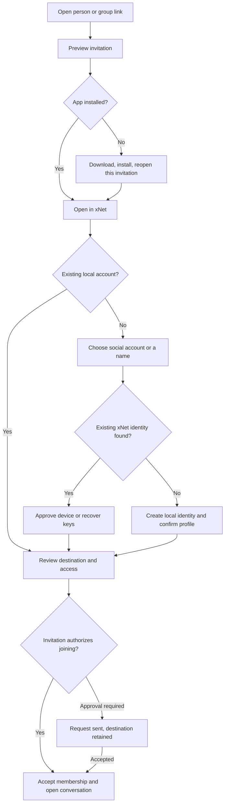
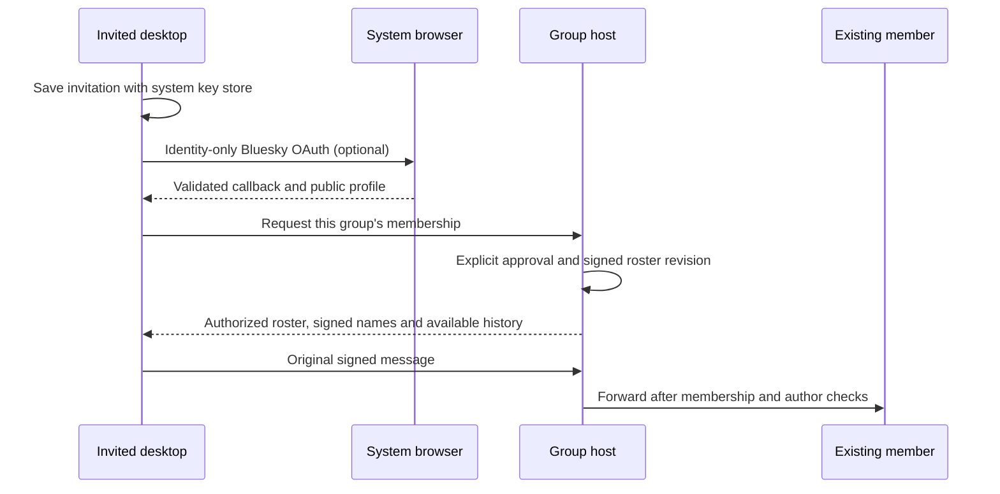

# Invitation-led desktop onboarding

> [!TIP]
> Keep the invitation at the center of the entire journey: **open link → install → continue with a familiar identity → join or send a request → chat**. Creating an account should never lose the person or group that brought you here.

This extends [0487: Contact links, requests, and group invitations](./0487_%5B_%5D_CONTACT_LINKS_REQUESTS_AND_GROUP_INVITATIONS.md). That document owns contact discovery, request transport, and membership boundaries. This document owns first-run onboarding, installation handoff, social account selection, and resuming the intended conversation. Repository inspection and external sources are from October 22, 2026, on the local `codex/chat-first-redesign` worktree.

The [clickable wireframe](./visuals/0488/exploration.mdx) shows proposed screens with simulated installation, sign-in, and acceptance. It makes no network requests and does not create accounts or join groups. The first Electron slice is implemented locally and recorded below; the wider design remains a proposal. Revisit November 5 after trying the local flow and choosing the first native OAuth adapter; accepted public/security contracts require an ADR and tripwire.

## One invitation, one continuous journey

The browser and desktop should repeatedly show the destination: **Chris invited you to Reading group** or **Connect with Chris**. Avoid a generic workspace setup wizard, a first-document prompt, relay settings, or a DID field between the invitation and the conversation.

| Stage                    | Main action                                                       | What stays visible                                        |
| ------------------------ | ----------------------------------------------------------------- | --------------------------------------------------------- |
| Invitation page          | Get xNet; Open in xNet for existing installations                 | Inviter, destination, and whether joining needs approval  |
| After download           | Open xNet; Copy invitation as a fallback                          | The same invitation, with simple installation guidance    |
| First launch             | Continue with Bluesky; X; another configured provider; use a name | Destination and why an identity is needed                 |
| Profile confirmation     | Continue as Maya                                                  | Editable name, selected account, what recipients will see |
| Final destination review | Join group, Request to join, or Send message request              | Exact scope, history access, and approval status          |
| Completion               | Conversation or one clear pending state                           | The opening message and an honest delivery status         |

For a valid invitation that already authorizes membership, the final **Join group** action confirms consent and redeems it. There should not be another administrator approval unless that invitation's policy requires it. For a public group request link, **Request to join** is honest; show the pending destination immediately but no private messages. Contact links retain 0487's message-request behavior.



With no invitation, use the same identity/profile flow, followed by a small home state: **Share my contact** and **Open an invitation**. A returning local user opening a link skips account creation. If multiple local profiles exist, show **Continue as Maya · Switch account** before redeeming anything.

## Installation must not swallow the invitation

Use separate HTTPS routes for person and group intents, for example `https://xnet.fyi/c#<code>` and `https://xnet.fyi/join#<code>`. These are illustrative routes, not deployed endpoints. The fragment carries the bounded invitation/code; the page must not place it in download URLs, analytics, crash reports, referrers, or installer filenames. Reading a link must not consume its invitation or membership seat.

The page offers the matching supported desktop download and keeps **Open in xNet** available afterward. Browser permission prompts and installation behavior vary, so a download is not proof of installation. Keep an explicit **I've installed xNet — continue** action, plus **Copy invitation**. Do not silently read the clipboard, fingerprint the browser to match an installation, or assume the installer passes its originating URL into the app.

On a phone, explain that this invitation currently needs the desktop app, and offer copying the link or using the system share sheet. Never claim a mobile experience exists or send the invitation through an email service automatically.

Custom protocol registration needs packaged testing. Electron documents different URL delivery mechanisms across macOS versus Windows/Linux, and macOS/Linux require a packaged application for this flow. Passing a development-only CDP test does not validate installation handoff. [Electron deep links](https://www.electronjs.org/docs/latest/tutorial/launch-app-from-url-in-another-app).

Group previews reveal only what their issuer elected to share: normally title, inviter, and a short description. No member roster, message snippets, presence, or document thumbnails before membership. Link previews use generic xNet metadata unless the group explicitly chose public preview data. Disable untrusted embeds and remote avatar loads in the pre-membership preview.

The current release/download catalog must also be honest about compatibility. An installer is not enough: the downloaded version must support this invitation version, Iroh binding, OS and architecture. Show **Update xNet to join** for an older build, and preserve the intent through that update. The current Iroh packaging gaps, including Intel Mac coverage, remain release gates.

## Social sign-in gives a recognizable identity

Offer **Continue with Bluesky** first, **Continue with X** when its adapter is configured, and **More ways to continue** for a small tested provider registry. Keep **Use a name instead** available. A display name and local keys are sufficient to start xNet; users should not need a social account or a globally unique xNet handle.

Use the provider's existing account session in the user's normal browser. Native OAuth should use an external user agent and PKCE rather than embedding the provider's password page inside Electron. An installed application cannot keep a shared client secret confidential. [OAuth for native apps, RFC 8252](https://www.rfc-editor.org/rfc/rfc8252.html).

After successful authentication, prefill the person's name and optional sanitized avatar. Let them change their xNet display name. Show the connected provider account so signing into the wrong browser account is easy to catch. The provider identity is stable account information; the DID remains a detail in account settings, not the name shown in conversation lists.

Separate three choices:

1. **Connect an account:** prove control for this xNet session and optionally use profile details.
2. **Share the social identity with contacts:** provide verifiable binding evidence or explicitly label an unverified link. Local OAuth success alone is not third-party proof.
3. **Let people find me by this handle:** publish the binding and contact locator described in 0487. Default off; do not publish a social graph as a side effect of joining a private group.

The profile confirmation can show the name and connected account without adding another privacy wizard. Public discovery belongs in an unchecked option or subsequent profile settings. Defer archive imports, social posting permissions, contact uploads, notifications, agent setup, and extension installation until those features are actually used.

### Provider adapters

| Provider             | Stable identity                          | Recommended path                                                   | Boundary to preserve                                                       |
| -------------------- | ---------------------------------------- | ------------------------------------------------------------------ | -------------------------------------------------------------------------- |
| Bluesky / ATProto    | Account DID                              | Native OAuth, then existing xNet binding when explicitly published | Verify DID-to-issuer relationship; handle changes do not change the person |
| X                    | Numeric account ID                       | Registered public native client, PKCE, authenticated user lookup   | Validate actual app access/scopes; no shared secret in the app             |
| Google / OIDC        | Issuer + subject                         | Tested provider configuration and validated ID token               | Email is not a stable identity key or automatic discovery consent          |
| Other OAuth services | Provider-specific immutable account ID   | Small adapter with a tested identity endpoint                      | OAuth support alone does not define a trustworthy login identity           |
| Organization SSO     | Issuer + subject and organization policy | Later configured OIDC integration                                  | Logging in does not automatically grant every group or device access       |

“Any social identity” is an extensible adapter interface, not a promise that any pasted OAuth URL is safe or immediately compatible. Show only configured, tested providers in production. The wireframe can demonstrate proposed providers but must label all sign-in actions simulated.

ATProto's current native callback rules require a reverse-domain custom scheme tied to the client metadata hostname, or a suitable HTTPS callback. The existing `xnet://` contact scheme is not automatically a valid ATProto OAuth redirect. For metadata on `xnet.fyi`, a candidate is `fyi.xnet:/oauth/callback`; verify registration, SDK support, exact metadata, and the actual packaged app before adopting it. Use identity-only scope initially; public binding writes are a separate scope/consent decision. [ATProto OAuth](https://atproto.com/specs/oauth).

X documents public native clients and authorization code with PKCE. Its registered callback and user lookup must work with the actual application configuration before its button ships. Do not request social DMs, post writes, or an archive merely to obtain a profile. Google similarly requires configured client credentials/redirects and validated ID tokens; use `sub`, not an email address, for the account key. [X OAuth](https://docs.x.com/fundamentals/authentication/oauth-2-0/authorization-code), [Google OpenID Connect](https://developers.google.com/identity/openid-connect/openid-connect).

## “Sign in again” must mean the same person

The difficult part of social sign-in is returning on another device. Proving control of Bluesky does not recreate the private keys that encrypt or sign an existing xNet account. The product must not tell someone they have signed back into their old chats while silently creating a fresh DID.

Recommend local keys protected by the OS, plus two explicit ways to restore: **Approve from another device** and **Use recovery key/backup**. A future encrypted backup service can reduce friction, but its decryption must require an independent recovery factor or an explicitly chosen custodial recovery policy. Provider identity or a public handle must never be used to derive encryption keys.

If a verified provider binding or account index identifies an existing xNet account, pause before creating a new active identity. Show **Welcome back, Maya** and the restore choices. Keep the invitation pending throughout. If no lookup is available, do not treat “could not check” as “new account”; explain the failure or offer explicit local setup without overwriting existing provider bindings. Starting a distinct identity is an explicit advanced action, with no silent reassignment of the old one.

On an existing desktop profile, linking another provider requires proof of that provider account and control of the current xNet identity. Matching email/name is insufficient. A link to an account already bound elsewhere is a conflict, not permission to merge identities.

Recovery setup should not become ten mandatory screens. After the first successful conversation, show one actionable account card: **Protect your account — save a recovery key or connect another device**. Until done, accurately state **Saved on this device only**. An OS-protected seed is not a backup. If secure OS storage is unavailable, the application must disclose that state and provide a safe choice before promising protected keys; the current plaintext fallback cannot silently inherit a secure-storage badge.

## Resume the invitation durably

Persist a validated pending intent in the trusted main process before opening OAuth or mounting account UI. It carries a local ID, invitation kind/version, bounded protected payload, expected issuer/destination, expiry, the selected local profile, and a resumable phase. Keep signing keys, tokens, provider state, and admission capabilities outside general renderer persistence.

Conceptual intent variants:

```typescript
type JoinIntent =
  | { kind: 'contact'; localId: string; protectedPayloadRef: string }
  | { kind: 'group'; localId: string; protectedPayloadRef: string }
  | { kind: 'channel'; localId: string; protectedPayloadRef: string }

// Shape for discussion, not a published API or complete validation contract.
```

Store invitation capabilities using the native protected-storage boundary. Deduplicate reopening the same link, bound the queue, and show a choice if a second different link arrives. Never replace an in-progress invitation invisibly. Resetting or cancelling onboarding must not delete an established account or another pending invitation.

OAuth state refers to a local transaction with a fresh nonce, expected provider/issuer, exact redirect, PKCE material, initiation time, and selected profile. Do not send the group invitation itself to the provider. A late callback after switching profiles or cancelling is rejected. Restart can resume a still-valid transaction when supported, or ask the user to sign in again while retaining the invitation. Tokens never appear in the contact deep link, renderer URL, logs, or a shared xNet node.

At the final join action, revalidate the invitation against current authoritative state. Check expiry, revocation, maximum uses, destination, inviter authority, role, history policy, and any intended recipient binding. Reserve/consume a membership slot atomically with the authoritative membership change; retries use an idempotency key. Multi-device/federated authorities must not each spend the same final seat independently. A cached signed invitation is not sufficient proof that it remains valid.

Group joins do not silently add a person to contacts or create a DM with every member. Contacts and membership remain separate. Joining cannot invoke an agent, install a shared extension, or share local files.

If the group authority is offline, show **Waiting for the group to confirm**. If admission or encryption-key setup fails after membership acceptance, preserve that accepted state and show **Joined · connecting** with Retry. Neither is equivalent to having received message history. The member must obtain only the allowed keys/history before the conversation is called ready.

## Failure states that should still feel clear

| Situation                                  | Screen behavior                                        | Recovery                                                       |
| ------------------------------------------ | ------------------------------------------------------ | -------------------------------------------------------------- |
| User cancels social consent                | Return to identity choices, keep invitation            | Retry, choose another account, or use a name                   |
| Provider/network unavailable               | Specific retryable error                               | No automatic new identity or broader-scope fallback            |
| Known account, missing keys                | Welcome back and restore choices                       | Other device or recovery key; invitation retained              |
| Invite expires during installation/sign-in | Keep completed local account; show expired destination | Ask inviter for a new link or open another invitation          |
| Link revoked or group full                 | Explain that joining is unavailable                    | Do not redeem a different scope or silently join the community |
| Group needs approval                       | One pending destination card                           | Notification when accepted; cancel request                     |
| Link for another signed-in profile         | Show current account and Switch                        | No automatic account linking or silent profile swap            |
| App update needed                          | Keep invitation and offer update                       | Retry the same intent after update                             |

The clickable companion covers the primary paths and representative failures. It is not a security implementation or a substitute for testing real installations and provider callbacks.

## Existing code and implementation seams

| Seam                                                                                          | Current state                                                                                       | What to change                                                                                                  |
| --------------------------------------------------------------------------------------------- | --------------------------------------------------------------------------------------------------- | --------------------------------------------------------------------------------------------------------------- |
| `apps/electron/src/renderer/main.tsx` `init()`                                                | Loads/creates native seed and initializes the data runtime before an account wizard                 | Add a bootstrap decision before activating a new identity; preserve existing profiles                           |
| `apps/electron/src/main/identity-seed.ts`                                                     | Durable seed, OS encryption where available, loud corruption errors, explicit plaintext fallback    | Reuse durability; expose storage mode honestly and integrate restore without replacing a live identity          |
| `apps/electron/src/main/deep-link.ts` and `main/index.ts`                                     | Connect/share handlers plus current peer links                                                      | Parse new intents, persist before renderer startup, distinguish OAuth callbacks from invitations                |
| `packages/react/src/onboarding/machine.ts`                                                    | Generic passkey/recovery flow ends at `CREATE_FIRST_PAGE`; no destination context                   | Introduce resumable destination-aware completion rather than creating a page                                    |
| `packages/react/src/onboarding/OnboardingProvider.tsx`                                        | Injected ATProto ceremony; completion through the browser identity manager                          | Reuse pure state patterns; native identity lifecycle needs a host adapter                                       |
| `apps/web/src/identity/atproto-ceremony.ts`                                                   | Real browser OAuth adapter; popup/sessionStorage; binding write and broad-scope compatibility retry | Reference for binding integration, not a drop-in native OAuth adapter; no silent scope widening in the new flow |
| `packages/identity/src/atproto/binding.ts` and `packages/hub/src/services/atproto-binding.ts` | Existing signed binding and verification                                                            | Reuse with the fresh resolution and secure fetch work in 0487                                                   |
| `packages/workbench/src/communities/dialogs.tsx`                                              | Profile social links self-declared; invitation grants broad Space membership                        | Add consent-based joins only after enforcing the requested scope                                                |
| `site/src/pages/download.astro`                                                               | Generic release selection; no resumable invitation                                                  | Add a focused invitation landing/handoff experience with compatible release selection                           |
| `apps/electron/src/main/peers/service.ts`                                                     | Expiring one-peer channel invitations and approval                                                  | Contact layer from 0487 first; group authorization/encryption remains separate work                             |

The desktop should not reuse the web wizard by mounting it unchanged: that would create a second identity lifecycle and finish in the wrong product experience. Reuse the tested pure logic and proof types behind a native bootstrap boundary.

## Scope and sequence

**First, deliver one complete path:** group/person landing page, packaged install handoff, durable pending intent, local profile, existing invitation request/acceptance, and the intended conversation. This can work with a name while the first native provider adapter is developed.

Then enable Bluesky, including returning-account handling; follow with X after verifying its actual app configuration. Add other providers through the same interface. Keep encrypted peer group onboarding gated on 0487's group membership/key work. A beautiful **Join** screen over hub-wide access or an unimplemented group transport is not a finished invitation flow.

<details>
<summary>Decisions deliberately deferred</summary>

- A universal public identity directory or xNet username namespace.
- Provider-only custodial recovery and a managed encrypted backup product.
- Mobile onboarding, mobile push, and universal cross-device deferred deep linking.
- Enterprise SAML and arbitrary unreviewed OAuth issuers.
- Automatic contact imports, group discovery, and social timeline access.

These do not block a focused desktop invitation journey. Revisit each only when a concrete user flow needs it.

</details>

## Local Electron implementation · October 22

The first slice uses the existing **one-person peer invitation**. It does not implement reusable contact links, social OAuth, group membership, or installation handoff. Those remain separate work below.

- A fresh desktop profile asks for an editable name and writes the canonical xNet `Profile` before completing setup. It uses the desktop's existing signing identity. Existing workspaces skip first-run setup.
- `OnboardingStore` keeps up to eight distinct invitations in a versioned file under the selected profile. Capabilities are encrypted with the platform key store, written atomically with restricted file permissions, and never returned in onboarding snapshots. A missing or locked key store cannot silently downgrade saved invitations to plaintext. Linux's `basic_text` backend is not treated as protection.
- Cold launch arguments, warm second-instance delivery, and pasted links enter the same queue. Re-delivery is deduplicated. Expired saved destinations remain explainable instead of disappearing; corrupt storage fails visibly rather than resetting identity or invitations.
- The recipient sees the destination before connecting. **Keep for later**, review, removal, malformed-link feedback, and explicit connection requests are wired. Request submission preserves the destination until the peer contact has been saved. Retrying after that save is idempotent.
- After approval, the intended conversation opens, including at narrow window sizes. Reopening an already-approved invitation reuses that connection. The current peer UI remains the place to inspect delivery/approval status.
- Key-storage copy distinguishes protected, plaintext, and development identities. The social buttons remain absent in Electron: a self-declared profile URL is not OAuth authentication.

Implementation lives in `apps/electron/src/main/onboarding/`, `src/shared/onboarding.ts`, and `src/renderer/components/DesktopEntry.tsx`, with the native entry points wired through main, preload, and the chat shell. The existing peer service now tolerates safe re-delivery, and the workbench accepts an initial conversation destination.

### What was exercised

Real macOS Electron profiles exercised a cold invitation launch, a warm deep link, quitting before name setup, quitting after profile creation, keeping/reopening an invitation, invalid-link feedback, request/approval across two profiles, actual messages in both directions, and reopening the approved link without duplicating the connection. The name was read back from the profile UI. The connection used the configured hosted relay for reachability and reported a direct path during message exchange. This was two profiles on one Mac, not a packaged cross-platform or separate-network test.

Ten storage tests cover restart, existing-workspace migration, queue order/deduplication, bounded capacity, encrypted/restricted persistence, encryption failure, expiry, locked/corrupt storage, and rejection of plaintext capabilities. Four protocol tests and the real-Iroh pairing/restart test also pass; the pairing test now repeats join and asserts one contact. The desktop's declared typecheck passes. A separate full renderer typecheck still reports four existing errors in DatabaseView, DocumentHeader, PluginManager, and the IPC sync-manager test; none are in this slice.

The Storybook companion exercises the proposed name-only and approval-required flows, and has an explicit appearance control for checking both palettes. Its social login, recovery, downloads, and group operations remain simulations. An offline HTML export is available under `output/0488-onboarding-preview/index.html`; screenshots and the manual verification record are under `output/0488-onboarding/`. The browser tool does not permit opening local `file:` URLs, so visual checks used the Storybook source companion rather than the exported file.

Peer profile/name synchronization is still missing: the local profile displays the chosen name, while the other device currently falls back to the sender's abbreviated DID. Neither social handle lookup nor public profile publication was added. The current invitation still expires after one hour and binds one accepter; this pass does not make it a reusable group or contact link.

## End-to-end follow-up · October 22

The follow-up implements real native Bluesky OAuth, signed peer names, and small
hosted peer groups. The first-slice limitations above describe the earlier state.

Bluesky sign-in is available during setup and in **Your profile**. It opens the
system browser, asks only for identity access, verifies the account DID and
bidirectional handle, then saves public identity metadata. Provider tokens and
DPoP/PKCE keys stay in main memory and are discarded after revocation; no provider
credentials are stored in the renderer or on disk. The existing xNet key remains
the workspace identity. Signing in again is not account recovery. Public binding
publication and social-handle discovery remain unimplemented.

A new `/join` website page previews an invitation, opens the native scheme, and
offers a clipboard fallback. Download instructions open separately so the original
invitation stays available. No analytics or third-party scripts run on this page;
the capability stays in the fragment. Electron accepts the HTTPS and native forms
and deduplicates them to the same saved intent. The website and native client
metadata are local changes, not published endpoints. Current public installers
have not been verified against this new protocol.

Private groups use separate one-person invitations into a creator-owned roster.
The host approves each member and signs each roster revision. Approved members
exchange original signed messages through the host over encrypted peer links.
Independent per-author cursors cover late messages whose Lamport clock is lower
than another author's. The host must remain online for delivery. Removing a member
stops new traffic; existing copies remain. New members receive available history
from current members, not newly replicated history from departed authors. This is
a bounded desktop prototype, not the eventual multi-host group encryption design
from 0487. See ADR-58 and ADR-59 for the exact boundaries and tripwires.



The real `crs.land` authorization completed in Electron. Its display name was
prefilled, and the identity and invitation survived a restart. An existing desktop
received the request, approved it, and exchanged actual messages with that profile.
The group pass then used the signed-in profile, an existing Maya profile, and a
fresh Nora profile launched directly from a group invitation. The new profile saw
no group messages before approval and received authorized history afterward.
Further verification evidence is recorded in `output/0488-onboarding/verification.md`.

Remaining release dependencies are explicit: publish the invitation page and
native metadata, validate packaged/cross-platform and separate-network behavior,
register/configure an X OAuth client before offering it, and implement identity
recovery/public binding before claiming provider-based account restoration. No
push, merge or deployment is part of this local pass.

## Verified local prototype scope

These items cover the implemented desktop slice; the broader release checklist
below remains open where it requires distributed builds, other providers, or
recovery.

- [x] Complete identity-only Bluesky OAuth in Electron main and save only the verified public profile. The real `crs.land` ceremony completed, and the built app reads it after restart.
- [x] Preserve the invitation through name/social setup, require a destination review, and open the approved DM with real message exchange.
- [x] Propagate signed display names so peers can recognize each other without publishing social-account bindings.
- [x] Create a private group, invite each person, explicitly approve membership, and exchange original signed messages through the host.
- [x] Keep group history hidden before approval; deliver available current-member history after approval and retain messages after restarting all three profiles.
- [x] Remove a member, stop their subsequent delivery, and show a disconnected, read-only conversation while retaining their received messages.
- [x] Accept HTTPS invitation links pasted into Electron and provide a local landing page with app handoff, clipboard fallback, malformed-link recovery, same-tab destination changes, and automatic expiry.
- [x] Separate development loopback OAuth callbacks from the packaged `fyi.xnet:/oauth/callback` scheme and reject cancelled, expired, foreign, and replayed callbacks in native tests.
- [ ] Publish the invitation page and OAuth metadata; validate the installed app’s OS registration and download/install/reopen path.
- [ ] Verify distinct computers and networks, each supported OS/architecture, X sign-in, provider-based recovery, and reusable public contact links.

## Implementation checklist

- [x] Add native name-only setup around the existing identity and preserve existing workspaces.
- [ ] Add provider-driven returning-account detection and recovery without duplicate identities.
- [x] Persist bounded, protected existing peer invitations through first-run setup and restarts, with deduplication and explicit review.
- [ ] Extend the intent model to contact/group links, profile selection, and independent OAuth transactions.
- [ ] Build person/group/channel link previews and HTTPS-to-app handoff with copy fallback and compatible downloads.
- [x] Wire the editable-name/no-social first-run UI and route approved existing peer invitations to their conversation.
- [ ] Add native provider availability and the broader group/contact onboarding screens.
- [ ] Implement native Bluesky OAuth using correct client metadata/callback registration and OS-protected credential storage.
- [ ] Implement verified provider-to-xNet binding, returning-account detection, conflicts, device approval/recovery, and explicit discovery consent.
- [ ] Verify and enable an X adapter, then configured OIDC/provider adapters without exposing unimplemented buttons.
- [ ] Implement authoritative, idempotent invitation redemption with recipient consent, role/scope/history checks, and capacity handling.
- [ ] Wire the group membership/key transport from 0487 before claiming private peer groups or immediate access to group history.
- [ ] Add one unobtrusive recovery reminder, truthful storage/delivery states, and profile switching without losing invitations.

## Validation checklist

- [ ] Fresh packaged install on each claimed OS/architecture: link → download → install → reopen → name/social identity → actual authorized conversation.
- [ ] Existing install: open a link with app closed, open, initializing, and on a different local profile; verify exactly one intended destination.
- [ ] Restart after receiving the link, opening OAuth, creating keys, saving the profile, accepting membership, and before receiving keys/history; resume without duplicate identities or joins.
- [ ] Use real Bluesky and X test accounts; verify expected subject/issuer, cancellation, wrong account, expired/replayed callbacks, scopes, and platform redirect registration.
- [ ] Restore the same xNet identity on a second device; verify existing conversation continuity and that provider login alone cannot decrypt/reassign it.
- [x] Try no-social onboarding; confirm recognizable profile names and working invitations without public discovery or provider access. Verified with the Maya and Nora Electron profiles.
- [ ] Revoke/expire the invitation during installation; race the final seat; change inviter authority/scope; reject replay and wrong-recipient joins.
- [ ] Verify group approval, immediate authorized joining, authority offline, relay capacity, and key delivery have distinct truthful states.
- [ ] Confirm no pre-join history, roster, presence, social-account publication, clipboard read, agent invocation, or extension installation.
- [ ] Inspect logs, redirect URLs, storage, download URLs and analytics boundaries for tokens, raw invitations and recovery secrets.
- [ ] Drive keyboard navigation and both themes; keep destination visible and preserve name/intent through retries.
- [ ] Verify invite/update compatibility against the actual distributed build, not only a development renderer.

## References

- [0487: Contact links, requests, and group invitations](./0487_%5B_%5D_CONTACT_LINKS_REQUESTS_AND_GROUP_INVITATIONS.md).
- [Visual companion](./visuals/0488/exploration.mdx).
- [OAuth for native apps](https://www.rfc-editor.org/rfc/rfc8252.html), [ATProto OAuth](https://atproto.com/specs/oauth), [X OAuth with PKCE](https://docs.x.com/fundamentals/authentication/oauth-2-0/authorization-code), and [Google OpenID Connect](https://developers.google.com/identity/openid-connect/openid-connect).
- [Electron deep links](https://www.electronjs.org/docs/latest/tutorial/launch-app-from-url-in-another-app).
