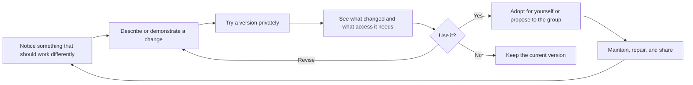

# An internet we can change

> [!TIP]
> Centre the essay on Chris's long-running wish for “GitHub for everyone”: people sharing what they are making, contributing to each other's work, and shaping the tools their communities live with. The personal thread runs from dinner parties through coworking to collaborative data and xNet. Ongoing, specific consent is part of what makes that future desirable.

The companion [essay](./drafts/0489-an-internet-we-can-change.md) incorporates Chris's October 24 interview and has now been written as a complete local essay at his request. **The primary audience is friends and small communities making tools together.** The personal history comes from his account; the future dinner-planning tool remains an explicitly imagined example. The first-person wording is based on his account; he has not yet reviewed the completed site version. Revisit November 7 to assess the revised voice and argument before preparing a publication version. The essay is written locally; nothing has been committed, pushed, or deployed.

## Completed local essay

The roughly 1,900-word essay is available as [Markdown](./drafts/0489-an-internet-we-can-change.md) and as an [Astro reading page](../../site/src/pages/blog/an-internet-we-can-change.astro). The two bodies are checked for text parity. The local preview is at `http://127.0.0.1:4347/blog/an-internet-we-can-change/` while the existing site preview server runs.

The essay is registered with `draft: true` and an empty publication date. It appears on the local blog index in development and in `pnpm --dir site build:preview` builds. Normal production builds and RSS exclude it until publication. The cover is shared by the hero, index card, and generated social card; the byline uses the existing human and Codex author records. No deployment has been performed.

## What this essay adds

The earlier posts establish a useful sequence. [Data Should Work Like Soil](../../site/src/pages/blog/data-should-work-like-soil.astro) argues for a shared foundation. [Clutch Power](../../site/src/pages/blog/clutch-power.astro) asks how pieces fit together and come apart. [The Vault and the View](../../site/src/pages/blog/the-vault-and-the-view.astro) separates lasting data from replaceable interfaces. [The Workshop and the Walled Garden](../../site/src/pages/blog/the-workshop-and-the-walled-garden.astro) connects that freedom to people changing software for themselves.

This essay should take the next step: **who gets to exercise those freedoms in everyday life?** An open format can still be hard to use. A powerful extension system can still ask people to understand a permissions matrix. An agent can generate code that its owner cannot inspect, repair, or safely run. Those are central design problems for xNet.

The revised thesis is that communities should be able to shape their software as their needs and relationships evolve. Durable data, shared meaning, and inspectable history let their work accumulate. Agents can lower the effort of making changes; ongoing consent gives people a say over how those changes participate in their lives. The purpose is to make more forms of collaboration possible, including projects that will never become businesses.

“GitHub for everyone” is the organising analogy, not a proposal for one central service or a claim that every project must be public. Open, reusable software can work with private data. Sharing a tool does not imply sharing the records that its original community used in it.

Use “internet primitives” carefully. The subject is a layer of application and data conventions built on existing internet protocols. This is not a proposal to replace the whole internet, or a claim that xNet invented collaboration, end-user programming, or shared data.

## Personal evidence from the interview

These are Chris's own recollections and aspirations, supplied October 24. No company names, founding dates, funding details, or invented scenes have been added. The essay paraphrases them; quotation marks below identify phrases actually supplied in the interview.

| Account                                                                                                | Editorial purpose                                                                                    | Boundary                                                                                                      |
| ------------------------------------------------------------------------------------------------------ | ---------------------------------------------------------------------------------------------------- | ------------------------------------------------------------------------------------------------------------- |
| Wanting “a GitHub for everyone” since getting into programming                                         | Establish the long-running motive before introducing xNet.                                           | Describe the collaboration pattern without promising to copy all of GitHub or requiring public personal data. |
| His first startup crowdfunded dinner parties so friends could gather more often                        | Start from a concrete social need, including his candid view that the business idea was impractical. | No invented dinner, guest, location, business outcome, or revenue claim.                                      |
| Opening dinner-only restaurants for daytime coworking, with locations in New York and San Francisco    | Show software helping people use physical places together.                                           | Do not invent exact dates, scale, or causal claims about individual members.                                  |
| “My product was my office”                                                                             | The emotional centre: inhabiting something he could help improve.                                    | Preserve the plain wording instead of replacing it with a new metaphor.                                       |
| COVID, reflecting on startup tooling as CTO, then CRDT study and experiments at Recurse Center         | Connect the social goal to the technical work without writing a separate engineering origin story.   | Do not imply a precise chronology beyond what he supplied, or claim a particular CRDT invention.              |
| Wanting more fluid ways to contribute to community needs and work that excites people                  | Give the project its wider social purpose.                                                           | Keep it an aspiration; no claim that a data format solves compensation, rent, or governance.                  |
| Difficulty connecting social posts, DMs, email, tasks, and work; using agent connectors as an engineer | Make the desired interoperability concrete.                                                          | His current experience, not a survey of all products or their capabilities.                                   |
| “Enthusiastic consent” in intimate spaces and sacred sexuality                                         | Frame access as an ongoing, revisable relationship.                                                  | Attribute the analogy to his thinking. Do not invent experiences, relationships, or credentials.              |
| Software as a living system shaped by living people                                                    | Connect the ending to the coworking experience.                                                      | Explain change through people's participation; avoid treating software as sentient.                           |

The earlier account of finding xNet too complicated remains near the end as an honest test of the ambition. The tic-tac-toe failure is removed from this revision: it is useful implementation evidence, but it interrupts the personal story and dates the essay to one prototype bug.

The charter already supplies the editorial standard: “A capability you cannot see is not a degree of freedom you have.” Its [capability discussion](../CHARTER.md) makes discoverability part of agency. The essay should extend that principle to people who do not know which question to ask an agent.

## Audience and possible angles

Chris selected **friends and small communities making tools together**. The essay should speak to people organising something with others, including those who do not want to program. Developers remain a second audience; the foundation should be concrete enough to understand without making the piece an SDK overview.

| Angle                           | Strength                                                                      | Cost                                                                             | Editorial choice                                                 |
| ------------------------------- | ----------------------------------------------------------------------------- | -------------------------------------------------------------------------------- | ---------------------------------------------------------------- |
| An internet we can change       | Connects personal experience, shared foundations, and everyday participation. | Needs a concrete example to avoid becoming a manifesto.                          | Recommended main argument.                                       |
| A common language for our data  | Gives engineers a clear account of interoperability.                          | Close to Clutch Power; easy to lose the person using the software.               | A short passage supporting the main argument.                    |
| Build software by talking to it | Immediately recognisable product story.                                       | Makes AI the whole proposition and can promise more than the prototype delivers. | Use as one route into making changes.                            |
| Software for everyone           | Welcoming ambition.                                                           | “Everyone” is too broad to claim as an achieved outcome.                         | Treat as an obligation to test, not a headline claim of success. |

Working title: **An Internet We Can Change**. Alternative: **Software We Can Live In**, drawn from the coworking account. Keep “GitHub for everyone” as the organising phrase inside the essay: it earns an explanation for readers unfamiliar with GitHub. The personal story now does the work that a new extended metaphor would otherwise have to do.

## The durable pieces, expressed as things people can do

This is an editorial map, not a frozen protocol specification. Keep most of it out of the essay as a table; let the reader meet these needs through the example.

| Human need                               | Foundation it asks for                                                    | Boundary worth explaining                                                                                                                 |
| ---------------------------------------- | ------------------------------------------------------------------------- | ----------------------------------------------------------------------------------------------------------------------------------------- |
| Keep something and find it again         | Records with stable references and documented meaning                     | A reference does not make a record public.                                                                                                |
| Use the same information in another tool | Shared schemas and explicit ways to connect different schemas             | Sharing a database alone does not make applications interoperable.                                                                        |
| Work together without losing changes     | Local storage and replication with defined conflict rules                 | Merging changes does not decide whose proposal a group should adopt.                                                                      |
| Let a tool help with a particular task   | Scoped access to data and device capabilities                             | An agent asking for access is not authority to grant it. Revocation cannot recall copies already disclosed.                               |
| Understand and undo a change             | Attributed versions, source differences, and relevant development history | Chat history can explain a change; it does not reproduce a model's hidden reasoning. Restoring code is not automatically a data rollback. |
| Keep using the result after people leave | Export, recovery, documentation, and more than one implementation         | These need ongoing maintenance and practical exit tests. Local storage is not itself a backup.                                            |

Introduce these foundations after the imagined group starts adapting a tool together. Stable references and agreed meaning explain why tools can work together; access and history explain how people retain a say. The essay does not need a catalogue of hashes or merge rules.

## Research that sharpens the argument

Ink & Switch's [Malleable software](https://www.inkandswitch.com/essay/malleable-software/) describes a gradual path from using software to changing it, with people helping one another along the way. It supports two choices here: start with a small change in context, and avoid assuming every person must become a programmer. The connection to xNet is our interpretation, not an endorsement from the authors.

[Local-first software](https://www.inkandswitch.com/essay/local-first/) brings collaboration, offline work, lasting access, and control into the same design agenda. That helps explain why generating an interface is insufficient. It does not show that xNet's current networking or recovery implementation is ready for everyone.

The W3C's [Introduction to Web Accessibility](https://www.w3.org/WAI/fundamentals/accessibility-intro/) includes contributing to the web within accessibility, alongside using it. That makes accessibility integral to this essay's thesis. Plain language, keyboard and screen-reader access, predictable controls, and ways to recover are part of who gets to participate. Affordability and access to devices add separate practical barriers; do not present them as claims of WCAG conformance.

These sources should support the piece without taking it over. The new contribution is the candid account of trying to turn those ideals into an approachable, shared tool.

## What we can honestly say about xNet today

Inspection is of the local `codex/chat-first-redesign` prototype on October 24, 2026. Reading code establishes the existence of these mechanisms; it does not certify their security, accessibility, or readiness for general use.

| Area                     | Evidence                                                                                                                                                                                                                                             | Suitable language                                                                                                                                                                        |
| ------------------------ | ---------------------------------------------------------------------------------------------------------------------------------------------------------------------------------------------------------------------------------------------------- | ---------------------------------------------------------------------------------------------------------------------------------------------------------------------------------------- |
| Data foundations         | [Schema definitions](../../packages/data/src/schema/define.ts), [change records](../../packages/sync/src/change.ts), and the root architecture guidance distinguish structured records from collaborative text.                                      | “xNet separates shared data from the interfaces built over it.” Explain that structured records use field-level last-write-wins rules and rich text uses Yjs if adding technical detail. |
| Asking for access        | [ExtensionAccessPrompt](../../packages/workbench/src/communities/ExtensionAccessPrompt.tsx) presents proposed data access and allow/deny choices.                                                                                                    | “We're building permission requests around the task a tool needs to do.”                                                                                                                 |
| Versions and explanation | [ExtensionVersionDiff](../../packages/workbench/src/communities/ExtensionVersionDiff.tsx), [development records](../../packages/workbench/src/communities/extension-development.ts), and [0482](./0482_%5B-%5D_COLLABORATIVE_EXTENSIONS_IN_CHAT.md). | “The prototype can retain versions, source changes, and the conversation context attached to development.” Avoid claiming complete provenance for every input or exact replay.           |
| Generated interfaces     | [Extension sandbox](../../packages/workbench/src/communities/extension-sandbox.ts).                                                                                                                                                                  | “Generated tools run behind an isolation and permissions boundary.” Avoid “safe arbitrary code” or “no vulnerabilities.”                                                                 |
| Inclusive everyday use   | Prototype work and earlier accessibility investigation in this conversation.                                                                                                                                                                         | A design goal that still needs testing with the people it intends to serve. No accessibility-conformance claim.                                                                          |

Keep platform specifics brief. Desktop currently makes a useful place to work with local data and local coding agents, but desktop-only availability and paid agent subscriptions limit who can take part. The vision should name that gap without promising an unbuilt mobile product or free inference.

## Consent as an ongoing relationship

Preserve Chris's reference to enthusiastic consent and intimate spaces, including sacred sexuality, in a short first-person passage. The draft should neither sensationalise the analogy nor quietly replace it with a generic permissions paragraph. It connects to his view that software already has an intimate place in our lives.

The essay's concrete example is a community tool that can use a planning chat and selected recipes while leaving other messages private. A person can review what will be shared, revise their preferences after using the tool, and refuse further access. These are future design goals, not a description of a shipped conversational permission system.

Keep three distinctions visible: the agent can help explain a request but cannot consent for a person; software must enforce the agreed boundary; revoking future access cannot recall past disclosures. Other people's boundaries matter too. A community vote or one enthusiastic member does not authorise every member's private data.

Enthusiasm should not become a requirement to interact with software. Ordinary use, explicit controls, and a quiet refusal need to remain valid choices. Accessibility, cost, and care are ways to make the social promise real, rather than an unrelated checklist at the end.

## Essay shape after the interview

1. **Name the longstanding wish.** “GitHub for everyone” means showing work, inviting contribution, and helping improvements travel.
2. **Tell the physical-world history.** Crowdfunded dinners and daytime coworking show technology making community possible. “My product was my office” is the centre of gravity.
3. **Follow the need into data.** The CTO's integration work, CRDT experiments, and today's disconnected personal information explain the foundation.
4. **Show what agents change.** People can begin with a need and try a tool together. A future dinner-planning example connects this to the real dinner-party origin without pretending that future product exists.
5. **Explain a few lasting pieces.** Stable references, shared descriptions, local work, access, and version history support interfaces that a community can replace or adapt.
6. **Make consent relational and enforceable.** Use the intimate-spaces analogy, then a specific access conversation and its limits.
7. **Bring in different ways of contributing.** Suggesting changes, testing, checking code, and maintaining tools should all count. Agent use is optional.
8. **Retain the wider social ambition.** Tools can support experiments in how people contribute and organise; compensation and governance still need human work.
9. **Return to inhabiting what we make.** End with a community whose software changes as its life changes, and acknowledge xNet's unfinished usability work.

The essay remains prose without a feature list or section headings. Its description now names dinner parties, shared workspaces, and communities shaping software. The earlier meal-board sketch has become a future scenario grounded in the actual biography.

## Editorial decisions and remaining questions

The three initial interview questions are answered. The audience is settled, the personal story is available, and the five-year aspiration is clearer: consent-based interoperability across personal and community life. There is no need to ask Chris to restate those choices.

The next useful review is of voice and emphasis. Does the revised first-person account feel like his? Does the economic aspiration have enough room without taking over the essay? Does the consent passage retain the meaning he intended? Those are editorial questions, not missing authorisation to keep drafting.

A specific remembered moment from a coworking space could add texture in a later revision. Leave room for Chris to offer one; do not manufacture dialogue or an illustrative member. Company names and exact dates are unnecessary unless he wants them included.

## Revision and validation checklist

The source research, interview account, and companion draft are recorded above. This remains an editorial exploration, not an implementation plan or publication approval.

- [x] Incorporate the October 24 interview and the confirmed community audience into the draft and brief.
- [x] Replace the generic opening with the dinner-party, coworking, and CRDT history; label the future tool example as imagined.
- [x] Develop ongoing consent and the wider social ambition without implying those outcomes are already implemented.
- [x] Check this revision's formatting, local links, readable language, and personal-history attribution.
- [ ] Review the first-person wording and consent passage with Chris.
- [ ] Have a reader outside software development explain what they believe their community could do after reading it.
- [ ] Recheck product claims, sources, title, and description against the intended build before preparing a publication version.

The recommended next step is reading the completed essay in context. The core argument now comes from Chris's account: people should be able to inhabit and reshape their shared software, with durable work and boundaries they can keep negotiating.

Verification on October 24: both Markdown files pass Prettier; all 13 local links resolve. The prose scan reports reading ease 70.8 and no mirrored sentence pairs. It still flags relatively uniform sentence lengths; this is a style heuristic, not a publication gate. Personal history was checked against the interview supplied in this conversation. Chris has not yet reviewed this revised wording.

At the initial text-only pass, the site production build passed (138 pages; 54 static routes validated). The rendered article matched the Markdown body exactly; the index and RSS omitted it at that stage. The later cover and listing pass is recorded below. Desktop and mobile reading layouts, including the dark theme, were visually inspected. Final prose reading ease is 71.0, with no mirrored sentence pairs. The publication checklist remains open.

## Cover, listing, and incoming main changes

On October 24, Chris requested a cover image, a visible blog listing, and the newer essay from main. `origin/main` was fetched at `bb9addc090f1d37c566f7bda294e1f4c163b1cce`. Its complete nine-file delta from this branch's merge base was applied as local changes, including **What Desire Builds**, its cover, Codex author registration, and explorations 0483–0484. All 80 previously edited tracked files were verified unchanged immediately after applying that delta. This updates the working contents; it does not create a merge commit or advance this prototype branch's HEAD.

The new cover was generated with the built-in image tool: friends exchanging sketches, laptops, and food around a communal restaurant table. The scene is imagined, not a depiction of the actual startup or its members. Final responsive assets are [the 1600px cover](../../site/public/blog/covers/an-internet-we-can-change.webp) and [the 800px cover](../../site/public/blog/covers/an-internet-we-can-change-800.webp). The prompt is recorded in the local image-generation output folder. The original generated PNG remains in the tool's output directory.

The initial preview build exposed a missing environment flag in the static rendering path. The index now reads the server environment directly. `build:preview` sets the flag explicitly; RSS continues to use published posts only. Draft pages omit publication JSON-LD and remote commit history until they are published.

Final verification on October 24: `pnpm build:preview` passed with 139 built pages and 55 static routes validated. Browser checks found the essay through search, opened both essays, and decoded both cover images. Visual inspection at 1440px and 390px exposed a scoped-style class overriding the new hero image's default positioning; an explicit positioning class fixed it, and both widths were rechecked without horizontal overflow. Screenshots are in `output/playwright/xnet-blog-integration/`. The draft stays out of RSS, and the incoming published essay appears there. All 80 preexisting edited tracked files still match their saved hashes. Nothing was committed, pushed, or deployed.
