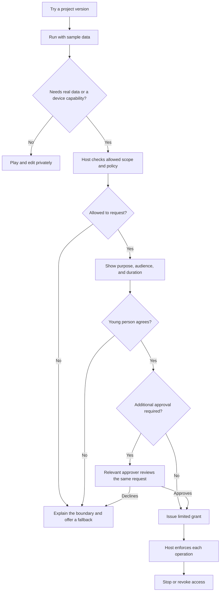
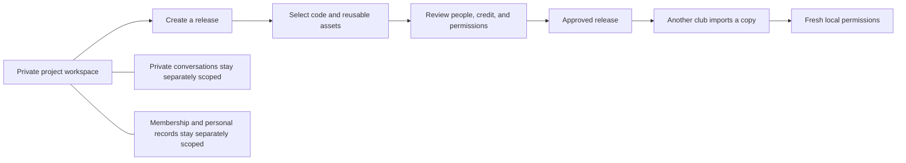

# A place young people can make their own

> [!TIP]
> Explore xNet as a shared creative place: friends making things, changing the tools together, and leaving with their work. Chris chose friends ages 16–25 as the starting setting. Distinguish 16–17-year-olds from adults, and investigate younger children's needs separately. This is a proposal for research and prototyping, not a claim that today's app is ready for children.

The question changes when the person who owns the data is sixteen. Ownership still matters. So do the right to experiment, the ability to ask for help, and the freedom to grow out of an old identity. A young person should have real choices without having to carry the full burden of securing a computer, assessing everyone they meet, or reading a model provider's contract. Younger children need additional support, but this burden is unreasonable for many adults too.

The promising ambition is a community where young people can shape their surroundings. A group could make a game, a comic, a band website, a club calendar, or something gloriously silly. Chat helps them work things out. Their work can survive a change of app or host. Friends can govern their own shared space; where children participate, responsible adults provide care and accountable boundaries without taking over every creative choice.

This is a strategic exploration. It does not change the app, publish a blog post, recruit participants, or approve a child-facing launch. Revisit it on November 24 after deciding how to review a small concept with young people, if that work is authorized. No change to the protocol or charter is accepted here.

## Starting points: Brain Rot, Viceless, and the conversation

[Brain Rot / Room for Play](https://crs48.github.io/brainrot/) asks how to make space for friendship, imagination, movement, and play. Its research separates evidence from advocacy and distinguishes total screen time from what someone does online. The practical lesson for xNet is that leaving the screen should be easy, and there should be something worth doing with other people when you do.

[Viceless](https://viceless.god1-0.chatgpt.site) examines commercial tactics that exploit attention and choice. It offers ways to recognize those tactics without making individual willpower the whole solution. For xNet, that suggests designing the incentives, defaults, and social expectations before adding another dashboard that tells someone to behave better.

The [October 27 conversation filed as “Nicki”](https://notes.granola.ai/d/f0ef2548-39f1-4005-bfd4-230a28a6a884) connects these concerns through a security metaphor: vulnerabilities in people deserve protective design too. I read the meeting's summary, not its transcript. This document uses the relevant product theme, without reproducing personal discussion or treating casual scientific claims as established evidence. That private source link should be removed or approved before a public essay is prepared.

The metaphor has a limit. A person's curiosity, need for belonging, attraction to novelty, or wish to be noticed is not a defect to patch out. Those needs make relationships and learning possible. The design question is who gets to benefit from them, and whether someone can recognize and refuse an attempt to exploit them.

## What the evidence can support

“Brain rot” is a cultural label, not a diagnosis this product should assign. We should not promise that xNet repairs attention, prevents addiction, or improves mental health. Those would require evidence about xNet itself.

The National Academies' 2024 review found both benefits and harms from social media. It found too little evidence to draw a causal conclusion about effects on adolescent health across the population. A UK government-commissioned review published in January 2026 also found major gaps in evidence about cause and effect. It distinguishes severe harms to particular children from an average effect across a population. These findings call for precise claims while leaving plenty of reason to address exploitation and bullying. [National Academies](https://www.nationalacademies.org/read/27396/chapter/6), [DSIT review](https://www.gov.uk/government/publications/understand-the-impact-of-smartphones-and-social-media-on-children-and-young-people/understand-the-impact-of-smartphones-and-social-media-on-children-and-young-people-executive-summary).

UNICEF's 2025 research draws attention to harmful experiences, unequal access, and digital skills. A link between use and skills doesn't prove that more use always helps. Total screen time also tells us little about the experience itself. A child being harassed and a child making a film may spend the same time online. Our research should distinguish what happens during that time. [Childhood in a Digital World](https://www.unicef.org/innocenti/reports/childhood-digital-world).

UNICEF's RITEC work offers a positive starting point: study how digital play can support children's well-being and involve children in defining what matters. Its research and design toolbox are useful inputs, not a certification of our design. Scratch contributes a related practice of making, experimenting, working with peers, and remixing. [RITEC](https://www.unicef.org/innocenti/reports/responsible-innovation-technology-children), [Scratch's creative learning philosophy](https://www.scratchfoundation.org/learn/learning-library/scratch-creative-learning-philosophy).

The APA advisory recommends matching features and support to young people's development and circumstances. There is no single birthday at which all judgment becomes mature. We should not turn “the brain develops into adulthood” into a claim that a 24-year-old needs parental control. The age bands below are product-research cohorts, not neurological diagnoses. [APA advisory](https://www.apa.org/topics/social-media-internet/health-advisory-adolescent-social-media-use).

| Distinction                      | Implication for this exploration                                                   |
| -------------------------------- | ---------------------------------------------------------------------------------- |
| Evidence about existing products | Helps identify plausible risks and useful practices; does not prove xNet will help |
| A design hypothesis              | Must be tried with the intended group, including people who dislike it             |
| A rights commitment              | A principle we choose to uphold, such as a meaningful ability to leave             |
| A security property              | Requires enforcement and adversarial verification, not persuasive copy             |
| A clinical outcome               | Outside the claims of an initial product pilot                                     |

## What Jonathan Shaw's interview adds

The October 21, 2026 Soft White Underbelly interview, [_A High School Teacher's Thoughts About Kids Today — Jonathan Shaw_](https://www.youtube.com/watch?v=urnSSZqWJ0A), adds a useful question: **what makes trying something feel socially safe?** I read the full English auto-generated transcript, from 0:00 through 1:09:43, on October 27. It contains transcription errors, so the notes below paraphrase and link to the relevant passages. This is one teacher's account, not a representative study of young people.

| Passage                                                                | Observation or argument in the interview                                             | Question it raises for xNet                                                       |
| ---------------------------------------------------------------------- | ------------------------------------------------------------------------------------ | --------------------------------------------------------------------------------- |
| [4:01–4:53](https://www.youtube.com/watch?v=urnSSZqWJ0A&t=241s)        | They discuss losing undistracted time alone.                                         | Can the app leave a pause unfilled, including by AI?                              |
| [17:13–19:40](https://www.youtube.com/watch?v=urnSSZqWJ0A&t=1033s)     | Shaw describes students avoiding sports because mistakes could be filmed and mocked. | Can people try something without exposing it to an expanding audience?            |
| [20:04–28:25](https://www.youtube.com/watch?v=urnSSZqWJ0A&t=1204s)     | He argues for more practice communicating and learning everyday skills.              | Does a project create chances to make choices and work things out together?       |
| [44:23–45:34](https://www.youtube.com/watch?v=urnSSZqWJ0A&t=2663s)     | He reports students wanting stronger limits for their hypothetical children.         | Which limits would participants choose together, and which would they reject?     |
| [50:40–54:23](https://www.youtube.com/watch?v=urnSSZqWJ0A&t=3040s)     | The conversation acknowledges living costs and exhausted parents.                    | How much time, money, and care does our proposal assume someone can supply?       |
| [57:01–1:00:38](https://www.youtube.com/watch?v=urnSSZqWJ0A&t=3421s)   | He recounts supporting an absent student who returned to tennis.                     | Does the design make dependable human relationships easier to sustain?            |
| [1:01:06–1:09:03](https://www.youtube.com/watch?v=urnSSZqWJ0A&t=3666s) | He discusses students' self-ratings, purpose, and religious community.               | Can members find meaningful roles without having to adopt a prescribed worldview? |

These questions are our interpretation. The interview does not test xNet, decentralization, or agent-assisted creation.

### The design goal is room to practise

> [!IMPORTANT]
> Add **the freedom to be a beginner** to the product brief. Someone should be able to try, ask for help, change their mind, and choose what becomes public. Making an impressive object is only one possible outcome.

This changes how we should understand digital Legos. Giving someone more pieces is useful, but they also need somewhere to build an awkward first attempt. A remix network can become another stage for public comparison if every experiment produces a notification, an attribution trail, and a count of how many people preferred someone else's version.

Propose three understandable sharing choices: **Only me**, **These people**, and **Publish a copy**. They describe different scopes; they are not steps everyone must advance through. Staying with a small group is a complete use of the product. A person should be able to show a rough game to two friends without notifying the whole community, or ask for feedback on one part without inviting an assessment of their skill.

Publication should create a reviewed release of selected work. It should not widen access to the original workspace. That means checking screenshots, thumbnails, source comments, embedded records, author details, and links as well as the main files. A public version must not expose private parent versions or conversations through a history link. Public releases can retain their own useful lineage and agreed credit.

The earlier request to reconstruct the chat behind an extension version remains useful **within the audience allowed to read that conversation**. A person receiving a public game does not thereby gain the right to reconstruct its makers' private chat. Retention is a separate choice from permission: even an authorized collaborator should know which old conversations the group intends to keep.

An audience label cannot prevent a member from taking a screenshot or filming a screen. xNet can enforce its own sharing paths, explain the boundary, and provide reporting and response. It cannot promise that a private group is leak-proof. Any “no recording” agreement must be presented as a social rule unless the claimed technical restriction has actually been verified.

### AI should leave people something they want to do

An agent that instantly completes every idea could undermine the reason friends came together. Ask participants what they want help with. They may want a hint, a working example, a patient explanation, or the whole tedious part done for them. The useful measure is whether they can still make decisions they care about and change the result.

Keep that choice conversational, with visible controls where useful. Do not turn learning into a compulsory difficulty level or make someone prove that they tried hard enough before receiving help. Accessible participation may depend on substantial assistance. Text chat, asynchronous replies, and quiet participation also deserve respect; fast speech and extroversion are not tests of social worth.

The agent should stay silent during an ordinary pause unless invited or carrying out an agreed task. It should not infer distress from inactivity, issue a friendship score, or manufacture check-in messages in somebody else's voice. A group may choose reminders for a shared activity. That does not authorize emotional monitoring of its members.

### Community requires people and resources

The practical direction is to help people arrange something they want to do together: a dinner, a game session, a zine, or a repair afternoon. Allow a gathering to be organised without requiring location tracking, public attendance, or a productivity score. Online friendship and play count too; going outside must not become a moral test that excludes disabled people or distant friends.

Care still takes human time. An open-source license or a peer-to-peer connection does not supply a reliable moderator, an accessible meeting place, transport, or someone who can help with a serious problem. Budget for those needs where a pilot depends on them. Do not build a plan that works only when a parent or volunteer is always available.

Known friend groups are a bounded starting point, but they cannot be the whole vision. People who lack a welcoming group need ways to find one. That is a later discovery and support problem, with particular obligations for minors; it should not be solved by quietly adding stranger DMs to the first pilot. Small groups can also bully, exclude, and enforce conformity. Members need a route to help outside the group and a practical way to leave.

### Where the interview should not set the policy

The interview's broad causal and numerical claims about mental illness and violence are not established by the transcript. Nor does it establish a hierarchy of family structures, religions, or communication styles. Keep those claims out of product copy and pilot screening. A sense of purpose can come from many kinds of relationships and shared work, including secular communities.

The [2024 National Academies review](https://www.nationalacademies.org/read/27396/chapter/6) and [January 2026 DSIT review](https://www.gov.uk/government/publications/understand-the-impact-of-smartphones-and-social-media-on-children-and-young-people/understand-the-impact-of-smartphones-and-social-media-on-children-and-young-people-executive-summary) remain the better basis for distinguishing association from cause. Their uncertainty about population effects does not excuse a specific harmful design. We can investigate unwanted exposure, coercive notifications, and obstacles to getting help without claiming that one technology explains a generation's difficulties.

The interview also cannot replace hearing from young people. Use it to ask better questions, then let participants disagree with both the teacher and this proposal. The local essay draft [Room to be a beginner](drafts/0490-room-to-be-a-beginner.md) develops this narrower argument for a public audience. It is unpublished and does not reproduce the private meeting notes.

## Ages 8–25 are several different design problems

Age matters, but so do disability, language, family circumstances, access to devices, and experience. A child who is an excellent programmer can still be vulnerable to pressure from a friend. A young adult who wants help regulating notifications should be able to choose that help without being treated as a child.

| Cohort | A useful starting situation                               | What ownership could feel like                                                       | Proposed starting boundaries                                                                                                        |
| ------ | --------------------------------------------------------- | ------------------------------------------------------------------------------------ | ----------------------------------------------------------------------------------------------------------------------------------- |
| 8–12   | Family, library, or after-school making group             | Choose what to make, keep private drafts, show chosen work, undo experiments         | Known group; simple audience choices; no public discovery or stranger DMs; facilitator support; no requirement to use AI            |
| 13–15  | Friend group or creative club                             | Run a project, remix friends' work, help write group rules, control ordinary sharing | Closed membership; clear adult roles; support and appeals; deliberate publication of selected work                                  |
| 16–17  | Teen-led collective, school club, band, or game team      | More independent collaboration and publishing, portable identity and work            | Teen privacy remains important; under-18 obligations and provider eligibility still apply; review sensitive capabilities separately |
| 18–25  | Friends, university groups, mutual aid, or a small studio | Full adult control, self-hosting, federation, optional AI and public distribution    | Adult product with calm defaults, ordinary permission boundaries, and no automatic guardian authority                               |

**The chosen starting point is friends making things together, ages 16–25.** Think of a game-making circle, a group producing a zine, a band organizing shows, or friends sharing the work of a community garden. Their common need is to turn an idea into something they can use together without appointing one person to maintain five disconnected services.

This is a broad audience, not a proposal to put every age in one room. An established group of 16–17-year-olds and a group of university friends can test the same creative concept through different research and operating arrangements. Mixed-age groups need explicit membership and adult-role policies, especially around private contact and mentoring. A familiar-looking profile is not evidence of a safe relationship.

An 18–25 prototype group is a practical first way to test the existing adult agent integrations. It would not establish that the same experience works for minors. Include 16–17-year-olds in appropriately supported co-design before fixing the product around adult assumptions. Younger children remain a separate, later research track; their input cannot be replaced by observations of older participants.

Even among adults, a student sharing a laptop, a young worker with only a phone, and a technically confident founder have different needs. Avoid treating age as a proxy for money, technical ability, or independence.

## What an ordinary afternoon might look like

Imagine three friends making a game about an unruly community garden. One draws creatures, one changes how the rain works, and one enjoys trying to break the game. Their friends already use the same shared space to arrange garden days and make a little zine. For the first prototype, imagine an adult friend group; a teen group should help adapt the experience through its own supported design sessions.

They open xNet and see their club, the garden game, and a few recent changes. There is no global popularity page to compete with their own intentions. Their last session is still there. A new drawing has arrived while they were away.

One friend opens **Make a version**, tries a new rule, and plays it privately. They can change a slider, edit a block, or inspect the code. If an eligible AI service is available, they can ask it for help. The product also works with templates and direct editing. Borrowing another person's AI account is not a prerequisite.

The game only needs its own board and score data. It has no reason to see the club's conversations or anyone's files. Its preview runs with sample data first. If the group later wants a scoreboard shared among members, the host explains the exact audience and access needed. Saying no leaves the private game usable.

The friends compare two versions and play both. The group chooses one to use, while the other remains available to its maker. A short note explains the change. Nobody is required to publish the conversation that produced it.

At the end, xNet says the work is saved and offers a simple way to resume. There is no streak to protect. The friends might go outside to look for real insects, or stay and play their game. The product does not grade which choice is more virtuous.

This is an imagined journey. Some building blocks exist in the prototype, but the complete experience and its safeguards have not been verified for this audience. The child account model would require additional work.

## The product center: people, places, and things we make

The recent chat-first work gives xNet a useful foundation. For this audience, the home screen should also make shared projects easy to find. Otherwise an excellent chat timeline still leaves someone digging through messages to reach the thing they care about.

Keep a small set of concepts. **People** are chosen contacts. **Groups** are shared places with clear membership and rules. **Projects** are things members can make, play, and change. **Versions** let someone try a change without destroying the shared work. Chat and threads belong alongside those things. Test these labels with young people: “club” may suit a library group and sound wrong to a band or friend circle. “Clubhouse” is a working metaphor, not an approved brand.

The first screen could show **Our people**, **Things we're making**, and **What's changed**, with a small composer to suggest an idea. A group can start with a conversation and turn a message into a project when it needs one. Nobody has to choose a database schema or establish an organization to make a shared dinner rota. Whether projects deserve a tab or a section beside chat should come from observing people use it.

Useful pleasures include drawing together, making a silly soundboard, changing a game's rules, sending a handmade invitation, producing a zine, and surprising a friend with an animation. Celebrations can be playful and optional. Avoid making joy contingent on attendance, public scores, a purchase, or a countdown.

Children should not need to become productive to earn a good digital space. Watching something together, joking, resting, and playing an unchanged game can be valuable too. “Creation versus consumption” becomes a poor rule when adults use it to score every minute.

| Familiar mechanism                          | Proposed xNet alternative                                             | What to watch for                                     |
| ------------------------------------------- | --------------------------------------------------------------------- | ----------------------------------------------------- |
| An endless recommended feed                 | A bounded list of updates from chosen clubs and projects              | Chronological lists can still produce overload        |
| Popularity counts and follower races        | Private or group-scoped feedback attached to the work                 | Replies and remix counts can become status scores too |
| Attendance streaks and disappearing rewards | Save, pause, and resume without penalty                               | Avoid turning healthy-use goals into another streak   |
| Notifications that create urgency           | Group-specific digests, quiet hours, and agreed urgent channels       | Important human contact must remain reachable         |
| Automatic previews and video playback       | A deliberate open/play action, with an audience and source label      | Preview fetching itself can disclose information      |
| A persuasive “Allow” button                 | Concrete access explanation, equally legible refusal, usable fallback | Repeated requests can wear someone down               |
| A default AI companion                      | An optional, clearly named tool called on for a task                  | Avoid affection, guilt, secrecy, and dependency cues  |

Making a list finite should not hide older messages or erase history. Keep an explicit way to load or search older material. The app can support large archives without continually presenting another reward to consume.

## Sovereignty with support

The UN Committee on the Rights of the Child connects protection with participation, privacy, and evolving capacities. That gives us a better starting point than choosing between unrestricted access and complete adult control. [General Comment 25](https://digitallibrary.un.org/record/3906061/files/CRC_C_GC_25-EN.pdf?version=1).

A young person's account should distinguish several kinds of authority. The person makes ordinary creative choices. For minors, a guardian may have duties and legally defined rights. A group steward manages membership and shared spaces. A support or safeguarding contact handles reports. A host keeps the service available. These roles may overlap in a small group, but the product must not silently treat them as interchangeable. An adult friend group should have no guardian role imposed on it.

For example, paying for hosting should not grant access to every child's messages. Inviting someone to a group should not authorize that person to read private drafts. A facilitator should not be able to impersonate a child through account recovery. Required parental access must be designed transparently for the relevant jurisdiction; the app cannot promise a privacy boundary that its legal model does not support.

Some adults are unsafe. Children need a way to ask for help outside the person whose conduct they are reporting. Show who receives a report before it is sent, make clear when a human will be available, and offer another route if that person is implicated. Do not forward every sensitive conversation to a parent by default. Any exceptions, required disclosures, and escalation duties need expert review and child-readable explanations.

The child should see the rules that affect them and be able to question them. Increased independence should follow review and conversation, rather than a hidden maturity score. At adulthood, optional supervision should not silently persist; account transition needs explicit notice, recovery choices, and removal of permissions that no longer have a valid basis.

## Permissions people can understand and the host can enforce

The existing request-based permissions direction is useful. An extension should only get access when every relevant condition is met. The person must control the data, the group must permit the use, and any age-related requirements must be satisfied. Nobody can grant someone else's private data. Even an adult approval must stay within the runtime's security rules. For adults, another approval usually comes from a shared-data owner or group administrator, not a parent.

An example permission could say: “The garden game wants to save your score in this group. Everyone in the group can see it. It cannot read your chats.” Controls might be **Allow for this project** and **Keep it private**. The exact words need testing, including what participants believe will happen after each choice.

Access prompts should be drawn by xNet outside the extension's surface. Untrusted code must not be able to issue a convincing fake system approval. The same applies to the agent's prose: “I need this” is a request, not authority. Repeated denials should stop repeated prompting until the person deliberately reopens the choice.

Keep the initial capability set narrow for everyone. Project data and approved assets are enough for many games and creative tools. Arbitrary network access, shell commands, broad folders, contacts, precise location, camera, microphone, payments, and external account connections need separate decisions. Adults can deliberately choose additional capabilities within the host's security model; minors need the applicable policy and approval path. New capabilities should never arrive as an unnoticed consequence of updating a project.

## AI can help without taking over the room

Offer different ways to ask for help: **Show me a hint**, **Explain what changed**, and **Make a version I can try**. Someone who wants to understand a bug should not receive a complete rewrite by default. Someone who wants to tell a story should not have to learn programming first. The choice should remain theirs, with honest explanations of where the AI may be wrong. These are intentions expressed in conversation, not another mandatory mode selector.

Keep the human group central. Do not give the agent jealousy, exclusivity, streaks, a simulated need for attention, or prompts to keep secrets from trusted people. It should not present itself as a therapist or promise confidentiality the system cannot provide. Safety responses need review with qualified practitioners, and a visible human support route; a model's classification cannot be the only basis for a consequential moderation decision.

The current promise to bring a local Codex or Claude setup into chat needs substantial revision for minors. The official consumer terms reviewed on October 27 specify an 18+ minimum for Anthropic's consumer services and generally 13+ for OpenAI's individual services, with parental permission below 18 and country-specific qualifications. Both restrict making an account available to another person. API and institutional arrangements have separate terms. A parent logging in is not a blanket solution. [Anthropic terms](https://www.anthropic.com/legal/consumer-terms), [OpenAI terms](https://openai.com/policies/terms-of-use/).

Before live child access, choose an explicitly suitable integration and verify eligibility, end-user obligations, retention, training use, and any data-transfer terms for that integration. A fully local model could reduce external disclosure, but does not establish suitability, safety, or license compliance. Early design sessions can use ordinary editing and disclosed, scripted AI demonstrations.

Secure the coding agent separately from the extension it builds. Restricting the extension does not make its authoring process safe. Give the agent its own project workspace with explicit limits on tools and resources. It should inherit no personal credentials or unrelated chats. Screenshots for self-checking should capture a project preview using test data. They should exclude the person's desktop and private conversation.

For group work, show exactly which context will go to which provider. One member inviting an agent must not silently authorize transmission of everyone else's past messages. Shared code can travel with a short, approved change summary; the development chat can keep its original audience.

## Decentralization creates choices and responsibilities

### Private groups need accountable care

End-to-end encryption can protect content in transit from a relay. It does not stop an authorized member from bullying someone, sharing a screenshot, or inviting an unsafe adult. A closed group needs accountable membership, moderation, reporting, appeals, and someone available to act. Groups involving minors also need appropriate adult-role checks and safeguarding arrangements. An “invite only” label is not a safeguarding process.

A proposal for the initial network is independent friend groups and clubs, with limited connections between them. An adult friend group, library, or community can operate a host or choose a managed one. The shared protocol should support moving to another host, while each host can refuse abusive traffic. Open source cannot guarantee the conduct of every fork or server; publish the precise boundary of what the supported client and service enforce.

### A direct connection can reveal where a connection comes from

Iroh's security guidance explains that direct connections disclose peers' IP addresses and that relays observe connection metadata. Its documentation currently lists relay-only behavior as upcoming; we must verify the exact behavior of xNet's installed binding rather than assume a setting exists. [Iroh security and privacy](https://docs.iroh.computer/deployment/security-privacy).

For unfamiliar contacts and any future cross-club discovery, require a tested route that does not expose a child's IP address to the other participant. If the installed transport cannot provide it, keep that feature unavailable or use a properly designed intermediate service. A relay outage must not silently enable direct networking. Relay operators still see metadata, and video-call paths must be checked separately for WebRTC address disclosure.

This means a youth deployment may deliberately use more relay capacity than an adult group on a trusted network. Bandwidth and staffing costs are real. “Almost no server cost” is not a sound requirement if it shifts the risk to children.

### Publishing a project is different from publishing a life

Use local nicknames and club membership without requiring a public Bluesky or X account. Social discovery and identity linking should be absent from the initial child experience. A stable public identifier can connect contexts a person wanted to keep separate; encryption does not prevent that correlation.

Distribution should separate code, approved reusable assets, private project records, membership lists, and development conversations. **Share a copy** should preview what leaves. A public remix can retain appropriate credit without exporting a legal name, a private chat, or credentials. Obtain appropriate rights for reusable artwork; making a project public should not silently impose an unrestricted license on every contributed asset.

### Growing up requires room to forget

The earlier idea of reconstructing the conversation behind every extension version is useful for collaboration. At sixteen or twenty-two, comprehensive permanent history can also become a permanent record of a period someone later wants to leave behind. This matters for adults as well as children.

Separate useful project provenance from personal conversation retention. Let people choose which drafts and selected versions to keep. Make retention periods visible, including those for attachments, backups, search indexes, model context, moderation evidence, and cached previews. A pseudonym or a hash can still be identifying when linked to other records.

The CRDTs that merge offline edits and the hashes that link changes do not make deletion automatic. A tombstone marks something as deleted; earlier copies can still contain the bytes. We may need to compact old records, limit how much history survives, expire backups, and change how keys are managed. Revoking access can block future requests under defined conditions. It cannot erase a screenshot or a copy held by a malicious peer. Do not promise remote erasure the system cannot deliver. These protocol changes would need separate decisions and migration tests.

### Membership changes must survive offline operation honestly

An offline member may not yet know that someone has been removed or that a permission has changed. Youth-sensitive operations need a defined freshness policy: which actions can proceed offline, how long an authorization can remain usable, and when the client requires current membership information. Group removal also needs a clear key-rotation and future-history policy. These are requirements to investigate, not properties established by the current prototype.

## Threats to test before calling this safe for young people

| Failure                                             | Proposed prevention or response                                                                               | Limit that must stay visible                                                               |
| --------------------------------------------------- | ------------------------------------------------------------------------------------------------------------- | ------------------------------------------------------------------------------------------ |
| An adult poses as a peer or forwards an invite      | Bound, expiring admission; membership review; verified organizational roles; no stranger DMs in the pilot     | Known communities can still contain harmful people; a self-declared age is not assurance   |
| Members exclude, pressure, or harass someone        | Quiet exit, block/mute, group rules, human reporting and appeal                                               | No popularity counters does not eliminate social hierarchy                                 |
| The reporter's guardian or steward is involved      | Alternate safeguarding contact, clear report audience, reviewed escalation procedure                          | Availability and legal duties depend on the operating organization                         |
| A shared game steals data or fabricates an approval | Isolated runtime, host-owned permission UI, constrained API, per-version review                               | Browser isolation is not proof that social manipulation is absent                          |
| Generated code crashes a low-end device             | CPU, memory, storage, and message limits; watchdog; stop and recover                                          | Limits must cover GPU, media, and worker paths too                                         |
| An agent leaks context through tools or prompts     | Separate agent boundary, synthetic previews, minimal context, mediated tools                                  | Prompt instructions alone are not isolation                                                |
| A child accidentally publishes their life           | Selected release bundles, explicit audiences, metadata removal, no automatic social linking                   | Recipients can still copy what they legitimately receive                                   |
| A malicious link or attachment crosses the boundary | No automatic remote fetches; bounded decoding; updated codecs; isolated previews                              | Files remain untrusted even when sent by a friend                                          |
| A group ban fails on an old offline client          | Versioned membership, freshness limits, key updates, compatibility policy                                     | Immediate global revocation is not possible across disconnected peers                      |
| A remix brings back compulsion or gambling          | No betting or manipulative monetization in the supported youth environment; distribution review and reporting | Arbitrary code can recreate harmful mechanics; a sandbox alone cannot detect their meaning |

Reports need a minimal, intentional evidence-sharing path. Do not expose whole chats to administrators by default. Handling suspected illegal material, serious threats, or exploitation requires a reviewed procedure and trained people, including rules about preservation and disclosure. Children should never be asked to investigate or redistribute harmful material to prove that they need help.

## What the repository gives us today

This is a focused code inspection of the local `codex/chat-first-redesign` worktree. “Present” means relevant code exists, not that it has passed a child-safety audit or that every path was exercised during this research.

| Area                 | Observed foundation                                                                                                                                                                                                                            | Gap for this proposal                                                                                                             |
| -------------------- | ---------------------------------------------------------------------------------------------------------------------------------------------------------------------------------------------------------------------------------------------- | --------------------------------------------------------------------------------------------------------------------------------- |
| Group access         | 🚧 [Peer contract](../../packages/workbench/src/communities/peer-contract.ts) represents invite, approval, and public groups, contacts, and blocking                                                                                           | Child/guardian/steward roles, assured admission, and supported cross-age rules are not established by that contract               |
| Membership and links | 🚧 [Peer service](../../apps/electron/src/main/peers/service.ts) manages invitations and groups; it prevents changing an existing group's public/private visibility in place                                                                   | Audit forwarding, removal, stale clients, metadata, and identity recovery for youth use                                           |
| Data permissions     | 🚧 [Extension data grants](../../packages/workbench/src/communities/extension-data.ts) name channels, records, containers, documents, and task writes                                                                                          | Add product policy and comprehension testing; do not equate an existing grant with child or legal consent                         |
| Durable grants       | 🚧 [Extension authority](../../packages/workbench/src/communities/extension-authority.ts) binds approval to owner, channel, and code hash, with revocation epochs                                                                              | Multi-party data authority, eligibility, guardian requirements, expiry, and update behavior need design                           |
| Preview isolation    | 🚧 [Sandbox](../../packages/workbench/src/communities/extension-sandbox.ts) and [preview frame](../../packages/workbench/src/communities/extension-preview-frame.html) contain runtime isolation and a restrictive content policy              | Audit every execution surface, native bridge, resource limit, and permission-UI boundary                                          |
| Local agents         | 🚧 [Agent runtime](../../apps/electron/src/main/community-agent-runtime.ts) includes environment filtering and restricted Codex/Claude paths; [service](../../apps/electron/src/main/community-agent-service.ts) checks shared-agent authority | No conclusion about child suitability follows; provider eligibility, context consent, and every harness mode need separate review |
| Version history      | 🚧 [Extension versions](../../packages/workbench/src/communities/extension-versions.ts) supports revision relationships                                                                                                                        | Separate private conversation evidence from distributable releases and define retention                                           |
| Media                | 🚧 [Media IPC](../../apps/electron/src/main/chat-media-ipc.ts) and [fetching](../../apps/electron/src/main/chat-media-fetch.ts) provide rich-message paths                                                                                     | Youth defaults, metadata removal, codec exposure, external tracking, and reporting need review                                    |
| Principles           | 📄 [Humane Internet Charter](../CHARTER.md) already covers calm, ownership, consent, exit, and economic constraints                                                                                                                            | Its claims and gates are inputs, not evidence that new chat/extension paths meet every promise                                    |

The installed Electron dependency declares `@number0/iroh` 1.2.0. It would be misleading to infer current relay-only support from a documentation heading or from the existence of a relay URL.

## Designing with young people

For the chosen 16–25 audience, invite participants to help decide what xNet is for. Work with adult friend groups and separately supported teen groups, rather than assuming an adult usability session represents both. Let them bring an ordinary shared activity: organizing a gig, making a game, planning a meal, or producing a zine. Pay people for their time and give them influence over what gets built.

Ask who would start the space, who would maintain it, what makes inviting a friend awkward, and what happens when the most technical person leaves. These questions matter as much as whether someone can find the edit button. A group should be able to reject the whole premise without being treated as a failed onboarding session.

The University of Maryland's KidsTeam uses sustained child–adult design partnerships rather than a single final usability test. That is a useful model for giving children influence over the problem as well as the buttons. It does not mean children are responsible for security, safeguarding, or legal compliance. [KidsTeam and Cooperative Inquiry](https://hcil.umd.edu/children-as-design-partners/).

For participants under eighteen, work through an experienced partner and resolve applicable consent requirements before recruitment. Obtain appropriate guardian consent and meaningful child assent where required. A participant can stop, decline recording, or choose an activity that does not use an agent. Recruit across experience, disability, language, and device access; the founder's technically confident friends cannot represent everyone. Younger-child research should use its own age-appropriate activities rather than a simplified copy of the teen sessions.

In the first session, ask participants to show or invent a place where they like making things with others. Use paper, drawing, and role-play before a functioning account system. In the next session, let them change a game or story and decide who can see it. Then try ordinary disagreements: a friend wants to publish, someone dislikes a remix, a moderator changes a rule, or a member wants to leave.

Give them real decisions over labels, creative tools, default views, and which ideas get tried. Maintain a short “you suggested / we changed / we couldn't change, and why” record. The team retains responsibility for security and, for minors, appropriate safeguarding. Explain those boundaries without pretending every decision is negotiable.

Do not make disclosure of distress or personal family details the price of participation. Use invented scenarios, keep research records minimal, and separate research consent from consent to ordinary product use. There should be no public recordings or identifiable showcase material without a separate, informed choice.

## Access and inclusion are part of the concept

A desktop-first app could fit a creative session well, but it can also exclude friends who only have a phone, a shared tablet, or a locked-down school Chromebook. Validate access before treating Electron as the delivery answer. Requiring every friend to install a desktop app and buy a coding-agent subscription could prevent a group from forming at all. A browser client might become necessary for this audience even if desktop remains the development environment.

Support keyboard-only use, screen readers, captions and transcripts for shared media, zoom, reduced motion, readable language, and alternatives to voice or camera. Shared devices need explicit profiles, a clear sign-out, and protection against the next user seeing private work. Offline work needs understandable sync states and a recovery path a family can use without managing keys by hand.

Do not infer attention disorders, emotional state, or maturity from use patterns. Personalization should expose choices rather than constructing a hidden psychological profile. Some children need predictable interfaces; others enjoy novelty. Both should be able to choose a comfortable experience.

## Options, operating costs, and a recommendation

| Direction                                           | What it offers                                                | Main cost or risk                                                                  | Recommendation                                                          |
| --------------------------------------------------- | ------------------------------------------------------------- | ---------------------------------------------------------------------------------- | ----------------------------------------------------------------------- |
| General xNet with a “kids mode”                     | Fastest reuse of the current app                              | A switch cannot establish admission, consent, supervision, or provider eligibility | Do not treat this as a child-ready launch                               |
| Friends making things together, ages 16–25          | Directly fits the chosen audience and xNet's shared projects  | Must distinguish minors from adults; device and agent access may exclude friends   | Recommended product direction; test with separate adult and teen groups |
| Younger children's creative clubs                   | A real social setting, bounded membership, room for co-design | Requires age-specific research, an operating partner, and safeguarding capacity    | Later research track; older users do not validate it                    |
| A public 8–16 social network                        | Broad reach and discovery                                     | Highest moderation, identity, privacy, distribution, and regulatory burden         | Defer until there is evidence and operational capacity                  |
| A local creation kit without online social features | Strong early creative freedom with fewer contact risks        | Does not test the main collaboration promise                                       | Good first functional prototype                                         |

Pursue the friend-group direction, beginning with a small creation kit and a few shared projects. Keep the open foundations, but make clear boundaries and accountable operation part of the supported product. Adults should retain their autonomy. Minors should be able to make a new game or interface without inheriting unrestricted access to an adult's machine.

Funding needs a real owner. A friend group might share hosting costs; a managed club service could charge an institution or cooperative for hosting, maintenance, and support, with grants or subsidies where useful. These are unvalidated options, not an accepted revenue lane. No ads, behavioral targeting, paid popularity, or sale of personal data. Essential reporting and privacy protections should not become premium features.

Apply all five tests in the [charter](../CHARTER.md). **Improvement:** payment would cover actual operations and labor. **BATNA:** self-hosting must remain viable with the same core protections; a community still needs its own trained people. **Vanish:** exported work and open software survive the company, while human support needs a transition plan. **Sleep:** a competitor copying the code would not replace existing support and local relationships, but willingness to pay is unproven. **Rust:** refusing attention revenue is currently unfunded for this product; label that gap and test a budget before launch. None of these tests is passed merely by writing the proposal.

### A bounded first pilot

Start with paper co-design around an existing friend group's shared interest, then a local kit using fictitious data and approved assets. Useful candidate projects are a collaborative zine, a game with editable rules, and a planner for a real gathering. Include an activity that works without AI and one deliberately silly activity. Use this to learn what participants want before building a youth account system.

An initial functional trial could involve roughly 6–10 adults ages 18–25 from established friend groups over several sessions. Those numbers are a practical planning hypothesis, not an evidence threshold. Test whether a less technical friend can make a meaningful change, whether everyone can take their work away, and whether the group can keep going without its original organizer. Do not treat a highly technical founder group as a representative sample.

In parallel, arrange appropriate co-design with 16–17-year-olds through an experienced partner. Any later live teen pilot needs its own consent, provider, support, and security review. Begin with no public directory, no cross-group strangers, no automatic remote embeds, no payments, and no unrestricted agent or native access. Research involving younger children would be a further, separately scoped step.

Success is whether participants can make a change they care about, understand who can see it, recover from an experiment, get help, and comfortably leave. An impressive generated game is insufficient if its makers cannot explain its audience or feel pressure to keep playing.

The Shaw interview suggests an additional exercise using invented material: try an unfinished project privately, invite two people to comment, then prepare a shareable copy. Before each action, ask who participants expect can see the work and its history. Include a version they prefer to keep private and a publication they decide to cancel. Success includes a confident refusal; the number of public releases is not a target. Test this with adults first and adapt it with the teen co-design partner.

| Question                          | Proposed evidence                                                                  | What would make us reconsider                                                            |
| --------------------------------- | ---------------------------------------------------------------------------------- | ---------------------------------------------------------------------------------------- |
| Do the intended groups want this? | Voluntary choices and interviews, including reasons for disinterest                | Only the organizer values the activity, or AI does all the meaningful work               |
| Can they exercise control?        | Teach-back of audience, version, permission, and undo using invented scenarios     | Repeated misunderstandings about who can read or change something                        |
| Can they be beginners?            | Private trials, chosen feedback, and a release or deliberate decision not to share | A draft escapes its audience, or participants feel watched, judged, or pushed to publish |
| Does AI support their choices?    | Participants can identify and change a decision they care about in the result      | The agent takes over, or participants cannot ask it to do less                           |
| Does support work?                | Rehearsed reports with known recipients and response expectations                  | Reports are lost, retaliation is plausible, or no independent support route exists       |
| Can they stop?                    | Participants describe whether leaving feels easy; optional session observations    | Social pressure or product mechanics make departure costly                               |
| Is it inclusive?                  | Accessibility sessions and use on devices participants actually have               | Participation depends on expensive hardware, fast reading, or a paid model account       |
| Can a club operate it?            | Measured hosting/support work and a costed coverage plan                           | Safety depends on unpaid, continuously available volunteers                              |

Do not judge success mainly by daily attendance, session length, or message counts. Avoid emotional profiling. Keep the research separate from ongoing behavioral tracking. A small pilot can reveal problems with use and operation. It cannot show a mental-health benefit across a population or prove that rare harms will never happen.

## Legal and provider boundaries to resolve before recruitment

This is a dated design map, not a complete legal assessment. Assign a qualified reviewer for the intended jurisdiction, operator, and deployment. Open source, local storage, or nonprofit intent does not by itself settle applicability.

In the United States, COPPA covers certain child-directed services and services with actual knowledge of collecting personal information from under-13s. Relevant duties include notice, verifiable parental consent where required, security, deletion, and retention limits. The 2025 amendments generally had an April 22, 2026 compliance deadline, with specified exceptions. Determine who operates the service and who receives data, including relay, analytics, model, and media providers. [FTC overview](https://www.ftc.gov/business-guidance/resources/complying-coppa-frequently-asked-questions), [final rule](https://www.govinfo.gov/content/pkg/FR-2025-04-22/html/2025-05904.htm).

The UK Children's Code sets expectations including high-privacy defaults and avoiding nudges toward unnecessary disclosure. It provides a useful design baseline, while applicability, UK online-safety duties, European requirements, and local rules still need assessment. Do not claim compliance from a privacy toggle. [ICO standards guidance](https://cy.ico.org.uk/for-organisations/uk-gdpr-guidance-and-resources/childrens-information/childrens-code-guidance-and-resources/faqs-on-the-15-standards-of-the-children-s-code/), [ICO nudge guidance](https://ico.org.uk/for-organisations/uk-gdpr-guidance-and-resources/childrens-information/childrens-code-guidance-and-resources/age-appropriate-design-a-code-of-practice-for-online-services/13-nudge-techniques/).

Australia's social-media minimum-age regime applies to defined services; messaging and gaming exclusions are not a blanket exemption for anything called a club. Classification depends on the actual service, and other online-safety duties remain relevant. A public discovery feature could change the analysis. [eSafety guidance](https://www.esafety.gov.au/about-us/industry-regulation/social-media-age-restrictions).

Age assurance must be proportionate, privacy-preserving, and reviewed for the deployment. Do not publish birthdays, collect identity documents by default, or equate a guardian's assertion with verified age or a safe household. A closed partner-led pilot can support careful admission, but it does not create an automatic exemption from the rules.

## Research and implementation checklist

These are proposed next steps, not completed product work. The chosen audience is friends ages 16–25; the adult and minor research tracks still need concrete arrangements. Today's prototype is not established as ready for child deployment.

- [ ] Choose the first adult friend groups, jurisdiction, shared activity, and separate teen co-design partner with Chris.
- [ ] Have a child-rights and safeguarding practitioner review the concept, support model, and co-design protocol.
- [ ] Review legal duties, provider eligibility, participant consent/assent, retention, and age assurance before recruitment or live child data.
- [ ] Run paper co-design sessions with appropriate consent/assent and minimal research records; record participants' actual influence on decisions.
- [ ] Prototype a local creation kit with fictitious data, no agent requirement, reversible versions, and an obvious exit.
- [ ] Specify account roles and the transition to adulthood, including parental rights, recovery, appeals, and alternate support.
- [ ] Specify mediated agent execution separately from extension execution; audit every native and network path.
- [ ] Specify project releases that exclude private chat, identities, secrets, and personal records by default.
- [ ] Co-design private practice, chosen feedback, and deliberate publication; distinguish public release lineage from private development history.
- [ ] Design retention, compaction, backup expiration, and honest deletion semantics before making lasting-history promises to children.
- [ ] Verify transport privacy, calls, metadata, and fail-closed behavior against the installed Iroh binding.
- [ ] Design membership freshness, key rotation, revocation, and compatibility behavior for offline or modified clients.
- [ ] Budget hosting and human support; decide which service commitments the club can actually sustain.
- [ ] Create separate ADRs before accepting wire-format, retention, public API, or revenue decisions.

## Validation checklist before a live online pilot

- [ ] Participants can explain an audience and a permission in their own words; revise any systematically misunderstood choice.
- [ ] Keyboard, screen-reader, zoom, captions, shared-device, low-end-device, and reduced-motion paths work with representative participants.
- [ ] A malicious extension cannot obtain another project's records, forge trusted approval UI, or escalate through an agent.
- [ ] A new version loses access unless its scope and required approvals are valid; denial does not produce repeated pressure.
- [ ] A removed member, replayed invite, stale client, and forged role are exercised with synthetic accounts.
- [ ] IP disclosure is checked across direct, relay, reconnect, and video-call paths; an outage cannot silently weaken the chosen privacy policy.
- [ ] Release bundles and self-check screenshots contain only intended material, including after an agent error.
- [ ] A recipient cannot traverse a release into private drafts, chat, or identities; canceling publication leaves the original audience unchanged.
- [ ] Participants can choose less AI help, keep an experiment private, and decline publication without losing their work or being repeatedly prompted.
- [ ] Participants can block, leave, report, and reach independent support; minors can reach an appropriate alternate responsible adult. Rehearse the response without real harmful material.
- [ ] Export and deletion are tested across primary data, old revisions, attachments, indexes, backups, and provider retention; the UI states residual limits accurately.
- [ ] The partner can sustain moderation, incident response, updates, recovery, and costs without assuming continuous unpaid availability.
- [ ] Stop the pilot for a serious unresolved safety or privacy failure; do not trade it against engagement metrics.

## A possible essay after the research

**A local draft now exists: [Room to be a beginner](drafts/0490-room-to-be-a-beginner.md).** It starts from the interview's account of feared humiliation, then asks what privacy, version history, AI help, and community ownership should mean for people learning together. It is an editorial proposal, not a published post or a record of Chris endorsing every sentence.

The strongest public essay question is **“What if we could change the internet we grow up in?”** It follows the earlier wish for a GitHub for everyone, but adds an essential condition: the freedom to grow should include the freedom to leave old work behind.

An essay could begin with your dinner-party and coworking history, then ask what a shared creative place would mean to friends at seventeen or twenty-two. It could connect protection from manipulation to the positive freedom to make things, describe a group making its own tools, and then ask what younger children would need to participate too. Keep the research document as the place for the detailed architecture and launch questions.

Do not frame children as broken adults, claim a generation's brains have been damaged, or promise to save childhood with another app. There is a more credible invitation here: give young people useful materials, real influence, dependable care, and enough room to surprise us.

Research scope and source provenance

Research checked October 27, 2026. This is a focused, English-language exploration, not a systematic review. Primary research organizations, regulators, project maintainers, and provider terms support the factual sections. Product defaults, pilot size, architecture, and evaluation choices are proposals derived from those inputs.

Local context reviewed: Brain Rot's README and research context; Viceless's README, origin note, and public introduction; the two corresponding Codex chats; the Granola summary linked above; the xNet charter and cited source files. The private discussion is context, not clinical evidence. This exploration and its local essay draft are the only artifacts changed for the transcript follow-up; the app and published concept site are unchanged.

The full YouTube auto-generated transcript was exported through YouTube's transcript interface and read through its final caption at 1:09:43. The video runs 1:09:51. Source metadata was checked on the video page. Third-party summaries were used only to locate the source, not as transcript evidence. The transcript remains a local research source outside the repository and is not republished with the essay. Exact quotations, disputed numbers, or wording that matters to an allegation would need checking against the audio before publication.

The references are linked beside the claims they support. Further reading worth using in the next stage includes the RITEC design toolbox and KidsTeam's cited Cooperative Inquiry papers. A review with young people should change this document, not merely endorse it. Work with an experienced partner for the research involving minors.

