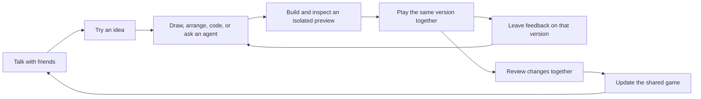
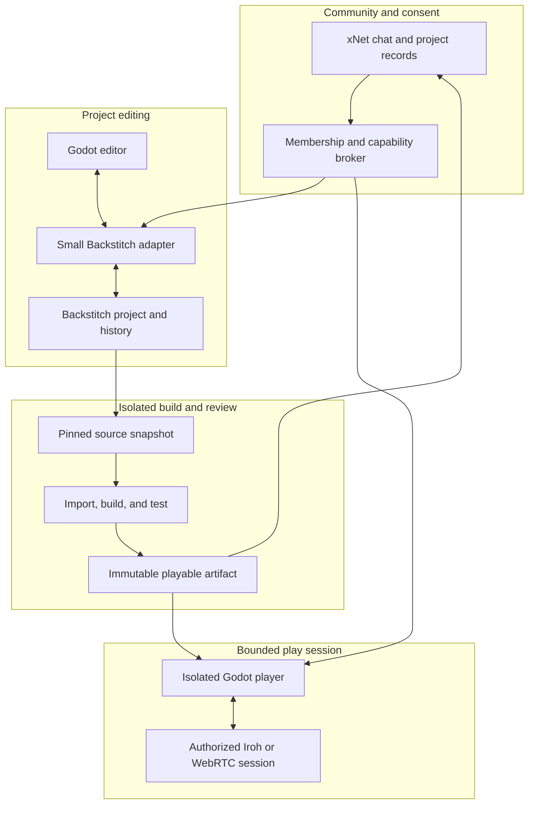
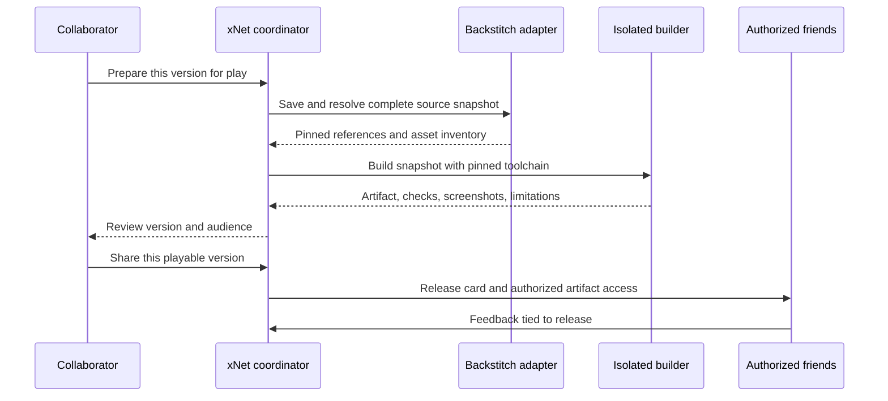

# A game workshop inside the conversation

> [!NOTE]
> **Latest direction, October 27:** [0493: A game studio we can share](./0493_[_]_COLLABORATIVE_GODOT_STUDIO.md) makes Godot and Backstitch the first authoring workflow, with GitHub source, Pages publishing, Bluesky discovery, and optional community hosting. It supersedes the interim Backstitch-optional sequencing in [0492](./0492_[_]_GITHUB_FOR_GAMES.md). This document remains the deeper engine and security research; historical playable releases remain optional.

> [!TIP]
> Explore xNet as a place where friends can talk, make a game, try each other's ideas, and keep building together. Use Godot for the game engine and Backstitch for collaborative project editing. Connect them through xNet's groups, permissions, development history, and playable previews.

**The first deep integration should open Godot beside xNet and put the game inside the chat.** The valuable work is making invitations, changes, playtests, and feedback feel continuous. Embedding the whole editor is a separate, expensive problem.

This extends [0490: xNet for young people](./0490_[_]_XNET_FOR_YOUNG_PEOPLE.md). That exploration starts with friends ages 16–25 and separates adult testing from work with minors. Here we also consider younger children, especially in supported clubs and small groups. These are different settings with different needs; a single unrestricted editor is unlikely to serve them all.

This is a research proposal, not an implemented integration or a claim that the current app is ready for children. Revisit it on November 24 to decide whether a bounded technical prototype merits further work. No public API, protocol, revenue model, or child-facing launch is accepted here.

## The experience worth building

Four friends have a chat called **Moss Club**. They want to make a game about getting tiny creatures across a flooded garden.

Someone chooses **Make a game** and starts from a small cooperative template. They can play it immediately. One friend draws a creature. Another changes how high it jumps. A third rearranges the stepping stones. Someone else mainly plays and notices that the last jump is impossible. All four have useful roles.

The conversation acquires a few ordinary objects:

| In the chat                  | What it does                                                            |
| ---------------------------- | ----------------------------------------------------------------------- |
| **Our game**                 | Opens the latest approved playable version; shows who can play and edit |
| **Try an idea**              | Makes an experiment with a clear audience and a return path             |
| **Maya changed the jump**    | Shows a short description, visual change, and playable comparison       |
| **Play together**            | Starts a temporary session of one exact version                         |
| **Feedback on this version** | Attaches a comment to the version, optionally to a scene or moment      |
| **Bring into our game**      | Reviews and incorporates an experiment into the shared version          |

The young person does not need to understand Git before participating. They should still be able to answer: What changed? Who can see this? Can I undo it? Am I playing my idea or the group's version?

An agent can help when asked: “Could the creature grab the edge if I almost make the jump?” It works on an experiment, runs checks, shows what it changed, and offers a playtest. Friends decide whether they like the result. Drawing, arranging a scene, writing GDScript, changing a parameter, and asking for help should all lead into the same project.

The group can stop for the evening without breaking a streak. Nobody needs to publish the game or make it impressive. The point is having somewhere to make things together.

## What Backstitch already contributes

Backstitch is unusually close to this vision. Its research grew out of the difficulty of teaching collaborative game development with conventional version control. The Ink & Switch report describes a gradual path from making changes together to using branches, visual differences, and merges. That is relevant prior art, rather than evidence that our proposed experience has already been validated with children. [Backstitch research report](https://www.inkandswitch.com/project/backstitch/phase-2/).

The current product synchronizes saved scene and resource changes, supports branching and merging, and makes changed nodes and properties visible in Godot. It uses Automerge and supports local work with remote synchronization. “Real time” here should not be read as every cursor movement or unsaved keystroke appearing instantly. The current tutorial makes saving the boundary for sharing a change. [Backstitch](https://backstitch.dev/), [making changes](https://backstitch.dev/docs/tutorial/making-changes).

The current manual installation guide specifies **Godot 4.7 or later**. The repository's Rust bindings select the 4.7 API. Older research and contributor instructions discuss a custom Godot build; we should not turn those historical instructions into an assumption that today's integration requires an engine fork. Pin and test an exact Godot, Backstitch, and export-template combination. [Manual setup](https://backstitch.dev/docs/installation/manual-setup), [Backstitch dependencies](https://github.com/inkandswitch/backstitch/blob/125ee79180fe24ac549e85aad946dfd6714dc9dc/Cargo.toml).

| Area                                           | Research status on October 27, 2026                             | Implication                                                          |
| ---------------------------------------------- | --------------------------------------------------------------- | -------------------------------------------------------------------- |
| Collaborative Godot editing                    | ✅ Present in Backstitch                                        | Reuse it instead of building another scene-file collaboration engine |
| Visual differences and branches                | ✅ Present                                                      | Connect chat feedback and experiments to these concepts              |
| Local work and Git compatibility               | ✅ Documented                                                   | Preserve normal project export and independent backup                |
| General external integration API               | 🔎 Useful Rust interfaces found; no stable xNet bridge verified | Build a small adapter, preferably upstreamable                       |
| Per-project server authorization               | ⚠️ Missing from the documented server model                     | A signed-in user is not necessarily an authorized collaborator       |
| Secure read-only sharing through the Webviewer | ⚠️ Explicitly not a security boundary                           | Do not use its read-only URL as a private group's permission system  |
| Multiplayer gameplay                           | ➕ Separate integration                                         | Editing a project together does not synchronize a running game       |
| Child-ready deployment                         | ➕ Unproven                                                     | Requires execution isolation, supported settings, and user research  |

Backstitch describes itself as alpha software and recommends separate backups. We should introduce it as an experimental collaboration tool, with recovery built into the prototype. [Current documentation](https://backstitch.dev/docs).

### Two access-control gaps change the design

The sync server's README says its default is unauthenticated and that knowing a project ID allows access to its data. Its optional OIDC support authenticates users but does not implement authorization; accepting a Google login does not restrict the server to the intended group. A private network can restrict reachability, but it does not supply xNet's project roles. [Sync server README](https://github.com/inkandswitch/backstitch-sync-server/blob/e8c3a985589586420b36d619b02012d2d62f0ced/README.md).

The Webviewer offers a read-only link, but its README explicitly says the restriction is superficial and the original project ID can be recovered. That link must not become our “only these friends can play” mechanism. [Webviewer README](https://github.com/inkandswitch/backstitch-webviewer/blob/e5a21a6214cab93509c43de223aa7284ceb12b62/README.md).

> [!IMPORTANT]
> An xNet invitation cannot secure an upstream server merely by hiding its address. Permissions must hold at every data and execution boundary, including direct requests that bypass xNet's interface.

## Four responsibilities, four kinds of state

The main architectural choice is to let each system own what it is good at.

| Responsibility                    | Owner in the proposed design                       | Examples                                                                  |
| --------------------------------- | -------------------------------------------------- | ------------------------------------------------------------------------- |
| Community and development context | xNet                                               | Membership, chat, requests, feedback, consent, attributed release records |
| Editable game project             | Backstitch                                         | Scenes, scripts, resources, branches, merge history, source assets        |
| Reviewed playable version         | A build and artifact service                       | Immutable export, asset manifest, toolchain versions, test evidence       |
| Live play session                 | Godot networking with an xNet-authorized transport | Inputs, snapshots, join/leave, temporary host state                       |

Do not translate every Automerge change into a Yjs update or a NodeStore edit. That would create competing authorities for the same project. xNet should store durable references to project versions, along with the conversation and decisions around them. Backstitch should retain its own history.

Likewise, do not store each movement of a game character in the durable chat database. A match may save an agreed checkpoint or result, but its network traffic has different requirements from a document.

The arrows crossing these boxes require explicit interfaces and authorization. This is a proposed division of responsibility, not a diagram of services that already exist.

## Where this fits in the current xNet prototype

The local chat-first worktree already has useful pieces. It does not have a Godot integration.

| Existing code                                                                                      | Useful foundation                                                         | Additional work                                                                |
| -------------------------------------------------------------------------------------------------- | ------------------------------------------------------------------------- | ------------------------------------------------------------------------------ |
| [Extension development records](../../packages/workbench/src/communities/extension-development.ts) | Requests, attempts, feedback, versions, selected chat context and digests | A project type that references a multi-file Godot snapshot                     |
| [Extension projects](../../packages/workbench/src/communities/ExtensionProjects.tsx)               | Building together inside a conversation                                   | Game cards, audience information, playtests, scene-linked feedback             |
| [Extension versions](../../packages/workbench/src/communities/extension-versions.ts)               | Attributed ancestry and change inspection                                 | Delegate scene differences to Backstitch; keep ordinary script differences too |
| [Extension surfaces](../../apps/electron/src/main/extension-surfaces.ts)                           | Isolated renderer surfaces and capability prompts                         | A separate Godot player profile and artifact loader                            |
| [Surface policy](../../apps/electron/src/main/extension-surface-policy.ts)                         | Denied network and navigation, constrained resources                      | Explicit WASM and game-asset support without widening every extension's policy |
| [Agent preview checking](../../apps/electron/src/main/community-extension-check.ts)                | Screenshots and iterative interaction checks                              | Game input, semantic probes, deterministic scenes, multi-client checks         |
| [Extension rooms](../../apps/electron/src/main/extension-rooms.ts)                                 | Short-lived Iroh sessions and observable connection state                 | Group-bound authorization and the delivery semantics needed by the game        |
| [Room policy](../../apps/electron/src/main/extension-room-policy.ts)                               | Expiring invitations, bounded frames and participants                     | Versioned game protocol, revocation behavior, explicit release binding         |

The current room prototype allows a host and three guests, uses one-hour invitations, limits frames to 1,000 bytes, and sends datagrams with bounded rates. It is useful evidence that a small play session belongs in the product. It is not a general Godot networking backend. Its invitation is a bearer capability tied to an application hash; possessing it is not the same as proving current group membership.

The existing screenshot checker also does not understand a game's scene tree just because it can see the rendered canvas. We need explicit checks for the things the game is meant to do.

## Integration options

| Approach                                           | What people get                                                       | Main cost or limitation                                                                  | Recommendation                                        |
| -------------------------------------------------- | --------------------------------------------------------------------- | ---------------------------------------------------------------------------------------- | ----------------------------------------------------- |
| Link to an ordinary Godot project                  | A quick way to share files from chat                                  | Collaboration, identity, review, and permissions remain disconnected                     | Useful baseline for comparison                        |
| **Native Godot beside xNet, with a deep adapter**  | Shared projects, attributed changes, integrated previews and feedback | Adapter, authorization, isolated execution, toolchain management                         | **Preferred first technical direction**               |
| Embed the native editor inside Electron            | One window                                                            | Cross-platform rendering, focus, accessibility, lifecycle, and sandbox complexity        | Defer until a demonstrated need                       |
| Put the full Godot web editor in chat              | A browser-shaped entry point                                          | Current web editor does not support GDExtensions, so Backstitch cannot simply load there | Separate long-term investigation                      |
| Replace Backstitch with xNet scene synchronization | One nominal data stack                                                | Rebuild scene semantics, diffs, merges, and recovery; lose specialist work               | No compelling reason at present                       |
| Start with a curated game workbench                | Accessible scene and rule editing inside xNet                         | Less freedom than the whole engine                                                       | Preferred initial experience for younger participants |

The last two recommended choices can coexist. A constrained workbench can edit data in a fixed, reviewed Godot template. More experienced collaborators can open the same project in the full editor once an appropriate execution environment exists. The transition should preserve the game, its authors, and its history.

Godot's web editor is still documented as preliminary, with limitations including GDExtensions and exporting. It is worth watching, but it is not an available shortcut to embedding today's native Backstitch plugin. [Godot web editor](https://docs.godotengine.org/en/stable/tutorials/editor/using_the_web_editor.html).

## Make “try an idea” a real promise

An experiment needs two separate properties:

1. **It does not disturb the shared game.** This is a version-control property.
2. **Only the intended people can see it.** This is an authorization property.

A branch can provide the first without providing the second. We have not verified a private-branch authorization boundary in Backstitch. xNet must not label an ordinary shared-project branch “private.”

For the first prototype, an experiment can be explicitly **shared with Moss Club**. A genuinely private experiment should live locally or in a separate protected project/access domain. Bringing it back means intentionally sharing a snapshot or changes. The original private history does not automatically travel with that operation.

This matters especially for children. An unfinished drawing, a joke that did not land, or a failed attempt should not become visible to everyone merely because a merge makes it technically reachable.

### Source collaboration is also code execution

Godot's `@tool` scripts run in the editor. Native code can also enter through extensions and plugins. Godot documents that tool scripts operate inside the editor without protective restrictions on their use. Merely opening or importing a received project can therefore cross an execution boundary before someone clicks Play. [Running code in the editor](https://docs.godotengine.org/en/stable/tutorials/plugins/running_code_in_the_editor.html).

Automatic synchronization into an open native editor is particularly sensitive: a collaborator's saved change may become executable on another person's machine. A permission to edit a shared game must not silently become permission to execute arbitrary code on every collaborator's computer.

The proposed policy has two tracks:

| Track                    | What can change live                                                  | Required environment                                                                 |
| ------------------------ | --------------------------------------------------------------------- | ------------------------------------------------------------------------------------ |
| Curated workbench        | Validated level data, bounded rule parameters, approved asset formats | Fixed reviewed engine/template, isolated import pipeline, resource limits            |
| Full Godot collaboration | Scripts, scenes, tools, and other project content                     | A separately secured editor/import/build environment suitable for untrusted projects |

Even an image or audio import needs limits and isolation; treating something as data does not make its parser invulnerable. Agents follow the same rules as human contributors.

## Permissions that describe an activity

The user-facing question should be “Who can play or change this game?” It should not begin with a form full of repository IDs and transport settings.

| Role          | Can do                                                  | Does not automatically receive                                 |
| ------------- | ------------------------------------------------------- | -------------------------------------------------------------- |
| Player        | Run an approved artifact and join an allowed playtest   | Source project, private chat, editing credentials              |
| Collaborator  | Read and edit the explicitly shared project             | Other projects, personal files, permission to publish publicly |
| Reviewer      | Inspect changes and approve a shared release            | Authority over everyone's accounts or private experiments      |
| Group steward | Manage membership and the group's agreed sharing policy | A right to inspect unrelated personal work                     |

These are proposed capabilities, not a rigid hierarchy. In a small adult group, people may hold several. A youth club needs clear responsibility without making every creative decision an adult approval queue.

The project and the conversation can have different audiences. Someone invited to play a game should not receive the chat that produced it. A friend leaving the group should lose future access, while the interface is honest that previously downloaded material cannot be recalled.

An invitation can offer **Play**, **Help make it**, or **Ask to join**. It shows the group, inviter, scope, and whether an adult facilitator is involved. It does not auto-open an executable project or install a plugin. Public sharing, if introduced later, is a separate release operation with a separate audience.

### Enforce access below the interface

A bounded self-hosted prototype could use one isolated Backstitch backend and storage area per collaboration access domain, behind an xNet-aware gateway. Every HTTP and WebSocket route must pass through that boundary; backend addresses must not remain publicly reachable. A gateway only checking the WebSocket handshake is insufficient if the admitted client can request other projects' documents.

For wider use, work toward authorization in the server itself: membership-bound credentials, roles, authorized document inventories, expiry, and session termination on removal. Project-linked binary documents and historical versions need the same checks as current scenes.

The current server exposes sync, document, historical-head, and change-list routes. Its code also documents a Webviewer/OIDC incompatibility and an option to disable authentication for that viewer. We should solve the incompatibility or use a separate artifact player, not disable protection to make a preview work. [Server routes and middleware](https://github.com/inkandswitch/backstitch-sync-server/blob/e8c3a985589586420b36d619b02012d2d62f0ced/src/main.rs).

This server can read the Automerge documents it serves. TLS and a private network do not make that storage end-to-end encrypted. State plainly who operates it and what they can read. A future encrypted replication design would be additional work, including key distribution and removal behavior. [Server document handling](https://github.com/inkandswitch/backstitch-sync-server/blob/e8c3a985589586420b36d619b02012d2d62f0ced/src/web.rs).

## A deep adapter without an engine fork

Backstitch's Rust `ProjectViewModel` exposes useful operations: project and branch identifiers, local changes, history references, merge/revert previews, synchronization status, and files at a reference. These are promising integration points, not a promised stable external SDK. [Current project API](https://github.com/inkandswitch/backstitch/blob/125ee79180fe24ac549e85aad946dfd6714dc9dc/backstitch/src/project/project_api.rs).

Start with a narrow adapter owned by the user-installed integration. It can report project state, prepare a snapshot, open a particular change, and execute an approved branch operation. Prefer upstream coordination over a permanent fork.

The local bridge needs its own trust boundary. Use an authenticated local channel with per-session credentials, explicit project scope, bounded messages, and no general shell operation. A downloaded project cannot choose an arbitrary filesystem root, replace the bridge binary, or tell it to read a credential store. Loopback networking by itself is not authorization.

Backstitch currently connects to its server through an authenticated WebSocket path. Direct Iroh replication of editor changes would require a transport adapter or another deliberate integration; xNet using Iroh elsewhere does not make that happen automatically. Preserve the working sync path initially, while making its hosting and authorization explicit. [Backstitch connection implementation](https://github.com/inkandswitch/backstitch/blob/125ee79180fe24ac549e85aad946dfd6714dc9dc/backstitch/src/project/connection.rs).

### One coordinator for project files

Godot, Backstitch, an agent, and xNet must not independently overwrite the same working directory. Establish one project lifecycle coordinator. Agent edits happen in an isolated experiment, and the coordinator imports or applies approved changes through a defined path. It must account for unsaved editor state and a branch changed by another collaborator while the agent was working.

The UI should distinguish **saved here**, **syncing**, **available to collaborators**, and **built for play**. A successful local save is not proof that everyone has the project or that a playable build exists.

## A playable version needs more than a source hash

The release record should connect a stable source checkpoint to the exact artifact someone plays. Because a project can span documents and binary assets, first verify how to pin a complete snapshot; one convenient change hash may not represent every required dependency.

Proposed record fields, without freezing a public schema:

| Record              | Contents                                                                                     |
| ------------------- | -------------------------------------------------------------------------------------------- |
| Project snapshot    | Backstitch project reference, necessary document heads, file and asset manifest              |
| Build identity      | Exact engine, Backstitch adapter, export templates, dependency versions, build configuration |
| Playable artifact   | Content hashes, sizes, entry point, required capabilities, license notices                   |
| Development context | Selected chat messages and digests, request, authors, agent/model provenance where relevant  |
| Review evidence     | Tests actually run, screenshots, known limitations, human approval and audience              |
| Ancestry            | Parent versions and the changes brought into this version                                    |

Keep an immutable record of what was approved. A mutable branch link can be convenient for collaborators, but it should never masquerade as the reviewed artifact.

This crosses stores, so it is not one database transaction. Use a durable job with explicit stages and retries. An interrupted build remains incomplete. A failed upload does not create a release card that claims to be playable. Publishing the record is the final step after checking artifact availability.

### Conversation history without involuntary publication

For a collaborator with access, **How we made this** can reconstruct the selected discussion that led to a version, including requests and feedback. Preserve the existing distinction between live messages and the frozen inputs actually supplied to an agent.

A public game should carry a chosen development note and attribution, not the group's complete conversation. Exporting a fresh source snapshot can avoid carrying private editing history; filtering a visible timeline is not equivalent. Define retention and deletion behavior before promising that development history lives forever, especially for children. A hash can establish consistency; it does not prove who had consented to publication.

## Run games without granting them the computer

> [!WARNING]
> A native Godot process is not a security sandbox. Native APIs include process execution and operating-system access. Electron's renderer sandbox does not automatically constrain a separate Godot process. [Godot OS API](https://docs.godotengine.org/en/stable/classes/class_os.html).

There are at least four places to isolate: receiving/importing assets, editing executable projects, building, and playing. An agent that edits or runs a project is a fifth. A safe exported game does not excuse an unsafe import step used to produce it.

### Prefer a constrained web player for shared previews

A Godot web export is a promising first player. Current exports use WebAssembly and WebGL 2 with the Compatibility renderer. GDScript is the practical initial language; Godot 4 C# projects currently cannot export to the web. Single-threaded exports reduce isolation and embedding requirements; multithreaded exports need the appropriate cross-origin isolation headers. These are real product constraints, not defects to hide. [Godot web export documentation](https://docs.godotengine.org/en/stable/tutorials/export/exporting_for_web.html).

Use a dedicated player origin/session and an explicit resource manifest. The current extension surface permits a very small resource set and denies workers and arbitrary connections; a `.wasm` engine and `.pck` assets are not a drop-in replacement. Add a separate policy rather than relaxing restrictions for every extension.

The player should have no Node integration, host filesystem, application cookies, inherited chat credentials, arbitrary navigation, or general network bridge. Explicit capabilities could include bounded project-local saves, gamepad input, and one authorized play session. Microphone, camera, files, and external network access remain separate decisions. The player does not need them just because Godot can use them.

A web sandbox reduces host access; it does not eliminate engine vulnerabilities, resource exhaustion, deceptive content, or harm between players. Patch the runtime, limit resources, and give users an always-available stop control outside the game.

### Full native editing needs a harder boundary

Before inviting children into arbitrary shared projects, demonstrate a credible editor/import/build boundary on each supported platform: for example a properly configured VM or OS sandbox, with a narrowly mounted project directory, trusted read-only tools, no ambient credentials, and restricted network access. Measure GPU support, input latency, accessibility, memory, and startup cost. Running a process in a temporary directory is not sufficient.

A remotely isolated development environment is another option, but brings hosting costs, network dependence, and an operator who may see the source. This exploration does not assume that a performant, cross-platform native editor sandbox is already solved.

Imported project configuration must not select arbitrary engine executables, download URLs, working directories, or build commands. Backstitch's launcher supports configurable engine locations and downloads, which are useful for trusted development but need a host-controlled policy here. [Launcher configuration](https://github.com/inkandswitch/backstitch-launcher/blob/main/README.md).

Until this boundary works, a younger child's first experience should use curated templates and validated edits. That is a meaningful creative product in its own right, not a claim that the full native editor has been secured.

## Multiplayer: editing together and playing together

Godot already offers a high-level multiplayer model over different transports. Browser exports have different networking capabilities from native exports. Reuse the engine's concepts where appropriate, while validating game actions and authority at the application level. A peer connection alone does not make an honest game. [Godot high-level multiplayer](https://docs.godotengine.org/en/stable/tutorials/networking/high_level_multiplayer.html).

There is also an existing community **Godot Iroh** plugin. Its current README supports Windows, macOS, and Linux; web exports and mobile are not supported. This is a strong candidate to evaluate before writing a native transport, but it has not been audited here or shown compatible with xNet's room protocol, identity, or relay policy. Its current dependencies include Iroh 1.2.0 and Godot Rust 0.5.5, so exact compatibility needs a pinned experiment. [Godot Iroh README](https://github.com/tipragot/godot-iroh), [dependencies](https://github.com/tipragot/godot-iroh/blob/main/Cargo.toml).

| Runtime path                         | Candidate transport                                      | Work still required                                                           |
| ------------------------------------ | -------------------------------------------------------- | ----------------------------------------------------------------------------- |
| Godot web export inside xNet desktop | A narrow JavaScript bridge to xNet's native Iroh service | Game message protocol, authority checks, release binding, delivery semantics  |
| Native Godot                         | Evaluate the existing Godot Iroh plugin                  | Authentication, protocol compatibility, sandbox integration, relay controls   |
| Ordinary browser player              | Godot WebRTC with authorized signaling                   | Browser/native interoperability, STUN/TURN deployment, privacy and cost tests |

A custom `MultiplayerPeerExtension` is an engine-supported integration point, but has obligations around modes, channels, peer lifecycle, and packets. Do not claim the existing xNet datagram broker implements all of it. [Godot transport extension API](https://docs.godotengine.org/en/stable/classes/class_multiplayerpeerextension.html).

WebRTC still needs signaling and may need TURN for relay. Godot's native WebRTC support uses an extension. An Iroh relay is not a TURN server, and the two transports are not interchangeable on the wire. [Godot WebRTC](https://docs.godotengine.org/en/stable/tutorials/networking/webrtc.html).

### Keep the first game small

Use a two-player cooperative 2D garden puzzle. One peer is the temporary host and validates player actions. Peers render smoothly from less frequent state updates. Reliable events such as joining or collecting an item need acknowledgments/retries or a reliable channel; lossy position snapshots have different needs. Backstitch does not receive these per-frame updates.

Start with a proposed 20 Hz update budget and small bounded messages, then measure it. That is an experiment target, not a verified performance claim. Expand to four players only after the two-player path survives loss, delay, reconnection, and host exit.

All participants must join the same release and compatible game protocol. If the project changes during a session, offer a restart into the new release. Do not silently hot-swap scripts underneath other players.

The current xNet room closes when its host leaves; automatic host migration is not implemented. An initial game can save a checkpoint and explain that someone needs to start another session. Predictable recovery is better than a frozen game that appears connected.

For a child-facing setting, scope sessions to admitted participants and the selected release. Direct peers may learn network addresses. A relay-only privacy mode must be demonstrated in the actual transport, with no silent fallback to direct connections; if that cannot be enforced, exclude that route from the relevant pilot. Explain the tradeoff to older users rather than promising that all peer-to-peer connections are anonymous.

## Agents should make a testable contribution

The agent's task is to help the group express an idea. Its authority should follow the project and selected context, rather than the full authority of a developer's logged-in computer.

An existing Claude Code or Codex installation may have broad filesystem and tool access. Launching it with a project-focused prompt does not remove that authority. Use an isolated harness with scoped tools, or limit the integration until that can be enforced. Agent access to chat, source, secrets, external services, and execution are separate grants.

For minors, provider eligibility and the supported account arrangement must be checked before enabling any cloud agent. Do not assume an adult's account can be shared with children. The creative workflow must work without an AI subscription.

### A concrete check-and-revise loop

Suppose the request is “make the creature grab a ledge.” The agent should:

1. Read the selected request and the permitted project snapshot.
2. Change an isolated experiment with a recorded parent version.
3. Import and build it inside the restricted environment.
4. Run a scene test that demonstrates approaching, grabbing, releasing, and missing a ledge.
5. Capture real frames and inspect visual issues such as clipping and camera framing.
6. If the mechanic is multiplayer, run two clients and check both clients' observed state.
7. Revise failures within a bounded time/resource budget.
8. Offer a playable result with the checks performed and anything still uncertain.

Useful game-specific probes could expose scene-node state, input actions, collision outcomes, and test assertions. These are deliberately scoped debug facilities, unavailable to arbitrary players. A screenshot alone cannot establish that a game is playable, accessible, or safe. Agent-authored assertions also need independent fixtures and human playtesting; an agent can write a test that merely agrees with its own mistake.

The chat can show **Changing movement → Checking the jump → Testing with another player → Ready to try**. Expand the details on demand. A failed build should remain a failed attempt with a useful explanation, not a confident “done.”

## Designing with younger creators

The age bands below are research tracks, not claims about a universal developmental timetable. Build on the rights, support, and evidence distinctions in [0490](./0490_[_]_XNET_FOR_YOUNG_PEOPLE.md).

| Setting                        | A useful starting experience                                       | Support and boundaries                                                             |
| ------------------------------ | ------------------------------------------------------------------ | ---------------------------------------------------------------------------------- |
| Friends ages 18–25             | Full creative project workflow and optional agents                 | Adults choose their own groups, sharing, and tools                                 |
| Ages 16–17                     | Similar creative power, with supported co-design                   | Age-appropriate account arrangements, clear help routes, deliberate public sharing |
| Ages 13–15 in a club           | Templates, scene building, scripting when the environment is ready | Known group, accountable facilitators, limited discovery, explainable permissions  |
| Ages 8–12 in a supported group | Drawing, levels, sounds, simple rules, immediate play              | Curated workbench, no arbitrary native plugins, no open stranger discovery         |

Do not start with a public game marketplace, follower counts, stranger DMs, spending, or a ranking of the most productive children. Begin with known groups and a few shared projects. This reduces the initial scope; it does not make bullying or unsafe adults disappear.

Participants need a way to leave, block, report, or ask for help outside the immediate group. Facilitator access should be legible. Secret monitoring and automatic emotional profiling are not substitutes for care. Group administration should not become ownership of a child's identity or personal work.

Creative ownership also includes the right to say no to a remix. Use clear permission and attribution choices for original art, music, voices, and source. Engine licensing does not grant rights to a child's drawing or a commercial sound file. Godot's MIT terms require appropriate notices; project assets need their own provenance and permissions. [Godot license](https://godotengine.org/license/).

### Help people understand the space

Avoid making fast reading, keyboard shortcuts, voice chat, or programming vocabulary prerequisites. Provide keyboard navigation, visible focus, readable labels, text alternatives to voice, remappable controls, reduced motion, and a way out of the game that remains outside its canvas. A game canvas needs its own accessibility work; an accessible surrounding chat does not supply that automatically.

Test on devices participants actually have. Godot, Electron, and a local agent together may demand more memory and storage than a family laptop can spare. A browser player can widen access to playing, but it does not solve browser-based editing with Backstitch. Shared computers need clear account separation and removal of local credentials after sign-out.

Most importantly, involve young people in choosing the tools and the rules. Ask whether an experiment felt safe to share, whether changing the game felt like their own work, and whether it was easy to stop. Do not turn those questions into a behavioral scoring system.

## Durability, cost, and exit

The first proposal is peer-to-peer where practical and hosted where useful. Backstitch synchronization, offline catch-up, build workers, artifact storage, and relayed gameplay may all require servers. “Decentralized” cannot mean that unavailable peers somehow supply files or computation.

Budget the components separately:

| Resource                    | Main driver                                       | First control                                           |
| --------------------------- | ------------------------------------------------- | ------------------------------------------------------- |
| Source and history storage  | Project assets, binary changes, retained versions | Per-project quotas, documented retention, tested backup |
| Playable artifacts          | Export sizes and repeated versions                | Content-addressed assets and explicit retention         |
| Sync and download traffic   | New collaborators and large assets                | Bounded projects, caching, observable egress            |
| Gameplay relay              | Participants, message rate, route                 | Small rooms, session limits, measured relay use         |
| Builds and isolated editors | CPU/GPU time, memory, concurrency                 | Curated templates, resource caps, scheduled work        |
| Community support           | Onboarding, moderation, recovery                  | A deliberately small supported pilot                    |

No monthly hosting price is established by this research. A cheap metadata server is not a budget for relaying game traffic or running isolated editors. This proposal adds no revenue lane; any later paid offering must satisfy all five tests in the [charter](../CHARTER.md).

Users should be able to export a normal Godot project with assets and license notices, plus their authorized development records. Preserve the appropriate Backstitch history where feasible, and explain when a clean snapshot intentionally omits it. Test opening an export with xNet absent and restoring a backup with the original sync server unavailable. Hashes without the referenced bytes are not a backup.

Retention has a social consequence as well as a storage cost. Keep playable releases and private experiments distinct. Give people clear choices about old work, while being honest that distributed copies and collaborators' records cannot all be erased remotely.

## A staged investigation

Each stage should produce evidence for a decision, not an automatic commitment to the next stage. These items remain unimplemented.

### Stage 0 — Establish the integration seam

**Participants:** two adult developers, synthetic projects, no private chat or children's data.

- [ ] Pin a compatible Godot, Backstitch, export-template, and adapter toolchain on two machines.
- [ ] Demonstrate save, offline edit, reconnection, branch, merge, and recovery using Backstitch itself.
- [ ] Build a read-only adapter that reports project, branch, changes, and sync status to a local xNet project card.
- [ ] Resolve and export one complete source snapshot, including binary assets and required document references.
- [ ] Record where unsaved state, incompatible changes, or concurrent branch operations prevent reliable coordination.

**Decision:** Can xNet integrate without owning Godot's editor or duplicating Backstitch's data model?

### Stage 1 — Secure project access and a playable release

- [ ] Isolate a test backend behind membership-enforcing access controls on every endpoint.
- [ ] Demonstrate that an unaffiliated account, leaked project ID, guessed document ID, and removed member cannot obtain new protected data.
- [ ] Establish an isolated import/build path before processing arbitrary received projects.
- [ ] Produce an immutable, manifest-checked web artifact from the pinned snapshot.
- [ ] Run it in a dedicated restricted player and attach it to the right chat/version.
- [ ] Show accurate pending, failed, ready, unavailable, and revoked states.

**Decision:** Can a player enjoy the game without gaining source, chat, or machine access?

### Stage 2 — Build, review, and revise together

- [ ] Add a scoped experiment workflow with explicit shared/private semantics.
- [ ] Connect Backstitch visual changes and script differences to the project's version history.
- [ ] Have an isolated agent implement one mechanic, test it, capture evidence, and revise a known defect.
- [ ] Demonstrate that another person can give feedback, make a competing experiment, and bring an approved change into the shared version.
- [ ] Preserve selected development context without leaking it into a player-only or public artifact.

**Decision:** Does this feel substantially easier than sharing a repository link and talking in a separate chat?

### Stage 3 — Play the exact version together

- [ ] Implement the two-player cooperative example through one chosen transport path.
- [ ] Bind admission to the approved release and intended participants, rather than a leaked bearer link alone.
- [ ] Exercise loss, latency, duplicate/oversized messages, reconnect, version mismatch, and host departure.
- [ ] Measure direct and relayed behavior; demonstrate the claimed privacy mode on the actual transport.
- [ ] Record CPU, memory, startup, import time, save-to-peer delay, asset transfer, and relay traffic on representative machines.

**Decision:** Is the experience reliable enough to invite people who cannot debug network failures?

### Stage 4 — Co-design a supported creative experience

- [ ] Test the workflow with adult friends first, including people who do not code.
- [ ] Prepare an age-specific safeguarding, consent, privacy, accessibility, and provider-eligibility plan before recruiting minors.
- [ ] Co-design with a supported older-teen group only after execution and access boundaries have been demonstrated.
- [ ] Separately prototype the younger-child workbench and evaluate it with appropriate facilitators and participant assent.
- [ ] Record frustration, exclusion, confusing sharing boundaries, unwanted social pressure, and reasons participants prefer their existing tools.

**Decision:** Do the intended participants want this place, and can the team support it responsibly?

## Validation that can disprove the proposal

Security and correctness checks need negative cases. The following are proposed acceptance experiments, not new CI gates or claims of a complete security audit.

| Experiment                       | Pass condition                                                                                             | Evidence of failure                                                       |
| -------------------------------- | ---------------------------------------------------------------------------------------------------------- | ------------------------------------------------------------------------- |
| Leaked project link              | Uninvited client gets no source, history, or assets                                                        | Any protected document can be retrieved directly                          |
| Player-only invite               | Player receives only the approved artifact and session scope                                               | Source API or private chat is reachable                                   |
| Private experiment               | Only its stated audience can retrieve its data                                                             | Another shared-project collaborator can enumerate it                      |
| Malicious project                | Editor/import/build confinement blocks host-file reads, subprocess escape, and disallowed network requests | A fixture accesses a host secret or produces an unapproved effect         |
| Untrusted launcher configuration | Host-selected toolchain and paths remain authoritative                                                     | Project chooses a binary, download source, or directory outside its scope |
| Revoked collaborator             | New sessions fail; active authority expires or is terminated within a declared bound                       | Removed member keeps receiving future protected changes indefinitely      |
| Incomplete build                 | No ready release appears until all required artifacts are verified                                         | Play card points to missing or mismatched bytes                           |
| Broken game mechanic             | Harness detects an intentionally broken ledge-grab case                                                    | Checks stay green when the mechanic is removed                            |
| Multiplayer mismatch             | Incompatible release/protocol is rejected clearly                                                          | Clients join and diverge silently                                         |
| Host exit                        | Other players get a clear end/recovery path                                                                | Frozen scene still says connected                                         |
| Relay-only mode                  | Network observation confirms no direct peer route                                                          | Direct connection occurs despite the setting                              |
| Service disappearance            | Authorized export and backup restore work independently                                                    | The only copy or required credential lives on the missing service         |

- [ ] Execute the access-control experiments against HTTP, WebSocket, history, and binary-asset paths.
- [ ] Keep malicious fixture content out of real projects and use disposable environments for execution tests.
- [ ] Verify keyboard-only navigation, non-voice participation, stop controls, and reduced-motion behavior in the real app.
- [ ] Have a reviewer other than the generating agent inspect the authorization and execution boundaries before a youth pilot.
- [ ] Document unsupported platforms and unresolved failure modes instead of treating an incomplete check as passed.

## Questions to take to the Backstitch community

These are research questions; no outreach has been sent.

- Which integration interface would the maintainers want another local-first application to use?
- What is the supported way to pin a complete project snapshot across scene and binary documents?
- Is per-project authorization planned, and could xNet contribute a useful implementation rather than a private fork?
- Which branch operations and editor reloads are safe under concurrent external edits?
- How should genuinely private experiments be separated from shared project history?
- What does the current classroom experience reveal about confusion, recovery, and the moments when branching becomes useful?
- Which Godot/export combinations are tested, and how should an integration handle upgrades and older projects?

## Recommendation

Start with **a two-person game workshop linked to one xNet chat**. Keep Godot as the editor and Backstitch as the source collaboration system. Build the small adapter and the isolated playable release path before attempting an embedded editor or a new synchronization protocol.

Make the first shared game a cooperative 2D toy. Prove that one person can change it, another can understand the change, both can play the same version, and either can recover their work without the service. Then add an agent that participates through the same experiment and review process.

For younger children, start with a curated workbench whose creative affordances are good enough to be enjoyable on their own. Opening the full engine becomes a further capability once its execution boundary is credible, not a hidden risk inside the first invitation.

This could make the “digital Legos” idea concrete: people get a working thing, can see how it fits together, and can change it with their friends. The contribution from xNet is the relationship between the people, their decisions, their permissions, and the evolving project. Godot and Backstitch make that project a much more capable creative medium.

Research scope, source revisions, and limits

Research date: October 27, 2026. Primary documentation, current public source, and the local chat-first xNet worktree were inspected. No Backstitch project was installed or run, no server was deployed, and no child-facing workflow was tested. Compatibility and security statements above distinguish documented behavior from proposed work.

Pinned upstream revisions used for source inspection:

| Repository             | Revision                                   |
| ---------------------- | ------------------------------------------ |
| Backstitch             | `125ee79180fe24ac549e85aad946dfd6714dc9dc` |
| Backstitch sync server | `e8c3a985589586420b36d619b02012d2d62f0ced` |
| Backstitch Webviewer   | `e5a21a6214cab93509c43de223aa7284ceb12b62` |

The launcher and Godot Iroh references use their current default branches and should be pinned before any implementation. Godot's stable documentation changes over time; several pages also flag incomplete updates for the newest release. Test the selected toolchain rather than assuming all current documentation describes one uniform compatibility set.

Local xNet references point to an unmerged prototype, including uncommitted work. They demonstrate available design seams, not generally released guarantees. The Godot integration, game-specific agent harness, and stronger room authorization described here remain proposed.

The [young-people exploration](./0490_[_]_XNET_FOR_YOUNG_PEOPLE.md) supplies the broader evidence and rights discussion. This document adds technical and product implications; it makes no claim that building games improves clinical outcomes or that decentralization alone makes a community safe.

Accepting a public project manifest, capability protocol, or long-term history policy later would require the repository's ADR process and a concrete tripwire for reconsideration. This draft does not accept those decisions.

