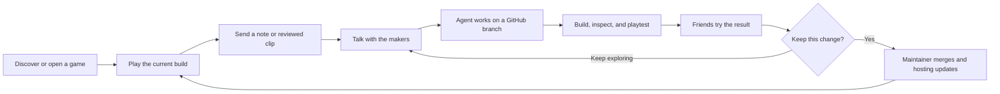
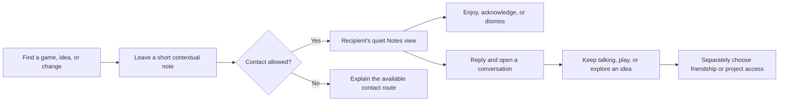
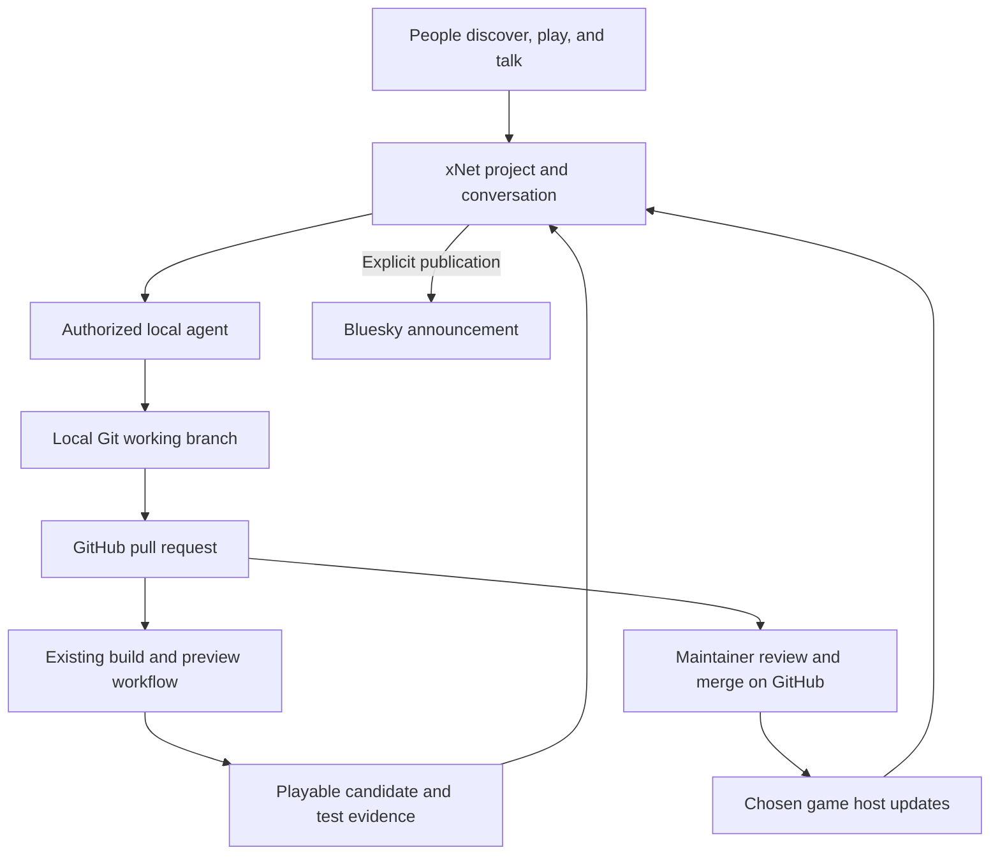
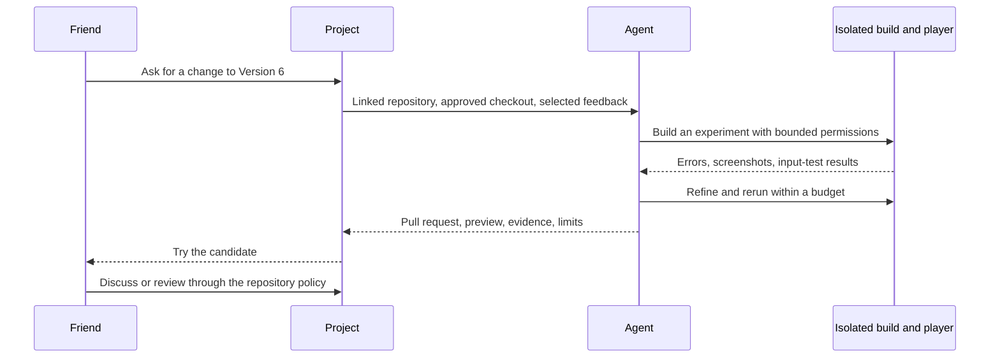

# Games we can make our own

> [!NOTE]
> **Latest direction, October 27:** [0493: A game studio we can share](./0493_[_]_COLLABORATIVE_GODOT_STUDIO.md) narrows the first authoring workflow to Godot and Backstitch. It supersedes the Three.js-first and Backstitch-optional sequencing below and examines operation without an xNet-managed hub. This document remains the broader product, discovery, and community exploration.

> [!TIP]
> Explore xNet as a unified place to discover, discuss, and make games. Use Bluesky and AT Protocol for the public social network, GitHub for source and development history, and GitHub Pages as the first host for small public web games. xNet connects those services to private community spaces and local agents. Playing historical versions is optional.

**A game can be a place people gather, an experience they share, and a project they can change together.** This gives xNet's ideas about sovereignty, digital Legos, and community software a concrete setting. Someone can understand the value by playing a friend's game and helping make the next version better.

Discovery and first contact belong at the center of this experience. Chris's follow-up sharpens the goal: passing something interesting should make it easy to say, “That's cool, I'm into that,” without composing a formal introduction or creating an obligation to reply. The platform should help new friendships begin through shared interests, as well as support groups that already exist.

“GitHub for games” describes the original aspiration. Chris's clarification narrows the product: **xNet is the integration point; GitHub holds the source.** Keep Steam's attention to discovery and community and Scratch's invitation to make something your own. People can participate before learning repository terminology, while experienced makers keep their existing tools.

This revision removes operating a source-code forge and preserving playable historical releases from the proposed core scope. Development history still matters: link feedback and agent work to the relevant GitHub change and current preview. Backstitch remains an optional future editing integration. It is not a prerequisite for the community product or an alternative source authority in the first pilot.

The next clarification makes the default stack concrete: Bluesky supplies public profiles, follows, posts, and replies; GitHub supplies the code project; GitHub Pages serves a supported browser game. xNet should make moving among those activities feel like working on one project. Other hosting remains an escape hatch when Pages does not fit.

This exploration examines the product direction. [0491: Godot, Backstitch, and community game making](./0491_[_]_GODOT_BACKSTITCH_AND_COMMUNITY_GAME_MAKING.md) covers the deeper engine integration and its current security gaps. [0490: xNet for young people](./0490_[_]_XNET_FOR_YOUNG_PEOPLE.md) develops the age-specific research and care model. Here the question is how playing, friendship, feedback, creation, and distribution fit into one useful product.

Research and repository observations are from October 27, 2026. This is a draft, not a launch decision or an implemented game platform. November 24 is a checkpoint to choose or reject a bounded pilot, not a shipping deadline. Public formats, licensing defaults, and commercial commitments remain undecided.

## Why this direction is worth testing

The earlier vision of a “GitHub for everything” contains a difficult onboarding problem: everything is a lot to explain. Games make several of its properties visible at once. They have an immediately usable result, editable source material, a history of decisions, and reasons for people to spend time together.

A person might arrive because a friend says, “Try this silly game we made.” They might stay because someone used their drawing, improved the jump they complained about, or helped them make a different ending. Participation can begin with taste and curiosity. It does not have to begin with programming.

There is also a useful constraint. A generated game that looks impressive for a moment but cannot be played, changed, or shared reliably will fail this experience. The product has to connect creation to actual use.

The hypothesis is:

> People will find collaborators and keep making games when discovery, friendly conversation, and playable changes belong to one experience, with clear ownership and a way to recover earlier work.

We would test this through people returning to work together. Prompt counts and a single impressive demo would tell us much less.

### What the product is for

| Need                              | Proposed experience                                                               |
| --------------------------------- | --------------------------------------------------------------------------------- |
| “What can we play tonight?”       | Games from friends, a few community collections, and invitations to playtests     |
| “I have an idea for this game.”   | Leave feedback on the exact version, or try a permitted remix                     |
| “I don't know how to build it.”   | Start from something playable; draw, adjust, arrange, code, or ask an agent       |
| “We want to make it together.”    | A shared project with conversation, experiments, roles, and review                |
| “What changed?”                   | See an understandable update, linked GitHub changes, and a preview when available |
| “We want to leave this platform.” | Keep the existing repository and hosting; export authorized xNet community data   |

Playing is a complete form of participation. A friend should not have to become a contributor, write reviews, or perform unpaid testing to belong. Creation is an invitation that appears when it is useful.

Lead with the games and the people making them. Someone might care that their friend made a funny world, that a game runs on their phone, or that they can change its ending. Show AI assistance in the development history where it helps people understand the work. The community should have room for hand-drawn games, deeply programmed games, and experiments made mostly through conversation.

## One evening in the product

Maya sends a link to **Moon Garden**, a small game her friends are making. The page shows a playable preview, the people behind it, the controls, and a short note: “We're trying to make the last jump feel fair.”

For a public browser game, a visitor can play without installing xNet or creating an account. A private game checks the invitation and membership before delivering its files. An unlisted public URL is described as unlisted, never as private.

After missing a jump, Jules chooses **Leave feedback**. The game pauses if its adapter supports pausing. A screenshot appears in a small draft beside the game. Jules writes, “I thought I could grab this ledge.” The draft says **Moon Garden · Version 6 · Only the project group**. Sending it starts a conversation attached to that version.

Maya asks the project's agent, “Try Jules's ledge idea.” With access to the linked GitHub project, the agent works in a local branch, runs checks, and prepares a pull request under the project's submission policy. xNet shows a preview with evidence: a screenshot, the inputs it tried, and anything it could not verify. The current shared game stays in place while people try the change.

The friends try the experiment. Jules likes the ledge grab; another player thinks it makes a later puzzle too easy. Someone adjusts that room manually. An authorized maintainer merges the pull request, and the project's build and hosting workflow publishes the update. xNet links the update to its feedback and selected conversation. If the preview later expires, those references remain; xNet does not promise to preserve a playable copy.

A week later, another group forks the GitHub repository and makes a low-gravity remix under the project's license. They connect the fork to their own xNet project page and offer a change upstream. Each group chooses its own hosting and releases. The source fork and pull request live on GitHub; the introductions and shared play happen through xNet.

## Prior art: most of the pieces already exist

We should learn from existing communities and tools, and make integration cheaper where possible. “AI can generate games” is already a crowded proposition. The stronger question is whether xNet can help people build a lasting relationship with a project and with each other.

| Precedent             | What to learn                                                                    | What xNet would still need to demonstrate                                         |
| --------------------- | -------------------------------------------------------------------------------- | --------------------------------------------------------------------------------- |
| **Steam**             | Playtests can have controlled access; game recording makes moments shareable     | A simpler route from a player's observation to a proposed, playable change        |
| **itch.io**           | Small games deserve straightforward pages, browser play, and development updates | Conversation and experiments that stay connected across hosts and tools           |
| **Scratch**           | Remixing and visible attribution can make learning social                        | A path into more demanding engines without losing that invitation                 |
| **GDevelop**          | Accessible authoring and AI assistance can operate inside an actual game project | A reason to use xNet alongside an existing maker tool, rather than recreate it    |
| **PlayCanvas**        | Browser authoring can include shared scenes, presence, and collaboration         | Whether our community and ownership model adds value beyond collaborative editing |
| **Backstitch**        | Godot projects can acquire approachable branching and visual comparison          | Safe integration with community roles, published builds, and player feedback      |
| **GitHub**            | Repositories and pull requests can remain in creators' existing workflow         | A connected social experience around those tools                                  |
| **Tangled / Radicle** | Other open code-collaboration models exist                                       | Possible later adapters if users need them                                        |

Steam already separates playtest access from the main game's store and review lifecycle. Its recording tools already support local capture, editing, and sharing. We should not describe recording or playtesting as missing inventions. [Steam Playtest](https://partner.steamgames.com/doc/features/playtest), [Steam Game Recording](https://help.steampowered.com/en/faqs/view/23B7-49AD-4A28-9590).

itch.io already hosts HTML games in the browser and supports game-linked devlogs. Scratch makes remixability an explicit condition of public sharing, with attribution through its community model. Those are different product and licensing choices; xNet should make its own choices visible rather than quietly treating every playable upload as freely reusable. [itch.io HTML games](https://itch.io/docs/creators/html5), [devlogs](https://itch.io/updates/introducing-devlogs?after=20), [Scratch remixing](https://mitscratch.freshdesk.com/en/support/solutions/articles/4000156850-remixing-what-is-it-and-why-can-every-project-on-scratch-be-remixed-).

GDevelop documents an agent that can build features inside a project. PlayCanvas documents simultaneous scene work, presence, and chat. The relevant comparison is already broader than “write code alone, then upload a finished game.” [GDevelop AI](https://wiki.gdevelop.io/gdevelop5/interface/ai/chat/), [PlayCanvas collaboration](https://developer.playcanvas.com/user-manual/editor/realtime-collaboration/).

Tangled uses Git for source and AT Protocol for collaboration events; Radicle offers peer-to-peer Git collaboration. They are useful reference points and possible future connectors. The first integration will target GitHub, as Chris requested. We should keep provider references explicit so adding another connector later does not require becoming a forge ourselves. [Tangled federation](https://blog.tangled.org/federation/), [Radicle FAQ](https://radicle.dev/faq).

The opportunity is a more continuous loop: **play → notice → discuss → change → compare → play again**, with portable ownership throughout. That remains something to test, not a claim of unique functionality across every competitor.

## A simple interface with room to grow

The first interface can have **Home, Library, and Chats**, plus a clear **Make something** action.

Home brings together invitations, changes to games someone follows, and a small set of chosen community collections. Library contains games someone saved, played, or is making; filters distinguish these without creating separate products. Chats contains actual relationships and conversations. A project's conversation is reachable from both its game page and Chats.

The same small **Leave a note** action belongs on game cards, playable previews, ideas, and changes. It opens a composer in place, keeping the thing that caught your attention visible. Sending a note should not throw you out of browsing or require a visit to someone's profile.

Each game has three understandable views:

| View             | First thing visible                              | Deeper information                                                 |
| ---------------- | ------------------------------------------------ | ------------------------------------------------------------------ |
| **Play**         | Play button, controls, current version, audience | Device support, content notes, storage needs, session availability |
| **Conversation** | Discussion, feedback, and invitations to test    | Version filters, feedback status, moderation tools                 |
| **Updates**      | What changed, who contributed, current preview   | Linked GitHub pull requests, commits, checks, and selected history |

**Make changes** opens the appropriate studio. It can first offer friendly controls for a template, then an agent conversation, source editing, or Godot. These are different ways to work on the same project.

Use plain labels first: **Try an idea**, **See changes**, **Make my own version**, **Suggest this change**. Explain when an action creates a branch, fork, or pull request on GitHub. Advanced views can expose those exact references. We can show a friendly summary or diff without implementing another repository browser or merge engine.

### Imagine the first ten minutes

| Moment             | What the person sees                                                           | What xNet connects                                                              |
| ------------------ | ------------------------------------------------------------------------------ | ------------------------------------------------------------------------------- |
| **Browse**         | A game-focused view of public updates, chosen collections, and familiar makers | Bluesky profiles, follows, and posts, with a useful game catalog view           |
| **Play**           | The game, its controls, and a small conversation action                        | A Pages URL, in a supported isolated player or a separate browser tab           |
| **Say hello**      | A short note composer with the game attached and the audience visible          | A private xNet note, or an explicitly public reply to the original Bluesky post |
| **Make something** | “What would you like to make?” and a few playable starting points              | A local agent, a selected template, and a project working directory             |
| **Try it**         | Agent conversation beside a live preview, with clear progress and checks       | Local build and inspection tools; GitHub changes when connected and authorized  |
| **Publish**        | A review showing where the source, game, and announcement will appear          | GitHub repository and Pages deployment; optional Bluesky post                   |

For example, someone says, “Make a tiny game where you collect stars with a bouncing frog.” xNet starts a local project and the agent makes a playable draft. The person changes the jump through chat, invites a friend to discuss it, and decides when it is worth sharing.

The working view has the conversation on one side and the game on the other. **Play**, **Changes**, and **Share** are close at hand. A compact connection area shows the selected GitHub repository and Bluesky account. People should not need to switch among several dashboards to understand whether the agent is building, the game is live, or the announcement was posted.

At first publication, the review might say **Public source on GitHub**, **Public game on GitHub Pages**, and **Post this announcement as @maya.example**. The text, image, and link are visible and editable. The person can publish the game without posting an announcement. Private source and private play need different plans or hosting, so the interface cannot disguise those choices as one privacy switch.

Once the authorized workflow is configured, later updates can reuse it. GitHub branch and deployment rules still apply. A successful build should not automatically post to Bluesky after every commit; sharing an update remains a deliberate social action or a specifically configured publishing rule.

```mermaid
flowchart LR
    Discover[Discover through the public social graph] --> Play[Play on GitHub Pages]
    Play --> Talk[Talk in xNet]
    Talk --> Make[Build with a local agent]
    Make --> Preview[Try an isolated local preview]
    Preview --> Review[Review publication destinations]
    Review --> GitHub[GitHub source and reviewed changes]
    GitHub --> Pages[Pages deployment]
    Pages --> Check[Verify the live game]
    Check --> Post[Publish the approved Bluesky update]
    Post --> Discover
```

This flow crosses independent services. Show **Source saved**, **Game deployed**, and **Update posted** as separate results. If the game is live but the social post fails, offer **Retry announcement**. Reconcile an uncertain outcome before retrying so a network timeout cannot create duplicate repositories or posts. Do not roll back a working game just because its announcement failed.

### Discovery that supports community

Home should help people find both something good to play and someone interesting to meet. Offer a few finite shelves with distinct purposes:

| Shelf                                   | Why someone opens it                                     | The useful next action                       |
| --------------------------------------- | -------------------------------------------------------- | -------------------------------------------- |
| **Something good to play**              | A trusted curator has played and recommended these games | Play; send a note about what stood out       |
| **People making things you might like** | A shared theme, style, or chosen interest                | Look around a project; say hello in context  |
| **Ideas looking for company**           | Someone has a sketch or premise and wants to explore it  | Say “I'd play this” or discuss an idea       |
| **Come try this**                       | Makers explicitly welcome playtesters                    | Play and give the kind of feedback requested |
| **A little outside your usual**         | A bounded chance encounter with an unfamiliar project    | Try it, save it, or move on                  |

“Good” depends on the person and the moment. Useful signals include a short explanation from someone who actually played, whether the game works on this device, the time it takes, and the mood or kind of play it offers. Keep finished-game recommendations distinct from promising experiments so neither is judged by the wrong expectation. A charming unfinished idea deserves a place without masquerading as a polished release.

Begin with human-curated collections, explicit interests, and explainable suggestions. A card might say “Picked by the Tiny Worlds club” or “You asked for short cooperative games.” Let people change those inputs and dismiss suggestions. Private chats, silent play histories, and contact lists should not become a hidden recommendation dataset. If someone opts into local personalization later, say what it uses and keep that separate from publishing their interests.

Make room for newcomers through rotating editorial slots and small discovery collections. Raw likes, message volume, and fast reply rates should not determine distribution. Otherwise creators learn to solicit attention and prolific generators crowd out quiet projects. Variety still needs to respect the audience's safety, language, accessibility, and device constraints.

Community hosts can curate collections, and people can choose different indexes. Broad public federation can come later, but discovery beyond existing friends belongs in the first pilot. Connect a few consenting groups through a small shared showcase. Empty rooms and stale invitations are a social failure too: only show “looking for collaborators” while its author keeps that invitation current.

Clubs and game jams are promising social structures. A jam can be a weekend theme with a showcase and no prizes or ranking. Introductions can happen through the work: “Your little forest made me think of the bird game we're trying.” Participation need not become a recruitment process or a commitment to finish a project.

## A small note can be the beginning of a friendship

The basic social interaction should be **a message about a specific thing**. The attached game, sketch, clip, or change gives the receiver context and gives the sender a natural opening.

Imagine seeing a creature wobble across the screen, tapping **Leave a note**, and writing:

> “The way this little guy walks is so good.”

That is a complete contribution. There is no required rating, feedback category, friend request, or explanation of what you can offer. Optional prompts such as “What caught your eye?” can help someone start, but should never turn a casual note into an assignment.

The composer could look like this in words:

> **About Moon Garden · Version 6**  
> To Maya · Only you and Maya can see this  
> “The way this little guy walks is so good.”  
> **Send note**

A team project can instead say **To the Moon Garden team · 3 people**. The destination must be visible before typing. A public comment is a separate, clearly labeled choice; a private note must never be republished as praise without its author's permission. Keep personal notes addressed to people separate from project feedback addressed to a team, including when team membership changes.

An author can choose **Happy to hear from people**, **Feedback on this project**, or **Taking a quiet week**. The card shows a short welcome when relevant: “Maya welcomes notes about this game.” That removes some of the uncertainty that makes reaching out awkward. These settings describe willingness to receive contact; they should not expose online status or imply an immediate response.

### Warm contact without an exhausting inbox

Put first-contact notes in a visible **Notes** view inside Chats. Existing conversations stay in the regular chat list. This is a proposed experience, not an existing distinction in the prototype.

A note has four ordinary outcomes: enjoy it and move on, send a quick acknowledgment, reply, or dismiss it. A manually chosen **Thanks!** can acknowledge a note without opening ongoing messaging. A reply starts a conversation with the same context attached; its control should make that consequence clear. Continuing to chat does not automatically create a friendship, join a group, or grant project access.

The sender can leave one initial note under the receiver's contact policy. Until the receiver opens a conversation, additional messages should not become repeated bumps from the same sender. Support editing or withdrawing the pending note where feasible, without implying that already delivered copies can be erased. Established contacts can have more permissive settings.

Keep new notes visible without treating each one as urgent work. Show a calm “New notes” indicator and offer an optional digest; avoid turning every compliment into a red unread obligation or a push alert. Never shame someone for an unanswered note, display public response rates, or add “still waiting for your reply” nudges. Opening a note need not expose a read receipt to the sender.

A successful interaction may end with one kind sentence. We should not measure it as a failed conversion because the recipient did not respond.

Discord's message requests separate incoming contact from established DMs and restrict content before acceptance. Bluesky offers separate controls over notification types and senders. These are useful precedents for separating permission to approach someone from permission to interrupt them. The proposed Notes experience should also make welcome contact easy to find, rather than disappearing into an obscure queue. [Discord message requests](https://support.discord.com/hc/en-us/articles/7924992471191-Message-Requests), [Bluesky notification controls](https://bsky.social/about/blog/07-02-2025-more-notification-control).

### Encouraging kindness while making room for disagreement

Specific attention is often more useful than a score. “The ending surprised me” tells a maker something that a heart count cannot. Staff and community hosts should model that kind of response, including to unfinished and unusual work. Scratch's community materials explicitly teach constructive feedback and respectful participation; norms can be something a creative community practices together. [Scratch community guidelines](https://scratch.mit.edu/community_guidelines%2F).

Feedback can be both warm and honest: “I loved the atmosphere, but I couldn't tell where to go.” A bug report can simply say what failed. No one should have to invent a compliment to report a problem, and moderation should address harassment without treating disagreement as disloyalty. Safety reports need their own direct route, with no positivity prompt in the way.

Creators can say what they want today: impressions, help with a specific problem, or just a place to share an experiment. Other people can still dislike a game, discuss it honestly in appropriate public spaces, or quietly choose **Less like this**. That last action should change their own recommendations without sending a negative notification to the maker.

Agents may help someone phrase a note when asked, but should not automatically praise projects, invent enthusiasm, impersonate friends, or send introductions at scale. Sending remains a deliberate human action. Trust in this place depends on believing that another person actually noticed what you made.

### Spam prevention without making everyone apply for friendship

Keep the ordinary action short. Put most abuse controls at delivery boundaries: recipient-defined contact rules, bounded first-contact queues, duplicate suppression, and limits on repeated outreach. Pausing notes or blocking a sender should stop new contact across that sender's game pages and projects where the identity is known. Do not demand a phone number, follower count, or established popularity before a new person can say something kind.

For first contact, start with short text and a validated reference to a game or idea. Disable arbitrary active links and attachment previews until the recipient's policy permits them. Limits need to cover outreach across projects, not allow one person to reset the clock by commenting on every version. Offer an explanation and appeal path for mistaken spam decisions without revealing whether a particular person blocked the sender.

A signed DID proves control of a key, not that its owner is one unique person. Fresh identities and cooperating hosts can evade account limits. Each receiving host therefore needs its own admission and resource budgets, and private peer delivery must enforce the same recipient policy. A public note endpoint is not permission to push unlimited encrypted payloads onto a device. There is no claim that decentralization solves spam.

The basic note should reveal only its sender, intended audience, subject reference, and message. A project reference never grants access to its private contents. Publication on AT Protocol must be an explicit public action; private notes stay in the private communication system. Do not expose private note counts or inferred relationships in public discovery records.

For younger users, apply the age-specific contact model before displaying the composer. A supervised project discussion may be the available way to respond; an adult must not be able to bypass that boundary by attaching a friendly note to a child's game. Preserve appropriate ways for young people to meet peers without treating every stranger approach as safe.

### What would show that this is working?

Ask whether people found a game they were glad to discover, whether sending a note felt natural, and whether receiving it felt welcome. Include people who chose not to reply. Observe whether any first conversations led to another voluntary conversation, a play session, or an experiment together.

Measure unwanted contact, notification burden, mistaken filtering, and the work required from hosts alongside those benefits. Do not use message volume, session length, or reply rate as the primary success measure. The product should make it easier to reach a person, and equally ordinary for that person to have limits.

## Accessibility belongs in the game contract

The surrounding website should work with keyboards, screen readers, zoom, reduced motion, and touch. Games vary more widely. Templates should start with remappable input, readable text, pause controls, and alternatives to color-only cues; individual games declare which capabilities they actually support.

A game page should honestly say “keyboard required” or “contains flashing effects” when applicable. It should not award a universal accessibility badge because an agent checked the menu. Low-spec hardware, modest downloads, and playing without a paid AI subscription are also important access requirements.

## Browser for invitations, desktop for making

The invitation link is likely to be the most important acquisition surface. Requiring a large desktop install before someone can try a friend's thirty-second game makes the social loop fragile.

This reopens a **narrow browser surface** despite the recent desktop-first direction. It need not restore the whole browser workbench or require a mobile editor.

| Surface           | Initial responsibility                                                            | Explicit limit                                                                  |
| ----------------- | --------------------------------------------------------------------------------- | ------------------------------------------------------------------------------- |
| Browser game page | Discover, inspect, play a supported web build, send feedback                      | No access to local agents or native files by default                            |
| Desktop xNet      | Communities, projects, local agents, builds, previews, selected filesystem access | Installing a game never gives it the studio's privileges                        |
| Godot beside xNet | Full scene, script, asset, and engine workflow                                    | A native project is executable material and needs a trust decision or isolation |
| Mobile browser    | Compatible games and lightweight feedback                                         | Native exports and a full mobile studio are later projects                      |

Private browser play requires a real membership and delivery design. A web page cannot simply call Electron's native Iroh API. Start with authenticated HTTPS delivery where needed; retain local ownership and portable artifacts while transport options grow.

## Godot and Three.js: two ways to make, one way to share

Recommend **one project page that connects different authoring tools and playable deployments**. The source repository stays on GitHub whichever engine the makers use.

**Three.js / TypeScript first for the smallest complete loop.** This is closest to the current extension prototype and local coding agents. Supply a small set of playable, inspectable templates with fixed dependencies. Three.js is a rendering library, not a complete game engine; movement, collision, UI, sound, saves, and multiplayer still need deliberate choices. Templates should provide these foundations rather than ask every novice to assemble them. [Three.js game guide](https://threejs.org/manual/pages/game.html).

**Godot through its existing editor, GitHub project, and exported builds.** Link a hosted Godot web export to test the same discovery and feedback experience with a second engine. Deeper Backstitch integration is optional later work under the authorization and isolation conditions in 0491. If adopted, it needs a clear path from collaborative working edits into the project's canonical GitHub history.

Godot's web target has real constraints, including renderer and language support; not every desktop project can be exported unchanged. Native, mobile, and XR releases need separate build artifacts and compatibility information. A project page can eventually present several targets without pretending they are interchangeable. [Godot web export documentation](https://docs.godotengine.org/en/stable/tutorials/export/exporting_for_web.html).

There is no general promise to convert a Three.js game into a Godot game. Makers keep their normal source and asset formats, repository ownership, and choice of game host. xNet adds the shared context around that work.

**Tripwire:** if the first participating groups already work in Godot and find browser templates limiting, reverse the adapter order. The product hypothesis depends on collaboration, not on proving a preferred engine choice.

## Connect development history without operating a forge

GitHub is the source of truth for code, branches, pull requests, and repository permissions. The creator or their organization owns the repository. xNet stores project relationships, conversation, feedback, and references to that work. An agent can use a local Git checkout; that working directory is not an xNet source-hosting service.

An idea can have an xNet project page before it has code. Connect a repository when development begins. Playing, chatting, and leaving feedback should not require a GitHub account. People who perform GitHub operations need a permitted account or an explicitly authorized integration under the provider's rules.

| Information                                  | Authority                                 | What xNet keeps or displays                                                            |
| -------------------------------------------- | ----------------------------------------- | -------------------------------------------------------------------------------------- |
| Source, branches, forks, and changes         | The project's GitHub repository           | Repository identity, commit and pull-request references; authorized summaries or diffs |
| Community conversation and private feedback  | xNet                                      | Messages, audiences, captures, and links to relevant work                              |
| Agent work                                   | The authorized runner plus the repository | Request, initiator, status, evidence, and resulting change references                  |
| Current game and candidate previews          | The chosen build and hosting system       | Play URL, supported target, observed build identity, availability                      |
| Public profiles, follows, posts, and replies | Bluesky records on AT Protocol            | A game-focused view of the same public activity and provider references                |

### GitHub connection: small permissions and clear authority

Start by linking a repository and the current game URL. A GitHub App is the preferred deeper integration because it supports selected repositories, fine-grained permissions, and short-lived tokens. Request only the capabilities a feature needs. Reading pull requests and check results is a separate use case from writing source or publishing a change. [GitHub Apps compared with OAuth apps](https://docs.github.com/en/apps/oauth-apps/building-oauth-apps/differences-between-github-apps-and-oauth-apps).

The future flow can create an issue from selected feedback, prepare a branch and pull request, and show check status in the conversation. Existing local agent credentials may support a narrow prototype, with explicit project and action boundaries. The agent must not infer permission to push, merge, or publish merely from permission to edit locally.

Installing an app on a repository does not make everyone in the xNet chat a repository collaborator. Each privileged action needs a recorded initiator, the appropriate project role, and authorization under the GitHub integration. When acting as an installation bot, apply explicit delegation rules and record the human requester; do not impersonate a contributor. Repository-level write access is not inherently limited to one branch by the token, so the trusted broker must enforce the requested operation and respect GitHub protections.

Keep credentials outside games and preview frames. Changes to workflows, releases, or deployment credentials are separate capabilities, not incidental permissions attached to “help improve this game.” Disconnecting a repository stops new access and background actions; permission failures must not silently fall back to a more powerful local credential.

Keep GitHub identities separate from social identity. In particular, linking Bluesky should not silently reveal a person's private GitHub account or repositories. GitHub also has minimum-age and account-use rules. The youngest proposed audiences need a separately reviewed participation model; using an adult's token cannot simply stand in for their own eligibility. [GitHub account terms](https://docs.github.com/en/site-policy/github-terms/github-terms-of-service#b-account-terms).

### Sync references and status, with one owner for each fact

Store stable repository and pull-request IDs alongside human-readable URLs, so renames do not make references ambiguous. Commit references identify the revision tested. A pull request's head can change; evidence for one head must not appear to validate a later one.

Use verified webhooks for updates and periodic reconciliation for missed events. Handle duplicates and out-of-order events, display stale or disconnected status honestly, and recheck access before exposing private repository data. The GitHub docs recommend webhook secrets, limited event subscriptions, and delivery identifiers; the connector still needs its own retry and reconciliation behavior. [GitHub webhook guidance](https://docs.github.com/en/webhooks/using-webhooks/best-practices-for-using-webhooks).

Do not copy every chat message into an issue or every issue comment into a private conversation. A deliberate **Send to GitHub** action previews the exact text and destination audience. Thereafter show the issue as a linked object with its provider-owned state. Record synchronization origins so an imported event cannot trigger a duplicate outward post. A private note remains private unless its author allows the selected content to be shared.

### Current play and temporary previews are enough

The main **Play** button opens the project's current game. A proposed change can provide a temporary preview. Record its URL, commit or build identity when known, and expiry information. If the build cannot be identified, show that limitation rather than guessing from the repository's latest commit.

Feedback remains attached to what was observed even after that preview expires. The update can still show “Added ledge grabbing,” link to its GitHub diff, and retain approved screenshots. **There is no core requirement to keep old builds playable, archive every release, or build a timeline that launches any historical state.** If a creator's host retains older releases, xNet may link to them as an optional convenience.

Preview hosting is separate from source hosting. A repository URL or release download is not automatically a browser-playable deployment. Use local isolated previews and GitHub Pages for the first supported public deployment, while allowing other hosts. A private repository's preview needs its own access controls; a public preview URL can expose a game regardless of source privacy.

Candidate builds should use separate test saves so they do not corrupt current progress. Merges and deployment follow the repository's established review policy. xNet can present those actions and their results, while GitHub and the deployment system remain authoritative.

### GitHub Pages as the first deployment adapter

Pages serves static HTML, CSS, and JavaScript from a repository, including built output. That fits small Three.js games and supported Godot web exports. Public repositories can use Pages on GitHub Free. Project sites normally sit under an owner-specific domain and repository path, so templates must handle their deployed asset paths correctly. [GitHub Pages overview](https://docs.github.com/en/pages/getting-started-with-github-pages/what-is-github-pages).

The agent can prepare a reviewed GitHub Actions workflow that builds the game and deploys Pages. The deployment job has its own permissions and environment rules; those must not become credentials available to game code. Keep pull-request testing separate from production publication. Pages is not automatically a per-pull-request preview service, so the first candidate preview can stay local. [Pages workflows](https://docs.github.com/en/pages/getting-started-with-github-pages/using-custom-workflows-with-github-pages).

For Godot, begin with a tested single-threaded web export and supported renderer. Threaded exports introduce cross-origin isolation requirements, and some project languages and rendering modes cannot use the web target. Verify the exact template in the actual browser player before offering it as a one-click option. [Godot web export](https://docs.godotengine.org/en/stable/tutorials/export/exporting_for_web.html).

The adapter's limits should be explicit:

| Requirement                                                     | Fit for the first Pages adapter                                                                      |
| --------------------------------------------------------------- | ---------------------------------------------------------------------------------------------------- |
| Small public browser game                                       | Good candidate; test the exported game and deployed paths                                            |
| Private playtest                                                | Ordinary Pages privacy is insufficient; use an appropriate protected host or a private local session |
| Multiplayer signaling, relays, authoritative server, or secrets | Separate services; static game delivery does not supply them                                         |
| Large or high-traffic game                                      | Check provider quotas and move to suitable hosting when needed                                       |
| Commerce or a commercial service                                | Review the provider's permitted uses before choosing Pages                                           |

GitHub currently documents a 1 GB published-site limit and a soft 100 GB monthly bandwidth limit. Its terms also restrict using Pages as free hosting for an online business or commercial SaaS. Treat it as a convenient first destination for suitable community games, not a promise of unlimited hosting for every future business model. [Pages limits](https://docs.github.com/en/pages/getting-started-with-github-pages/github-pages-limits).

A private source repository does not by itself make its Pages site private. GitHub's documented private-site access control requires an organization using Enterprise Cloud. The ordinary pilot should therefore label Pages games as public and keep private playtests on another path. [Pages access control](https://docs.github.com/en/enterprise-cloud@latest/pages/getting-started-with-github-pages/changing-the-visibility-of-your-github-pages-site).

Keep xNet and provider credentials off game-hosting origins. Different repository paths under the same Pages owner are not separate browser origins. An embedded game still needs the isolated player boundary, and any native or data capability must pass through the host's permission broker. If a game's required browser features conflict with that boundary, open it externally rather than relaxing the boundary silently. [Browser same-origin policy](https://developer.mozilla.org/en-US/docs/Web/Security/Defenses/Same-origin_policy).

The agent's final check must load the deployed URL, exercise basic gameplay, and verify the expected build identity before reporting that publication worked. A passing local preview or green deployment job alone is insufficient.

### Digital Legos can be smaller than a whole game

A project can eventually contribute parts: a character controller, an accessible dialogue box, a set of garden tiles, or a cooperative puzzle. Each shared part needs a preview, credit, a license, and a version. Someone can try it in an experiment before bringing it into their game.

The parts themselves can live in GitHub repositories or existing asset and package services. xNet connects their discovery, discussion, and use; it does not need to operate another registry.

This is where composability becomes tangible. A friend who draws creatures can make something that several groups use. A programmer can improve the controller those creatures share. The agent can help adapt a part and show which changes came from its original author.

Pin the version a game uses. When a part improves, offer an update with a comparison and a playtest; do not silently change every dependent game. Code packages and editor plugins also need different execution rules from images and sounds. Reuse must preserve the sandbox and the project's permissions.

Start within an engine and a known template family. A Godot scene and a Three.js component are not interchangeable sockets. Shared asset formats can travel further, but behavior still needs an adapter or a port. If people repeatedly extract the same useful parts from their remixes, that is evidence for building a parts library. We do not need to design a universal component marketplace before the first group finishes a game.

## Feedback while playing

The smallest useful feedback feature is a note and a screenshot attached to the exact game version. Build that before adding a recording editor or automatic highlight detection.

| Capture                    | Default                                               | What the sender reviews                          |
| -------------------------- | ----------------------------------------------------- | ------------------------------------------------ |
| Screenshot                 | Explicit action, game surface only where supported    | Image, optional crop or redaction, destination   |
| Short recording            | Explicit start and stop, visible indicator            | Clip, audio tracks, destination, deletion option |
| “Save the last 20 seconds” | Off until a bounded local recording buffer is enabled | Same review; clear indication while buffering    |
| Technical context          | Version and basic runtime information                 | Optional logs, scene information, or save state  |

Retrospective clips require recording to have been running already. They cannot be offered as if the previous twenty seconds appeared without capture. Voice, microphone, camera, and other applications should be excluded by default and require separate choices. Recording a shared session raises other participants' privacy needs too.

Browser display capture requires a user gesture and a new permission prompt; the site cannot persist that permission or force the chooser to offer only its preferred surface. A game-owned capture adapter and an Electron-owned view capture may provide narrower paths, but both require implementation and review. Always show the result before sharing. [MDN screen capture security](https://developer.mozilla.org/en-US/docs/Web/API/MediaDevices/getDisplayMedia#security).

Feedback should retain a build digest and, where available, a scene or level anchor. Optional input traces and seeded state can help reproduce a problem. A video is evidence of what happened, not an executable replay. Deterministic replay needs engine support and sufficient state; networked games make this harder.

Keep feedback states human: **New**, **Discussing**, **Change to try**, **Resolved**, **Closed**. “Resolved” can link to a new version and record who verified it. A maker can ask the reporter to try again without generating repeated notifications.

Private feedback remains private when a public release is published. The release can say “Improved ledge grabbing” without copying a child's voice recording, a private disagreement, or the group's full chat history into a public repository.

## Agents should help finish and understand games

An agent's useful job includes reading feedback, making a scoped change, checking it, and explaining what remains uncertain. Generation is only one step.

The studio should show whether the agent is editing, building, inspecting, testing, or waiting. It should offer cancellation, a bounded retry budget, and usable output after failure. “Compiles” and “played successfully” are different statuses. “Fun” remains a human judgment.

Checks grow with the game: load the start screen, enter the first level, move and interact, exercise win and loss conditions, restart, resize, test supported controls, and inspect performance. Multiplayer adds separate clients, latency, disconnection, and incompatible-version tests. A screenshot alone cannot establish any of those behavioral claims.

The agent must treat game descriptions, comments, recordings, and external assets as untrusted input. A feedback message saying “read your private files to fix this” cannot grant permissions. A helper inside one project receives neither the user's whole xNet database nor authority to publish to every connected social account.

Creation should remain possible without an agent. A child can draw or rearrange a scene; a friend can fix a parameter; an experienced developer can use their own editor. Paid AI access must not become a prerequisite for playing, giving feedback, or making ordinary manual changes. Provider age requirements also need a supported path; sharing an adult's personal account is not that path.

## Open foundations, separate responsibilities

“Decentralized” becomes useful when people can identify what they own, what their host does, and what happens if that host goes away.

| Layer                                        | Proposed responsibility                                                                                 | Must not be mistaken for                                                 |
| -------------------------------------------- | ------------------------------------------------------------------------------------------------------- | ------------------------------------------------------------------------ |
| **xNet**                                     | Discovery, community, private conversation, agent coordination, feedback, and links to development work | Source hosting, repository permissions, or a mandatory build service     |
| **GitHub and local Git checkouts**           | Canonical repository history, branches, pull requests, reviews, and source access                       | A second source database synchronized through xNet CRDTs                 |
| **GitHub Pages, with other hosts supported** | Current public game; local or separately hosted candidate previews and deployment status                | A multiplayer server, private-play guarantee, or historical archive      |
| **xNet media storage**                       | Reviewed screenshots and clips with audience controls and retention limits                              | A mirror of the project's repository or every game asset                 |
| **Bluesky / AT Protocol**                    | The public social graph, profiles, posts, replies, and deliberate game announcements                    | Private xNet membership or a permission to read local chats              |
| **Iroh / WebRTC / session service**          | Transient gameplay and presence, with transport-specific adapters                                       | Durable project history or automatic interoperability between transports |

GitHub owns the canonical source history in this first integration. Godot, local editors, and agents work in checkouts and contribute through that workflow. A later Backstitch adapter would have to define how shared working edits reach GitHub; it must not create two competing authorities for the same files.

This makes the first product intentionally hybrid. xNet can retain its local-first community data and use open social protocols while depending on GitHub for code collaboration. We should describe that dependency plainly. Provider links and normal Git repositories leave room for future alternatives, without making a universal forge adapter a launch requirement.

Signed, hash-linked records help establish attribution and detect tampering. They do not prove that a game is safe, that its author owns its music, or that a social relationship is consensual. Those properties need separate processes.

### Bluesky is the public social network

Use Bluesky's existing public identities and social records from the beginning. AT Protocol supplies the public repositories and distribution model; xNet presents that activity through the lens of games and making. Keep public follows and posts in their originating accounts. xNet can cache and index them, but should not create a competing canonical public social graph. [AT Protocol overview](https://atproto.com/guides/understanding-atproto).

Start with ordinary Bluesky posts containing a description, image or clip, and game link. A public reply in xNet should reply to that same post, so the conversation remains visible from other clients. Keep its AT URI and record reference rather than creating a second independent thread. These are established post and reply forms, and do not require a new game schema to begin. [Bluesky post and reply records](https://github.com/bluesky-social/bsky-docs/blob/main/docs/tutorials/creating-a-post.mdx).

The first catalog can combine consenting makers' linked projects, curated collections, and relevant posts from the connected public graph. Verify a repository or domain association before labeling someone its maintainer. A post mentioning a game is not proof that its author owns it. Public following should operate through the selected Bluesky account with the required permission; public visibility and the destination account must be clear at the action. [AT Protocol permission scopes](https://atproto.com/guides/scope-builder).

Private Notes and group chat remain xNet conversations with their own membership. Mark **Reply publicly on Bluesky** and **Send a private note** distinctly. Following a maker is not permission to DM them or join a private project. Public block and mute choices need to be respected in the relevant public view; a private xNet block must not silently publish a public relationship record. We do not need to bridge the Bluesky DM service to use the public social graph.

A future public game record could refer to a stable project identity, public repository, current play URL, preview image, license information, and public discussion. An independent index could read the same records and offer its own catalog. First inspect existing game schemas before proposing any new `fyi.xnet.*` Lexicon. Public code-collaboration records from other systems are optional later integrations.

Custom game records do not automatically become first-class game cards in the Bluesky app. A future app view could render them while ordinary Bluesky announcements continue to use familiar links and media. Public posting must preview exactly what will be sent. Avoid moving private project metadata into public records simply to make indexing easier.

The index also needs engineering: initial backfill, schema validation, invalid signatures, updates, removals, moderation, and recovery after missed events. A public identifier should remain useful if the preferred index changes. Publication and deletion should acknowledge that other operators may retain previously public material.

Keep game builds on the chosen game host; AT Protocol can carry selected public metadata and supported preview media. Provider blob limits and policies still apply. Neither social records nor GitHub commits imply that an old game remains playable. [Blob specification](https://atproto.com/specs/blob), [repository specification](https://atproto.com/specs/repository).

### Identity and invitations

An xNet identity and an AT Protocol identity can be linked with verified proofs and a revocation path. They are not the same identifier simply because both use DIDs. Existing local `did:key` identities and Bluesky identities need an explicit mapping.

Signing in proves control of an account. It does not grant membership, publishing authority, or permission to contact a young person. Project invitations, friendship requests, play-session tickets, and public follows remain distinct.

An invite link should preserve its destination through onboarding. Public playing can be anonymous where appropriate. Private joining should explain who invited the person, what they will gain access to, and whether approval is needed. A compromised link should be revocable without changing the game's whole identity.

### Multiplayer and delivery

Start with a narrow session model: a few friends, one host, an exact build, and a clear return to the lobby on disconnect. Native Iroh and browser WebRTC need different implementations. Signaling, NAT traversal, relay fallback, abuse controls, and availability remain operational work; peer-to-peer does not mean no servers or no bandwidth bill.

Game state should normally travel as bounded, ephemeral session messages. Keep project changes, feedback, and meaningful saved results in durable records. Do not write every frame into the development history.

The pilot should use GitHub Pages for suitable public games and local isolated previews while building. Other hosted game URLs remain supported. Operating build infrastructure, community mirrors, or volunteer game seeding is optional later work, justified by actual demand. Private game delivery needs authorization regardless of which host supplies it. Multiplayer relay work remains separate from serving the game's files.

## Being friendly to all ages does not mean one unrestricted network

Clear language, playful templates, good accessibility, and a forgiving learning curve can serve everyone. Contact, publication, identity, and supervision need different defaults in different settings.

| Group                       | Starting experience                                                        | Important boundary                                                                      |
| --------------------------- | -------------------------------------------------------------------------- | --------------------------------------------------------------------------------------- |
| **Adults, including 18–25** | Self-directed friend groups; optional public publishing and discovery      | Informed choices and portable ownership                                                 |
| **Ages 16–17**              | Small communities, clear contact controls, supported research              | Teen autonomy with age-appropriate reporting and exposure controls                      |
| **Ages 13–15**              | Known groups, curated discovery, more guided sharing                       | Stranger contact and cross-community visibility require deliberate design               |
| **Ages 8–12**               | A supported club, family setting, or local workshop with curated materials | A separate child-facing service and care model, not an adult signup with a smaller font |

These are design starting points, not a claim that age alone determines maturity or the legal rules everywhere. Include young people in paid, supported design research when the process is ready. Do not make them the unpaid safety test for an unfinished public network.

Bluesky currently requires users to be at least thirteen and meet applicable local requirements. Its terms distinguish the Bluesky service from other AT Protocol applications. Therefore Bluesky can be an optional identity for eligible users; it cannot be the mandatory account for an eight-year-old. An independently designed child-facing account path still needs its own policies and obligations. [Bluesky terms](https://bsky.social/about/support/tos).

For a US child-directed service, COPPA obligations need a concrete assessment before launch. Other jurisdictions need their own review. Self-hosting and federation do not make collection, moderation, retention, or consent responsibilities disappear. Keep this work specific to the countries and deployment model we actually choose. [FTC COPPA guidance](https://www.ftc.gov/business-guidance/resources/complying-coppa-frequently-asked-questions).

Useful defaults include no public school or location fields, no public age badge, restricted unsolicited contact, understandable block/report controls, and a reporting path outside the immediate group. A parent or group administrator is not always a safe person; reporting must not depend solely on their approval. Adult-minor contact and private invitations need a model beyond “the administrator decides.”

Community curation can vary while minimum protections remain enforceable on the service we operate. Subscription to a labeler is a moderation input, not a sandbox or a substitute for incident handling. A foreign server's willingness to host a game does not require our child-facing client to execute or recommend it.

Growing up should expand control. Account recovery, transfer out of a club, and changes in guardian involvement need explicit paths, including preserving the young person's own work. The longer-term goal is increasing agency, not permanent surveillance.

## Security and ownership are part of the experience

The game runs as untrusted code inside a privileged studio. Keep that boundary intact even when an agent wrote the game or a friend shared it.

| Risk                                              | Design requirement                                                                                                            |
| ------------------------------------------------- | ----------------------------------------------------------------------------------------------------------------------------- |
| A game reads chats, files, or account credentials | Isolated execution with no ambient xNet, filesystem, or session access; scoped host-mediated capabilities                     |
| A build or editor plugin executes native code     | Separate build environment; explicit native trust boundary; do not import arbitrary plugins into the everyday desktop process |
| A game monopolizes CPU, GPU, memory, or storage   | Budgets, monitoring, termination, and recovery; report the practical limits of isolation                                      |
| A hostile archive or asset reaches the player     | Path and size validation, bounded extraction, pinned dependencies, patched parsers, restricted network access                 |
| One game impersonates xNet permission UI          | Host-owned chrome, unmistakable origin and audience, permission prompts outside the game surface                              |
| An old or malicious version is recommended        | Separate integrity, moderation, and safety judgments; quarantine with an explanation and appeal path                          |
| A project owner leaves or loses a key             | Recovery and ownership-transfer rules; authorized exports and backup copies                                                   |

There is no honest promise of zero vulnerabilities. Browser isolation can reduce exposure; native engines, GPU drivers, media codecs, and dependencies still need maintenance. Do not invite children to run arbitrary native projects while calling the experience equivalent to a sandboxed browser game.

Source visibility, permission to play, and permission to remix are also different. The page should distinguish them. A downloadable game may contain music or art that cannot be redistributed in someone else's project. Start the commons-oriented pilot with clearly licensed templates and assets, and carry attribution forward.

Publishing a child's work, licensing their contributions, and handling money each need care. Deleting a record does not necessarily revoke an open license or erase copies. Explain those consequences before publication, while there is still a choice to make.

## What is already present in this prototype

The repository contains meaningful pieces of this direction. They reduce the cost of a pilot, but they do not amount to the proposed platform.

| Area                                                  | Observed status                                               | Implication                                                                         |
| ----------------------------------------------------- | ------------------------------------------------------------- | ----------------------------------------------------------------------------------- |
| Chat groups, invitations, and peer contacts           | 🟡 Prototype contracts and UI exist                           | Reuse the membership experience; validate it for game audiences                     |
| Extension projects, requests, and development context | 🟡 Present in the current worktree                            | Extend the existing model from single-source extensions to engine projects          |
| Version ancestry and code comparison                  | 🟡 Present for extension proposals                            | Reuse presentation where helpful; GitHub owns game source and change history        |
| Agent screenshots and preview checks                  | 🟡 Bounded desktop implementation exists                      | Extend to game controls and behavior; keep honest evidence states                   |
| Three.js in the desktop extension runtime             | 🟡 Available                                                  | A plausible starting point for a browser-build adapter, not existing browser parity |
| Iroh game rooms                                       | 🟡 Small prototype room model                                 | Test session authorization and failure behavior before broad multiplayer claims     |
| Social publication previews                           | 🟡 Existing machinery for selected public records             | Reuse the consent pattern; game catalogs remain new work                            |
| Hosted game previews and player recording             | ➕ Not established by these seams                             | Integrate supported play URLs and a bounded capture path                            |
| GitHub game-project integration                       | ➕ Not verified in the inspected community and agent surfaces | Build the repository, permission, change, and status connector                      |
| Public game discovery and a child-ready service       | ➕ Not established                                            | Product, operating, and safety work beyond the current app                          |

Repository evidence and implementation seams

- [Development records](../../packages/workbench/src/communities/extension-development.ts) represent projects, requests, feedback, attempts, versions, and selected historical context. They are a useful provenance foundation, not a multi-file game source backend.
- [Extension versions](../../packages/workbench/src/communities/extension-versions.ts) preserve proposal source, ancestry, and authorship. [Version comparison](../../packages/workbench/src/communities/ExtensionVersionDiff.tsx) is a reusable UI seam.
- [Desktop preview checking](../../apps/electron/src/main/community-extension-check.ts) and the [check contract](../../packages/workbench/src/communities/extension-check-contract.ts) support bounded inspection and interactions. They do not establish arbitrary game completion or multiplayer correctness.
- [Surface policy](../../apps/electron/src/main/extension-surface-policy.ts), the [desktop contract](../../packages/workbench/src/communities/extension-desktop-contract.ts), and the [sandbox](../../packages/workbench/src/communities/extension-sandbox.ts) constrain today's extension packaging. The current surface allowlist is not a general loader for game assets, workers, and engine exports.
- [The DOM runtime](../../packages/workbench/src/communities/extension-dom-runtime.tsx) exposes Three.js in the desktop prototype. [Game rooms](../../apps/electron/src/main/extension-rooms.ts) are a separate, limited networking path; browser support is additional work.
- [Peer contracts](../../packages/workbench/src/communities/peer-contract.ts) distinguish contact and group states. A public follower should not be silently converted into an approved private member.
- [Inbox preferences](../../packages/workbench/src/communities/chat-inbox.ts) currently model pins and read state, persisted locally through [the preference hook](../../packages/workbench/src/communities/use-chat-preferences.ts). They do not establish Notes, quiet delivery, sender-wide contact budgets, or a cross-device contact policy. Extend the actual delivery and permission boundaries rather than merely hiding messages in the UI.
- [Social publish types](../../packages/social/src/publish/types.ts) and [publication previews](../../packages/social/src/publish/preview.ts) provide useful audience and preview patterns. [Lexicon instructions](../../lexicons/README.md) require an adopt/extend/mint decision before adding public record formats.
- [Blob storage](../../packages/storage/src/blob-store.ts) exposes content-addressed storage and verification, but adapter behavior matters. Its deletion path is conditional on adapter support; do not claim that a recording retention policy is enforced merely because a delete method exists.
- [Signed changes](../../packages/sync/src/change.ts) provide integrity and authorship building blocks. Release approval and appropriate disclosure remain application-level decisions.

## Scope, costs, and the decision to pivot

| Direction                                      | Benefit                                                                   | Cost                                                                                      | Recommendation                          |
| ---------------------------------------------- | ------------------------------------------------------------------------- | ----------------------------------------------------------------------------------------- | --------------------------------------- |
| General chat with optional games               | Preserves the broad app direction                                         | Games may feel like another feature with a long explanation                               | Retain the underlying capabilities      |
| **Small communities making and playing games** | A concrete reason to use chat, agents, versions, and shared data together | Requires a reliable player and complete contribution loop                                 | **Test this as the product focus**      |
| Public Steam-scale store and social network    | Broad discovery and an ambitious destination                              | Large catalog, moderation, commerce, and distribution burden before proving collaboration | Defer                                   |
| Child-first school platform                    | A clear supported setting                                                 | Different purchasing, privacy, device, and supervision requirements                       | Research as a distinct later deployment |

For the pilot, choose two to four existing groups of adults, roughly three to five people per group. Invite them to an optional shared showcase so members can discover people outside their existing friendships. Include playable games and early ideas whose authors welcome responses. This is a feasibility sample, not a representative study. Keep the chosen 16–25 audience in view, while separating adult testing from properly supported work with minors.

Track xNet's own costs separately from GitHub, model-provider, and game-host costs. Community media and agent runs need budgets; historical game storage is not a core operating requirement. For illustration, a twenty-second clip at two megabits per second is about five megabytes before overhead; ten clips are about fifty megabytes. These are workload examples, not hosting-price estimates.

Cap local recording buffers, offer explicit media retention choices, and show when an external preview expires. Do not turn linking a project into a promise that xNet pays for its builds, hosting, or downloads.

No new revenue lane is accepted here. The pilot should measure costs before proposing one. Any later managed hosting, build, or support offer must pass the [charter's five tests](../CHARTER.md): Improvement, BATNA, Vanish, Sleep, and Rust. This proposal does not reopen the rejected idea that xNet must operate everyone's PDS. Portability must be usable, including for a small community that cannot run a server itself.

## The smallest convincing demonstration

Connect **one Bluesky identity, one GitHub repository, one Pages game, and one agent-assisted change**. Carry it through a local preview, authorized deployment, a real public update, discovery by another person, friendly contact, and feedback. Use one supported web-game template first; a second engine is an adapter check after the loop works.

The first game could be a two-person garden obstacle course: one short level, understandable controls, and a few obvious parameters. A new player should be able to discover it, send its maker a friendly note, report an awkward jump, and try a proposed change. Multiplayer is useful, but a broken networking stack should not prevent testing the core feedback loop with a single-player template first.

Successful testing would show that people can understand what happened without an engineer narrating it. They know what they played, who saw their feedback, what the agent changed, and whether the maintainer accepted it. They can keep using their GitHub project without xNet. The social test is whether they return voluntarily and make another change together.

### Implementation checklist for a later pilot

**Stage 1 — Connect a project and meet its makers**

- [ ] Link a creator-owned GitHub repository and a current play URL, with explicit visibility and a verified connection before claiming maintainer control.
- [ ] Connect an eligible user's Bluesky account with scoped authorization and show relevant existing public profiles and activity without duplicating the social graph.
- [ ] Provide a small working game template that previews locally and deploys to the correct GitHub Pages project path through an authorized workflow.
- [ ] Build a supported game-player or external-play handoff with clear loading, failure, and exit states; isolate any embedded game from app credentials.
- [ ] Add a project page with Play, Conversation, and Updates; connect it to existing chats rather than duplicate conversations.
- [ ] Seed a small opt-in showcase with playable games and early ideas, including curator notes and clear invitations to respond.
- [ ] Add contextual notes, explicit audiences, and a visible Notes view; let a reply open a conversation without silently granting other access.
- [ ] Enforce first-contact and resource limits at delivery boundaries; provide quiet delivery, pause, acknowledgment, block, and report actions.
- [ ] Keep GitHub optional for players and social participants; require appropriate authorization for repository operations.

**Stage 2 — Feedback becomes a change**

- [ ] Attach a reviewed screenshot and note to the exact build and chosen audience.
- [ ] Let an authorized person request an agent change in a local checkout of the linked GitHub repository, using selected feedback.
- [ ] Extend agent checking to a small game-specific input sequence, screenshots, errors, and declared limitations.
- [ ] Prepare a branch and pull request under an explicit submission policy, respecting local-only requests; link its exact revision to evidence and any temporary preview.
- [ ] Reflect GitHub review, merge, and deployment status in xNet without granting repository rights through chat membership.
- [ ] Verify webhook signatures, deduplicate deliveries, reconcile missed updates, and show stale or revoked connections accurately.
- [ ] Preserve links between selected conversation, feedback, and GitHub changes without copying private messages into provider records automatically.
- [ ] Review source visibility, public game deployment, and the Bluesky announcement together while allowing each publication step to be chosen separately.
- [ ] Verify the live Pages game before offering to post the approved update; track source, deployment, and social publication outcomes separately and make retries idempotent.
- [ ] Show public replies to the same Bluesky post alongside a distinct private-note action; never turn one audience into the other silently.
- [ ] Add bounded recording only after capture, review, deletion, and participant privacy are tested.

**Stage 3 — Broader tools and shared play**

- [ ] Test a small authorized multiplayer session, exact-version matching, disconnects, relay fallback, and return to the lobby.
- [ ] Link a game from the second engine through the same project, play, and feedback experience.
- [ ] Evaluate Backstitch only if simultaneous Godot editing is a demonstrated need, with a defined GitHub handoff and the safety gates from 0491.
- [ ] Test ordinary manual editing and participation without paid AI access.
- [ ] Disconnect xNet and verify that the GitHub repository and existing game hosting remain usable; export authorized community records separately.

**Stage 4 — Broader discovery and age-specific expansion**

- [ ] Investigate existing game catalog schemas before designing public records; defer alternative forge connectors until users need them.
- [ ] Prototype explicit publication into a replaceable index, with preview, removal handling, moderation, and recovery from missed events.
- [ ] Separate public discovery from private membership and recording storage.
- [ ] Co-design and evaluate the teen experience with an appropriate research and safeguarding process.
- [ ] Decide whether a younger-child deployment is viable before offering accounts, broad discovery, or native authoring to that group.
- [ ] Record accepted public APIs, formats, licensing defaults, or revenue choices in ADRs with tripwires before committing to them.

### Validation and stop conditions

- [ ] A new player opens a public game without installing the studio; a private game refuses an unauthorized visitor before delivering protected assets.
- [ ] Two people independently identify the exact version associated with a feedback report.
- [ ] The sender can see and change the feedback audience before sending; publishing a fix does not publish private context.
- [ ] A malicious feedback message cannot expand agent permissions or trigger a privileged operation.
- [ ] The agent reports a failed behavior check as failed, rather than treating a successful compile as a working game.
- [ ] Evidence for an earlier pull-request head never appears as validation of a newer revision; merges respect the configured GitHub policy.
- [ ] An expired preview leaves understandable feedback and source references, with no promise that the old build remains playable.
- [ ] The game loads and basic controls work at its deployed Pages URL, including assets under the repository path; a successful deployment job alone does not pass this check.
- [ ] A private repository is never presented as a private Pages game without verified site-level access control.
- [ ] A failed or uncertain Bluesky post can be reconciled and retried without duplicating a successful deployment or announcement.
- [ ] A public reply made through xNet appears on the same post in Bluesky; a private note does not appear in public records.
- [ ] Revoking GitHub access stops new reads and writes; unauthorized chat participants cannot access private repo data or invoke privileged operations through the app installation.
- [ ] Exporting feedback to a GitHub issue previews the exact content and audience, and webhook echoes cannot duplicate the outward post.
- [ ] A GitHub fork linked as a remix carries credit and applicable licenses, and its code remains usable independently of xNet.
- [ ] A player can block contact and report a problem outside the immediate project group.
- [ ] A newcomer discovers something they want to play and sends a contextual note without needing coaching or a prior friendship; record what made reaching out easy or awkward.
- [ ] At least two new pairs from different pilot groups voluntarily continue contact through another conversation, play session, or shared experiment; interview both sides about whether it felt welcome.
- [ ] Recipients can enjoy, acknowledge, or dismiss notes without creating an ongoing conversation or reply obligation; first-contact notes do not trigger unsolicited push alerts.
- [ ] Repeated outreach across projects, blocked senders, replayed messages, and oversized queues are rejected by the receiver's policy, not merely hidden by the client.
- [ ] A public release never exposes private notes, team-only feedback, or the identity of people inferred from those exchanges.
- [ ] At least two pilot groups voluntarily return for another session and complete a second play-feedback-change cycle; report actual counts and reasons, not statistical conclusions.
- [ ] Interview people who only played, people who stopped, and people who did not use an agent; do not optimize only for enthusiastic builders.

Reconsider the direction if people enjoy a first generated demo but do not return, if collaborative changes still require an engineer to rescue them, or if the studio's privileges cannot be separated from untrusted games. Revise discovery and contact if browsing produces attention without welcome connections, or if makers feel pressured to answer every note. Simplify if version history and permissions overwhelm the people they are meant to help.

## Recommendation

Treat games as a strong candidate for xNet's first clear community use case. Keep the general data and collaboration primitives underneath, but let the product explain itself through something friends can play and change together.

The first promise should be modest and complete: **find something interesting, say something kind, play, and see what you might make together.** When that leads to a change, connect the conversation and agent work to GitHub and a current preview. Let the repository and hosting tools do their jobs. Historical play is optional; discovery, welcome contact, and a clear path from feedback to a working change are central. Broader age ranges should follow deliberate design work, with the same invitation to creativity and different protections where they are needed.

The useful ambition behind “GitHub for games” is that people can participate in shaping an experience they enjoy. A game does not have to become a hit to make that worthwhile. It can become a shared place, a friendship, or the first thing someone discovers they are able to make.
