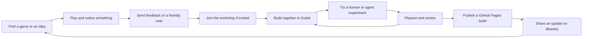
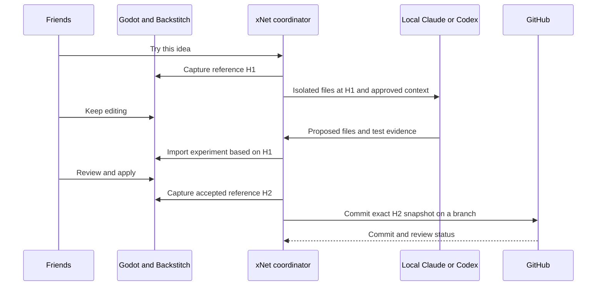
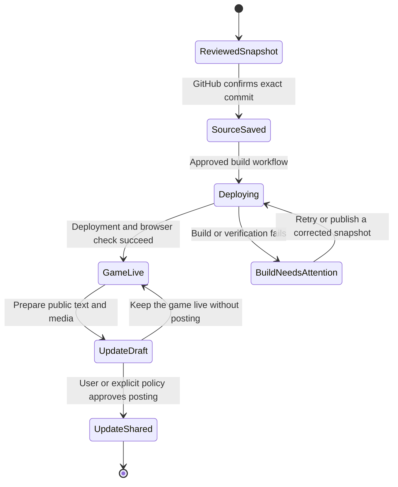
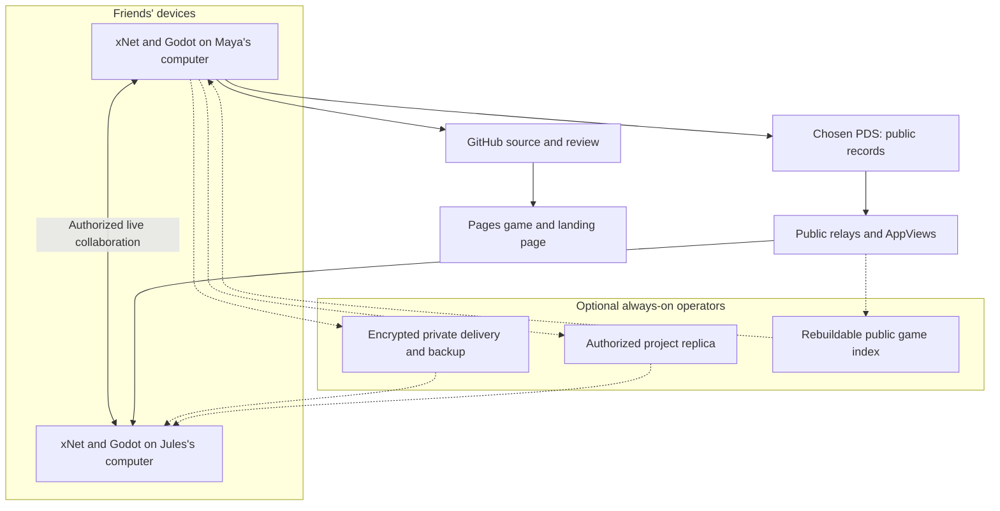

# A game studio we can share

> [!TIP]
> Build one good workflow: friends make games in Godot with Backstitch, ask their own Claude Code or Codex to help, publish through GitHub Pages, and find one another through Bluesky. xNet brings the people, tools, and project history together. An optional hub keeps shared work available when their computers are asleep.

**Most of the proposed product can work without an xNet-operated backend.** Public games and social updates already have homes on GitHub and AT Protocol. The hard gaps are private offline delivery, reliable access to shared projects, and a secure bridge between Backstitch and xNet's peer connections.

This narrows [0492: Games we can make our own](./0492_[_]_GITHUB_FOR_GAMES.md) to **Godot and Backstitch as the first authoring stack**. It supersedes that document's Three.js-first and Backstitch-optional sequencing. GitHub remains the source repository. Keeping playable copies of every old release remains optional. [0491](./0491_[_]_GODOT_BACKSTITCH_AND_COMMUNITY_GAME_MAKING.md) supplies the deeper engine and Backstitch research; this exploration decides how the whole service could fit together.

The product hypothesis is a desktop studio where making a game feels as social as playing one. The first feasibility group should be adult friends, followed by the supported youth research in [0490](./0490_[_]_XNET_FOR_YOUNG_PEOPLE.md). This proposal does not establish that an unrestricted native editor is safe for children.

Research is dated October 27, 2026. November 24 is a checkpoint to decide whether the integration is practical, not a delivery promise. This draft accepts no new public protocol, licensing default, or revenue lane.

For a critical comparison with a standalone implementation, see [0494: Which xNet primitives earn their place?](./0494_[_]_XNET_PRIMITIVES_FOR_COMMUNITY_GAME_MAKING.md). It recommends a narrow community data layer and tests whether nodes, replication, and signed history justify their cost.

## What someone would actually do

Maya sees a small garden game in **Discover**. The page says that its creators are looking for ideas for new creatures. She plays, captures a moment she likes, and sends a short note: “The jumping mushroom is lovely. Have you tried one that floats?” She can choose a public reply or a private note before sending.

Jules replies and invites her into the game's workshop. That invitation lets her join its conversation. A separate grant lets her edit the project. Neither action silently grants access to Jules's computer, GitHub account, or agent subscription.

Maya chooses **Open in Godot**. xNet checks the supported editor, Backstitch plugin, export templates, and project version. The editor opens beside xNet. The conversation stays useful: who is here, which experiment they are trying, what the agent is doing, and whether changes have reached someone else's device.

Jules moves a platform while Maya adjusts a creature. Backstitch shares their saved changes. Maya asks Codex, “Try a floating mushroom that sinks when you stand on it.” Codex works on an isolated experiment. xNet shows a small activity card: **Changing movement → Testing → Ready to try**. It includes the actual preview, test inputs, and any failures.

They play the experiment, discuss it, and bring it into the shared project. When they want others to try it, **Publish an update** presents three concrete results: a reviewed source change on GitHub, a playable web build, and a draft Bluesky post. The public post does not include their private conversation.

Someone new can enjoy the game in a browser without installing xNet. If they want to help, the same page offers a low-pressure introduction and a path into the workshop.

Playing, drawing, arranging scenes, testing, and talking are all useful ways to participate. Coding and AI prompting should not become the price of belonging.

## A small number of tools, each with a clear job

| Part                       | Owns                                                                                              | Does not automatically own                                  |
| -------------------------- | ------------------------------------------------------------------------------------------------- | ----------------------------------------------------------- |
| **Godot**                  | The editor, game runtime, scenes, resources, and exports                                          | Community identity or publishing permissions                |
| **Backstitch**             | The live working project's replicated state and editing history                                   | GitHub reviews, releases, or xNet membership                |
| **GitHub**                 | Canonical source checkpoints, branches, pull requests, and repository permissions                 | Private workshop conversations                              |
| **GitHub Pages**           | The public game page and supported web build                                                      | Private playtests, matchmaking, or a game server            |
| **Bluesky / AT Protocol**  | Public profiles, follows, posts, and replies                                                      | Private xNet chats or permission to edit a project          |
| **xNet desktop**           | Invitations, private collaboration, agent coordination, previews, and links between these records | A replacement source forge                                  |
| **Optional community hub** | Chosen availability, storage, indexing, and support services                                      | Ownership of every project or a mandatory account directory |

Godot's MIT license makes it a good foundation. The engine license does not decide the license of a game or its art. xNet should record those choices separately and carry required notices into exports. [Godot licensing](https://godotengine.org/license/)

Backstitch advertises Git compatibility: use its live collaboration while making changes, then commit larger changes through Git. That fits this division. Its current collaboration shares saved scenes and resources; we should not describe it as a guarantee of shared unsaved edits. [Backstitch overview](https://backstitch.dev/)

There will necessarily be two kinds of history. Backstitch needs working history to merge experiments. GitHub contains the source checkpoints the team chooses to retain and review. xNet can link them without storing another authoritative copy of the source repository.

The combined product is partly decentralized. Source and default hosting depend on GitHub, while public social features depend on the selected PDS and AppView. Keep those dependencies visible. People should be able to export ordinary Git repositories and static games, and choose other service adapters.

## Three meanings of “without a hub”

**No xNet-operated backend** is the right first goal. The desktop can use GitHub, Pages, a user's PDS, a public AppView, and independently operated connectivity relays. xNet the company does not need to receive the project's private data.

**No always-on project server** is a stronger mode. Friends can collaborate while the necessary peers are online. A sender can queue messages locally for later. If every replica goes offline, nobody can fetch new private content from them. An invite link cannot change that physical limit.

**No external servers at all** is useful for a local session, not a promise for the whole product. LAN collaboration can be tested without internet services. Fresh GitHub publishing, Bluesky updates, and cloud model calls cannot occur offline. Internet peer connectivity may also need discovery and a relay.

Running a service on a friend's home computer still creates a server role. It changes who operates it and when it is reachable; it does not remove that role.

> [!IMPORTANT]
> An Iroh relay and a durable replica solve different problems. The relay forwards encrypted traffic between connected endpoints, including payload traffic when a direct route fails. It does not provide an offline inbox merely by being present. Endpoint authentication also leaves project authorization to the application. [Iroh connection and relay documentation](https://docs.rs/iroh/latest/iroh/)

## What works without our service?

“Possible” in this table describes the proposed architecture, not a claim that all of these integrations have been implemented.

| Experience                                             | Without an xNet-operated hub                                                      | What an always-on service adds                                                        |
| ------------------------------------------------------ | --------------------------------------------------------------------------------- | ------------------------------------------------------------------------------------- |
| Edit and play a local Godot project                    | Yes                                                                               | Nothing essential                                                                     |
| Ask installed Claude Code or Codex for help            | Yes, subject to that runtime's authentication and model connectivity              | Scheduled execution while the user's device sleeps, if separately authorized          |
| Share source and review changes                        | Yes, through GitHub                                                               | Optional webhook handling; desktops can reconcile while awake                         |
| Publish a small public web game                        | Yes, through Pages                                                                | Alternative hosting for workloads Pages does not fit                                  |
| Post updates, follow people, and read public replies   | Yes, through AT Protocol and existing Bluesky services                            | A specialized game index or feed service                                              |
| Discover games from known people and collections       | Yes, with existing public APIs and local caching                                  | Wider indexing, fresher search, and moderation operations                             |
| Private messages between connected desktops            | Yes in principle; build on the current peer path                                  | Delivery when sender and recipient never overlap online                               |
| Group chat with every relevant peer reachable          | Possible, but current owner-mediated routing needs explicit availability testing  | A durable authorized group replica                                                    |
| Live Backstitch editing                                | Stock Backstitch needs its sync server; a desktop-hosted bridge is proposed below | Collaboration without relying on the session host's computer                          |
| Reopen a private project while all collaborators sleep | Only if this device already has the required data                                 | An authorized reachable replica serves missing data                                   |
| Join a private project while its owner sleeps          | Only with a previously issued grant and a reachable authorized peer               | A durable replica; an undecided join request still needs an authorized decision-maker |
| Recover after every participant loses their local copy | No, unless an independent backup exists                                           | Backups with tested restore and separate key recovery                                 |
| Phone notifications when every desktop sleeps          | No dependable desktop-only solution                                               | Push delivery and its platform services                                               |
| A public game page visitors can always open            | Yes: Pages already supplies this server role                                      | No additional xNet host required                                                      |
| A private browser playtest                             | An online authorized host can serve it, with extra access plumbing                | An authenticated preview host with reliable uptime                                    |
| Real-time multiplayer gameplay                         | Depends on the game's transport and authority model                               | Optional signaling, relay, matchmaking, or authoritative simulation                   |

A peer can store and forward data for friends if it has the necessary authority and stays reachable. That is a community-operated availability service, even if its UI is just a setting in the desktop app.

The first product can therefore be useful before xNet operates a hub. It should say **Saved here**, **Shared with Jules**, or **Waiting for the workshop host**, rather than using one reassuring “Synced” label for all three states.

## The first technical risk: Backstitch transport and access

The current Backstitch sync server is a WebSocket service built around Automerge. Its README warns that it has no authentication by default. Optional OIDC identifies people but does not supply project authorization. Knowing a project identifier is not an acceptable permission boundary. [Sync server README, pinned revision](https://github.com/inkandswitch/backstitch-sync-server/blob/e8c3a985589586420b36d619b02012d2d62f0ced/README.md)

The client connection code currently manages one remote server connection at a time. Its API exposes project references, file access at a reference, branches, and merge previews. These are promising integration points, but an internal Rust trait is not a stable desktop automation contract. [Connection implementation](https://github.com/inkandswitch/backstitch/blob/92ff2d5b6fe9df13de08e6bd145e6e79d6262c95/backstitch/src/project/connection.rs), [project API](https://github.com/inkandswitch/backstitch/blob/92ff2d5b6fe9df13de08e6bd145e6e79d6262c95/backstitch/src/project/project_api.rs)

### Options worth comparing

| Option                                                                                   | Benefit                                            | Cost or limitation                                                                  | Recommendation                                            |
| ---------------------------------------------------------------------------------------- | -------------------------------------------------- | ----------------------------------------------------------------------------------- | --------------------------------------------------------- |
| Existing Backstitch server behind a private network                                      | Fast way to test the authoring experience          | Still a server dependency; authorization and operator trust remain                  | Useful adult feasibility baseline                         |
| One desktop hosts an isolated Backstitch service, reached over an authorized Iroh tunnel | No xNet cloud required; retains more upstream code | Host availability, API tunneling, process packaging, and access isolation need work | First transport experiment                                |
| Native peer transport for Backstitch / Automerge                                         | Better fit for independent local replicas          | New adapter, document discovery, blobs, membership, and recovery work               | Pursue if the experiment shows the tunnel is too limiting |
| Managed Backstitch service for every project                                             | Easiest continuous availability                    | Central cost and trust; stock service is not a private multi-tenant product         | Optional later, after security work                       |

For the desktop-hosted experiment, begin with **one service and storage namespace per trust group or project**, containing only data that every admitted editor may read. An Iroh gateway authenticates the device, verifies its project grant, and exposes only that service. Include REST and asset routes in the analysis; tunneling the sync socket alone may be insufficient.

This isolation is a deliberate simplification. A generic tunnel into one shared Backstitch repository could let a member request another project's documents. Later multiplexing needs authorization over the entire reachable document graph, including branches and blobs. Filtering a visible project ID or putting a login page in front is insufficient.

The local endpoint also needs protection against other local apps and web pages. Loopback binding alone is not authentication. Reject unexpected origins where relevant, use an authenticated local bridge, and keep arbitrary HTTP proxying out of the protocol.

The desktop host is a trusted participant in this experiment and can read its project. Moving that same server to our cloud would make us a trusted reader too. An operator-blind service would require a separate encrypted storage/transport design; TLS and disk encryption do not establish that property.

What the transport experiment must settle

Can an unmodified plugin complete its handshake through the bridge? Which routes and identifiers does it need? Can each client retain enough project state to reopen independently? What happens after the host dies? Can another peer take over without creating divergent project identities? Does importing a large audio file stall all other work? Can a revoked device still request a branch or blob it learned about earlier?

A successful two-laptop connection answers only the first part. Multi-peer membership, durable recovery, and malicious document requests need separate evidence. Coordinate an upstream integration seam before maintaining a long-lived Backstitch fork.

## One coordinator between the editor, agents, and Git

The dangerous implementation would let Godot, Backstitch, `git checkout`, and several agents all write into the same live directory. A CRDT cannot protect files that another tool overwrites outside its model.

Give each project a local coordinator with explicit operations: open the workspace, snapshot an experiment, apply a reviewed change, and publish a checkpoint. It should be restart-safe and reconstruct its state from saved records. It does not need a distributed workflow engine.

**Live editing.** The shared Godot working copy follows Backstitch. Unsaved editor changes remain visibly unsaved. Human collaborators can keep working while an agent explores a separate copy.

**Agent experiment.** Capture a Backstitch reference and corresponding source files. Give the agent an isolated directory and the approved project context. Record the starting reference, requesting person, runtime, and intended change. The agent can modify files normally inside that boundary.

**Bring back the result.** Import the proposed files through a supported adapter into a new Backstitch experiment. Review both the code and the playable behavior. Reconcile with edits made since the starting reference. A syntactically merged scene can still contain an impossible jump or a broken relationship between nodes.

**Git checkpoint.** Capture one immutable project reference, materialize its files into a clean staging directory, and build from that snapshot. Commit those exact files to a Git branch. Record the Git commit and content digest beside the Backstitch reference. The editor may continue changing; the checkpoint must not quietly include later files.

**Changes from GitHub.** Fetch an incoming commit into a separate directory. Import it as a new experiment with its known base. Review before applying to the live project. Never run an automatic destructive checkout over an open collaborative working copy.

Keep `.godot` caches, credentials, machine paths, local chats, and private agent logs out of Git checkpoints. Store project configuration and required source assets deliberately. Large binary assets need explicit size budgets and an asset strategy; a CRDT does not make them cheap to replicate or meaningfully mergeable.

The first prototype needs one tested import/export path and one pair of compatible Godot and Backstitch releases. Installing arbitrary editor plugins, tracking nightly engine builds, and embedding the whole Godot editor can wait.

## Claude and Codex as workshop participants

A local coding runtime can use the user's existing account and tools. Model inference may still require a paid cloud service. Show whose device runs the agent and which provider receives the approved context, along with who pays for usage. Keep Claude and Codex behind replaceable adapters; an open xNet client does not make those providers open source.

Reuse the local runtime detection in [community-agent-runtime.ts](../../apps/electron/src/main/community-agent-runtime.ts). The current development records already model a host, an authorization epoch, requesters, parents, and context references in [extension-development.ts](../../packages/workbench/src/communities/extension-development.ts). Extend those concepts for game experiments rather than treating a mention as permission to execute on someone else's laptop.

One request has one execution owner and a stable request ID. Both friends may discuss it. Only the designated host runs it. If that device sleeps, show **Waiting for Maya's agent**. A different person can explicitly take over with their own runtime and permissions; their provider tokens are never copied across the group.

The agent should be able to read scenes and scripts, make changes, launch an isolated preview, supply inputs, collect errors, take screenshots, and revise the result. These capabilities belong to narrow host tools with bounded access. Game content and chat messages remain untrusted inputs.

For a new mechanic, require a small evidence record: what was tested, the source reference, screenshots or a short recording, observed results, and what remains untested. A screenshot proves appearance at one moment. It does not establish that multiplayer, saving, or every control works.

Link each experiment to the selected conversation revisions and their content digests, not only the current text of editable messages. That lets an authorized member inspect the feedback and agent work that produced a change. Missing or revoked context stays visibly unavailable. Publishing the game or its Git commit should not publish that private development history.

Use distinct grants for project editing, running code, reading additional xNet data, accessing chosen files, spending on a provider, pushing source, deploying, and posting publicly. A user may approve a durable policy for routine actions, but the UI must make that policy visible and revocable. “Help us build this game” should not silently authorize reading everyone's DMs.

## Social architecture: one public conversation, one private workshop

The public social network should stay on AT Protocol where it fits. A person's **PDS** hosts their public repository, and a **relay** distributes updates from those repositories. An **AppView** turns records into feeds and other application views. Bluesky operates major instances of these services; it is not the only possible source of every account's data. [Understanding AT Protocol](https://atproto.com/guides/understanding-atproto)

An xNet game index would be closer to a specialized AppView than to GitHub or a new PDS. An xNet private-data hub is a separate role. Combining their deployment for convenience must not combine their access rights.

### Discovery that leads to people

Begin with three understandable shelves: **People you follow**, **Playtests you can join**, and **Community picks**. Add search across known games, names, and tags. Explain why each game appears. A visitor can browse curated public collections without creating an account.

Games in progress and ideas looking for collaborators deserve space alongside finished games. A request such as “We need someone who likes drawing weird plants” is a better invitation than a leaderboard of follower counts. Keep the quiet first-contact **Notes** flow from 0492: a small initial note, recipient controls, and no obligation to turn it into a permanent chat.

Initially, discover known game links from ordinary Bluesky posts, creator profiles, and explicit collections. Cache those references locally. A link to a recognized publisher page can supply richer metadata. Hashtags alone are neither a complete catalog nor proof that a person owns a game.

A comprehensive fresh game directory eventually needs an index somewhere. That can be operated by xNet, a community, or another service. Let people select collections and index providers; deduplicate by stable game identity. Do not consume the whole public firehose merely to serve a small workshop.

A custom Bluesky feed generator is also an online service. A locally ranked shelf inside xNet is a useful earlier feature and does not require hosting a feed endpoint. The two should not be confused. [Bluesky feed generator architecture](https://github.com/bluesky-social/feed-generator#overview)

### A game page that survives us

Give a game a public landing page in its own Pages deployment. It can show the current playable build, controls, accessibility notes, creators, source license, asset credits, selected updates, and ways to contribute. It links to the repository and the canonical public discussion. xNet renders a richer view of those same references.

The repository should contain a small publisher-controlled description of the game and its links. Use a prototype-local format first; investigate existing formats before standardizing a new one. Include the deployed source revision so feedback can identify what someone actually played. Pin stable GitHub repository IDs and AT DIDs where available, with current URLs for navigation. Handles and repository names can change.

Verify claims that a social account represents a project using control of both accounts, rather than matching names. Treat metadata as untrusted: schema limits, no arbitrary HTML execution, and safe URL handling. A future custom AT record can describe the game, but it should be deliberately specified and indexed. An arbitrary new record does not automatically appear in the Bluesky feed.

Public game URLs should remain useful in a normal browser. “Open in xNet” adds collaboration; it should not be the only way to learn what the game is. Private invitations need a different path that does not put secret project details into public pages or preview crawlers.

### Where conversations live

| Conversation                              | First home                                | How xNet presents it                                     |
| ----------------------------------------- | ----------------------------------------- | -------------------------------------------------------- |
| Public release or work-in-progress update | A Bluesky post                            | Update card with the original record reference           |
| Public response to that update            | Replies to the same Bluesky thread        | The same conversation, with an explicit public composer  |
| Private feedback or a first introduction  | xNet note / conversation                  | Quiet inbox with request controls                        |
| Day-to-day project planning               | Private xNet workshop chat                | Chat, threads, experiments, and agent activity           |
| A reproducible bug or source change       | GitHub issue or pull request, when useful | Linked item with selected context copied only by consent |
| A durable public forum with categories    | Optional GitHub Discussions initially     | Link or focused integration, not a second mirrored forum |

Start each game with **Play**, **Updates**, and **Conversation**. Members also see **Workshop**. Conversation clearly separates public discussion from private channels. A project may select one pinned public thread initially; its update threads remain attached to their updates.

If a community needs categories, pinned answers, and long-running topics, offer a deliberate GitHub Discussions connection. That imposes GitHub participation requirements and will not suit every community. A custom AT forum or xNet-hosted public forum should follow evidence of that unmet need, not arrive as another default social network.

Preserve the canonical reference for external comments. Do not manufacture duplicate Bluesky and xNet replies or pretend deletion propagated to every service. A private conversation can produce a reviewed public summary, not an automatic public transcript.

## Privacy is attached to each object

A public game can have private source, private planning, and public updates. An open-source game can have invite-only playtests. One project-wide “public/private” switch cannot express these choices safely.

| Object                                  | Proposed default   | Who can read it                                                          |
| --------------------------------------- | ------------------ | ------------------------------------------------------------------------ |
| Workshop conversation and agent context | Private            | Explicit members and approved execution context recipients               |
| Live Backstitch project                 | Private to editors | Admitted replicas; also the sync operator under a readable-server design |
| GitHub repository                       | Chosen at creation | GitHub's repository policy, independently of chat membership             |
| Agent experiment                        | Project-scoped     | Approved reviewers; no automatic public branch                           |
| Published Pages game                    | Public             | Anyone who obtains the URL; unlisted is still public                     |
| Bluesky post and public replies         | Public             | Public network consumers, not just xNet users                            |
| Private playtest recording              | Private            | Selected feedback recipients until explicitly published                  |
| Public discovery index                  | Public data only   | Visitors to that index                                                   |

Linking a Bluesky identity does not make someone a GitHub contributor. Joining a chat does not grant source access. Being allowed to edit does not grant publishing permission. Exporting a game publicly distributes its client assets; it cannot promise that a player will be unable to inspect or copy them.

For private content, use established application-level encryption and explicit device membership before giving a storage operator only ciphertext. Revoke future access and rotate keys as the chosen group protocol requires. Previously authorized recipients may retain prior copies. Availability, encryption, and deletion are separate properties.

## Publication is three operations, with three receipts

GitHub Pages is a useful initial destination for modest public games. Its documented site limit is 1 GB and its soft bandwidth limit is 100 GB per month. It is static hosting, with policy restrictions on commercial uses. It is not a universal free game backend. [Pages limits](https://docs.github.com/en/pages/getting-started-with-github-pages/github-pages-limits)

Choose a GDScript template using Godot's Compatibility renderer and single-threaded web export. Current Godot documentation says Godot 4 C# projects cannot export to web. Multithreaded exports need additional cross-origin arrangements. Test the actual Pages URL, including its repository subpath, and use another host when the project exceeds this supported profile. [Godot web export](https://docs.godotengine.org/en/stable/tutorials/export/exporting_for_web.html)

Do not equate a private GitHub repository with a private Pages site. Access-controlled Pages has separate plan and organization requirements. [Pages visibility](https://docs.github.com/en/enterprise-cloud@latest/pages/getting-started-with-github-pages/changing-the-visibility-of-your-github-pages-site)

The UI should be honest about partial success: **Source saved. Build failed. Nothing posted.** A retry reconciles with external state before creating another branch, deployment, or post. Keep the source commit, workflow run, deployed artifact digest where available, live URL, and AT post reference together.

Use a reviewed build workflow with narrowly scoped permissions. Build untrusted proposals without publish credentials; do not let an agent-edited workflow obtain secrets just because its pull request exists. Publishing permissions belong to the authorized actor and the selected repository.

### Authentication without a token broker

A shared GitHub App installation private key must never ship in a desktop binary. GitHub supports a device flow for **user access tokens**, whose rights are the intersection of the user's and app's access. That provides a route to native sign-in without xNet running a token-exchange backend. Verify the selected-repository permissions, refresh flow, and push behavior in the pilot. Hosted automation acting as an installation is a separate capability. [GitHub App user authentication](https://docs.github.com/en/apps/creating-github-apps/authenticating-with-a-github-app/generating-a-user-access-token-for-a-github-app)

AT Protocol supports public OAuth clients, with PKCE and DPoP. Native sign-in need not make xNet a confidential token broker. The client metadata URL is still an availability dependency; keep it static and replaceable in another distribution. Store account credentials in the desktop's protected host boundary. [AT Protocol OAuth](https://atproto.com/specs/oauth)

The existing desktop Bluesky flow is intentionally identity-only: [bluesky.ts](../../apps/electron/src/main/onboarding/bluesky.ts). Posting requires additional authorization and durable credential handling. A linked profile is not evidence that xNet can already publish as that person.

Reconcile GitHub and Bluesky state when the desktop wakes. A continuous webhook receiver is optional. If one is added, it must be authenticated, deduplicate deliveries, and survive missed events; the client should still be able to recover from canonical upstream state.

## What an optional hub should do

The first managed offer should be simple: **Keep our workshop available while we're away.** Its concrete services can be added separately.

**Private continuity.** Store authorized encrypted messages and attachments until recipients retrieve them. Apply quotas, expiration, replay protection, and revocation rules. A receipt from storage means “stored for delivery,” not “Jules has read it.” Group history access must follow the group's policy.

**Project availability.** Keep a Backstitch project replica reachable. Under the current readable-server design, that grants the operator access. Offer it only with that fact visible, or first implement and verify an operator-blind alternative. Private chat encryption cannot compensate for readable project storage elsewhere.

**Recovery.** Keep independent encrypted backups and demonstrate restore on a fresh machine. Sync alone replicates mistakes and deletions. Recovery keys cannot live only on the device whose loss the backup is meant to cover.

**Public discovery.** Index published games and their public references, provide selected collections, and apply documented moderation. The index is rebuildable derived data. A user can choose another index without changing the repository or public social account.

**Connectivity.** Operate a relay when needed for reliability or privacy policy. It has a bandwidth budget. Keep this separate from storage promises and from a gameplay server.

### How this relates to the hub we already have

Repository inspection found useful foundations, not a finished game-service backend:

| Existing seam      | Evidence                                                                                                                                  | Consequence for this proposal                                                                           |
| ------------------ | ----------------------------------------------------------------------------------------------------------------------------------------- | ------------------------------------------------------------------------------------------------------- |
| Named hub roles    | [roles.ts](../../packages/hub/src/roles.ts) defines `personal`, `community`, `index`, and `gateway`, among others                         | Compose existing services through config; do not invent one all-powerful federation role                |
| Public AT indexing | [atproto-index.ts](../../packages/hub/src/features/atproto-index.ts) has a derived-state guard and configurable collections               | Candidate for a game index; ordinary game links and a future game format need their own ingestion work  |
| Hub subscriptions  | [hub-subscriber.ts](../../packages/hub/src/features/hub-subscriber.ts) mirrors public Spaces under `/sub/*`, without transitive re-export | Useful public federation; not an existing private group replication protocol                            |
| Backups            | [backup.ts](../../packages/hub/src/services/backup.ts) accepts bounded blobs                                                              | A storage seam; the caller must establish encryption and usable restore semantics                       |
| Document sync      | [relay.ts](../../packages/hub/src/services/relay.ts) applies Yjs updates                                                                  | Do not describe every existing hub route as an opaque encrypted mailbox                                 |
| Desktop peer chat  | [peers/service.ts](../../apps/electron/src/main/peers/service.ts) maintains cursors and checks acknowledgements                           | Extend delivery evidence; current group paths involve owner mediation, so test owner absence explicitly |

The hub's PDS integration remains a sidecar, not a new hub role. Nothing here requires operating users' PDS accounts or replacing GitHub. The `gateway` mirror should not become an accidental way to re-export private workshop data.

A managed deployment may contain several processes, including a Backstitch sidecar. Keep self-hosting understandable. The existing package rule against workflow-engine dependencies still applies: a single-community hub must not require operating an orchestration cluster.

### Federation means an exit that actually works

Users should be able to choose a community operator, use a spare home machine, or keep an online-only peer session. Configuring several replicas must not give them authority to add members or publish source.

An operator change should move authorized data and routing references while preserving project IDs, signatures, and membership. It should not require transferring the user's signing key. Private replication between hubs is a new contract to specify and test; the current public subscription mechanism does not prove it works.

Preserve useful fallback paths: ordinary source files, Git remote access, playable static exports, public post references, and private exports that only their owner can decrypt. If a third party forks the client, it must be able to register its own OAuth integrations and metadata endpoints. Hard-coding our app registration as the sole route would create a quieter form of dependency.

## Keep game networking separate from making games together

Backstitch synchronizes a project under development. That does not make the resulting game multiplayer. Chat transport also does not define who decides whether a player hit a target.

For the first studio pilot, make a small single-player game collaboratively. This exercises the social and authoring loop without simultaneously inventing a multiplayer SDK. A second template can add a cooperative session with a named host and explicit disconnect behavior.

Native Iroh sessions and browser networking need separate compatibility work. A Pages game does not inherit the desktop's Iroh endpoint. A browser multiplayer template may use WebRTC with signaling and a TURN fallback, or a supported server protocol. Its matchmaking and simulation costs are separate from publishing static files.

Transient player positions should not enter the durable chat log or source history. Persist selected outcomes, feedback, or save state when needed. Competitive games may need an authoritative server; a CRDT is not an anti-cheat system.

## Safety boundaries that shape the product

Godot's `@tool` scripts run inside the editor. Receiving a collaborator's scene or plugin can therefore bring executable code into a live workspace. “Live” should not mean “execute any new code from any participant on my machine.” [Godot editor scripting](https://docs.godotengine.org/en/stable/tutorials/plugins/running_code_in_the_editor.html)

Use separate states for receiving a change, reviewing it, and executing it. Authoritative membership decides who may propose a change; execution policy decides where it may run. An editor process is not a sandbox merely because it is separate from Electron. The prototype must establish an actual restricted execution environment, or clearly limit itself to informed adult collaborators with trusted projects while that boundary is researched.

Browser game previews need isolated origins or partitions, no Electron preload bridge, bounded permissions, navigation controls, and deliberate network access. Sibling GitHub Pages projects can share an origin; a repository subpath is not a strong security boundary. Game content must not share xNet's authenticated application origin.

Agent tools should not receive the whole desktop by default. A project grant must not expose SSH keys, provider credentials, another workshop's files, or arbitrary local services. Screenshots and recordings need a defined capture area so feedback does not publish private windows.

Public discovery and private messaging need their own abuse controls. Use recipient-controlled first contact, per-sender limits, block/report, and clear moderation ownership. Public indexes can curate public data. Private reports should include only evidence deliberately shared by the reporter. Do not promise that an operator can inspect encrypted chats for safety.

For young people, keep public discovery distinct from invitations into a private group. Youth design needs separate research on contact defaults, trusted adult support, reporting outside the immediate group, and age-appropriate accounts. Provider age rules remain relevant: agents should not bypass them by lending an adult's credentials to a child. The initial adult feasibility pilot avoids pretending those questions have already been solved.

## Costs and a service people could choose to pay for

With no xNet cloud, costs still exist. Participants supply device storage, electricity, agent subscriptions or inference, and network bandwidth. GitHub and social providers supply other infrastructure under their plans and policies. A relay can carry significant data if direct connections fail.

Measure storage, transferred bytes, relay fraction, active replicas, build minutes, and operational work separately. For scale intuition, a sustained 2 Mbit/s flow transfers about 0.9 GB per hour in one direction before overhead. A large project sent to several new collaborators can matter more than a month's text messages. This is arithmetic, not a prediction of xNet's traffic.

The lowest-cost first service is likely bounded private continuity for small communities, plus a limited public index. Avoid hosting every game binary when Pages already serves it. Set explicit storage and relay budgets, show usage before large transfers, and give a graceful alternative when a budget is exhausted. A fixed “five dollars a month covers everything” claim needs measurements we do not yet have.

### Funding options and the five charter tests

These are options within the existing **hub hosting + operations** and **support** lanes in [ECONOMICS.md](../ECONOMICS.md), not accepted new pricing. [CHARTER.md](../CHARTER.md) requires five tests, including the Rust test for whether our refusals remain affordable.

| Test            | Optional managed community continuity                                                                                                          | Patronage-funded public discovery                                                                |
| --------------- | ---------------------------------------------------------------------------------------------------------------------------------------------- | ------------------------------------------------------------------------------------------------ |
| **Improvement** | Pays for storage, restore drills, uptime, and support we actually provide                                                                      | Pays for indexing, curation, and moderation work, with clear scope                               |
| **BATNA**       | Same software and export path must work on another operator or a home server                                                                   | Public records and collections remain usable by other indexes                                    |
| **Vanish**      | Community keeps local replicas, keys, source, and a tested migration path                                                                      | Creators retain their Pages sites and AT records; export collections too                         |
| **Sleep**       | Operations and support still have value if a competitor copies the features; service quality must earn the margin                              | Weaker: copying an index is easy; sustained curation and patron trust need evidence              |
| **Rust**        | Existing hosting/ops and support lanes survive free introductions, portable identity, and free export; game-specific margins remain unmeasured | Patronage is not yet a proven lane for this workload; treat it as a bounded subsidy until funded |

Recommend testing managed continuity as an optional operational service only after a real self-hosted alternative works. Use community capacity budgets rather than charging for friendships or introductions. Do not fund the index by selling better placement or access to the published social graph. Resource costs and quotas must be clear without creating an export toll.

The economics register gives us a candidate surviving lane, not proof of demand or profitable unit economics. Measure a small cohort before setting prices. If the service cannot cover its costs while meeting all five tests, narrow what it offers rather than quietly making peer operation worse.

## A staged proof, with reasons to stop

### Stage 1: Two friends can make something

- [ ] Pin a supported Godot/Backstitch pair and a tiny GDScript project with a verified web export.
- [ ] Run an adult two-device authoring session using a private Backstitch server as the baseline.
- [ ] Prototype the isolated desktop-hosted Backstitch service over an authenticated Iroh bridge.
- [ ] Verify project isolation, connection recovery, and behavior when the session host leaves.
- [ ] Prove snapshot → agent experiment → review → import without modifying the active working copy behind the editor.

Stop or revise the transport if it requires a fragile fork, cannot isolate project data, or loses usable local history. The user-visible Godot workflow may still be worth pursuing with an explicitly chosen private server.

### Stage 2: They can publish and find each other

- [ ] Connect one selected GitHub repository with native user authorization and enforce the actor's actual permissions.
- [ ] Materialize a frozen Backstitch snapshot, create the corresponding Git change, and reconcile an incoming Git change as an experiment.
- [ ] Build and verify the exact approved revision on Pages, with a public game landing page.
- [ ] Add a separately approved Bluesky update and render its public replies from their canonical references.
- [ ] Build discovery from known creators and curated collections, plus recipient-controlled private notes.
- [ ] Keep private planning, public posting, source permissions, and publication authority visible as separate choices.

Stop expanding the product if friends cannot complete this loop without an engineer narrating it. The next investment should be onboarding and clarity, not a larger catalog.

### Stage 3: The workshop stays available

- [ ] Measure missed conversations, blocked joins, and project delays caused by unavailable peers.
- [ ] Specify private delivery and replica authorization separately from existing public federation.
- [ ] Test a self-hosted continuity service, independent backup restore, and migration to another operator.
- [ ] Add a managed option only after measuring capacity, support cost, and the five charter tests.
- [ ] Add a cooperative multiplayer template only after the authoring and publishing loop is reliable.

Do not add an always-on component because “platforms need a backend.” Add it when a named unavailable-device case justifies it.

## Validation that would make the proposal credible

| Scenario                                     | Required observation                                                                                                                                                                                         |
| -------------------------------------------- | ------------------------------------------------------------------------------------------------------------------------------------------------------------------------------------------------------------ |
| Block xNet-operated runtime domains          | Existing project editing, permitted peer collaboration, GitHub publishing, and public game access remain usable through documented alternatives; fresh OAuth registration dependencies are tested separately |
| Take both peers offline                      | Local edits survive; public posting and cloud-model calls report unavailable; nothing claims remote delivery                                                                                                 |
| Sender and recipient never overlap online    | No-hub mode visibly waits; the continuity mode delivers after the sender leaves                                                                                                                              |
| Group owner leaves                           | Document exactly which group operations stop; no silent claim of full-mesh behavior                                                                                                                          |
| Agent works while a friend edits             | The result identifies its base and preserves the friend's work during review                                                                                                                                 |
| Import a GitHub change during a live session | It becomes a separate reviewable experiment; no automatic working-copy reset                                                                                                                                 |
| Deployment succeeds but Bluesky is down      | The game remains playable and a later retry makes at most one intended update                                                                                                                                |
| Remove an editor                             | New access is rejected across the document graph; prior copies are not falsely claimed erased                                                                                                                |
| Move to another community operator           | Authorized private data and project references remain usable without the old operator's signing key                                                                                                          |
| Try the web game from its real URL           | Controls, loading, error handling, and captured version match the advertised build                                                                                                                           |

Negative controls matter as much as happy paths:

- [ ] A peer admitted to Project A cannot fetch Project B's root, branch, blob, or Webviewer route.
- [ ] A private chat message asking an agent to ignore permissions does not cause an unauthorized run.
- [ ] An incoming editor script cannot execute merely because its files arrived.
- [ ] A proposal cannot deploy itself by modifying a workflow or claiming an old review applies to a new commit.
- [ ] A game page cannot read xNet credentials or call desktop APIs.
- [ ] A revoked device cannot regain access by replaying an earlier invitation or stale membership claim.
- [ ] A failed backup restore is displayed as a failure, never counted as “backed up” because upload succeeded.

These are future implementation gates. This exploration did not run those experiments or validate a production service.

## Recommended next move

Build the **two-person Godot workshop** first. Keep the editor beside xNet, one small game template, one local agent host per request, one reviewed publication path, and one clear public/private conversation boundary.

The first proof should end with two friends changing a game together, an agent producing a tested experiment, a GitHub commit that matches the accepted project, a working Pages link, and a Bluesky update. Then close the host's laptop and observe exactly what stops. That failure boundary tells us what the first optional hub should provide.

The social promise is that finding something interesting can lead naturally to meeting its makers and making something together. Godot, GitHub, and AT Protocol provide durable foundations for that experience. xNet earns its place by making their boundaries easy to understand and pleasant to cross.
