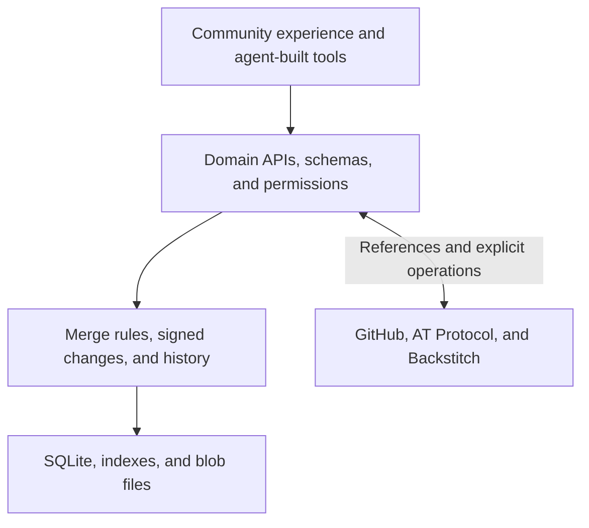
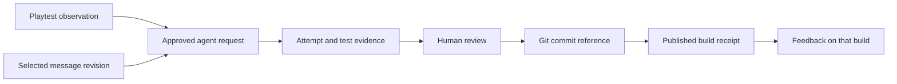
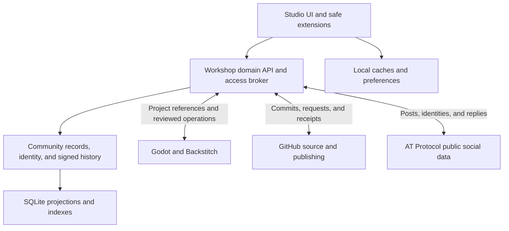

# Which xNet primitives earn their place?

> [!TIP]
> Keep a small xNet layer for private community records, scoped access, and portable development history. Let Godot, Backstitch, GitHub, and AT Protocol own the data they already handle well. Prove the value through a few user experiences before making the game studio depend on more of the platform.

**We could build a compelling version of this product without xNet primitives.** Game discovery, a friendly chat interface, local agent integration, and a GitHub publishing flow do not require our node model or hash chains. A conventional application could also be open source, respectful of attention, and easy to export from.

The stronger reason to use xNet is a specific promise: **a community can change its tools and hosts while keeping its work together.** Its feedback and development history remain usable data. New tools and agents can work with that data, with permission, without starting a new silo.

That promise is valuable, but it is not exclusive to xNet. We need to compare the cost of delivering it with our existing kernel against simpler implementations and other shared-data systems. Prior investment alone is not a reason to keep an abstraction.

This exploration evaluates the stack proposed in [0493: A game studio we can share](./0493_[_]_COLLABORATIVE_GODOT_STUDIO.md), with the community and discovery goals from [0492](./0492_[_]_GITHUB_FOR_GAMES.md). It is a design assessment, not a completed performance study or a decision to rewrite the app. Revisit it on November 24, alongside the two-person Godot prototype. New wire formats or security guarantees would need their own decision records.

For a full design of the standalone alternative, see [0495: The standalone Tauri game studio](./0495_[_]_TAURI_GAME_STUDIO_WITHOUT_XNET.md). It separates desktop-shell choices from data semantics and sketches the interface, host model, and growth path.

## Two products hiding inside the same idea

The first product is a **good social game-making application**. People find games, meet collaborators, talk, and use agents to make changes. It makes existing tools easier to use together. A conventional desktop app could do this well.

The second product is a **workshop people can reshape**. A group asks for a playtest board, a jam calendar, or a creature-design notebook. Those tools use the group's existing records and relationships. Members can change the interface, bring their own agent, move to another operator, or open the same data in another compatible client.

The second product has more need for a shared data layer. It also has more engineering work and a much larger security burden. We should not assume that everyone who enjoys the first product wants the second.

The practical question is whether malleable community tools are part of the near-term experience, or a distant aspiration. If they stay distant, much of the platform's generality is a cost paid before users receive a benefit.

| If the product becomes…                                                        | The case for xNet                                                            |
| ------------------------------------------------------------------------------ | ---------------------------------------------------------------------------- |
| A pleasant launcher for Godot, GitHub, and Bluesky                             | Weak; integrations and UX matter much more                                   |
| A game community with one fixed set of features and a required trusted backend | Moderate reuse value, but a conventional database is a serious alternative   |
| A private workshop that keeps working across devices and operators             | Stronger case for replicated records and portable identity                   |
| A workshop whose members create tools over shared data                         | Strongest case for common schemas, scoped APIs, and reactive queries         |
| A universal platform for every kind of data before the game workflow works     | Poor sequencing; the platform could prevent the product from becoming useful |

## What the primitives actually do today

The implementation matters more than the name of the abstraction. This is a reading of the current prototype worktree, not a claim that every route has been verified end to end.

| Primitive                      | What the code supplies                                                                                                                                                                                                                     | What that does not establish                                                           |
| ------------------------------ | ------------------------------------------------------------------------------------------------------------------------------------------------------------------------------------------------------------------------------------------ | -------------------------------------------------------------------------------------- |
| **Nodes and schemas**          | Stable record IDs, typed properties, relations, and materialized state in [store/types.ts](../../packages/data/src/store/types.ts)                                                                                                         | That unrelated applications agree on what those properties mean                        |
| **SQLite storage and queries** | A [SQLite node adapter](../../packages/data/src/store/sqlite-adapter.ts), indexes, and [query compilation](../../packages/data/src/store/query-compiler.ts)                                                                                | That every query is cheap or every data set fits comfortably on a device               |
| **Structured merge rules**     | Sparse property updates with a shared [LWW comparator](../../packages/core/src/lww.ts)                                                                                                                                                     | That the chosen value matches human intent or preserves a business invariant           |
| **Signed changes**             | Hashes, authors, signatures, logical timestamps, and optional batch fields in [change.ts](../../packages/sync/src/change.ts)                                                                                                               | Encryption, permission to make the change, or proof of a human's intent                |
| **Hash links**                 | A new node change references a previous change; [chain.ts](../../packages/sync/src/chain.ts) can inspect links and forks                                                                                                                   | A complete global causal graph, consensus, or proof that a server disclosed everything |
| **Reactive APIs**              | [useQuery](../../packages/react/src/hooks/useQuery.ts) and [useMutate](../../packages/react/src/hooks/useMutate.ts) over the data bridge                                                                                                   | Permission to expose the same unrestricted hooks to arbitrary code                     |
| **Extension access**           | Durable approvals, scoped records, and controlled queries in [extension-authority.ts](../../packages/workbench/src/communities/extension-authority.ts) and [extension-data.ts](../../packages/workbench/src/communities/extension-data.ts) | Automatic support for every new game-specific schema or secure native code execution   |
| **Development records**        | Requests, attempts, context references, versions, and approvals in [extension-development.ts](../../packages/workbench/src/communities/extension-development.ts)                                                                           | A complete Godot integration or a guarantee that an agent's report is true             |

The first correction is simple: **xNet is already built on SQLite.** SQLite is the storage engine, while the node layer adds common record semantics, replication metadata, and APIs. The comparison is between plain application tables and those additional layers.

SQLite is a credible foundation for the standalone alternative. Its own documentation describes local application storage, application file formats, and portable data containers as appropriate uses. None of those requires our data model. [Appropriate uses for SQLite](https://sqlite.org/whentouse.html)

### Four layers that should not be conflated

We can simplify one layer without discarding the others. A shared schema does not require every field to have a CRDT. Local storage does not require a hash chain. Signed provenance does not require a custom general-purpose database. The design should justify each combination.

## The strongest standalone alternative

Imagine the same desktop UI with ordinary TypeScript services and SQLite tables for projects, conversations, feedback, and agent runs. GitHub holds source. Backstitch manages live game editing. Bluesky supplies public identity and conversation. The app stores external references and cached views locally.

For private collaboration, it could use a small trusted server with a database and WebSockets. An offline outbox retries operations with stable request IDs. Shared rich-text editing, if needed, uses Yjs or Automerge. Export produces documented JSON and media files. The server is open source and self-hostable.

This is a serious option. It offers familiar transactions, easier inspection, and fewer custom protocol decisions. A small group could have an excellent experience with it. Open source and good export already deliver meaningful freedom.

Its main compromise is that the server decides the accepted private state. Offline clients can queue work, but concurrent edits and permissions still need explicit rules. Moving hosts requires exporting and restoring that authoritative state, including identities and membership. Making the server optional would require more replication work.

A second standalone option replaces the server's authority with an established replicated-data library. Automerge already supports offline updates, merging, history, and separate storage/network adapters. Yjs supplies shared types and editor bindings. Neither makes community membership, encryption, discovery, and arbitrary-code permissions disappear. [Automerge's model](https://automerge.org/docs/hello/), [Yjs architecture](https://docs.yjs.dev/)

There is also the smallest product: use existing external messaging as well, and build only the creative workflow. That gives up control over a unified private workshop but could test whether people enjoy making games together before investing further in infrastructure.

> [!NOTE]
> A fair comparison distinguishes “we dropped a requirement” from “we implemented it more simply.” A trusted-server app may be the better product choice. It should not be described as equivalent to an independently writable, operator-independent workshop unless it actually provides those properties.

## Nodes: useful common objects, not magic interoperability

A node is a record with an identity and a schema. Its practical value is that a conversation, a playtest observation, and a task can point to the same underlying object rather than copying its text into three disconnected tools.

For example, a playtest observation could reference the exact game build tested, with a screenshot and a conversation. A board groups observations by scene, while a calendar helps schedule another test. The agent reads selected observations to propose a fix. Each tool uses the same observation IDs and respects the same access boundary.

An ordinary relational database can model those relationships just as well. The advantage of the xNet node model is the reusable contract around them: common queries, subscriptions, version handling, and access checks across independently added tools. Its value increases when we actually add such tools.

The cost is real. Generic properties are less direct than a focused table with columns and constraints. Queries may need joins, derived indexes, hydration, or fallback filtering. Schema versions and compatibility become a platform responsibility. A generic model can also tempt agents to create incompatible versions of the same concept.

For this product, define a small shared vocabulary first: workshop, game reference, playtest observation, experiment, and publication receipt. Reuse existing chat and identity types where their semantics fit. Keep domain APIs clear enough that an agent does not need to understand the storage representation.

New schemas still need access rules, migrations, and transport support. The current [peer chat validator](../../apps/electron/src/main/peers/protocol.ts) accepts a narrow message schema and property allowlist. Declaring a `PlaytestObservation` type would not make it safely traverse that connection. The existing extension grant also names supported schemas explicitly.

This is a useful reality check on “digital Legos.” Common pegs and sockets need agreements about meaning and authority, not just matching JSON shapes. If every extension needs a custom privileged adapter, the promised composability has not yet arrived.

**Verdict:** keep nodes for durable workshop objects that several views or tools will share. Do not force temporary view state, every cache entry, or every external record into the same signed model.

## CRDTs: choose them by the conflict, not by the product label

A CRDT gives replicas rules for reaching the same result after receiving the same valid updates. People can work before they can reach one another, though the merged result may still need human review.

The current structured node model uses last-writer-wins rules per property, with logical timestamps and deterministic tie-breaking. Maya can change an observation's title while Jules changes its status, preserving both edits. When both change the status, one value wins according to the comparator. The merge rule doesn't decide which status makes more sense.

Automerge also distinguishes deterministic merge behavior from user-visible conflicts. Concurrent writes to one property can have a selected value while alternatives remain available for inspection. Applications still have to decide what to show. [Automerge conflict semantics](https://automerge.org/docs/reference/documents/conflicts/)

For this studio, different data wants different treatment:

| Data                                          | Suitable behavior                                                       |
| --------------------------------------------- | ----------------------------------------------------------------------- |
| A new chat message or playtest observation    | Create a separate record; deduplicate by identity                       |
| An author editing their message               | Preserve a revision policy; no need for a group text editor             |
| Two people editing a shared design brief      | A text CRDT can be worthwhile                                           |
| Independent fields on a shared task           | Field merge may be sufficient                                           |
| Two incompatible approvals                    | Preserve both proposals and require a decision                          |
| Permission revocation or publishing authority | Explicit security protocol and an authoritative decision boundary       |
| A local window width                          | Local state, or a simple preference rule if cross-device sync is wanted |
| Player position at 60 frames per second       | Transient game transport, not durable node history                      |

The chat schema already makes each message its own signed node rather than placing the entire conversation in one large collaborative document. That is a sensible fit for append-heavy data. Its comments mention offline delivery, but actual delivery still depends on the transport and an available recipient or replica. [ChatMessageSchema](../../packages/data/src/schema/schemas/chat-message.ts)

Backstitch already owns the game's live project CRDT. xNet should not wrap each scene in another independently editable CRDT and attempt to keep both authoritative. Reference the Backstitch project and snapshot, then use the explicit Git checkpoint process from 0493.

There is also a limit around irreversible actions. Two offline peers can both believe they are allowed to start a paid agent run or publish a release. Merging records afterward cannot undo the duplicate charge or public post. These actions need a designated executor, conditional checks, stable operation IDs, and reconciliation with the external service. Local transactions do not establish a distributed exactly-once guarantee.

**Verdict:** retain proven field merge for selected shared records. Add rich-text collaboration only where people edit the same document. Keep security decisions, publication, and gameplay outside a generic “merge everything” policy.

## Signatures, hashes, and hash chains are three different benefits

A **content hash** gives a stable reference to specific bytes and detects a mismatch. Signing those bytes associates them with control of a key. The **parent hash** links a change to an earlier change the author referenced.

Most of the value for relayed messages comes from signatures and verified identities. A storage operator should not be able to invent a message by Maya simply by editing a database row. Content hashes let a review point at the exact proposal that was approved. Parent links add inspectable lineage.

That is useful when data passes through an untrusted relay, moves to another operator, or arrives through a friend. It is less valuable for a disposable cache whose authoritative copy can be fetched from GitHub or a PDS.

The implementation's [`Change<T>`](../../packages/sync/src/change.ts) signs a hash covering the payload and metadata. The [node store](../../packages/data/src/store/store.ts) normally links a new write to the last change it has for that node. This is not a single worldwide chain, a blockchain, or a complete multi-parent causal history of the community.

The [chain validator](../../packages/sync/src/chain.ts) is explicitly structural. It does not verify signatures and intentionally tolerates absent parents for partial history. Remote admission has separate hash and signature checks. We should not describe a successful chain check as proof that every required event was received.

| Claim                                              | What would be needed                                                              |
| -------------------------------------------------- | --------------------------------------------------------------------------------- |
| “These received bytes match the referenced change” | Verify the content hash                                                           |
| “This key authorized these bytes”                  | Verify the signature and key binding                                              |
| “This person was allowed to change this object”    | Evaluate the applicable permission policy                                         |
| “Nothing is missing from this history”             | A completeness protocol, known checkpoints, and data availability                 |
| “Nobody saw a conflicting history”                 | Evidence exchange or a stronger consistency protocol                              |
| “The agent really ran this test”                   | Trusted test capture and execution evidence, not only an agent's signed statement |
| “Only members can read this”                       | Encryption and key management, plus protected endpoints                           |

A signature does not stop a compromised key, make a statement true, or prove that a human understood a request. Nor do hash links force a peer to share its data. Byzantine-tolerant replication has further requirements beyond ordinary CRDT convergence; this is established research, not a property we should infer from our vocabulary. [Kleppmann, Making CRDTs Byzantine Fault Tolerant](https://martin.kleppmann.com/papers/bft-crdt-papoc22.pdf)

**Verdict:** signed, content-addressed workshop history has a clear use. The incremental value of parent chains is narrower and should be measured against retention and repair costs. Keep the existing signed format while evaluating it; removing linkage or changing signatures would be a protocol change, not a small optimization.

## Permissions and identity may matter more than the merge algorithm

The agent-built-tool experience depends on answering a plain question: **Can this tool use these records for this purpose?** A shared database is not helpful if every extension must receive all the user's data to be useful.

The current extension system already has useful ingredients. It binds approval to an owner and extension version, supports selected records and containers, and records approval state durably. The host controls access through a bridge. That is closer to a product advantage than an abstract promise of unlimited schemas.

These boundaries are still distinct. Community membership decides which data may reach a person. Extension approval decides what code running for that person may use. Agent approval decides what context leaves for a model provider and what tools may execute. A filesystem grant is separate again.

The node format itself does not enforce all of this. `NodeStore.applyRemoteChange` runs general policy checks when an evaluator is supplied; peer chat has its own narrower checks. The presence of crypto helpers or an authorization API is not evidence that every ingress route uses them correctly.

The [encrypted envelope implementation](../../packages/crypto/src/envelope.ts) encrypts content while retaining some public metadata, including recipient identifiers. Its existence does not establish end-to-end confidentiality for every chat, asset, backup, or Backstitch route. The proposed private workshop needs a threat model and tests for the actual path.

Identity portability is valuable if an operator change does not sever a person's contributions or relationships. It also creates recovery and device-management work. A DID is not a friendly onboarding experience by itself. Bluesky can supply a familiar public identity while local device keys serve narrower technical roles; linking them needs a verified binding.

**Verdict:** keep a shared capability boundary and reusable identity handling. Make those boundaries visible and testable. Neither a node schema nor a signature can replace them.

## Development history: explain the work without becoming GitHub

Git tells us what source changed. It does not automatically preserve the private conversation that motivated the change, the feedback that led to it, or the agent's unsuccessful experiments.

xNet can connect those records. A member should be able to open a proposed feature and see the selected feedback, the agent request, what ran, what was observed, and the accepted Git commit. This can help a new collaborator understand the project without reconstructing it from scattered messages.

Ordinary SQL tables could store this graph. xNet's added value is making the records portable, independently verifiable where appropriate, and available to multiple permissioned views. The graph does not justify copying Git's source history into xNet.

Store references to exact message revisions and content digests rather than assuming current message text is the original input. Keep enough authorized content for the stated retention policy. Missing context must appear as missing. A hash of a deleted transcript cannot recreate its words.

An agent-generated patch also should not be displayed as though a human personally wrote it. Record the requester, execution host, runtime, and reviewer separately. A valid signature can prove who submitted the record; it cannot establish the actual model used without supporting evidence.

This is particularly sensitive for young people. Durable development history should not become a permanent archive of every private conversation or awkward experiment. Define deletion and retention deliberately. The public Git commit can carry a reviewed explanation while the workshop keeps private context under a different policy.

**Verdict:** retain selected development provenance as community data. Avoid a permanent transcript requirement and keep Git as the source authority.

## The experience that would justify the shared data layer

The strongest demonstration is not “we can display nodes.” It is this:

A group has played its game for a week. People have left observations in chat, attached screenshots, and marked a few problems as fixed. Someone asks, “Can we have a board that groups our feedback by room and lets each of us claim one thing to try?”

The agent creates a small view over the existing observations. Before opening it, xNet asks for access to that project's feedback and permission to update assignments. Once approved, the board appears with the old data already in it. A friend opens it on another device, and their changes reach the original conversation view too.

Later, the group replaces the board with a different design. Its records do not need to migrate into a new service. An authorized member can still inspect why a fix was proposed and which build included it. If the operator disappears, the local data and another compatible client remain useful.

This scenario is proposed. The prototype must prove support for game records beyond the current extension allowlist and peer transport.

The result would make the “digital Legos” idea concrete: people can add a tool without rebuilding the foundations or moving their community into another application. Ink & Switch's malleable-software work argues for shared data and adaptable tools, but it does not prescribe the xNet node protocol. We should preserve that distinction. [Malleable software](https://www.inkandswitch.com/essay/malleable-software/)

If the same result is simpler with SQLite, an established CRDT library, and a small permissioned API, use that result as evidence. The goal is the experience, not loyalty to the current implementation.

## What should live where?

| Data                                           | Recommended authority                                               | xNet's role                                                                 |
| ---------------------------------------------- | ------------------------------------------------------------------- | --------------------------------------------------------------------------- |
| Godot scene files, scripts, and source assets  | Backstitch working project; GitHub accepted checkpoints             | Project and snapshot references; workflow coordination                      |
| Public profiles, follows, posts, and replies   | AT Protocol                                                         | Authorized client, cached views, links to private context                   |
| Public game files                              | Pages or another selected host                                      | Deployment receipts and safe preview                                        |
| Private workshop chat                          | Community-owned replicated records, subject to the comparison below | A primary candidate for the narrow xNet kernel                              |
| Playtest observations and shared task state    | Community-owned records                                             | Common schema, relationships, queries, and scoped changes                   |
| Agent requests, attempts, and review decisions | Workshop records                                                    | Provenance and execution coordination                                       |
| Screenshots, recordings, large attachments     | Bounded blob storage                                                | Metadata, hashes, access, and references; not inline copies in every change |
| Search results and public discovery caches     | Derived local SQL or replaceable index                              | Cache and ranking preferences; no new canonical copy of upstream posts      |
| Presence, typing, and transient agent progress | Ephemeral messages or bounded local state                           | Display without retaining every update as history                           |
| Game simulation state                          | The game's chosen multiplayer protocol                              | Optional session launch and selected durable outcomes                       |
| Provider tokens and machine secrets            | Protected local credential storage                                  | Scoped host operations; never a shared node                                 |

Caching external records is fine. Giving those cached records an independent edit history and writing them back through a generic node update creates a second authority. Use explicit GitHub and AT operations, with receipts and retry rules, for those changes.

## AT Protocol makes the alternatives more interesting

The argument that AT Protocol is public-only is now too broad. Its **Spaces alpha** launched on August 20, 2026 for non-public records. The announcement explicitly distinguishes access control from confidentiality and warns against production use of the alpha. [Spaces alpha announcement](https://atproto.com/blog/atproto-spaces-alpha)

On October 14, the team described personal-private data, gated publishing, and shared group data as target uses. It also reported breaking changes since the alpha launch. This is a serious adjacent direction, not a complete replacement we have evaluated. [Spaces developer goals](https://atproto.com/blog/devex-goals-for-spaces)

For public data, AT repositories already offer content addressing, signed commits, and portable records. Re-signing every copied public post as an xNet node would mostly add a wrapper; it would not improve the original author's proof. [AT repository specification](https://atproto.com/specs/repository)

The remaining case for a private xNet kernel has to be specific: independent local writes, local query and extension access, selected provenance, and a verified confidentiality model across optional operators. Spaces may eventually cover some of those needs more simply. We should test that as its interfaces settle.

[0324](./0324_[_]_ATPROTO_PERMISSIONED_PRIVATE_DATA_AND_XNET.md) is useful historical analysis, but its pre-alpha maturity assessment is no longer current. Its older security observations about xNet also need current route-level verification before reuse.

This is not a recommendation to add another synchronization system today. Keep the application contract narrow enough that a future backend comparison does not require rewriting every view.

## Where the costs accumulate

The expensive part is not just computing a hash. It is maintaining a coherent system across several forms of state, authority, and failure.

| Cost                     | How it appears to users or maintainers                       | How to contain it                                                                         |
| ------------------------ | ------------------------------------------------------------ | ----------------------------------------------------------------------------------------- |
| Generic property storage | Slow queries, hydration work, unfamiliar inspection          | Bounded queries, measured indexes, clear domain views                                     |
| Change history           | Database growth, slow catch-up, longer restore               | Explicit retention and compaction tied to actual replica guarantees                       |
| Signing and verification | Work on every durable update                                 | Batch where valid; keep ephemeral state out of the durable log                            |
| Replication              | Duplicates, missing data, partial histories, old clients     | Tested reconciliation and honest delivery states                                          |
| Distributed permissions  | Revocation races, stale credentials, inconsistent decisions  | Explicit authority and epoch rules; no casual LWW over security policy                    |
| Multiple identities      | Confusing recovery and account linking                       | Clear device and account roles; tested recovery                                           |
| Multiple data engines    | Backstitch, node merge, text CRDT, SQL, and Git interactions | One authority per data class and few explicit handoffs                                    |
| Extension generality     | Large API surface and difficult permission prompts           | A small supported schema set and purpose-specific capabilities                            |
| Ecosystem obligations    | Schema compatibility, SDK documentation, migrations          | Support the studio's actual needs before promising arbitrary application interoperability |

There are already concrete signs of this complexity. SQLite holds current nodes alongside property metadata, change history, and derived indexes. Queries can take several execution paths. Dedicated tests check that adapters converge on the same state. These are useful engineering investments, but they are ongoing obligations. [Storage schema](../../packages/sqlite/src/schema.ts), [LWW conformance tests](../../packages/data/src/store/lww-conformance.test.ts)

The previous [compaction exploration](./0254_[_]_COMPACT_THE_CHANGE_LOG_SNAPSHOT_THE_STATE_KEEP_THE_TAIL.md) assumes an authoritative hub can re-serve pruned history. That assumption must be revisited for a hub-optional workshop. Deleting the last recoverable copy is not cache cleanup. Preserving current state also does not preserve every conversation needed to explain an old agent decision.

The [scale benchmark harness](../../packages/data/src/store/scale-limits.bench.test.ts) distinguishes query paths that push work into SQL from paths that may hydrate many records. That is a reason to measure the actual chat and feedback workloads. It is not evidence that this game studio is fast, or that CRDTs are the cause of a particular slow screen.

Performance questions that need measurements, not architectural slogans

Separate time spent in SQLite from signing, IPC, access checks, object hydration, and React rendering. Break down storage into current data, history, and indexes. Check whether startup reads the whole log, extension queries are bounded, and reconnecting resends old history. Also count durable writes: a completed agent step and a stream of response tokens have very different needs.

A slower node-backed query might be fixed by a better index. Meanwhile, a simple SQL prototype might look faster because it omits authorization and history. Both observations can be true, and neither settles the product decision alone.

No new performance benchmark was run for this exploration. Older reports are pointers to failure modes, not measurements of the current proposed workflow.

## Architecture options

| Option                                       | What it buys                                                       | What we take on                                                                  | When to choose it                                                    |
| -------------------------------------------- | ------------------------------------------------------------------ | -------------------------------------------------------------------------------- | -------------------------------------------------------------------- |
| **Integration-only desktop**                 | Small scope; reuse external source, social, and messaging services | Fragmented private context and less control over the workshop                    | Testing whether the creative workflow itself is wanted               |
| **SQLite client + trusted community server** | Familiar model, centralized permissions, focused tables            | Server authority, migration, offline conflict policy, and operational dependence | A fixed product where reliable hosted collaboration is the priority  |
| **SQLite + established replication library** | Local-first behavior without maintaining every merge primitive     | Membership, encryption, queries, domain schemas, and adapters still need design  | A greenfield local-first studio, or a measured replacement candidate |
| **A narrow xNet community kernel**           | Reuse existing chat, records, identity, and permission work        | Finish the boundaries and pay the existing protocol costs                        | Recommended for this prototype, conditional on the tests below       |
| **All data through the full xNet platform**  | Uniform concepts on paper                                          | Duplicate authorities, more migrations, larger security and performance surface  | Not justified by the current product                                 |

The greenfield and existing-code decisions differ. Starting today from nothing, SQLite plus an established collaborative-data library would deserve an early prototype. In this worktree, chat, permissions, agent history, and data APIs already depend on xNet. Replacing them has a real migration cost and can reintroduce bugs.

That reuse benefit is not proof that our architecture is intrinsically better. It is a reason to simplify the existing integration while running bounded comparisons, rather than either defending everything or starting an unmeasured rewrite.

## Recommended boundary: a small community kernel

Use xNet for the workshop's own durable records and their relationships. Keep the public network and source workflow connected through adapters. Prefer ordinary local SQL for disposable caches and machine-specific state. Use a document CRDT only for a shared document that needs it.

“Small” must be enforced through actual dependencies and data flow. It is not a new package name wrapped around the entire platform. Put clear domain operations in front of the existing data bridge. Keep the storage choice behind that boundary, and avoid dual-writing two authoritative workshop stores.

Agents should work with actions such as creating a playtest observation or proposing a fix. The host handles replication, signatures, and approval. Advanced tools may use schema-aware queries through the same permission broker. This lets agents use their coding skills without learning or bypassing every internal mechanism.

An agent can also use GitHub and Bluesky through their APIs or connectors without copying those systems into xNet. A common workshop API reduces repeated integration work for our own data; it doesn't remove the work of understanding each external service.

Do not weaken existing verification merely to improve a benchmark. If signed changes, per-property metadata, or schema design need revision, measure the benefit and design compatibility before changing a public contract.

### What to retain, limit, and leave elsewhere

| Decision                          | Scope                                                                                                                                 |
| --------------------------------- | ------------------------------------------------------------------------------------------------------------------------------------- |
| **Retain**                        | Stable workshop record IDs, common schemas, bounded queries, reactive views, scoped extension access, selected development provenance |
| **Retain and verify**             | Signed replication, identity binding, key recovery, actual authorization and confidentiality at each boundary                         |
| **Use selectively**               | Rich-text CRDTs, detailed history retention, cross-device settings, replicated derived metadata                                       |
| **Keep outside the node log**     | Frame-by-frame gameplay, typing, token streams, caches, provider tokens, and large media bytes                                        |
| **Leave authoritative elsewhere** | Game source in Git/Backstitch, public social records in AT Protocol, published game artifacts at the selected host                    |
| **Defer**                         | Universal schema federation, arbitrary application portability claims, and making every service use one storage model                 |

## The philosophy survives a change of database

The [xNet charter](../CHARTER.md) names ownership, exit, calm, consent, agency, and commons. These are commitments about what people can do and how they are treated. A CRDT does not prevent manipulative notifications. An open-source server does not ensure a usable export. A signed log does not make a permission prompt understandable.

Some technical choices support those commitments. Local copies help people continue without a host. Shared schemas can help them replace a tool. Signed records can help them carry evidence across operators. Each is a means to an outcome that still needs to work in the product.

The local-first literature makes collaboration and ownership joint goals rather than treating them as opposites. It presents CRDTs as a promising mechanism, not as the definition of humane software. [Local-first software](https://www.inkandswitch.com/essay/local-first/)

We should therefore preserve the philosophy even if a particular xNet primitive loses the comparison. Conversely, keeping every primitive while shipping an inaccessible or unreliable app would not fulfill it. For a young person trying to make something with friends, an understandable tool that works is itself a form of agency.

No new commercial lane is proposed here. Optional managed continuity remains the hosting-and-operations hypothesis evaluated against all five charter tests in 0493. The data model should not be retained merely to create a service only we can operate.

## How to decide with evidence

The next investigation should compare one bounded workflow, not rebuild two entire products. Chris is the consumer of the result: choose the minimum architecture that preserves the experiences the pilot actually values.

### Product tests

- [ ] **Replace a tool:** create two independently implemented feedback views over the same records. Change a record in one and observe it in the other without an export/import step or a new privileged backend adapter.
- [ ] **Work through a disconnect:** two authorized devices add observations and edit independent fields offline, then reconnect. Keep every accepted observation and converge on the documented field results.
- [ ] **Inspect a decision:** move an experiment record to another authorized device and recover its exact approved inputs, evidence references, and Git commit, with missing private context clearly marked.
- [ ] **Leave an operator:** disable the original hub, restore through a second operator or authorized peer, and continue with the same project identities and readable records.
- [ ] **Respect a denial:** a useful extension works with its granted feedback records while failing to read another workshop, private messages outside scope, or host credentials.

The first test is the most important proof of composability. If it requires custom server work for each view, investigate that failure before adding more generalized APIs.

### Comparison design

Use one realistic data fixture: 100,000 chat messages, 2,000 playtest observations, and 5,000 durable agent activity records, with a separate media manifest. These are proposed test sizes, not observed usage. Run on the same named laptop, with pinned runtime versions and the same query results and UI.

Compare a focused SQLite implementation with the narrow xNet path for local reads and writes. Treat a version without signatures, authorization, or history as a performance floor only. For a product comparison, add those requirements to the standalone version or explicitly record the capability it gives up.

For replication, compare a trusted-server outbox and an established CRDT adapter only to the extent needed for the chosen offline scenario. Do not quietly build a second general-purpose platform to make the comparison exhaustive.

| Measurement                                                | What it tells us                                           |
| ---------------------------------------------------------- | ---------------------------------------------------------- |
| Time to first usable local chat on cold launch             | Whether durable local data is actually accessible quickly  |
| First page, search, and feedback-board p50/p95             | Whether the data abstraction obstructs the main experience |
| Durable local write p95, separated from UI acknowledgement | Whether “instant” means saved or merely optimistic         |
| Storage growth per meaningful user action                  | Cost of history, indexes, and replication metadata         |
| Catch-up bytes and time after a known offline interval     | Practical replication efficiency                           |
| Peak memory and main-thread stalls                         | Cost on ordinary laptops                                   |
| Work needed to add the second feedback tool                | Whether shared primitives reduce integration work          |
| Failures and repair effort during host migration           | Whether portability is real                                |

Provisional UX gates for that fixture are: first usable local chat within two seconds; a warm first page of 50 messages within 200 ms at p95; and local durable metadata writes within 100 ms at p95. Confirm the target hardware before using these as gates. Public network latency and media transfer are measured separately. Passing these budgets would not establish that every query is fast.

Existing [query-scale tests](../../packages/data/src/store/scale-limits.bench.test.ts) and [convergence tests](../../packages/data/src/store/convergence.test.ts) are starting points. They do not replace this product-level comparison.

### Negative controls

- [ ] Alter a signed record and confirm the receiver rejects it.
- [ ] Replay an accepted record and confirm no duplicate observation or external action occurs.
- [ ] Present a valid signature from a person without permission and confirm signature validity is not treated as authorization.
- [ ] Withhold a referenced history item and confirm the UI shows incomplete evidence rather than a fabricated complete timeline.
- [ ] Remove a record from an extension's access and confirm a cached query cannot continue returning it.
- [ ] Introduce a concurrent conflicting approval and confirm the system does not silently publish whichever value wins LWW.
- [ ] Compact one replica, remove its old host, and verify that promised recovery and history still work or fail explicitly.

### Decision rules

Keep the narrow xNet kernel if it meets the UX budgets and demonstrably reduces the work of adding a second tool, reconnecting independent edits, or moving the workshop. Record which benefit was observed; do not treat a successful schema definition as proof of all three.

Narrow it further if the product is valuable but users do not use custom tools or independent offline collaboration. Preserve the common API and move replaceable caches or local-only state out of the replicated log where that reduces measured cost.

Choose a simpler backend if a requirement-equivalent prototype meets the same privacy, portability, and collaboration tests with substantially less maintenance. Moving away should include an explicit migration for existing records and identities, not a reset that makes prototype users lose their work.

Reconsider a broader platform only when a second independently useful tool shares these records and permissions without special treatment. That is stronger evidence for “internet Legos” than adding more primitive types before anyone needs them.

## Recommendation

Keep xNet as a **small, testable foundation for the community's own working data**. Its strongest potential value is that a group can keep its relationships and work while changing the software around them. Game source, public posts, and simulation state already have better-defined homes.

The next proof should be the feedback-board experiment alongside the two-person Godot workflow. It tests the part that an ordinary launcher does not supply: a group asking for a new tool and finding its existing data already there, safely usable and still theirs.

If that experience does not materialize, simplify. The xNet philosophy is worth preserving independently of whether every current xNet primitive survives.
