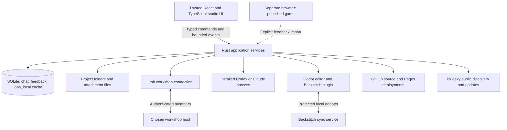
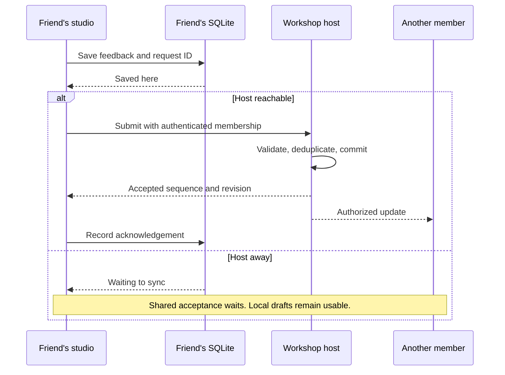
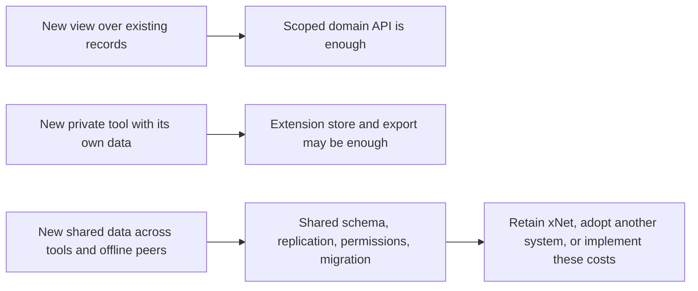

# The standalone Tauri game studio

> [!TIP]
> A focused Tauri studio is a credible product in its own right. Build the experience around Godot, Backstitch, local agents, GitHub, and Bluesky, with ordinary SQLite tables for the studio's own records. Its main compromise is a narrower model of shared data and authority—not a necessary loss of openness or creativity.

Imagine opening a small desktop app, finding a friend's strange little game, and sending them a note. They invite you into their workshop. You talk, try a change with your agent, play it together, and publish it. Nobody needs to know what a node, CRDT, or hash chain is.

That experience can exist without the xNet data layer. This exploration gives that alternative a full design, then asks where it would remain simpler and where its costs would return.

It follows [0494: Which xNet primitives earn their place?](./0494_[_]_XNET_PRIMITIVES_FOR_COMMUNITY_GAME_MAKING.md) and [0493: A game studio we can share](./0493_[_]_COLLABORATIVE_GODOT_STUDIO.md). It also revisits [0486's Tauri comparison](./0486_[_]_IROH_INVITES_AND_THE_TAURI_DECISION.md), now that the proposed product is more focused.

**Scope:** research and speculative interface sketches, not a built Tauri application, a measured performance result, or a migration decision. Code observations refer to the current local prototype; external documentation was checked on October 27, 2026. Review on November 24 to decide whether a bounded implementation experiment is worth doing. That is a decision checkpoint, not a shipping date. Accepted wire formats or security contracts would need an ADR and a tripwire.

The [visual companion](./visuals/0495/exploration.mdx) shows three proposed desktop states: discovery, a shared workshop, and a workshop whose host is away. Names, activity, and game content are illustrative.

## Two independent choices

**Tauri does not require abandoning xNet. Keeping xNet does not require Electron.** The shell and the shared-data model answer different questions.

|              | Existing xNet data layer                                           | Focused application tables                                                                   |
| ------------ | ------------------------------------------------------------------ | -------------------------------------------------------------------------------------------- |
| **Electron** | Current foundation; most existing native integrations remain       | Useful control experiment: simplify the data layer without changing the shell                |
| **Tauri**    | Smaller-shell candidate; bridge or port the required xNet services | The standalone studio explored here; new Rust services and a narrower collaboration contract |

The xNet implementation already uses SQLite. The choice is whether to add common node schemas, field merge rules, signed changes, and shared reactive APIs above that storage engine. Tauri supplies neither those semantics nor a replacement for them.

We can also keep the name and philosophy of xNet while choosing different internals. Open source, consent, calm discovery, community ownership, and useful exports are product commitments. None is exclusive to a database model.

## What the small product promises

The promise is **a place to find games and make them with friends**. It is not initially a universal personal-data platform or a replacement for every communication app.

The first complete loop is deliberately small:

1. Find a game through a followed creator or a community collection.
2. Play its published web build without installing the studio.
3. Send a kind, contextual note or request an invitation to help.
4. Enter a private workshop with chat, feedback, and a shared Godot project.
5. Ask an installed agent to try a change in an isolated working copy.
6. Inspect the result, run a playtest, and accept or discard the change.
7. Save source to GitHub, publish the web build, and optionally post an update to Bluesky.

This preserves the social direction from [0492](./0492_[_]_GITHUB_FOR_GAMES.md). A game is a reason to meet someone. Making a small contribution should feel easier than learning a forge's entire vocabulary.

### A compact interface

The sidebar has **Discover**, **Chats**, and **Your games**, followed by pinned workshops. A workshop can hold several games later; the first version opens one game directly. Unread markers describe actual messages, not pressure to return. There are no streaks or global popularity scores.

Inside a workshop, **Chat**, **Play**, and **Build** are the main views. Feedback stays attached to the relevant game or playtest, with a compact filter in the conversation. A right panel opens for an agent's proposed change, a feedback item, or sharing settings. It is resizable and can close completely.

**Open in Godot** launches the real editor beside the studio. We should not start by embedding a native editor window or rebuilding its inspector. The app can still feel coherent: the same game name, collaborators, branch, and playtest appear in both places.

| Moment                       | What a person sees                                                   | What stays in details                                 |
| ---------------------------- | -------------------------------------------------------------------- | ----------------------------------------------------- |
| A friend is making something | Game title, short update, why it appeared, Play and Send a note      | AT record URI and repository identifiers              |
| People are working together  | Chat, active collaborators who opted into presence, current playtest | Backstitch document references and transport routes   |
| An agent is trying a change  | A short task, progress, Cancel, then Try and Review                  | Provider events, exact patch, logs, evidence metadata |
| Publishing partly succeeds   | Source saved; game publishing; update not posted                     | Commit, deployment, and post receipts                 |
| The host goes away           | Saved here; waiting for the workshop to reconnect                    | Outbox cursor and authority epoch                     |

A private note and a public Bluesky reply are different actions. Show the destination beside the composer. Sending a compliment should not silently create a public post or grant access to someone's project. Message requests, blocking, and rate limits remain necessary even when the community's tone is friendly.

The first feasibility cohort should be two adult friends. Designing for younger people remains a goal, but a small native bundle does not make downloaded projects safe for children. The age-specific work in [0490](./0490_[_]_XNET_FOR_YOUNG_PEOPLE.md) still applies.

## The architecture at the extreme

Keep React and TypeScript for the interface. Use Rust for native services, local persistence, peer transport, and process supervision. Remove the general node store from this version. There is no per-property Lamport clock or universal signed mutation chain in the studio database.



This removes one broad abstraction, not every specialist system. Backstitch still has a CRDT. Git still has history and hashes. AT Protocol still has signed repositories. Iroh still has keys. Each serves a specific part of the product.

Tauri supports a Rust core with an HTML/CSS/JavaScript interface and message passing between them. React does not become native Rust UI when hosted there. The shell can avoid bundling Chromium, while rendering and JavaScript work still run in a webview. [Tauri architecture](https://v2.tauri.app/concept/architecture/)

### Ordinary tables, explicit operations

Use domain tables rather than one generic record format. A plausible first schema is:

| Table or local store              | Purpose                                                           |
| --------------------------------- | ----------------------------------------------------------------- |
| `workshops`, `members`, `devices` | Named communities, roles, authorized endpoints, chosen host       |
| `games`, `external_refs`          | Project folders, GitHub repositories, Pages URLs, AT records      |
| `conversations`, `messages`       | Private workshop chat and accepted message requests               |
| `feedback`, `attachments`         | Playtest notes, screenshots, build references, blob metadata      |
| `agent_runs`, `proposals`         | Requester, executor, bounded context, patch, review and evidence  |
| `publication_jobs`, `receipts`    | Resumable source, deployment, and social publishing steps         |
| `outbox`, `sync_cursors`          | Pending submissions, deduplication, accepted host sequence        |
| Local credential store            | Account tokens and device secrets, separate from exported content |

SQLite is well suited to local application files and caches. Use transactions, indexed queries, full-text search where needed, and cursor pagination. Keep large media outside row payloads, with quotas and references. [SQLite use cases](https://sqlite.org/whentouse.html)

The frontend asks for operations such as `listMessages`, `submitFeedback`, and `startAgentExperiment`. Rust checks the caller, membership, resource, and current grant. Do not send the renderer raw SQL or an unrestricted filesystem API.

Illustrative API shape, not an accepted public contract:

```ts
type WorkshopService = {
  listMessages(input: {
    conversationId: string
    before?: string
    limit: number
  }): Promise<MessagePage>
  submitFeedback(input: {
    requestId: string
    gameId: string
    buildRef: string
    text: string
  }): Promise<SubmissionReceipt>
  startAgentExperiment(input: {
    requestId: string
    gameId: string
    provider: 'codex' | 'claude'
    prompt: string
    grantId: string
  }): Promise<RunHandle>
}
```

Limits, identities, and grants must be validated in the receiving service; TypeScript types are not a security boundary. A grant identifier is a reference to a checked grant, not proof of permission on its own.

## The simplification that matters: one workshop authority

For the strongest _simple_ alternative, choose one host for each workshop. Initially that can be the creator's desktop. It accepts member submissions and writes the canonical community database. Every client keeps the history it is allowed to read, plus a durable local outbox.

The host gives accepted operations a sequence number. Clients deduplicate by request ID and resume from a cursor. Editing an existing shared record includes its expected revision; a mismatch produces a reviewable conflict. Ordinary chat appends do not need a general field-level CRDT.

This is peer-hosted, but it is not a fully symmetric multi-writer system. The distinction should be explicit in both architecture and UI.

A Bluesky handle helps people find each other; it does not authorize a device to read private workshop data. The invitation flow must bind the accepted person to their device keys, then check current membership on every connection. The first private DM can be a two-member workshop under the same rules. Making DMs independent of that chosen host is a separate protocol improvement, not something to imply through the chat UI.



### What happens during a split

When the host sleeps, members can read cached chat, draft messages, and work on personal game experiments. They cannot promise that new membership, role changes, shared edits, or agent jobs were accepted. Live Backstitch collaboration through that host also pauses; any local editing supported by the chosen Backstitch version must be tested separately.

On reconnection, recheck permission before accepting queued work. A removed member's pending operation can be rejected even if their UI once showed it as a draft. Do not quietly relabel a rejection as synced. An edit conflict offers both revisions.

A portable workshop archive can contain a SQLite snapshot, allowed attachments, schema version, and external references. Use SQLite's backup facilities rather than copying an active database file carelessly. Exporting a workspace is not the same as transferring its authority or rotating its keys.

**Host transfer is explicit.** Start with a coordinated handoff: quiesce writes, transfer a verified snapshot and sequence, authorize the successor, and retire the old host. A lost host needs a separate recovery procedure. Do not auto-elect a new writable host after a timeout and assume two diverging authorities will reconcile safely.

### Privacy is part of the comparison

In this baseline, the chosen workshop host can read the workshop it serves. Iroh encrypts transport between devices, including relay traffic, but the receiving host is an endpoint. A hosted version of the same protocol would therefore trust its operator with that data.

If we require a cloud operator to be unable to read private chat, we need application-level group encryption, device enrollment, key rotation, and recovery. Use a reviewed protocol and implementation; do not invent cryptography to preserve the appearance of simplicity. Backstitch's server access model needs its own assessment. Its data cannot become opaque to an operator just by placing it behind an encrypted connection.

> [!IMPORTANT]
> Comparing a trusted-host SQLite app with a system intended to support untrusted storage is not an equal security comparison. Record the reduced promise. If that reduction is unacceptable, include the cost of restoring it on the standalone side.

This gives the standalone app a real advantage for small, trusted groups. It also identifies the point where “just SQLite” stops describing the engineering work.

Attribution is narrower too. A trusted host can record which authenticated member submitted a message, but an exported row is not independent cryptographic proof of authorship. If that proof matters, add signed envelopes for the relevant objects using a reviewed library. That need does not by itself justify a hash chain on every property change.

## The integrations that still need to work

### Godot and Backstitch

Keep the real Godot editor and Backstitch plugin. A Rust supervisor owns process lifetime and routes project-specific connections. Start the Backstitch service only for active work, with a protected endpoint and isolated project storage. A per-project service is a possible first isolation boundary; its memory cost must be measured.

The inspected Backstitch server is an Automerge/WebSocket service. It has no authentication by default, and its optional OIDC support distinguishes sign-in from project authorization. Guessing a project identifier can expose its data without an added access boundary. This is a concrete integration gap, not something Tauri fixes. [Pinned server README](https://github.com/inkandswitch/backstitch-sync-server/blob/e8c3a985589586420b36d619b02012d2d62f0ced/README.md)

The proposed Iroh bridge from 0493 still needs implementation: authenticate workshop membership before forwarding WebSocket, asset, or REST access. Cover every route and document reference, not only the initial connection. Bind local services carefully and authenticate local access too; loopback is not proof of a trusted caller.

Backstitch owns live project state. A coordinator captures a stable reference for an agent experiment, imports reviewed changes, and records the exact source snapshot sent to GitHub. Do not let Git checkout, a file watcher, an agent, and live collaboration rewrite the same working tree independently.

### Claude and Codex

The current adapters already communicate with installed processes. [Codex uses app-server over stdio](../../packages/devkit/src/codex-app-server.ts); the Electron [runtime integration](../../apps/electron/src/main/community-agent-runtime.ts) also handles Claude's structured stream. Rust can implement those process and protocol boundaries without a permanent Node service.

That is a port, not a relabeling. Preserve cancellation, bounded buffering, provider errors, version checks, attachment limits, permissions, and session recovery. “Use my existing setup” means invoking an installed runtime with an authorized configuration. It does not automatically mean taking over an arbitrary open desktop chat.

The present reply path intentionally disables tools and inherited integrations. A full game-editing mode needs a separate, explicit project grant and a provider-compatible execution policy. Removing those restrictions globally would be a security regression.

Each proposed change has one execution owner and one request ID. Other people can contribute to its conversation; they do not silently gain the ability to spend the owner's model budget. The agent edits an isolated experiment. A human reviews it before it enters the shared project or publishes anywhere.

Even a locally installed agent can send context to a cloud model. Show the provider and approved context. Local integration does not promise offline inference or free usage.

### GitHub, Pages, and Bluesky

Source remains in GitHub. Public web builds and game pages can use Pages. Bluesky carries public updates and social discovery; the studio keeps references and a local cache. Private workshop chat stays in the workshop service in this design.

The publication flow retains three separate receipts: **Source saved**, **Game live**, **Update shared**. A failed post must not trigger a second commit or lose the successful deployment. Never post or push merely because an agent finished a patch.

Pages is static hosting with size, bandwidth, and use restrictions, not a game server or unlimited asset CDN. Keep export destinations replaceable. [GitHub Pages limits](https://docs.github.com/en/pages/getting-started-with-github-pages/github-pages-limits)

Use Godot's GDScript/Compatibility web path for the first template. Its current web export requires WebAssembly and WebGL 2; Godot 4 C# projects cannot use that path. Single-threaded export avoids some cross-origin requirements, but browser compatibility still needs testing. [Godot web export](https://docs.godotengine.org/en/stable/tutorials/export/exporting_for_web.html)

Rust does not eliminate OAuth work. The current Bluesky adapter uses a Node library and is an identity-linking flow, not a completed posting integration. A Rust port must preserve the protocol's security checks; a temporary Node sidecar is an honest alternative. GitHub authentication, repository access, and publication grants are also separate from signing in socially.

AT Protocol Spaces is a relevant future alternative for shared private records. The October 14 developer update describes group hosts and recent breaking changes after the alpha. It deserves a compatibility experiment, not an assumption that stable private collaboration is already available to this prototype. [Spaces developer update](https://atproto.com/blog/devex-goals-for-spaces)

## Small bundle, potentially faster app: what is actually gained?

Tauri uses WKWebView on macOS, WebView2 on Windows, and WebKitGTK on Linux. That reduces the need to ship a private browser engine, while introducing a platform and OS-version compatibility matrix. Webview updates and available features follow those runtimes. [Tauri webview versions](https://v2.tauri.app/reference/webview-versions/)

Windows installation may download WebView2 or bundle a runtime for offline use. Count that dependency when comparing fresh-machine installation, even if it is absent from the nominal app download. [Windows distribution](https://v2.tauri.app/distribute/windows-installer/)

| Change                 | Plausible benefit                                                              | What needs evidence                                                    |
| ---------------------- | ------------------------------------------------------------------------------ | ---------------------------------------------------------------------- |
| System webview         | Smaller shell distribution                                                     | Complete signed installer and first-use download on each OS            |
| Rust native services   | Direct Iroh integration; fewer Node/native-addon packaging seams               | Process-tree memory, crash recovery, actual query and transfer latency |
| Fixed domain tables    | Straightforward indexes and transactions; less generic query/history machinery | Same data volume and user operations, including sync metadata          |
| Fewer product surfaces | Less code loaded, fewer background services                                    | Which existing features were removed from the comparison               |
| On-demand tools        | Light browsing/chat session                                                    | Time and disk cost of first game creation                              |
| One authority          | Simpler conflict and permission decisions                                      | Availability and trust lost relative to independent peers              |

The [current Electron manifest](../../apps/electron/package.json) includes much more than chat: editors, canvas, charts, meetings, and native packages. A narrow Electron build might also improve substantially. Its Iroh package already reaches native transport; moving to Rust does not turn a formerly pure-JavaScript network stack into native code for the first time.

Count three footprints separately: **the studio alone**, **a ready-to-create installation**, and **an active collaboration session**. Godot, export templates, Backstitch, installed agents, project caches, and webview processes all belong in the relevant total. A tiny launcher that downloads a large toolchain has a useful distribution model, but it is not a tiny complete toolchain.

Do not claim Rust makes chat scrolling fast. History virtualization, query shape, image decoding, layout, event batching, and IPC volume remain important. Keep work off the UI thread and send small updates. The most valuable result may be fewer pauses and clearer failures rather than a dramatic headline speedup.

## Security and agent self-checking

### Four trust zones

| Zone                         | Allowed by default                   | Boundary to prove                                                                           |
| ---------------------------- | ------------------------------------ | ------------------------------------------------------------------------------------------- |
| Bundled studio UI            | Named app operations                 | Every command validates resource scope and current authority                                |
| Downloaded game              | Browser playback                     | No studio IPC, credentials, filesystem grants, or silent navigation into privileged content |
| Godot project/editor plugins | Explicitly trusted local development | Native project code can execute; this is not equivalent to browser playback                 |
| Agent process                | Approved experiment and tools        | Restricted context, paths, network/tools, cancellation and publication approval             |

Tauri capabilities constrain which windows or webviews can invoke APIs, but custom app commands need deliberate configuration: registered commands are broadly available by default unless constrained. Permissions from overlapping capabilities combine. The documentation also flags iframe-origin limitations on Linux and Android. [Tauri capabilities](https://v2.tauri.app/security/capabilities/)

**First prototype: open untrusted published games in a separate browser.** Do not put them in an iframe inside the privileged studio window. A later embedded play surface must have no studio capabilities and a reviewed message bridge, with cross-platform tests. Arbitrary plugins belong behind that boundary too.

The Rust service remains responsible for consent and scope. Use opaque file handles or grants, validate paths against symlink escape, isolate project credentials, and avoid generic shell or SQL commands exposed through IPC. Tauri's capability system is not an OS sandbox for Godot or an agent child process. Security depends on application code and dependencies as well as the framework. [Tauri security model](https://v2.tauri.app/security/)

The existing Electron implementation contains real work to preserve: [extension surfaces](../../apps/electron/src/main/extension-surfaces.ts) use isolated sessions, navigation restrictions, brokers, and capture APIs. Porting that requires an explicit replacement for each property. A smaller native core is not evidence that the replacement is safer.

### The agent must still see what it made

The tic-tac-toe failure remains the right regression case. An agent should compile, launch an isolated preview, inspect layout and errors, interact with it, capture evidence, and refine the result. A successful build alone cannot establish a playable game.

Current Tauri documentation recommends WebdriverIO with an embedded WebDriver service that supports macOS, Windows, and Linux. Direct native `tauri-driver` use is still limited to Windows and Linux. This improves the outlook compared with older “no macOS testing” summaries. It does not make existing Electron CDP tooling portable unchanged. [Tauri WebDriver](https://v2.tauri.app/develop/tests/webdriver/)

Use that tooling to validate the studio during development. Keep debug automation and arbitrary backend evaluation out of the production build. For an end-user agent's game checks, provide a separate constrained runner with synthetic or approved data and only preview-scoped actions. Screenshots must capture the game, not unrelated chats or the whole desktop.

For Godot, separate structural checks, headless import/build checks, and actual rendered playtests. A browser runner can inspect a web export; native gameplay needs its own window/input capture path and OS permissions. Label evidence with the exact build and environment, and report checks that were not run. A screenshot is evidence of appearance, not proof of all gameplay or safety.

## How this grows

These are operating stages, not performance claims or fixed user-count limits.

| Stage                                                  | Standalone Tauri studio                                               | What the xNet alternative could add                                           |
| ------------------------------------------------------ | --------------------------------------------------------------------- | ----------------------------------------------------------------------------- |
| One person                                             | Local SQLite, Godot, installed agent, GitHub publishing               | Common APIs and existing local data reuse; possibly unnecessary overhead here |
| A few friends online together                          | A chosen desktop host; cached reads and queued writes                 | Replicated record semantics; transport and membership still need work         |
| A community across time zones                          | Move the host to a home server or community server; backup and quotas | More flexible replicas and encrypted-storage designs where implemented        |
| Many independent communities                           | Separate workshop hosts; aggregate public discovery elsewhere         | Shared client/data contracts across operators, if interoperability is proven  |
| Communities invent their own tools                     | Versioned domain APIs, extension-owned data, exports                  | Shared schemas and scoped reactive data across many tools                     |
| Independent peers must keep editing while disconnected | Add domain conflict rules or adopt a mature replication system        | A stronger reason to retain a tested xNet kernel                              |

### Growth in people does not force a universal data layer

A large population spread across many small workshops need not share one giant database. Isolate projects and communities, paginate local history, bound subscriptions, and retain only selected media. Public discovery can have its own index and moderation service. The studio's local SQLite database need not ingest the whole social network.

One enormous workshop is a different workload. Its write rate, attachment traffic, membership checks, and fan-out must be measured. A community service may eventually need a different server database while clients keep SQLite caches. That is a service evolution, not proof that every client needed generic nodes from day one.

Real-time gameplay is a third workload. Backstitch synchronizes project editing, not the movement of game entities. Competitive or persistent games may need authoritative game servers; peer sessions still need matchmaking and abuse decisions. Neither Tauri nor xNet CRDTs provides anti-cheat or a simulation tick loop.

### What requires an always-on service?

| Feature                  | Without an xNet-operated service                         | Why a community/cloud service helps                           |
| ------------------------ | -------------------------------------------------------- | ------------------------------------------------------------- |
| Public game and source   | GitHub/Pages remain available under their own terms      | Larger assets or other hosting needs can use another provider |
| Public social updates    | Existing Bluesky/AT services                             | Custom discovery ranking, indexing, and moderation            |
| Live private workshop    | Chosen desktop host must be reachable                    | Continuity when that desktop sleeps                           |
| Durable offline delivery | Pending local work waits for an available holder         | Mailbox or workshop host can accept and retain it             |
| Backstitch editing       | Authorized participants reach the active project service | Stable availability and backups                               |
| Agent execution          | Owner's authorized machine must be running               | A separate, opt-in runner—with its own budget and trust model |

Iroh relays forward encrypted traffic when direct paths fail. They do not retain application messages for later delivery. Public relays have limits and no availability guarantee; a production capacity plan is still required. [Iroh relays](https://docs.iroh.computer/concepts/relays)

“No server operated by us” is achievable for an early cohort. “No servers anywhere” is not an accurate description of GitHub, Bluesky, Pages, relays, or Backstitch. This exploration adds no pricing proposal; hosted options and their charter tests remain in 0493.

## How much composability is really lost?

Less than it first appears, provided we deliberately build useful interfaces.

People can still connect Godot, GitHub, Bluesky, and their preferred agent. They can ask for a new screen over approved APIs, too. The larger gap concerns shared data. A fixed feedback API is easy to reuse. New shared record types need rules for how tools read, change, and sync them.

Consider asking, “Make a playtest board from our feedback, then let people assign items to themselves.” A standalone app can support this with a scoped feedback API and an assignment operation. It does not require a CRDT. If another tool should use the same assignments, publish that schema and API rather than copying data into an isolated plugin store.

Now ask for a creature-design notebook, linked to scenes and feedback, editable offline by several people, usable in three unrelated clients, and portable to another host. The standalone application must supply schema evolution, merge behavior, authority, and access control across those tools. That is where a common data layer may repay its cost.



There is no unique threshold at which xNet becomes mandatory. Mature CRDT libraries, documented event protocols, and AT Spaces may offer alternatives. The question is which implementation delivers the desired semantics with the least work and fewest failures.

In this sense, the standalone version can still feel like digital Legos. Its first connectors are named product APIs. The xNet version aims for a broader shared substrate. Both need stable semantics and good documentation; a generic record store does not create interoperability by itself.

## What we can reuse, and what we would replace

| Current code                                                                                    | Proposed treatment                                                                                           |
| ----------------------------------------------------------------------------------------------- | ------------------------------------------------------------------------------------------------------------ |
| [Community UI](../../packages/workbench/src/communities/CommunityApp.tsx) and visual components | Reuse suitable presentation and interaction patterns; introduce service-backed view models                   |
| [Community data hooks](../../packages/workbench/src/communities/use-community-data.ts)          | Replace direct node-store dependence in the standalone slice                                                 |
| [SQLite node adapter](../../packages/data/src/store/sqlite-adapter.ts)                          | New domain tables; retain the original store for comparison and import only                                  |
| [Preload bridge](../../apps/electron/src/preload/index.ts)                                      | Replace Electron IPC with typed Tauri commands and events                                                    |
| [Peer service](../../apps/electron/src/main/peers/service.ts)                                   | Reuse validated requirements and cases; Rust implementation still needs authorization and lifecycle work     |
| [Extension authority](../../packages/workbench/src/communities/extension-authority.ts)          | Preserve grant semantics where needed; no blanket port of the full extension platform in the first prototype |
| [Agent adapters](../../packages/devkit/src/chat-agent.ts)                                       | Port framed protocols to Rust, or temporarily retain a narrowly packaged Node helper                         |
| [Bluesky onboarding](../../apps/electron/src/main/onboarding/bluesky.ts)                        | Port or bridge verified OAuth behavior, then add explicit posting grants                                     |
| [Extension checking](../../apps/electron/src/main/community-extension-check.ts)                 | Replace Electron-specific windows, capture, and inspection with equivalent scoped tooling                    |
| [Rust xNet core](../../rust/xnet-core/src/lib.rs)                                               | Relevant to a Tauri+xNet option; it is an interop kernel, not the full desktop NodeStore and React bridge    |

Tauri supports external binaries, packaged for each target architecture. A Node helper is therefore a practical transition option, but its size, dependency updates, and process overhead remain part of the result. [Tauri sidecars](https://v2.tauri.app/develop/sidecar/)

Do not rewrite every protocol in Rust to prove the product idea. First record which existing adapters require Node and which can use a small Rust process boundary. If keeping one bridge avoids an insecure rushed OAuth port, that is a worthwhile trade to measure.

Existing user data should remain untouched during an experiment. Use a new app identifier, separate data directory, and explicit imports. Preserve IDs, timestamps, external references, and an archive of original signed records where applicable. A converted SQL row must not pretend to retain verification properties that its importer discarded.

## A comparison that can change our minds

Build one representative slice, not four complete products. Use the same UI workload across the four shell/data combinations where practical. At minimum, compare current Electron+xNet, narrowed Electron with the same features, and the standalone Tauri slice. A Tauri+xNet bridge distinguishes shell savings from data-layer savings.

Record feature and security differences beside every number. Native Godot playback must be compared with native Godot playback; do not compare it with a more constrained browser build and attribute the difference to the shell.

| Measurement          | Method                                                                            | Proposed decision signal                                                          |
| -------------------- | --------------------------------------------------------------------------------- | --------------------------------------------------------------------------------- |
| Footprint            | Signed per-architecture installer, installed files, first-use downloads           | A meaningful reduction in complete installation, not only the empty shell         |
| Responsiveness       | Same hardware, cold/warm runs, 100k messages, 2k feedback items, 5k agent records | First local view within 2s; warm first page p95 within 200ms; provisional targets |
| Idle cost            | Whole process tree, UI open/closed, services active/inactive                      | Less idle memory/CPU without false “connected” status or lost work                |
| Native compatibility | macOS first, then Windows and Linux                                               | OAuth, invite links, agent streaming, Godot, media, and accessibility all work    |
| Recovery             | Crash between commit and acknowledgement; retry; host sleep; revocation           | No duplicate job, silent data loss, unauthorized acceptance, or false completion  |
| Composability        | Add a scoped playtest board over existing feedback                                | New view works without duplicating data or granting whole-database access         |
| Maintenance          | Log changed surfaces, provider-port defects, OS-specific fixes                    | Footprint gains outweigh an expanding parallel implementation burden              |

The latency targets come from 0494 and remain hypotheses. A candidate adoption threshold could be 50% less complete installer size or 25% less idle process-tree memory, with no material regression in the core flow. These are decision criteria to agree before measuring, not estimates of Tauri's performance.

An apparent win that drops encryption, offline capabilities, extension checks, or whole features is still useful evidence—but it answers a different product question. Make the reduced scope explicit.

## Recommendation

**The focused Tauri studio is worth a bounded prototype.** Its strongest case is a product where game creation and community come first, with a small set of shared records and a chosen workshop host. That could be easier to understand, package, and maintain than the full current workspace.

Start the experiment with React, Rust, SQLite, one Godot template, Backstitch, and the existing installed-agent protocols. Keep Godot in its own window and published games in a separate browser. Require chat, a real two-person edit, an agent experiment with visual evidence, and a partially failing publication flow to work before celebrating the shell size.

Retain the existing prototype as a control. If the standalone version makes those flows substantially better and users do not need broad shared-data tools, choose the simpler product. If people repeatedly build tools that need common data across devices and hosts, test Tauri with a narrow xNet kernel. That outcome would preserve the shell gains without rebuilding a general data layer under a new name.

The decisive question is: **Are we building a great collaborative game studio, or a medium communities can reshape into many kinds of software?** The first can succeed with ordinary tables. The second needs more common infrastructure, whether it comes from xNet or elsewhere. We can learn which promise matters through actual use.

## Implementation checklist for a future prototype

- [ ] Agree on the host-authoritative baseline, privacy claims, and supported OS versions.
- [ ] Create an isolated Tauri app and data directory; keep existing xNet data unchanged.
- [ ] Implement the three-view workshop shell with typed Rust service boundaries.
- [ ] Add paginated SQLite chat, feedback, outbox, receipts, and crash recovery.
- [ ] Authenticate invitations and members; implement queued/rejected/accepted states and coordinated host transfer.
- [ ] Integrate one Godot template and a project-isolated Backstitch service through an authenticated adapter.
- [ ] Support one installed agent end to end, including cancellation and constrained visual checks; then add the second provider.
- [ ] Coordinate experiment review, Backstitch import, and exact Git source publication.
- [ ] Add resumable GitHub/Pages/Bluesky publication with separate approvals and receipts.
- [ ] Expose one small, scoped feedback API to an agent-created view.
- [ ] Compare the representative slice with the Electron controls and, if practical, a Tauri+xNet bridge.

## Validation checklist

- [ ] Two physical devices can join, chat, edit, review, and publish using their own identities and grants.
- [ ] Host sleep is visible; local drafts survive restart; reconnection neither duplicates nor misattributes work.
- [ ] Queued work from a removed member is rejected, and conflicts are shown rather than overwritten silently.
- [ ] Godot edits, Git operations, and agent experiments cannot race over the same live working copy.
- [ ] An untrusted game cannot invoke app commands or acquire local credentials; test explicit denial cases.
- [ ] The agent catches a broken layout, produces screenshots and interaction evidence, and accurately reports skipped checks.
- [ ] Production artifacts exclude debug automation backdoors; native execution and file grants remain explicit.
- [ ] Keyboard navigation, focus return, reduced motion, and screen readers are checked in real native webviews.
- [ ] Installer, total toolchain, process-tree, and large-history measurements identify included features and security semantics.
- [ ] Export/import and a deliberate host handoff preserve accessible data and disclose any lost guarantees.

<details>
<summary>Questions to settle from the prototype</summary>

Would friends tolerate a sleeping desktop host, or would they choose an always-on community host immediately? Is a browser handoff for playtests comfortable enough? How much of the existing agent and OAuth logic should stay in a helper initially? Can users build a useful new tool from the small API without asking for raw database access? Which native OS causes the most integration work? Do people miss the wider workspace, or is its absence part of the appeal?

These are testable product questions. None requires announcing a wholesale rewrite in advance.

</details>
