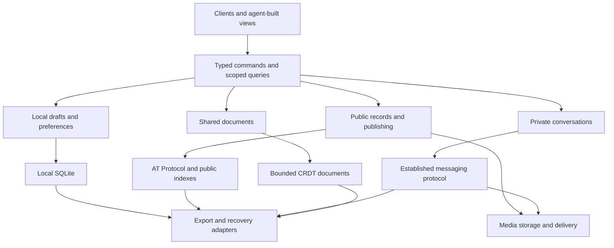
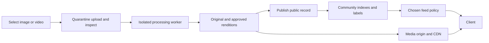
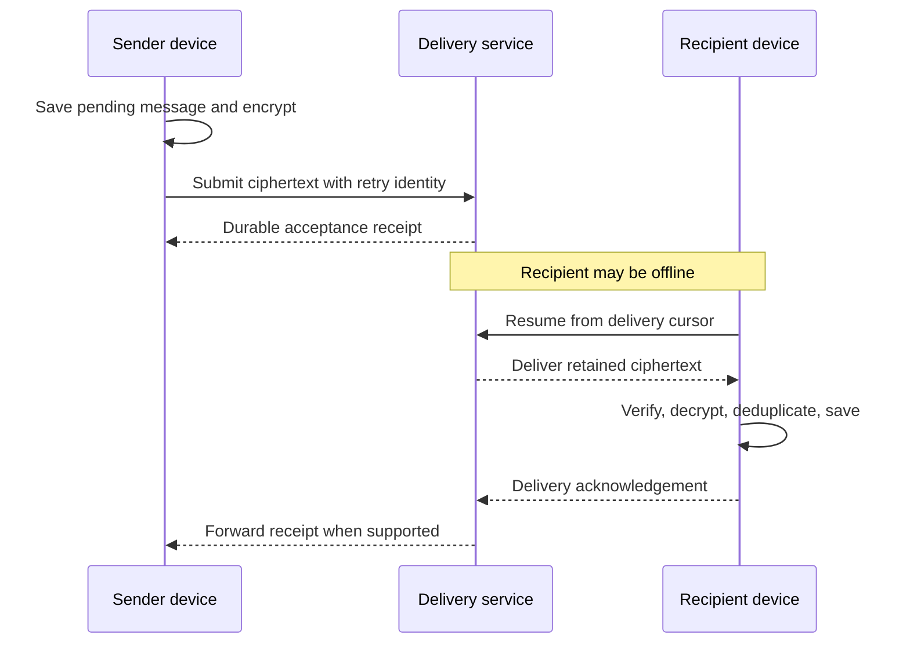

# Start small. Stay yours.

## A different center of gravity

> [!TIP]
> Make **portable data, explicit authority, and replaceable services** the foundation of xNet. Use local storage for speed and continuity, ordinary transactions for rules that need an authority, and CRDTs for the specific objects people edit together.

Here, authority means who can accept a change: the author of a post, a messaging protocol, or a service enforcing a group's rules. The product can begin on one person's computer and grow into a community service. Every device need not have equal power to change all shared state. That trades some independence during network failures for simpler coordination and a clearer route to operating a large service.

This exploration asks what remains when we set aside both the chat-first shell and the game studio. The two reference applications are an open image-and-video social network and a messenger for people and agents. The goal is to find shared foundations without forcing the applications into one storage or security model.

**Working thesis:** xNet could become a kit for building software that starts locally, can be hosted by a community, and can be moved without losing its meaning. Its most useful product might be a small set of well-tested boundaries and a great reference application.

This is a proposal, not a migration decision or a claim that these services exist. The [web edition](web/0496/index.html) includes a workload explorer and a video cost calculator. It is generated from this document. Research was checked on November 2, 2026. Revisit on December 2 after one small experiment; this date is for deciding whether the approach is worth pursuing.

## What sovereignty actually promises

“Local-first,” “decentralized,” “open source,” and “community owned” describe different properties. Local apps can trap data in opaque files, while federated services can be expensive to leave. Even an open-source app can depend on one irreplaceable index.

Ink & Switch's local-first work ties collaboration to ownership and offline use. Its malleable-software work argues for people reshaping their tools where they use them. Those are useful goals even when an application chooses a server to accept shared writes. [Local-first software](https://www.inkandswitch.com/local-first-software/), [Malleable software](https://www.inkandswitch.com/essay/malleable-software/)

For this proposal, sovereignty has six observable parts:

| Promise    | Evidence we would require                                                      | Limit we must explain                                              |
| ---------- | ------------------------------------------------------------------------------ | ------------------------------------------------------------------ |
| Possession | A readable export with referenced media, schemas, and a completeness report    | A cache may contain only some history                              |
| Exit       | Restore on another host and continue using stable references                   | Recovery needs keys, copies, and somewhere to run                  |
| Choice     | Change client, feed, media host, or messaging provider through supported paths | The providers do not have identical features                       |
| Privacy    | A clear answer to who can read each object, including agents                   | Recipients can copy what they receive                              |
| Voice      | Communities can set rules, appeal decisions, and choose operators              | No one can require every other community to distribute their posts |
| Adaptation | Build another view or workflow without copying the entire database             | New data types still need shared meaning and permissions           |

Treat these as separate tests. Content hashes let us check bytes against an expected value, but we still need backups. Signatures attribute a statement to a key without proving the statement true. CRDTs merge updates; group membership needs its own rules. Encryption protects content within a defined threat model, leaving agent execution safety as a separate problem.

There is also a governance choice. Who owns the domain, can replace an administrator, controls backups, approves a policy change, and pays a surprise bandwidth bill? A community-run binary alone does not answer those questions. Publish an operator handover procedure and practice it with two people.

## What we have to work with

The code observations below refer to the local `codex/chat-first-redesign` worktree. It contains substantial uncommitted prototype work. They are source observations, not fresh production or security verification.

| Existing piece           | Observed state                                                                                                                                                                           | How it informs this direction                                                                                                           |
| ------------------------ | ---------------------------------------------------------------------------------------------------------------------------------------------------------------------------------------- | --------------------------------------------------------------------------------------------------------------------------------------- |
| NodeStore and SQLite     | ✅ Present: [store](../../packages/data/src/store/store.ts), [adapter](../../packages/data/src/store/sqlite-adapter.ts)                                                                  | xNet already uses SQLite. The comparison is about the model above it, not SQLite versus no SQLite                                       |
| Signed changes           | ✅ Present: [change format](../../packages/sync/src/change.ts)                                                                                                                           | Hash links, Lamport ordering, and signatures can be useful selectively; they need not wrap every cache or ephemeral event               |
| Portable bundles         | ✅ Present: [types](../../packages/data/src/portability/types.ts), [verification](../../packages/data/src/portability/verify.ts), [import](../../packages/data/src/portability/apply.ts) | `.xnetpack` preserves changes, blobs, and Yjs state. A simpler implementation will need an explicit translator, not just a renamed file |
| JSON row export          | ✅ Present: [exporter](../../packages/data/src/database/export/json-export.ts)                                                                                                           | Useful for readable tables, but not a complete identity, media, permission, and history migration                                       |
| Public publishing states | ✅ Present: [publish types](../../packages/social/src/publish/types.ts)                                                                                                                  | Already distinguishes local, staged, published, failed, and withdrawn. Public withdrawal cannot promise universal erasure               |
| Extension approval       | 🚧 Prototype: [authority](../../packages/workbench/src/communities/extension-authority.ts)                                                                                               | Durable approval, scope, version, and revocation are reusable ideas regardless of the database                                          |
| Desktop peer chat        | 🚧 Prototype: [protocol](../../apps/electron/src/main/peers/protocol.ts), [service](../../apps/electron/src/main/peers/service.ts)                                                       | Identity binding and narrow validation are useful. Do not relabel the existing transport as a reviewed group-encryption protocol        |
| Feed views               | ✅ Present: [saved media views](../../packages/social/src/feeds/defaults.ts)                                                                                                             | One collection can support several views; this does not require one global multi-writer database                                        |

The previous [primitives exploration](0494_[_]_XNET_PRIMITIVES_FOR_COMMUNITY_GAME_MAKING.md) asked where nodes and CRDTs earn their cost. The [Tauri exploration](0495_[_]_TAURI_GAME_STUDIO_WITHOUT_XNET.md) separated the desktop shell from the data model. This proposal goes further: different kinds of information may deserve different protocols inside one coherent application.

## The smallest useful decomposition

Begin with interfaces inside one application, not eight separately deployed services. A module earns an independent process only when trust, operations, or measured load requires it.

| Building block            | Small contract                                                             | What stays outside it                                              |
| ------------------------- | -------------------------------------------------------------------------- | ------------------------------------------------------------------ |
| Identity and devices      | Stable principal, verified account links, device enrollment and revocation | Treating a social login token as a decryption key                  |
| Records and references    | Typed records, stable IDs, schema versions, links to external objects      | Forcing every domain into a generic property bag                   |
| Commands and receipts     | Named actions, validated inputs, idempotency, an honest result             | Direct arbitrary SQL from an extension                             |
| Updates and subscriptions | Bounded snapshot, resumable cursor, invalidation, catch-up                 | A permanent socket to every other person                           |
| Media objects             | Content identity, renditions, integrity, location and retention            | Video bytes embedded in a row or change log                        |
| Access and execution      | Scoped capabilities, runtime isolation, expiry and revocation              | Assuming a permission dialog constrains an unrestricted subprocess |
| Views and discovery       | Search, lists, feed policies, rebuildable indexes                          | Making a ranking database the only copy of someone's work          |
| Export and recovery       | Versioned manifests, verified copies, restore and handover                 | Assuming readable JSON alone means the app can be reconstructed    |

Public TypeScript APIs should describe these operations in domain language. Rust can implement native storage, networking, or media coordination where it helps. A Swift client could use the same network contracts later. Neither language parity nor a universal SDK is required to test the design.



This architecture shares identity links, references, UI components, and an access vocabulary. It does not assert that a public post, an encrypted message, and a collaborative document have interchangeable update semantics.

### Concrete data shapes

Use ordinary tables for objects with clear owners. For a public post, store its author, stable external reference, revision, media references, and publication state. Messages need an opaque ID, conversation reference, protocol metadata, ciphertext, and delivery state. Decrypted message content lives only at authorized endpoints. Keep rendition and integrity details in a media manifest, separate from the provider's URL. Local views store their query, schema compatibility, and granted scope.

Keep three kinds of reference distinct: **identity of an object**, **identity of a revision**, and **where bytes can currently be fetched**. Moving an object between hosts must not silently change which object a conversation points to. Re-encoding a video creates different bytes and a new rendition identity. A transient CDN URL is not an object identity.

Preserve the native protocol reference for interoperable public objects. Choose and document stable IDs for app-owned objects during the prototype. The wire format remains a future decision requiring an ADR.

## Give each kind of change the right rules

The question is not whether CRDTs are good. It is which concurrent changes the product needs to accept independently, and what a person should see when they disagree.

| Information                        | Proposed default                                   | Conflict or failure behavior                                               |
| ---------------------------------- | -------------------------------------------------- | -------------------------------------------------------------------------- |
| A person's unpublished caption     | Local row with revision check                      | Retain both drafts if edits conflict                                       |
| A published post                   | Author-controlled versioned record                 | Update through its protocol authority; show pending publication separately |
| Messages                           | Distinct message IDs plus protocol-governed events | Retry safely; reconcile duplicates; edits reference the original message   |
| Group membership and device keys   | Serialized protocol transitions                    | Reject stale transitions and reconcile with current membership             |
| Shared writing or a canvas         | CRDT within a bounded document                     | Merge valid concurrent changes; retain permission checks                   |
| A task assignment or payment state | Transaction with expected revision                 | Reject or explicitly resolve competing operations                          |
| Typing and online status           | Expiring best-effort events                        | Drop stale events; do not retain a signed history                          |
| Search results, counts, ranking    | Rebuildable projections                            | Expose lag; repair from authoritative data where available                 |

Even append-only messages need rules for deletion requests, redaction, retries, ordering, and device changes. A transport cursor can provide a convenient display order without claiming a global causal order. The selected messaging protocol must define its own ordering and membership behavior; a generic event log is not a replacement for that protocol.

CRDTs remain valuable for shared documents, whiteboards, and some personal collections. Limit document sizes, subscriptions, and retained history. Measure snapshots and compaction. Concurrent changes to access rights should not use an arbitrary last-writer-wins rule.

Hash-linked history can support provenance and tamper detection against a known checkpoint. It cannot alone detect every omitted branch, enforce authorization, or guarantee that two observers have seen the same history. Preserve the signed history we already have; do not require an equally elaborate history for a playback position or thumbnail cache.

## Public media: separate publishing from distribution

AT Protocol already separates account hosting, repository distribution, and application indexes. A personal data server (PDS) hosts an account's signed repository. Relays distribute repository updates, while AppViews assemble records into usable application views. Decentralized identifiers (DIDs) identify accounts across host changes. Media delivery remains a separate job. [AT Protocol overview](https://atproto.com/guides/overview)

An initial image-first client could use existing Bluesky post and media shapes, preserving compatibility with other clients. More specialized records may justify new Lexicons later. Registering a schema does not make existing clients render it, index it, moderate it, or include it in feeds.

AT media blobs are separate from records and referenced by content identifiers. Blob transfer, source retention, derived renditions, and playback distribution remain real operational work. [Images and video](https://atproto.com/guides/images-and-video)



For the first experiment, use one upload adapter and a hosted or self-hosted media service. Confirm compatibility with the actual target PDS and AppView. A generic media bucket cannot simply be substituted for every native AT blob reference. If our own AppView serves extra renditions, it must retain a documented mapping to the public record and source.

Before publishing, make sure required media is readable and the publication command is idempotent. Interrupted uploads should remain drafts, with bounded orphan cleanup. Migration must preserve original files or explicitly state that only derivatives survive. A successful post export with missing media is an incomplete export.

### Choosing an algorithm means choosing more than a sort order

Feed generators can return ordered post references that another service resolves into views. This is a useful mechanism for algorithm choice. [AT feeds](https://atproto.com/guides/feeds)

Our proposed feed contract should make five things visible: where candidates came from, what filters were applied, how they were ranked, what personal data was used, and which policy version ran. A “why this?” explanation should refer to that receipt. A client can re-rank downloaded candidates locally, but cannot retrieve posts that the upstream index never returned.

Start with following and community feeds, explicit filters, and a finite batch with a stopping point. Allow people to try another policy on the same sample before adopting it. Store private preferences outside the public repository. A server-side personalized feed may reveal interests through requests even when those interests are not published.

Open source helps inspection, but does not prove a hosted service runs the published code or has unbiased inputs. Reproducible policy versions, test fixtures, provider choice, and visible limitations make a stronger promise than “trust our algorithm.”

### Community control needs everyday moderation tools

The proposed product needs blocks, mutes, message requests, upload limits, reporting, and appeals from the start. Separate a person's choice to hide something from a community's decision to stop indexing or hosting it. Record who made each decision and its scope. Changing feed providers should not silently discard a person's blocks or private preferences.

For encrypted conversations, let a person choose exactly which messages to include in an abuse report. Show the recipient and the content before sending: reporting is a deliberate disclosure of plaintext. Rate limits and invitation controls can reduce unwanted contact without giving an operator access to everyone's conversations. None of this removes the need for people to handle disputes and respond to reports.

### Existing public-network alternatives

ActivityPub provides another federation model with client-to-server and server-to-server interfaces. Its ecosystem is worth considering when interoperating with existing community services matters more than AT-native identities and repositories. Bridging the two would require deliberate identity, deletion, and moderation mappings. [ActivityPub specification](https://www.w3.org/TR/activitypub/)

PeerTube is a concrete reference for community video operations. It supports adaptive HLS playback with optional WebRTC sharing and video redundancy. Its documentation explains how rendition choices add processing and storage work. P2P can reduce some origin bandwidth; it still needs available peers and a reliable path for unpopular or newly uploaded videos. [PeerTube configuration](https://docs.joinpeertube.org/admin/configuration), [PeerTube FAQ](https://joinpeertube.org/faq)

Do not add cross-network federation, a new video protocol, and an Instagram client in the same first release. Pick one public network, keep the internal adapters narrow, and show losses honestly when an external service cannot represent a feature.

## Private messaging: delivery and secrecy are separate jobs

A messenger needs durable delivery while people are offline, several devices per person, enrollment and recovery, group changes, attachments, abuse controls, and an understandable history policy. A WebSocket is only one way to deliver updates while connected.

Use an established end-to-end encrypted (E2EE) messaging implementation as the first serious baseline. Matrix offers a complete messaging ecosystem; its Rust SDK describes itself as production-ready and includes encryption support. The application still inherits device verification, key recovery, federation operations, and SDK integration work. Test account relocation and full export explicitly rather than assuming federation gives AT-style account portability. [Matrix Rust SDK](https://github.com/matrix-org/matrix-rust-sdk), [Matrix encryption guide](https://matrix.org/docs/matrix-concepts/end-to-end-encryption/)

MLS, the Messaging Layer Security standard, is an alternative foundation for group encryption. It specifies group key establishment with forward secrecy and post-compromise security; it assumes authentication and delivery services. It does not supply a whole messenger, contact discovery, notifications, attachments, or recovery UX. [RFC 9420](https://datatracker.ietf.org/doc/html/rfc9420), [MLS architecture](https://datatracker.ietf.org/doc/html/rfc9750)

OpenMLS is a Rust implementation to evaluate if building an MLS-based service is justified. Review the chosen version, integrations, maintenance, and security evidence before relying on it. Do not design a new ratchet from scratch. [OpenMLS](https://github.com/openmls/openmls)

| Option                  | What we get                                                 | What remains ours                                                                    | Position in this exploration                                 |
| ----------------------- | ----------------------------------------------------------- | ------------------------------------------------------------------------------------ | ------------------------------------------------------------ |
| Matrix SDK and server   | Existing messaging, federation, crypto and device machinery | A good client, operations, identity links, safe agents, exit UX                      | Preferred comparison baseline for a small complete messenger |
| MLS plus our service    | A standard group-encryption building block                  | Delivery, identities, devices, recovery, history, abuse controls and interop profile | Research option if Matrix blocks essential product needs     |
| Existing xNet peer chat | Reuse of the current prototype and local UX                 | Reviewed group secrecy, offline mailboxes, recovery, scale and cross-host delivery   | Keep as a reference; no security equivalence claim           |

A direct encrypted Iroh connection can be useful for nearby transfers or a fast path between online devices. Iroh's relays forward traffic and help connection establishment; their documentation says they do not store messages. An offline mailbox is a separate service. [Iroh shared relays](https://www.iroh.computer/blog/shared-relays)

### A message while your friend is asleep



This is a conceptual application flow, not a new cryptographic protocol. The selected SDK governs wire messages, retries across key changes, and device state. “Saved here,” “accepted by service,” “delivered,” and “read” should remain separate UI states. Expired delivery retention must be visible; a sync cursor may require a new authorized snapshot.

At scale, route subscriptions by conversation and device. Bound catch-up batches, apply backpressure, and use minimal push notifications to wake clients. Nobody needs a permanent connection to every other user. Large public channels may have different fan-out and history rules from private groups.

Email can be an import or notification adapter later. Forwarding a private message to email is a new disclosure boundary, not seamless continuation of the original encryption.

## One interface, several privacy boundaries

“Public and private” should describe explicit spaces and actions. A single visibility toggle cannot undo publication.

| Context                        | Who can read content?                                                    | Server-side capabilities                         | Change of audience                                                          |
| ------------------------------ | ------------------------------------------------------------------------ | ------------------------------------------------ | --------------------------------------------------------------------------- |
| Public post                    | Anyone who receives a copy                                               | Search, ranking, transcoding, public labels      | Withdrawal asks services to stop serving; copies may remain                 |
| Gated community, host-readable | Members and authorized operators/services                                | Private server search and processing             | Membership rules control future service access                              |
| E2EE group or DM               | Authorized endpoint devices, plus any explicitly included agent endpoint | Ciphertext delivery and limited routing metadata | Protocol key transitions govern future content; history sharing is separate |
| Device-only draft              | That device and anything explicitly granted access                       | None until an approved transfer                  | Publishing creates a public copy                                            |

**Current research update:** AT Protocol Spaces entered alpha on August 20, 2026. The announcement distinguishes access control from confidentiality and warns against production use. This is more advanced than the draft-only situation recorded in [0324](0324_[_]_ATPROTO_PERMISSIONED_PRIVATE_DATA_AND_XNET.md). Evaluate it with test data for gated communities, but do not treat it as an E2EE messenger or a stable dependency. [Spaces alpha](https://atproto.com/blog/atproto-spaces-alpha)

Germ is evidence that AT identity can sit alongside a separate encrypted messaging design. Its documented Bluesky integration is currently bespoke, rather than a standard any application can activate. Use this as prior art, not a promised integration capability. [Germ DM](https://www.germnetwork.com/using-germ-dm), [Bluesky app integrations](https://bsky.network/docs/about-bluesky-content/app-integrations/)

A person can link a social identity to a messaging identity without making their private groups public. Require verified links and explicit disclosure choices. Public handle lookup, device key verification, group membership, and account recovery are distinct operations. A recovered social account must not silently gain old conversation keys.

### Crossing a boundary should leave a receipt

Sharing a public clip into a private group usually creates a reference and an optional authorized cache. Sharing private conversation content publicly creates a new publication, with a preview of exactly what leaves. An agent does not acquire publication rights merely because it can read the conversation.

Private attachments should be processed on an authorized endpoint, then encrypted before storage on an untrusted host. Server transcoding requires plaintext access, so offering it changes the promise. A signed download URL is access control, not E2EE. Private thumbnails, captions, filenames, and search indexes require the same care as the original media.

E2EE does not hide all timing, sizes, membership, or routing information. Device compromise, participant copying, and voluntarily submitted abuse reports remain possible. Removal stops future access under the protocol's assumptions; it cannot retract plaintext or keys someone already copied.

## Malleability without giving every plugin the keys

The reusable xNet idea is a stable relationship between data, actions, and permission. An agent should be able to build a new collection view, media organizer, group planner, or conversation summary without reverse-engineering a generic change log.

For example, “turn the clips we shared into a film-night shortlist” should request access to those messages and media references, then create a shortlist. It should not acquire every DM, the user's filesystem, and the ability to publish as them.

Prefer typed domain commands such as `createCollection`, `addMediaReference`, and `sendMessage` over raw database writes. The host checks scope on each query and mutation. A capability names the principal, resource set, actions, execution environment, expiry, and version. Revocation invalidates active subscriptions as well as future calls. Denied or unavailable access must stay distinguishable from an empty result.

An agent's model provider is part of the data flow. Running a local Codex or Claude Code process does not establish that inference stays on the device. If selected private messages are sent to a remote model, that provider receives plaintext. A group needs a visible rule for agent participation and historical access; one member's click is not proof that everyone expected that disclosure.

Local coding tools can also have filesystem and network privileges outside xNet's control. A broker cannot constrain tools that bypass it. Offer an isolated execution mode with scoped files and mediated credentials, and label any trusted local mode accurately. Untrusted posts, repositories, and attachments are inputs, never permission to execute instructions.

| Layer             | Proposed responsibility                                                |
| ----------------- | ---------------------------------------------------------------------- |
| Agent             | Propose a change and use granted tools                                 |
| Trusted host      | Enforce access, budgets, credentials, and publication approvals        |
| Preview runtime   | Run untrusted UI without host IPC or unrestricted network access       |
| Verification loop | Compile, interact, inspect screenshots, test behavior, record failures |
| Version system    | Preserve source revisions, migrations, and a reversible rollout        |

The user's earlier tic-tac-toe failure is the useful benchmark: the agent needs to see that its board is a grid and play a game against it. A successful build is insufficient. This same loop should catch a collection view that leaks data or a chat view that loses drafts during reconnect.

## Start on a laptop, then change the deployment

SQLite is appropriate for local state and many smaller services. Its own guidance notes the one-writer-per-file constraint and when a client/server database is a better fit. A user-count threshold alone cannot decide the migration. [SQLite deployment guidance](https://sqlite.org/whentouse.html)

| Stage               | Placement                                                        | What changes                                                   | Evidence that pushes us onward                                        |
| ------------------- | ---------------------------------------------------------------- | -------------------------------------------------------------- | --------------------------------------------------------------------- |
| One person          | Local SQLite, local drafts, explicit external adapters           | No community operations yet                                    | A second person needs reliable asynchronous access                    |
| Small community     | One chosen service host, object storage, messaging backend       | Host accepts shared commands; clients cache authorized subsets | Measured queueing, backups, or uptime needs exceed this setup         |
| Busy service        | Postgres where justified, workers, media delivery, paged indexes | Database migration and operational separation                  | Hot conversations, media volume, or indexes need independent capacity |
| Several communities | Independently run hosts and standard protocol federation         | Routing, moderation and operator relationships become explicit | Users can move and interact without depending on our operator         |

“Start local” means the command model, IDs, and export story survive these moves. It does not mean changing a database URL turns a laptop into a global service. Transactions, SQL types, migrations, index behavior, backups, and performance must be tested on each backend. An adapter advertises supported capabilities and fails explicitly when it cannot provide one.

Use server-authoritative shared writes with optimistic local UI where appropriate. Persist a local outbox and report acceptance separately from local display. Offline commands are proposals until accepted. A revoked member's pending action may be rejected after reconnect; preserve a local draft without publishing it.

For ordinary server-backed application data, selective replication can make clients responsive without peer multi-writer semantics. Electric's Postgres Sync is one example: it distributes subsets from Postgres while application writes and business logic remain on the server. It is prior art for the separation, not a drop-in replacement for encrypted messaging. [Electric Postgres Sync](https://electric.ax/sync/postgres-sync)

Keep indexes and subscriptions scoped. Load the visible message window, page older history, fetch media on demand, and build local search only over authorized retained data. A server indexing private plaintext would change the privacy model. Rebuildable projections need invalidation and retention rules even if they are technically caches.

## Video makes the economics visible

Three different workloads drive cost: how much people upload, how much is retained, and how much people watch. A short popular clip can be cheap to encode and expensive to deliver. Private media may need endpoint processing and can have less opportunity for shared caching.

Use these planning formulas, with decimal GB:

```text
delivered_minutes = daily_viewers × minutes_per_viewer_per_day × days
delivered_GB = delivered_minutes × 60 × average_Mbps / 8 / 1000
stored_GB = sum(duration_minutes × 60 × retained_Mbps / 8 / 1000)
```

The storage sum includes each retained original and rendition separately. Add replicas, backups, thumbnails, audio, captions, and indexes according to actual policy. Delivered traffic includes prefetch and retries where billed; watch time alone can underestimate it.

For a concrete reference, Cloudflare Stream's published rates checked on November 2 are $5 per 1,000 stored minutes of capacity per month and $1 per 1,000 delivered minutes. Encoding and bandwidth are included in that product's listed model. This is a pricing example, not a vendor decision or a whole-system budget. [Stream pricing](https://developers.cloudflare.com/stream/pricing/)

| Illustrative monthly workload               | Delivered minutes | Traffic at 2 Mbps | Stream storage + delivery subtotal with 10,000 stored minutes |
| ------------------------------------------- | ----------------: | ----------------: | ------------------------------------------------------------: |
| 100 daily viewers × 10 minutes × 30 days    |            30,000 |            450 GB |                                                           $80 |
| 1,000 daily viewers × 20 minutes × 30 days  |           600,000 |          9,000 GB |                                                          $650 |
| 10,000 daily viewers × 20 minutes × 30 days |         6,000,000 |         90,000 GB |                                                        $6,050 |

The web calculator lets the reader change these assumptions. The result excludes messaging, databases, moderation, support, backups outside that service, AI, taxes, and engineering. Use it to compare workloads, with those costs still to be added.

Object storage is a different model. R2, for example, lists storage and operation charges without direct egress charges. That does not include a transcoder, playback service, moderation team, or an automatic media migration. Compare complete systems rather than subtracting bandwidth from one service and calling the rest free. [R2 pricing](https://developers.cloudflare.com/r2/pricing/)

P2P sharing should be optional and measured. It can disclose peer network information and consume upload bandwidth or battery. Private content must remain encrypted to participants. Do not promise donated devices will eliminate origin capacity, cold-video storage, or emergency limits. A community budget needs quotas, alerts, explicit upload policies, and a way to degrade quality or pause new uploads before a surprise bill.

### Processing untrusted media

Treat media parsing as hostile-input processing. Isolate jobs from the application and credentials; deny network access unless specifically required. Use maintained decoders, bounded CPU, memory, wall time, output size, dimensions, and frame counts. Quarantine the original until processing completes. Remote import must reject private-network targets and re-check redirects and resolved destinations.

A container is one isolation tool, not proof against all kernel or decoder bugs. Donated transcoding is a later research project with stronger isolation, restricted inputs, provenance, and output validation. Start with controlled workers. Do not send arbitrary executable job definitions to friends' machines.

## Portability is a restore exercise

A good export identifies its scope and what is missing. Include schema versions, stable object references, authorized records, required media, view definitions, and provider-specific receipts. Keep user-authored facts separate from derived caches and other people's private data.

Private archives need encryption and an explicit recovery method. Do not casually export live ratchet state and restore it to two devices: duplicated protocol state can cause correctness and security failures. Device enrollment, key backup, and history restoration must follow the chosen messaging implementation's supported design.

AT account migration has concrete steps for repositories, blobs, preferences, and identity changes. Some private state may live in other services and require separate migration. If the old host vanishes without usable backups, preserving identity does not recover missing content. [AT account migration](https://atproto.com/guides/account-migration)

For xNet, preserve existing signed bundles as archival evidence. A translator can construct the new application's state while retaining source IDs and provenance. It must report unsupported schemas and missing blobs rather than silently dropping them. A plain SQL snapshot is convenient but should not become the only documented exchange format.

The practical exit test is simple to describe and demanding to pass: turn off the original operator, restore on a second host, reconnect a second client, follow an old reference, send a new message, and play the exported video. If a step requires our private service, name that dependency.

## Options for the next xNet

| Direction                           | Main benefit                                                                     | Cost or concession                                                      | Assessment                                        |
| ----------------------------------- | -------------------------------------------------------------------------------- | ----------------------------------------------------------------------- | ------------------------------------------------- |
| Universal xNet replicated workspace | Shared object model and strong offline collaboration across tools                | Every domain carries replication, authorization, and history complexity | Keep for workloads that need those properties     |
| Conventional integrated service     | Fast route to a coherent application and ordinary database operations            | Exit, client choice, and federation need deliberate investment          | Strong baseline, especially for a focused product |
| Composable portable application kit | Reuse identity, references, commands, capabilities, and recovery across products | Several protocols and adapters need clear boundaries                    | Recommended hypothesis to test                    |
| Thin client over existing networks  | Smallest owned backend and fastest ecosystem access                              | Product is limited by upstream APIs, economics, and portability         | Useful first implementation of selected surfaces  |

The recommended kit should begin as a reference application with a few ports. Extract a library only after the same contract works in two genuinely different features. Avoid a new universal ORM, generic workflow engine, protocol, or package for every row in the table.

The biggest risk is merely relocating complexity into adapters. Public AT data and Matrix rooms do not share native identity, membership, deletion, and migration semantics. Preserve those differences in the API. A common UI should simplify the explanation, not hide what the systems can and cannot do.

### What to keep, narrow, and stop assuming

Keep xNet's investment in explicit schemas, references, export verification, readable permissions, local indexes, and agent self-checking. Narrow CRDT use to shared mutable objects with a real offline/concurrent-edit requirement. Apply signatures and hash history where provenance or untrusted replication justify them.

Stop assuming one global data model, one replication mechanism, or one transport must power every feature. Also stop assuming removing CRDTs automatically fixes performance. Query planning, hydration, indexes, UI rendering, message retention, and media delivery can dominate either architecture. Measure the current path before replacing it.

The [charter](../CHARTER.md) currently makes stronger commitments: device-first possession, offline operation, and chronological feeds. Server-authoritative shared data and user-chosen ranking would require an explicit revision to the relevant commitments if adopted. This document proposes the discussion; it changes no charter or accepted ADR.

Optional managed hosting must pass the existing “no ground rent” tests. **Improvement:** charge for actual storage operations, delivery, processing, backups, or support. **BATNA:** someone can run the documented alternative and move data without an artificial exit fee. **Vanish:** a verified copy and the software remain usable if we close. A mandatory hosted identity resolver, unique decryption service, or private media format fails that test. This is an assessment of possible services, not a pricing launch.

## A small experiment that can change our minds

Build a shared film club rather than both an Instagram replacement and a messenger at full scope. Maya imports a few images and clips locally, invites Jules to an encrypted conversation, and asks an agent to make a shortlist from explicitly selected content. They choose one clip to publish publicly. The public feed and private workshop reference that clip without copying private discussion into the public network.

Use AT Protocol for the public path and an established messaging SDK for the private path. Begin with image posts and a supported short video path, one community, and bounded data. The first custom extension is a shortlist view, not arbitrary filesystem automation. A later shared note tests whether a small CRDT document adds value without pulling everything into NodeStore.

For comparison, run the same actions through the current xNet model and the simpler command/database model. Use the same device, fixtures, indexes, and UI virtualization. Report warm and cold results, p50/p95 latency, memory, database size, network traffic, and failure recovery. Treat 100,000 history items and 10,000 media references as test fixtures, not achieved capacity claims. The test should page history rather than load every record into memory.

Chris is the consumer of this experiment. It passes only if the simpler route materially reduces implementation or operational burden while preserving the stated exit and permission guarantees. Fast UI with missing privacy or incomplete restore is a failed comparison. If the gain disappears once those guarantees are restored, that is evidence for retaining more xNet primitives.

### Implementation checklist for a future prototype

- [ ] Write a short contract for each domain's authority, privacy, offline behavior, retention, and export completeness.
- [ ] Build a vertical slice with typed commands and local SQLite, preserving stable references and an outbox.
- [ ] Connect one public AT identity and publish supported media with explicit receipts and retries.
- [ ] Integrate an established E2EE messaging SDK; test device enrollment before adding custom agents.
- [ ] Add one least-privilege shortlist extension and a visible agent disclosure flow.
- [ ] Export and restore the authorized dataset, media, and view definitions on a second setup.
- [ ] Compare the current and proposed data paths with identical workloads.
- [ ] Review the findings before extracting packages, adopting a wire format, or revising the charter.

### Validation checklist

- [ ] Duplicate retries produce one accepted action; failed actions remain visible.
- [ ] Reconnect catches up from a cursor; expired retention produces an explicit recovery state.
- [ ] Revoked devices and stale membership transitions cannot gain future content through the supported protocol.
- [ ] A private attachment, thumbnail, caption, and summary never reach the public publishing path without an explicit action.
- [ ] A denied extension cannot read through search, live subscriptions, a guessed ID, or a stale grant.
- [ ] An agent preview is inspected and exercised; a broken layout or denied operation is recorded as failure.
- [ ] Interrupted media jobs are bounded, restart safely, and do not expose credentials or private network access.
- [ ] Restore reports missing blobs and unsupported schemas, and never calls a partial restore complete.
- [ ] Two clients can continue on the replacement setup after the original operator is unavailable.
- [ ] Performance results include the same privacy, export, and permission work on both implementations.

## Questions to decide with real use

The sharpest unresolved question is whether xNet is a public-network client with private collaboration attached, or a private community tool that can publish outward. They share foundations, but have different reasons for people to return. The film-club experiment can reveal which interaction is compelling before we make a large platform bet.

We also need to choose the first honest availability promise. A sleeping laptop cannot be an always-available mailbox, so a community that wants reliable delivery needs someone to run its host. Hosted delivery can make the product easier while preserving choice, provided users can leave and private content is protected as promised.

The end state worth pursuing is software people can understand, reshape, and leave. Local storage, federation, cryptography, and CRDTs each earn their place by helping deliver those properties in a specific part of the system.

## Source notes and reproducibility

External links sit beside the claims they support. Product descriptions and pricing are point-in-time evidence, not guarantees of future compatibility. Architecture choices, threat boundaries, workload scenarios, and evaluation gates are proposals developed here. No application benchmark, security audit, or service deployment was performed for this document.

The web edition is a standalone local HTML file. Its controls explore scenarios without sending data, connecting accounts, or configuring xNet. The video example uses published Stream rates and user-adjustable assumptions. Rebuild it from this Markdown and the adjacent page template with the [reader generator](web/0496/build.mjs). Repository references in the web edition are displayed as local source paths; the canonical Markdown retains clickable relative links.
