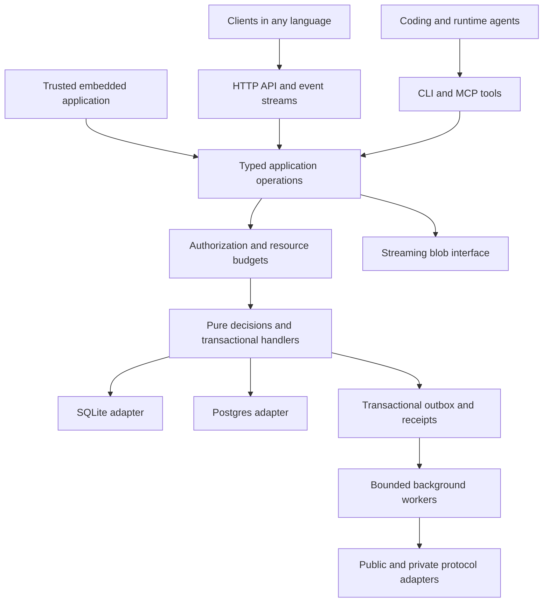
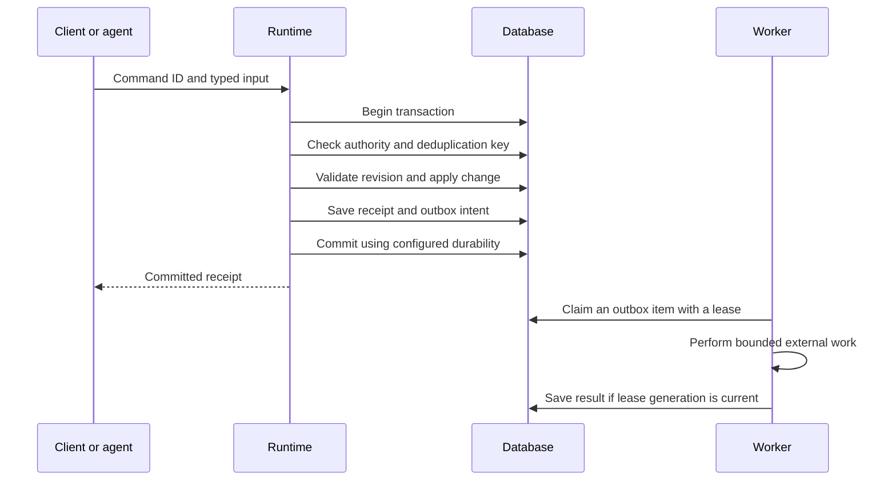
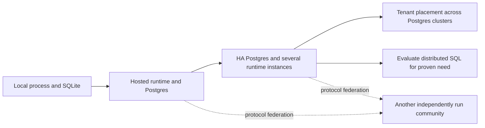

# A small Rust runtime that can grow

> [!TIP]
> Build a Rust application runtime with typed commands, bounded queries, resumable updates, and verified export. Support SQLite for embedded use and Postgres for hosted use first. Make agents productive through a CLI, HTTP API, and MCP tools that all enforce the same rules.

This extends [0496: Portable social foundations](0496_[_]_PORTABLE_SOCIAL_FOUNDATIONS.md). That exploration separated sovereignty from any particular sync mechanism. This one asks what developers would actually use, how an agent would discover it, and what happens as the application grows.

The proposed product is a useful backend foundation for personal and community software. Its first example is a media collection that people can share, annotate, and ask an agent to reshape. Public publishing and encrypted conversations attach through existing protocols. React is one possible client.

**The promise to test:** keep application behavior stable as deployment changes, while making differences in durability, capacity, and supported features visible. We should be able to start with one process and grow into several hosts without inventing a database or requiring a particular cloud.

This is research and API design. All new commands, crate names, configuration fields, and code examples below are proposals, not installed APIs. No performance claim has been measured in this pass. Revisit December 2 after a small implementation and agent usability trial; Chris decides whether the benefits justify expanding it. Adopting a public API, wire format, or new license would need a separate ADR and a tripwire.

## What should make an agent reach for this?

An agent can already combine Axum and SQLx, or write a TypeScript service over Postgres. A useful framework must save work that otherwise goes wrong repeatedly: permission checks, retries after timeouts, schema changes, bounded data access, recovery, and explaining what a command actually did.

Imagine asking: “Import my saved videos, make a film-night shortlist, and let two friends add suggestions.” The agent should discover the installed operations, request access to the selected collection, write a small service or client, and run an acceptance test. It shouldn't need to understand NodeStore's replication internals before making a list.

| Developer job        | Proposed useful result                                        | What would make the framework a burden?                        |
| -------------------- | ------------------------------------------------------------- | -------------------------------------------------------------- |
| Start a personal app | One binary, SQLite, local blob directory, useful fixture      | A cluster before the first query                               |
| Add a feature        | Ordinary Rust functions and SQL with typed inputs and results | A new DSL for every field and relationship                     |
| Let an agent act     | Discoverable tools, scoped access, explicit receipts          | An all-powerful database tool and a prompt asking it to behave |
| Add another user     | A hosted profile with the same operation contract             | Rewriting the application around a new SDK                     |
| Find a slow path     | Query timing, queue depth, traces, rows examined              | A fast language hiding an expensive abstraction                |
| Leave a host         | Verified records, media, migrations, and restore instructions | An export that only the old service understands                |

The initial value is this working path and its tests. Extract general libraries only after two different features use the same contract successfully.

### Existing foundations deserve a fair comparison

PostgREST already turns Postgres structure and permissions into an HTTP API. For a hosted application that mainly needs data access, it may remove much of the reason to write a new API server. Its database-centered contract does not provide an embedded SQLite path. [PostgREST](https://docs.postgrest.org/en/stable/)

Supabase documents a self-hosted stack with authentication, storage, and realtime services. Its official route uses Docker; Kubernetes options are community maintained. Hosted-platform features such as managed backups are not automatically included in the self-hosted edition. It is a serious utility baseline, with a larger operating footprint than the proposed single-process local profile. [Supabase self-hosting](https://supabase.com/docs/guides/self-hosting)

Loco is an Apache-2.0 Rust application framework worth trying before writing basic application scaffolding ourselves. Compare its conventions with the needs of the first collection service. [Loco](https://github.com/loco-rs/loco)

Our reason to build a thin layer would be shared operation semantics across embedded and hosted use, scoped agent access, and tested recovery. If a small set of adapters around existing projects gives us that, use them. A new framework has to beat that simpler option.

## Rust is a good default, with a specific job

Rust fits the long-lived runtime: native deployment, explicit ownership, and control over allocation and concurrency. Its ownership rules are checked by the compiler rather than a tracing garbage collector. That gives us useful tools for predictable resource use. It doesn't establish a latency target for an application. [Rust ownership](https://doc.rust-lang.org/book/ch04-01-what-is-ownership.html)

Queries, disk flushes, network round trips, lock contention, and unbounded fan-out can dominate either a Rust or TypeScript service. Rust also has costs: longer builds, more complex async types, a smaller contributor pool, and foreign-library boundaries. SQLite and media codecs can still bring C code into the process. Avoid claiming that a Rust wrapper makes a decoder safe.

| Option                                                | Why consider it?                                                          | Main tradeoff for this project                                    | Proposed role                                         |
| ----------------------------------------------------- | ------------------------------------------------------------------------- | ----------------------------------------------------------------- | ----------------------------------------------------- |
| Rust                                                  | Resource control; native libraries and services; strong compiler feedback | Build time and API complexity can slow iteration                  | Preferred runtime and reference backend               |
| Go                                                    | Straightforward service development and operations                        | Garbage-collected runtime; a separate choice for native embedding | Credible alternative if operator simplicity dominates |
| TypeScript                                            | Existing xNet knowledge and fast agent iteration                          | CPU-heavy work and allocation patterns need care                  | Generated client, tools, and comparison baseline      |
| Rust core with a mandatory native SDK in every client | Reuse compiled logic                                                      | Packaging and ABI work spreads to every consumer                  | Defer; HTTP covers most consumers first               |

These are architectural judgments, not comparative benchmark results. We should test the same feature before assuming Rust improves the whole development loop.

Prefer a few concrete types, plain functions, and thin adapters. Keep policy decisions pure where possible. Put I/O, transactions, and scheduling in an explicit outer layer. Do not make agents navigate deep generic types or add `unsafe` just to satisfy the compiler.

**Platform scope:** target Linux for hosted services and macOS, Windows, and Linux for local use. Validate each shipped architecture and dependency combination. A portable Rust core does not mean a server with SQL connections, filesystem access, and subprocesses can run unchanged in a browser. Browser clients use the network API; a smaller Wasm library can follow if a real use case needs it.

## Existing work we can reuse

These observations are from the local `codex/chat-first-redesign` worktree, including its uncommitted prototypes. The files establish that a concept exists; they are not evidence of a new benchmark or security review.

| Piece                    | Status       | Actual source                                                                                                                      | Implication                                                                                                                                            |
| ------------------------ | ------------ | ---------------------------------------------------------------------------------------------------------------------------------- | ------------------------------------------------------------------------------------------------------------------------------------------------------ |
| Rust interop kernel      | ✅ Present   | [manifest](../../rust/xnet-core/Cargo.toml), [implementation](../../rust/xnet-core/src/lib.rs)                                     | Identity, change verification, and LWW logic already have Rust code. This isn't a general hosted runtime; reuse requires conformance and crypto review |
| SQLite-backed nodes      | ✅ Present   | [NodeStore adapter](../../packages/data/src/store/sqlite-adapter.ts)                                                               | Existing performance includes the node model, hydration, indexes, and change history. Switching languages alone does not remove that work              |
| Conditional mutations    | ✅ Present   | [transaction conditions](../../packages/data/src/store/transaction-conditions.ts), [types](../../packages/data/src/store/types.ts) | Expected-state checks and explicit conflict errors are worth preserving                                                                                |
| Blob storage interface   | ✅ Present   | [storage types](../../packages/storage/src/types.ts)                                                                               | Useful starting separation, but a hosted media API also needs streaming, ranges, quotas, and lifecycle rules                                           |
| Agent entry points       | ✅ Present   | [MCP command](../../packages/cli/src/commands/mcp.ts), [doctor command](../../packages/cli/src/commands/doctor.ts)                 | Discoverability and diagnostics already matter in xNet; a Rust rewrite must improve this path rather than erase it                                     |
| Durable extension grants | 🚧 Prototype | [extension authority](../../packages/workbench/src/communities/extension-authority.ts)                                             | Scope, epochs, receipts, and revocation should survive a storage change                                                                                |
| Portable archives        | ✅ Present   | [bundle types](../../packages/data/src/portability/types.ts)                                                                       | Preserve existing signed archives. Translation into new tables must report losses                                                                      |

The [charter](../CHARTER.md) currently makes stronger device-first and offline commitments than a server-authoritative application does. This proposal continues 0496's explicit discussion of that change. It does not amend the charter or accepted decisions.

## Three surfaces, one application contract

Start with modules inside one executable. Keep the command handler independent of the transport so an embedded caller, an HTTP request, and an MCP tool cannot acquire different rules accidentally.



A Rust library is the embedded surface. HTTP with JSON and OpenAPI is the interoperable surface. CLI commands and MCP are the agent surface. All three invoke the same registered operations. Start with server-sent events for one-way updates and use WebSockets only where bidirectional traffic earns their complexity.

Generate API descriptions, client types, and tool schemas from one operation registry. OpenAPI provides a language-neutral description for HTTP clients; select a version supported by the generators we actually test. MCP adds tool discovery and invocation, and its official Rust SDK is a possible adapter. Neither format enforces our permissions for us. [OpenAPI](https://spec.openapis.org/oas/latest.html), [MCP tools](https://modelcontextprotocol.io/specification/2025-06-18/server/tools), [Rust MCP SDK](https://github.com/modelcontextprotocol/rust-sdk)

### What belongs in the first runtime

| Module      | Contract                                                         | Deliberate boundary                                        |
| ----------- | ---------------------------------------------------------------- | ---------------------------------------------------------- |
| Operations  | Validate, authorize, execute, return a typed result              | Domain commands, not remote arbitrary SQL                  |
| Queries     | Named query, bounded page, selected fields, explicit freshness   | No default full-database dump                              |
| Changes     | Snapshot and resumable stream within a declared scope            | No promise of a global total order                         |
| Media       | Begin upload, stream bytes, finalize integrity, reference object | Large bytes do not pass through tool text or SQL rows      |
| Jobs        | Durable intent, bounded lease, retry state, result               | No required workflow cluster                               |
| Portability | Manifest, records, blobs, schema versions, restore report        | Unsupported data is an error or an explicit partial result |

Authentication, identity links, and policy enforcement are shared runtime concerns. Messaging encryption and AT publishing remain adapters with their own state machines. An SQL event table must never impersonate an established end-to-end encryption protocol.

A plausible internal layout is `runtime/{operations,policy,limits}`, `domains/collections`, `adapters/{sqlite,postgres,blobs}`, and `transports/{http,mcp,cli}`. Keep these as modules at first. Creating a published crate for each box would add work before proving reuse.

## A concrete operation, from discovery to receipt

Use a small collection service to make the proposal tangible. A person or agent can list a collection, add a reference to a clip, reorder entries, and follow updates. The data itself can remain in an existing public or private media service.

The following CLI is **proposed syntax**. `xnet-next` is a placeholder that avoids suggesting these commands already exist in the current `xnet` binary.

```sh
xnet-next init film-club --profile local
xnet-next dev --config film-club/xnet.toml
xnet-next capabilities --json
xnet-next describe collections.add-entry.v1 --json
xnet-next query collections.entries.v1 --input query.json --json
xnet-next command collections.add-entry.v1 --input add-entry.json --json
xnet-next receipt get 019a0000-0000-7000-8000-000000000001 --json
```

The caller uses an existing session or a scoped credential issued by a trusted host. Actor identity and effective rights are derived from that session. A field supplied by the agent never makes it the owner of a tenant.

### The operation descriptor

This abbreviated descriptor is a design sketch. The full input and output definitions would be JSON Schemas, with examples and field limits generated beside them.

```json
{
  "name": "collections.add-entry.v1",
  "summary": "Add one existing media reference to a collection",
  "input_schema": "schemas/collections.add-entry.v1.input.json",
  "output_schema": "schemas/collections.add-entry.v1.output.json",
  "effects": ["collection.write"],
  "required_scope": "the named collection",
  "approval": "only if the current grant is insufficient",
  "idempotency": "required",
  "atomic_scope": "one tenant",
  "max_input_bytes": 16384,
  "errors": [
    "permission_required",
    "revision_conflict",
    "idempotency_mismatch",
    "outcome_unknown",
    "overloaded",
    "unsupported_capability"
  ]
}
```

An agent should see what an operation does, what it costs, how to retry it, and how to verify its result. Fetch descriptors as needed; do not place the entire API manual in every model prompt. A read-only tool annotation is a hint for the client UI, while the host enforces what the operation can actually do.

### Rust callers use the same operation

This is **illustrative Rust API syntax, not a compiling example**. The proposed types are intentionally ordinary. We would pin and test the actual client before publishing a quickstart.

```rust
let client = Client::connect(endpoint, credentials).await?;
let command_id = CommandId::new(); // persist before the first attempt

let input = AddEntry {
    tenant: tenant_id,
    collection: collection_id,
    media: media_reference,
    expected_revision: Revision::from_u64(42),
};

let receipt = client
    .execute(command_id, input)
    .with_timeout(Duration::from_secs(3))
    .await?;

match receipt {
    CommandResult::Committed { value, revision, .. } => show_entry(value, revision),
    CommandResult::Queued { operation_id, .. } => show_pending(operation_id),
}
```

A timeout is an error with a known or unknown commit outcome; it is not a `Committed` receipt. A local offline client may show a queued draft, but that is not acceptance by the shared service. Embedded Rust applications can call the operation dispatcher directly without serializing through HTTP.

### HTTP remains easy to inspect

An illustrative command envelope:

```json
{
  "command_id": "019a0000-0000-7000-8000-000000000001",
  "operation": "collections.add-entry.v1",
  "input": {
    "tenant": "club-maya",
    "collection": "friday-films",
    "media": {
      "kind": "external",
      "uri": "at://did:plc:example/app.bsky.feed.post/example"
    },
    "expected_revision": "42"
  }
}
```

The AT URI is a placeholder, not a resolvable account. Revisions and cursors travel as strings so JavaScript clients do not lose 64-bit integer precision. The URI is a reference; adding it must not silently fetch a private-network URL or publish content.

```json
{
  "status": "committed",
  "command_id": "019a0000-0000-7000-8000-000000000001",
  "resource": "friday-films",
  "revision": "43",
  "result": { "entry_id": "entry-7" },
  "deployment_profile": "hosted-postgres-v1",
  "trace_id": "trace-example"
}
```

A receipt means the configured durability policy accepted the database transaction. Public publication, remote delivery, or transcoding would have separate operation states. The profile description must say whether an acknowledged write survives process failure, host loss, or a specified replica failure.

### Permissions should be a short flow

When a grant is insufficient, return a structured `permission_required` result describing the exact resource, requested actions, and reason. A trusted host presents that request to the person. The agent cannot call a tool that grants itself access.

For an already authorized collection, routine reads and edits should proceed without repeated prompts. Sharing private data with a remote model, publishing it publicly, changing membership, and accessing local files are separate rights. An approval can be bound to a specific operation version and request digest when the action warrants it.

Recheck current permissions when executing, fetching a stored receipt, delivering stream events, or reading cached results. Revocation needs to reach active subscriptions. Error responses must not reveal a private resource's existence to an unauthorized caller.

## The transaction is the reliability boundary

The first database adapters should implement a small set of domain operations. They may use different SQL, but must pass the same behavioral tests. A generic `execute_sql()` trait would hide the differences without solving them.

Within one transaction, the host checks current authority and expected revisions, applies the domain mutation, records the idempotency result, and appends any durable outbox intent. A concurrent revocation must participate in the same locking or validation scheme. Use conditional writes, explicit locks, or stronger isolation where the invariant requires it. Postgres's default Read Committed isolation does not automatically protect multi-step business rules. [Postgres isolation](https://www.postgresql.org/docs/current/transaction-iso.html)



The deduplication key includes tenant, principal, operation version, and command ID. Store a digest of validated command input with it. A repeated key with different input is an error. Concurrent repeats must converge on one durable result, not two entries.

If the reply is lost after commit, the client retrieves the receipt or retries with the same key. Define a retention window and a command-expiry policy before release. Beyond that window, do not claim a duplicate can always be recognized. Return an explicit indeterminate outcome and offer reconciliation using a stable resource ID.

Never call a remote service or model inside a transaction retry loop. The outbox stores intent, and a worker performs it after commit. Delivery is at least once unless the recipient supplies a stronger, verified contract. Provider idempotency or reconciliation prevents duplicate side effects; where neither exists, expose uncertainty. A worker lease alone does not prevent a paused old worker from completing an external request after its lease expires.

Cancellation follows the same rule. Stop work that hasn't committed, but don't claim that disconnecting a client undoes an accepted change. Retrying a whole transaction needs a bounded policy for serialization failures and deadlocks, with no external side effects in the retried body.

## Queries and updates must stay bounded

Expose named queries with explicit fields, keyset pagination, byte limits, and deadlines. Use stable tie-breakers in sort order. A list of 50 clips should not hydrate every property of 100,000 nodes. Search results need the same authorization as direct reads.

A query response declares its consistency: authoritative, at least a named revision, or a bounded-staleness projection. After a write, the client can ask for that revision and route to the authority until a replica catches up. Authorization and membership checks must not silently use a stale read replica.

### A cursor is a contract, not just a number

Define ordering within a collection or conversation first. For the collection example, lock its revision row while applying a mutation and append the corresponding event in the same transaction. This serializes that collection's writes and gives a clear stream order. It also creates a measurable hot-key limit.

Do not use an allocated database sequence as proof of commit order. One transaction can reserve a lower value and commit after a transaction with a higher value. Advancing a catch-up cursor past the higher value can then lose the later commit.

The initial subscription algorithm should obtain a consistent snapshot and a matching stream boundary, then replay committed events after that boundary. To stay bounded, a large initial snapshot needs a versioned snapshot job or another defined paging strategy. Independent page queries over changing live rows do not make a consistent snapshot.

Cursors are opaque, authenticated, versioned, and bound to tenant, query, and retention epoch. A cursor conveys no permission. Current access is checked on each resume. An expired cursor returns `resync_required`; a changed grant can invalidate a stream rather than pretending the lost events were an empty page.

Across many streams, use a documented composite cursor or a separately ordered projection. Avoid a single global counter that serializes every tenant. Slow consumers get bounded buffering and a resumable disconnect. Typing indicators can expire without durable storage.

## Database portability should preserve behavior

SQLx is a strong candidate for explicit SQL in Rust. It supports SQLite and Postgres, optional compile-time checked queries, migrations, and cached query metadata for offline builds. Its runtime-selected `Any` driver selects a driver; it does not make SQL dialects or isolation behavior identical. Prefer backend-specific SQL beneath the same tested operations. [SQLx](https://github.com/transact-rs/sqlx), [SQLx Any](https://docs.rs/sqlx/latest/sqlx/struct.Any.html)

| Contract           | SQLite implementation direction                | Postgres implementation direction                      |
| ------------------ | ---------------------------------------------- | ------------------------------------------------------ |
| Atomic command     | Short write transaction; bounded writer queue  | Transaction with domain locks or conditional writes    |
| Typed values       | Explicit representations and validation        | Native types where useful; matching API representation |
| Time and revisions | UTC convention; revisions encoded consistently | Same external convention; test precision and ordering  |
| Hot queries        | Deliberate indexes and query plans             | Deliberate indexes, statistics, and query plans        |
| Full-text search   | Optional SQLite-specific implementation        | Optional Postgres implementation; ranking may differ   |
| Schema changes     | Versioned SQLite migrations                    | Versioned Postgres migrations and lock budgets         |
| Recovery           | Consistent database backup and blob manifest   | Database backup, WAL recovery, and blob manifest       |

Keep critical query fields in ordinary typed columns. Use validated JSON for extension fields that benefit from flexibility. Avoid rebuilding a generic entity/attribute/value engine before measuring a need for it. Postgres JSONB supports indexing, but useful index design still depends on actual queries. [Postgres JSON types](https://www.postgresql.org/docs/current/datatype-json.html)

The runtime should advertise **semantic capabilities**, such as `atomic_command_v1`, `collection_stream_v1`, and `full_text_v1`. Optional capabilities can differ by backend. An adapter that can't meet a required contract fails at startup or returns `unsupported_capability`; it must not quietly weaken it.

Use separate migrations for each backend and one parity suite for behavior. Test nulls, ordering, uniqueness, foreign keys, integer ranges, JSON, timestamp precision, and concurrent changes. A common query builder alone cannot provide those guarantees.

## A growth path with real stopping points

A deployment profile is a tested combination of software, configuration, and operating instructions. It describes limits and failure behavior. It is more useful than a single “scale” switch.



| Profile          | Default deployment                                                     | When it is enough                                                 | Trigger for the next step                                  |
| ---------------- | ---------------------------------------------------------------------- | ----------------------------------------------------------------- | ---------------------------------------------------------- |
| Embedded         | One process, SQLite, local files                                       | Personal apps and local development                               | Reliable asynchronous access by other people               |
| Hosted           | Runtime plus Postgres and blob storage on a VM or containers           | A small service with an operator                                  | Measured contention or availability requirements           |
| Highly available | Several runtimes, connection budgets, HA Postgres, independent backups | A busy service within a chosen fault domain                       | Primary bottleneck persists after query and workload fixes |
| Partitioned      | Tenants assigned to separate Postgres clusters                         | Most writes stay within one tenant                                | Cross-partition transactions become a core need            |
| Distributed SQL  | A separately qualified database adapter                                | Required geography or cross-node transaction semantics justify it | Specific workload evidence, not a user-count milestone     |

The first version supports only embedded and hosted profiles. HA packaging can follow after restore and failover tests. Tenant placement and distributed SQL are designs to keep possible, not four extra adapters to build immediately.

<details>
<summary>Illustrative local and hosted configuration</summary>

These are proposed fields, not accepted configuration for the current app. A real profile would validate its settings and advertise the effective durability and limits at startup.

```toml
profile = "embedded-sqlite-v1"

[database]
kind = "sqlite"
path = "./state/app.sqlite3"
durability = "local-fsync"

[blobs]
kind = "filesystem"
root = "./state/blobs"

[limits]
request_bytes = 16384
page_rows = 100
subscriber_queue_bytes = 262144
```

A one-host deployment could keep the blob interface while changing the database implementation:

```toml
profile = "hosted-postgres-v1"

[database]
kind = "postgres"
url_from_env = "XNET_DATABASE_URL"
max_connections = 20
durability = "primary-fsync"

[blobs]
kind = "filesystem"
root = "/var/lib/xnet/blobs"

[limits]
request_bytes = 16384
page_rows = 100
subscriber_queue_bytes = 262144
```

The hosted example describes one server, without a host-loss guarantee. Several API servers would need a shared blob service and a database connection budget across the whole deployment. Authentication, TLS, backups, and a migration procedure remain required; these snippets are not production manifests.

</details>

SQLite can serve real small applications. Its one-writer constraint and WAL rules still matter: WAL readers can overlap a writer, but it is not a shared network-filesystem database. Do not run several pods against the same SQLite file to simulate horizontal scale. Pin a maintained, patched SQLite build. [SQLite deployment guidance](https://www.sqlite.org/whentouse.html), [WAL](https://www.sqlite.org/wal.html)

More Postgres read replicas do not add primary write capacity. Read replicas are useful for workloads that tolerate their lag. Synchronous replication trades latency and availability for a stronger acknowledged-write guarantee; asynchronous failover can lose recent acknowledged writes. Name the chosen failure model in the deployment profile. [Postgres replication](https://www.postgresql.org/docs/current/warm-standby.html)

Tenant placement is an operational scaling strategy, distinct from federation. A hot tenant may still saturate one cluster, and moving it needs routing, fencing, and a controlled data transfer. Cross-tenant features should use a separate projection where possible, rather than pretending they retain one local transaction.

### The first database move can include downtime

For SQLite to Postgres, begin with a documented maintenance window: stop accepting shared writes, drain or preserve pending work, take a consistent export, import into Postgres, compare counts and integrity, then move the endpoint. Retain IDs, grants, receipts within their retention period, and pending intents. Rotate credentials deliberately.

Keep the old store read-only until verification ends. Once new writes begin on Postgres, rollback needs those writes transferred back or reconciled; switching a connection string back loses them. A later online migration needs change capture and fencing, not an uncoordinated dual-write loop.

## Which databases meet the open-source constraint?

The requirement is the full supported operating path: database, orchestration, backup, restore, and required extensions. Self-hosted software with a commercial license is a different choice from a fully open-source stack. The findings below were checked November 2, 2026; pin release versions and license notices during implementation.

| Candidate                    | Current licensing and shape                                                                    | Fit for this proposal                                                                                                                                                                                                                                                                   |
| ---------------------------- | ---------------------------------------------------------------------------------------------- | --------------------------------------------------------------------------------------------------------------------------------------------------------------------------------------------------------------------------------------------------------------------------------------- |
| SQLite                       | Public-domain deliverable; embedded database                                                   | ✅ Local default. [License](https://www.sqlite.org/copyright.html)                                                                                                                                                                                                                      |
| PostgreSQL                   | PostgreSQL License; self-hostable relational database                                          | ✅ Hosted default. [License](https://www.postgresql.org/about/licence/)                                                                                                                                                                                                                 |
| Citus                        | AGPL-3.0 Postgres extension for distributed tables                                             | 🔎 Candidate for tenant-aligned distribution; inspect cross-node SQL restrictions. [Repository](https://github.com/citusdata/citus), [SQL limits](https://docs.citusdata.com/en/stable/develop/reference_workarounds.html)                                                              |
| YugabyteDB core              | Apache-2.0 core, with PostgreSQL-derived YSQL; management components have different terms      | 🔎 Candidate when distributed transactions or geography justify a new engine. Exclude commercial management components from the required stack. [License inventory](https://github.com/yugabyte/yugabyte-db/blob/master/LICENSE.md), [YSQL](https://docs.yugabyte.com/stable/api/ysql/) |
| TiDB / TiKV                  | Apache-2.0; distributed SQL with MySQL compatibility and a separate storage layer              | 🔎 Credible open alternative; needs its own dialect and semantic qualification, not the Postgres adapter renamed. [TiDB](https://github.com/pingcap/tidb), [TiKV](https://github.com/tikv/tikv)                                                                                         |
| FoundationDB                 | Apache-2.0 distributed transactional key-value store                                           | ⏸ A different storage architecture; substantial schema, query, and indexing work above it. [Repository](https://github.com/apple/foundationdb)                                                                                                                                          |
| CockroachDB current releases | CockroachDB Software License; September 2026 announcement moves new source development private | ❌ Does not meet this exploration's open-source requirement. [Licensing](https://www.cockroachlabs.com/docs/stable/licensing-faqs), [Source policy](https://www.cockroachlabs.com/blog/source-code-protection/)                                                                         |
| Spanner / Spanner Omni       | Google offers a deploy-anywhere edition, with commercial production licensing                  | ❌ Deployment outside Google Cloud does not satisfy the open-source requirement. [Omni overview](https://docs.cloud.google.com/spanner-omni/overview), [License terms](https://cloud.google.com/terms/spanner-omni-license-terms)                                                       |

YugabyteDB's current repository distinguishes its core from YugabyteDB Anywhere, whose management and troubleshooting components use Polyform Free Trial terms. “Yugabyte is open source” is too broad a dependency policy. Qualify the exact components we ship.

Citus can preserve much of the Postgres environment, but distributed tables have constraints. Yugabyte's Postgres-facing interface also does not prove parity with our extensions, locking assumptions, migrations, or failure recovery. Test the operations we use. Distributed consensus adds coordination and geographical latency; it is not a free speed upgrade for a small colocated workload.

If “open source” also means permissive licenses only, Citus leaves the shortlist. This proposal allows open-source copyleft software, while keeping required proprietary services out. No new xNet license is selected here.

## A self-hosted operating kit

A reasonable starting stack is Rust with Tokio, Axum/Tower, SQLx, and serialization/schema tooling. Axum supplies HTTP routing and uses the Tower ecosystem for middleware. This is a shortlist to pin and test, not a promise about every crate's latest release. [Axum](https://github.com/tokio-rs/axum)

| Concern          | First deployment                              | Optional growth path                                                         |
| ---------------- | --------------------------------------------- | ---------------------------------------------------------------------------- |
| Runtime          | One executable; HTTP and workers can share it | Separate worker and API processes using the same code                        |
| SQL              | SQLite locally; ordinary Postgres hosted      | CloudNativePG on Kubernetes; later qualified distributed adapters            |
| Blobs            | Scoped filesystem directory                   | Self-hosted S3-compatible storage                                            |
| Jobs and wakeups | Database outbox with bounded polling          | An external broker only after measured need; database remains durable source |
| Search           | Indexed SQL and backend-specific text search  | Separate search projection when required                                     |
| Observability    | Local structured logs, metrics, traces        | Operator-selected open collectors and dashboards                             |
| Secrets          | OS credential storage or protected files      | Operator-managed secret store; no required cloud KMS                         |

CloudNativePG is an Apache-2.0 operator for Postgres on Kubernetes. It is a plausible packaged option, not a prerequisite for running xNet. A VM deployment remains supported. The operator reduces repeated work; the operator of the service still has to choose storage, backup destinations, failure domains, and restore procedures. [CloudNativePG](https://github.com/cloudnative-pg/cloudnative-pg)

For blobs, Apache OpenDAL is a candidate Rust abstraction over filesystem and S3-compatible services. The adapter must expose supported features rather than assume all stores implement ranges, multipart upload, conditional writes, or deletion identically. SeaweedFS's Apache-2.0 edition is one self-hosted candidate; its commercial edition has additional features, so qualify the exact open edition. [OpenDAL](https://opendal.apache.org/), [SeaweedFS](https://github.com/seaweedfs/seaweedfs)

An S3-compatible API does not require AWS. Even so, a storage bucket is not a global video CDN, and self-hosting does not remove bandwidth or operations costs. Transcoding runs in isolated workers with bounded inputs and resources. Keep the media economics and private-media boundaries from 0496.

Kubernetes packaging should accept explicit storage classes, ingress, certificate, secret, and backup choices. Ship non-root images, resource limits, readiness checks, and graceful drain behavior. Use a separate migration job with a lock; do not let every pod race to migrate on startup. Bound total database connections across all replicas before enabling autoscaling.

A cluster inside a VPC is not automatically a secure multi-tenant service. Bind embedded mode to a local socket or authenticated loopback endpoint. Hosted mode needs authenticated TLS, tenant checks, least-privilege database roles, and restricted admin endpoints. Keep secrets and message content out of diagnostic traces by default.

The independence test should be executable: mirror required artifacts, disable outbound internet, start the local and hosted profiles, create data, restart, and restore a backup. Public federation and cloud-model calls can report unavailable, but the core service must remain usable. No license server, vendor control plane, required hosted identity service, or external telemetry should be needed for that test.

## Federation stays above storage

A replica is operated as part of one authority. A federated service belongs to another operator and may apply different policy, run a different version, be offline, or refuse a request. Sharing a database protocol does not solve those differences.

Use AT Protocol for the selected public publishing path and an established messaging protocol for private conversations, as explored in 0496. These adapters preserve native references and expose local states such as `queued`, `accepted_by_remote`, `rejected`, and `outcome_unknown`. A local commit must not be displayed as remote delivery.

The application runtime owns intent, policy checks, local receipts, and bounded retries; the chosen protocol governs identity and message semantics. Do not attempt distributed SQL transactions between independent communities. Cross-host work needs idempotency, authorization, version negotiation, and visible failure states.

A person should be able to run a small community on one host and federate with a large one. Both operators can later change internal storage while preserving their public protocol contracts. Full independence also requires self-hostable discovery and protocol services; a mandatory Bluesky AppView or cloud agent would remain an external dependency even if our own database were portable.

## Performance needs a budget at every boundary

Rust gives us tools to control work. We still have to choose limits. Bound input bytes, result bytes, page size, SQL connections, concurrent jobs, per-tenant work, and per-subscriber queues. Apply backpressure before memory use grows without limit.

Tokio's `spawn_blocking` does not make arbitrary computation harmless: its docs recommend limiting CPU work, and an already-running blocking task cannot simply be aborted. Put expensive transforms in a bounded executor; use a supervised process when work must be killed reliably. Media parsing must not share the latency-sensitive request loop. [Tokio blocking work](https://docs.rs/tokio/latest/tokio/task/fn.spawn_blocking.html)

Prefer batched reads and explicit columns. Stream large responses and exports rather than building them in memory. Cache only with a defined freshness and authorization key. A cached result for one tenant or grant must never satisfy a different caller. Do not add signatures, a hash chain, vector embeddings, or CRDT updates to every mutation unless the domain needs them.

### Proposed measurement plan

These are **initial experiment targets**, not published capabilities. Record hardware, OS, database versions, durability settings, connection counts, and workload distributions with every result.

| Exercise              | Fixed workload                                                                                                           | Candidate gate                                                                                                                         |
| --------------------- | ------------------------------------------------------------------------------------------------------------------------ | -------------------------------------------------------------------------------------------------------------------------------------- |
| Local utility         | 100,000 collection entries; 10,000 media references; indexed 50-row page; named reference laptop and cold/warm runs      | Warm storage-query p95 below 25 ms; no whole-history hydration; report cold behavior separately                                        |
| Hosted baseline       | 8 vCPU, 16 GiB RAM, local NVMe Postgres; separate load generator with recorded RTT; 1 million entries across 100 tenants | At 500 page reads/s plus 100 mutations/s for 15 minutes: p95 below 100 ms reads and 200 ms commits; report p99, errors, and saturation |
| Runtime overhead      | Raw Axum/SQLx baseline with the same indexes, authorization, durability, and receipts                                    | Runtime p95 no more than 1.5× baseline at the same accepted load; explain regressions                                                  |
| Subscription pressure | 2,000 consumers over 100 streams; 200 one-KiB events/s; 200 consumers stop reading                                       | Each queue stays within 256 KiB; slow clients resume or receive explicit resync; no silent loss                                        |
| Hot tenant            | 50% of write traffic targets one collection                                                                              | Measure contention and unaffected-tenant latency; reject excess work explicitly                                                        |
| Restore               | Fixed database plus media fixtures; original host disabled                                                               | All declared records and blobs verify; old references resolve; a second client can write                                               |

Report achieved throughput and offered load separately. Include timed-out requests and avoid hiding overload by measuring only requests that completed. Track process memory, CPU, database I/O, pool wait, lock wait, WAL growth, event lag, and retained data size. Never compare a memory-only prototype against a durable service and attribute the difference to language choice.

For failure testing, interrupt the process before and after commit, drop the reply, restart a worker after an external side effect, fill the disk, and revoke access during a subscription. Test lost connectivity, serialization retries, and configured database failover. An API returning quickly while losing acknowledged data fails the experiment.

Use proposed recovery objectives as separate claims: a durable local commit should survive a process crash; an HA profile must state its tolerated node failures and its recovery point and time objectives. Measure failover and restore rather than inferring them from a green health endpoint.

## Agent integration is more than adding MCP

The framework needs an excellent first five minutes. Ship one small starter, offline documentation, current examples, machine-readable errors, and a test fixture an agent can inspect. Every quickstart should run against the release it describes.

| Agent need                  | Proposed surface                                                              |
| --------------------------- | ----------------------------------------------------------------------------- |
| Learn what is installed     | `capabilities`, operation search, versioned descriptors                       |
| Understand a failure        | Stable error code, safe details, retry classification, trace ID               |
| Request data access         | Exact scope request surfaced by the trusted host                              |
| Preview risky work          | A plan bound to input digest and relevant revisions, revalidated at execution |
| Verify a change             | Query result, receipt, targeted tests, and UI evidence where relevant         |
| Diagnose performance        | Scoped query plan and timing tools without exposing other tenants             |
| Share a reproducible result | Fixture, operation versions, migration files, and verification output         |

Separate the coding agent from the runtime agent. A developer may authorize a coding agent to edit and test a trusted service repository. That does not mean an extension sent in chat can load native Rust into the production process.

Runtime extensions use constrained operations. If we later need untrusted server-side code, evaluate a Wasmtime component with only explicit host functions, memory limits, execution limits, and bounded host I/O. Wasmtime documents a sandbox model and configurable fuel or interruption, but its security also depends on the embedding and exposed host functions. General coding tools and arbitrary native dependencies need a stronger process or VM boundary. [Wasmtime security](https://docs.wasmtime.dev/security.html), [Execution configuration](https://docs.wasmtime.dev/api/wasmtime/struct.Config.html)

A local Codex or Claude process may send selected data to a remote model. Make that destination visible in the grant. Untrusted documents and tool results cannot expand access. Agents should not receive administrator database credentials to make the integration convenient.

### Measure usefulness as carefully as throughput

Give Codex and Claude Code five fresh attempts each at the same tasks, with fixed model/tool versions and the same context budget. Ask them to build a collection view, add a field and migrate, recover a lost command response, handle revoked access, and move the fixture from SQLite to Postgres.

A proposed gate is at least four successful attempts out of five for each task, with no human patching. Every successful attempt must pass deterministic correctness and access tests. Record time, tool calls, retries, compilation time, model cost, and where the agent got stuck. This is a small usability sample, not a general model ranking.

Compare against a plain Axum/SQLx starter and the current TypeScript xNet path. If our framework needs more explanation without saving reliable work, shrink it. Rust's type system only helps an agent when the APIs and compiler errors make the next action clearer.

## The first implementation should stay small

Build `collections.add-entry`, `collections.list`, and `collections.subscribe`, with media references rather than a complete video pipeline. Include scoped permissions, a mutation receipt, a durable outbox item, and an export/restore path. Exercise the same operations through Rust, HTTP, and MCP.

Support SQLite and Postgres immediately in that slice so we test the portability claim before building a large domain model. Use backend-specific migrations and SQL. A local CLI should create a disposable fixture and explain the effective profile. The hosted example should run on one VM with no required cloud account.

Once that works, connect one public publishing adapter and one established messaging adapter. Their inclusion should not turn the core into a universal social protocol. A small optional CRDT document can be added separately when collaborative editing becomes part of the experiment.

| Decision             | Proposed choice now                                 | Observation that reopens it                                               |
| -------------------- | --------------------------------------------------- | ------------------------------------------------------------------------- |
| Runtime language     | Rust                                                | Agent iteration or maintenance cost outweighs measured runtime benefit    |
| Hosted database      | Postgres                                            | Required workload misses its gate after query, index, and placement fixes |
| Embedded database    | SQLite                                              | A required local workload cannot meet its write or platform needs         |
| Data access          | Named domain operations with explicit SQL           | Repeated domains demonstrate a smaller safe abstraction                   |
| Scaling package      | One executable plus explicit profiles               | Independent failure or load boundaries justify a separate service         |
| Agent surface        | CLI, HTTP, and MCP generated from the same registry | A concrete client cannot express a required interaction                   |
| Distributed database | No default adapter yet                              | A demonstrated requirement survives the simpler alternatives              |

### Implementation checklist

- [ ] Define the collection contract, permission rules, error codes, receipt retention, and stream ordering.
- [ ] Build a small Rust runtime and keep its public API experimental.
- [ ] Implement SQLite and Postgres operations with separate migrations and shared behavioral fixtures.
- [ ] Make mutation, idempotency receipt, and outbox intent commit atomically.
- [ ] Add bounded snapshots, resumable streams, and explicit expiration behavior.
- [ ] Generate HTTP descriptions, CLI discovery, and MCP tools from one registry.
- [ ] Ship a local starter and a single-host Postgres example with no required external control plane.
- [ ] Add verified export, restore, and a maintenance-window migration procedure.
- [ ] Run performance, failure, and agent-usability comparisons before expanding the framework.
- [ ] Qualify an HA Postgres profile only after backup, restore, and failover tests pass.

### Validation checklist

- [ ] An unauthorized caller cannot read through queries, caches, streams, stored receipts, or guessed IDs.
- [ ] Concurrent duplicate commands produce one mutation; changed payload under the same key fails.
- [ ] A lost reply is distinguishable from a failed mutation, and retry behavior respects retention limits.
- [ ] A failed transaction leaves no successful receipt or orphaned outbox intent.
- [ ] Revocation and a concurrent mutation have a defined ordering enforced by both adapters.
- [ ] Snapshot plus stream has no lost committed event, including deliberately reversed commit timing.
- [ ] Slow consumers and hot tenants respect memory and work budgets.
- [ ] Adapters pass the same value, conflict, permission, and recovery tests with their documented semantics.
- [ ] The runtime meets or explicitly fails each declared benchmark gate with complete measurements.
- [ ] Agent tasks pass deterministic acceptance tests without manual repairs.
- [ ] A second installation restores the fixture and continues after the original host is gone.
- [ ] Required binaries, database, object storage, and operations can run without vendor registration or a license service.
- [ ] A negative control makes each future gate fail: inject a missing permission check, duplicate retry, dropped event, missing blob, or intentional slowdown in the test environment.

Chris is the consumer of the comparison. The decision is whether this slice makes a useful application cheaper to build and operate while preserving permission and exit guarantees. A large new framework with no measurable gain is a failed result.

## Recommendation

Proceed with a **Rust runtime, SQLite for embedded use, and Postgres for hosted use**, tested through one small collection application. Keep clients language-neutral and make agent discovery, diagnostics, and recovery part of the first API.

Treat the next stages as qualified deployment profiles. A database becomes supported after its semantics, operations, licensing, and failure behavior pass the contract. Federation remains an application-protocol concern above those profiles.

The central product opportunity is reliable composition: an agent can find an operation, understand its limits, use it within a grant, and verify the result. That is valuable even before xNet runs at massive scale.

## Research and verification notes

External links sit beside the facts they support. Technology descriptions and license boundaries were checked on November 2, 2026 against primary documentation and repositories. The API design, deployment profiles, budgets, and evaluation criteria are proposals developed here.

No runtime was implemented, database cluster deployed, benchmark run, or security audit performed for this exploration. The unchecked lists are future work. Existing Rust and TypeScript code was read to identify reuse points; its tests were not rerun as evidence for this proposed architecture.
