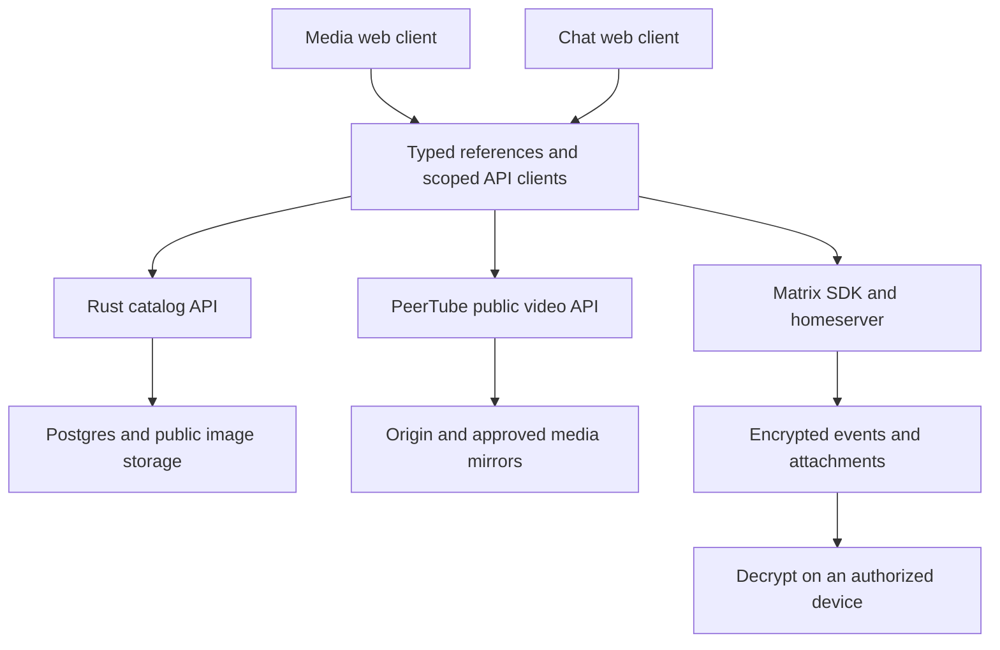
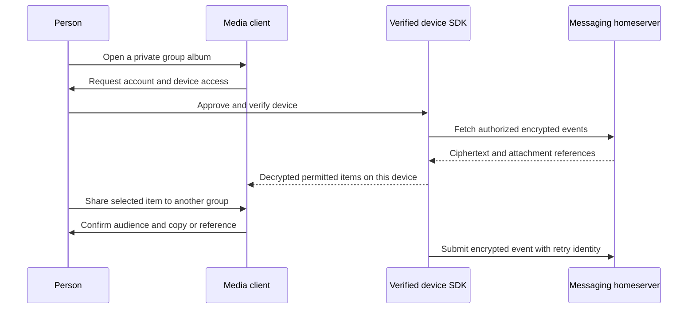
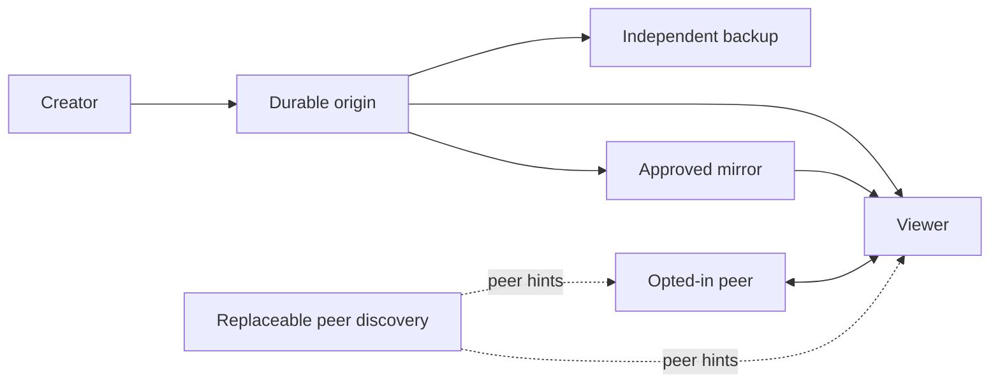

# Two apps, one community network

> [!TIP]
> Ship a photo/video app and an encrypted messaging app around one useful loop: publish, share, discuss, collect. Give them a small shared API contract. Start media delivery with durable hosts, then let communities contribute explicitly budgeted replicas and peer bandwidth. Reserve replication capacity for content that has few copies, including new work.

This extends [0496: Portable social foundations](0496_[_]_PORTABLE_SOCIAL_FOUNDATIONS.md) and [0497: A small Rust runtime that can grow](0497_[_]_RUST_RUNTIME_AND_PORTABLE_APPLICATION_API.md). It turns their architecture into two starter products and a path toward community hosting.

**Status:** a researched proposal and an [interactive companion](web/0498/index.html), not a deployed network. API examples, targets, and placement rules below are proposed. The companion simulates placement; it does not upload files or connect peers. Revisit December 2 after the first two-host integration experiment, before committing to a public protocol. Chris decides whether to keep the adapters or own more infrastructure. Accepted wire formats and public APIs would need an ADR with a tripwire.

## 1. The first experience worth shipping

Maya posts a short film from a community garden. Leo sees it in his chosen feed, shares it into the gardening group, and discusses the next workday. Someone adds a frame and a caption to the group's private album. Maya can find that album from the media app because she belongs to the group. Neither app asks her to download and upload the same file again.

The media app and messaging app can live on different domains with different operators. Their clients resolve references, authenticate to the service that owns a resource, and ask for the access they need. Public information works without connecting a personal account. Private information works only within the approved scope and, where encrypted, on a device with the necessary keys.

Later, Leo gives the community 10 GB of storage and a modest upload budget from an always-on computer. It keeps selected public films available and can store encrypted copies of the group's album. Leo can pause or withdraw that contribution. Being a community member does not require being a server operator.

That is the product to test. A universal replicated database, a worldwide recommendation engine, live broadcasting, and an open compute marketplace can wait.

| Starter           | Ship in the first release                                                                                                                        | Deliberately defer                                                                      |
| ----------------- | ------------------------------------------------------------------------------------------------------------------------------------------------ | --------------------------------------------------------------------------------------- |
| Media             | Profiles; images and short video; following and community feeds; public posts; encrypted group albums; collections; share-to-chat; export        | Livestreams, algorithm marketplace, private adaptive video streaming, unlimited uploads |
| Messaging         | Encrypted DMs and invitation-only groups; offline delivery; verified device enrollment; recovery; attachments and media cards; requests/blocking | Public room search, calls, enormous communities, arbitrary bots reading conversations   |
| Shared experience | Account links; typed references; scoped access; freshness and permission states; account export                                                  | Universal cross-server joins, automatic access to an entire digital life                |
| Hosting           | A documented self-host setup, backup/restore, quotas, one independently operated mirror experiment                                               | Permissionless storage enrollment and automatic database sharding                       |

Use provisional upload limits of **30 MB per image and 100 MB / two minutes per video** during the prototype. These are admission limits to test, not evidence of capacity or a permanent product policy. Private video starts as a supported file attachment with download-before-play behavior where required. Give unsupported codecs an honest error. Public playback gets one modest baseline rendition before adding resolution choices.

Web comes first. Keep the application protocol independent of React and the browser. A desktop shell later adds durable seeding and local agents; mobile adds camera upload, device keys, notifications, and foreground opportunistic transfer. Do not promise permanent background seeding from phones.

## 2. What we already have, and what remains missing

Repository inspection is from the local `codex/chat-first-redesign` worktree. Existing prototype code is not evidence that a new browser network works.

| Area                           | Status                  | Evidence and implication                                                                                                                                                                                                 |
| ------------------------------ | ----------------------- | ------------------------------------------------------------------------------------------------------------------------------------------------------------------------------------------------------------------------ |
| Desktop peer connections       | 🚧 Prototype            | [Peer service](../../apps/electron/src/main/peers/service.ts) uses `@number0/iroh`, invitation/contact state, streams, and group synchronization. Useful native integration experience; not a browser media swarm        |
| Invitation and transport rules | 🚧 Prototype            | [Peer protocol](../../apps/electron/src/main/peers/protocol.ts) validates invitations and relay origins. Preserve explicit admission rather than treating every discoverable peer as trusted                             |
| Content addressing             | ✅ Code present         | [BlobStore](../../packages/storage/src/blob-store.ts) computes content IDs and exposes verification. Its `get` delegates to storage; the existence of a verification method does not prove every untrusted read verifies |
| File chunks                    | ✅ Code present         | [ChunkManager](../../packages/storage/src/chunk-manager.ts) records ordered chunks and distinguishes raw manifests from reassembled files. Its full-buffer APIs are not yet a bounded streaming video API                |
| Permission concepts            | 🚧 Prototype            | [Extension authority](../../packages/workbench/src/communities/extension-authority.ts) is useful precedent for scope and revocation. Extension permission is not a replacement for remote resource authorization         |
| Portable data                  | ✅ Code present         | [Archive types](../../packages/data/src/portability/types.ts) provide a place to preserve export fidelity. A new media/chat adapter still needs its own tested export and recovery path                                  |
| Durable media fleet            | ❌ Not established here | No verified replica placement, private swarm protocol, browser/native interoperability, or availability guarantee is demonstrated by this exploration                                                                    |

Retain useful ideas from xNet: stable references, inspectable schemas, explicit grants, portability, and content integrity. Use ordinary transactions for authoritative catalog and quota state. CRDTs remain an option for a shared collection or collaboratively edited description; they do not solve media availability or encryption key distribution. This proposal does not silently change the [charter](../CHARTER.md).

## 3. Choose existing systems where they save the most work

PeerTube is particularly relevant. Its recommended playback path is HLS with WebRTC peer assistance, including adaptive playback and redundancy. That is more specific than saying it is a conventional BitTorrent website. Its architecture also describes operator-selected caches and announcements of cached files. [PeerTube configuration](https://docs.joinpeertube.org/admin/configuration), [PeerTube architecture](https://docs.joinpeertube.org/contribute/architecture).

WebTorrent's browser peers use WebRTC; a normal TCP torrent client is not automatically a browser peer. HTTPS web seeds can supply missing content. This is useful precedent for fallback delivery, not a reason to assume every transport can join the same swarm. [WebTorrent FAQ](https://webtorrent.io/faq).

Matrix already specifies encrypted rooms and attachment envelopes. The first messaging release should use an established SDK and homeserver, including their device verification and recovery behavior. Build the integration UX rather than a new encryption protocol. [Matrix encryption specification](https://github.com/matrix-org/matrix-spec/blob/main/content/client-server-api/modules/end_to_end_encryption.md), [attachment encryption implementation](https://github.com/matrix-org/matrix-encrypt-attachment/blob/main/README.md).

| Approach                                                  | Benefit                                                | Cost                                                                                  | Decision                                                 |
| --------------------------------------------------------- | ------------------------------------------------------ | ------------------------------------------------------------------------------------- | -------------------------------------------------------- |
| PeerTube + Matrix, with thin application adapters         | Existing public video pipeline and encrypted messaging | Several services, identity linking, adapter UX, upstream upgrades                     | **Start here**                                           |
| Rust catalog + custom video delivery + Matrix             | More control over media semantics                      | Own upload processing, streaming, peer delivery, moderation, and operational failures | Reconsider after the first integration test              |
| One new Rust stack for media, messaging, crypto, and mesh | A consistent implementation language                   | Largest security and delivery burden before anyone benefits                           | Defer                                                    |
| Entirely volunteer P2P, no durable host                   | Minimal operator footprint when peers are available    | Offline gaps, key recovery, discovery, mobile suspension, unpredictable retention     | An optional mode with weaker guarantees, not the default |

**Recommended implementation:** two small TypeScript web clients; a Rust integration API for profiles, public image/post metadata, collections, and resource resolution; Postgres for its hosted state; PeerTube for public video; Matrix for private messages and private album attachments. Use the SDK's local device store for decrypted private indexes. Keep NodeStore out of this new MVP's critical path unless a measured requirement justifies it.

PeerTube owns its video records; Matrix owns room events; the Rust API owns its catalog records. Adapters retain native identifiers. Do not create competing authoritative copies of the same record. A public post can refer to a PeerTube video; a private album can be a projection of encrypted room events. The media app must enroll as an authorized Matrix client to display that album.

This is several services, not the single Rust binary imagined in 0497. The Rust layer should remain small enough to remove. If it merely forwards requests without adding useful policy or schemas, use a TypeScript adapter for the first experiment instead. Shipping the two-app loop matters more than language uniformity.

Use upstream-supported self-host configurations on ordinary Linux hosts. Keep storage behind a filesystem/object-store interface and avoid requiring a particular cloud. Postgres-backed services can share a machine initially but keep separate databases and credentials. A later Kubernetes package should follow demonstrated demand; it is not required to try the product.

Bluesky linking and a public-post adapter are sensible next additions. Custom application records do not automatically appear in the Bluesky app. Do not make implementing AT Protocol, ActivityPub, and a new federation protocol all at once a condition of the first release.

## 4. A shared graph of references

The apps should feel like they share a graph. The implementation can be much smaller: **typed resources owned by named services, connected by explicit references**.



Start with `Profile`, `Post`, `MediaAsset`, `Collection`, `ConversationRef`, and `ShareIntent`. Avoid inventing a universal `Message` object that loses encryption, event identity, sender provenance, or room semantics in translation. A reference describes how to resolve the native object; it is not a capability to read it.

Proposed public response:

```json
{
  "schema": "xnet.media-ref.v1",
  "id": "https://garden.example/resources/film-7",
  "authority": "https://garden.example",
  "kind": "video",
  "visibility": "public",
  "revision": "r17",
  "nativeRef": {
    "system": "peertube",
    "url": "https://video.garden.example/videos/watch/example-id"
  },
  "links": {
    "self": "https://garden.example/api/v1/resources/film-7",
    "author": "https://garden.example/api/v1/profiles/maya"
  }
}
```

These illustrative URLs are not live services. The logical ID is separate from a rendition's content hash and its current download locations. Replacing a caption increments the record revision; transcoding creates new bytes and hashes. A content hash proves byte identity, not authorship, permission, safety, or continued availability.

| Proposed operation                                     | Contract                                                                                        |
| ------------------------------------------------------ | ----------------------------------------------------------------------------------------------- |
| `GET /api/v1/capabilities`                             | Supported schema versions, bounded query features, authentication methods; no private inventory |
| `GET /api/v1/resources/{id}`                           | Public projection or caller-authorized projection; revision and visibility included             |
| `GET /api/v1/collections/{id}/items?cursor=…&limit=50` | Opaque cursor, stable ordering, hard page limit, visible freshness                              |
| `POST /api/v1/share-intents`                           | Resolve a destination and scope before sending; idempotency key prevents duplicate side effects |
| `GET /api/v1/changes?cursor=…`                         | Authorized resumable updates with documented cursor expiry and snapshot recovery                |
| `GET /api/v1/exports/{id}`                             | Explicit export job with scope, format, completeness, and attachment availability               |

Authorization applies at the owning service on every read and write. Tokens need audience, scope, expiry, and revocation behavior. Use existing OAuth/OIDC implementations; an OAuth login is not proof that two accounts belong together until both sides have been authenticated. Do not put reusable bearer tokens in share URLs or logs.

Public indexes contain public projections only, with source revision, deletion markers, and a freshness timestamp. Fetch from a configured set of services, enforce timeouts and response-size limits, then merge bounded result sets. A global distributed join is outside the MVP. Stale indexes should produce an unavailable/changed state, not resurrect removed records.

Untrusted references are also a network boundary: resolution must reject private-network targets, redirects into internal services, DNS rebinding, and oversized responses. Downloads belong on a media origin with restrictive content handling, not an origin that can execute script with account cookies.

## 5. Private interoperability without a hidden back door

“Connect my account” can authorize an app to read selected data. It cannot make a server decrypt material whose keys exist only on a device.

| Data                                   | Unconnected app  | Connected service backend                           | Authorized client device                                 |
| -------------------------------------- | ---------------- | --------------------------------------------------- | -------------------------------------------------------- |
| Public post                            | Query public API | Same public API                                     | Read/cache                                               |
| Private server-readable metadata       | No               | Scoped grant, where the source actually supports it | Scoped grant                                             |
| Encrypted conversation or album        | No               | Ciphertext and permitted envelope metadata only     | Decrypt with explicit account/device enrollment and keys |
| Another participant's unshared content | No               | No new rights                                       | No new rights from linking an account                    |

A first permission screen can offer **“Connect your encrypted messaging account on this device.”** Explain the actual breadth of access and use the messaging SDK's verification flow. Browsers on separate origins do not share a magic keychain. Avoid passing room keys through URL parameters or an application backend.

**A normal Matrix client login is not a room-scoped permission grant.** Do not display “only this album” while handing the media app a general account token or access to the account's key backup. For the first two trusted clients, make full account enrollment explicit. For a separately installed extension that needs just one album, a later design can use a distinct application identity admitted to selected rooms, or a capability broker on an already trusted device. That identity must have no general account token or key-backup access. The broker needs its own enforced scope. Narrow filtering in the UI alone is not an access boundary.

For selected sharing, offer **Share link**, **Share a copy**, or **Ask for access** according to the resource's policy. Public-to-private sharing can send a reference. Private-to-public publishing needs a separate, unmistakable action and a review of the content being disclosed. Authorization to read a private group is not permission to expose that group to the world.



Search private data locally after decryption. Sending it to a remote agent is another disclosure requiring its own permission. Agent tools should expose typed operations and truthful receipts, not raw database credentials. A `share` dry run can show destination, scope, and whether new plaintext leaves the device before any actual send.

Revocation prevents future authorized service access and should invalidate local grants. It cannot erase a recipient's prior screenshots, keys, exported files, or independently kept copies. Group membership changes need the chosen messaging protocol's key rotation rules. Rotating only a wrapping key does not revoke an old key someone retained.

## 6. What adding a node actually adds

The proposed network has several roles. Name the role in both configuration and the UI so “add capacity” means something measurable.

| Role                         | Adds                                                          | Does not automatically add                            |
| ---------------------------- | ------------------------------------------------------------- | ----------------------------------------------------- |
| Public media mirror          | Storage, geographic proximity, download bandwidth, redundancy | Database write throughput or new authority over posts |
| Private ciphertext seed      | Copies and delivery of approved encrypted bytes               | Decryption rights or group membership                 |
| Application host             | Accounts and writes for its own users/community               | A shared multiwriter database with every other host   |
| Public indexer               | Search and feed coverage                                      | Canonical ownership or private search access          |
| Messaging homeserver/mailbox | Durable encrypted queues and supported federation             | The ability to decrypt room contents                  |
| Relay                        | Connectivity through difficult networks                       | Offline storage or free bandwidth                     |

A central bootstrap directory is reasonable for the initial community. Make its responses cacheable, exportable, and replaceable with configured alternatives. Keep data ownership and encryption independent from it. Existing references and direct service URLs should continue to work during a directory outage; discovering brand-new peers may not.

Do not put all public originals, private indexes, identity, and availability claims behind one supposed “cache.” Those have different trust and retention requirements. A central public search cache may be rebuilt; an irreplaceable original cannot.

## 7. Delivery starts dependable, then becomes cooperative

Use three layers:

1. **Durable origin:** accepts uploads within a stated retention/quota policy; has backups and a tested recovery procedure.
2. **Approved mirrors:** opt into specified content, keep complete copies under renewable retention commitments, and can be monitored.
3. **Opportunistic peers:** viewers or desktop users contribute bytes while available. They improve delivery without being counted as permanent storage.



**One online seeder is a target, not a guarantee a volunteer network can make.** Machines sleep; families share power and internet failures; people uninstall apps. One online copy also says little about durability. Before accepting responsibility for a public upload, reserve origin storage and a backup. Before advertising mirror failover, confirm a complete playable copy on a second independent online host.

An availability probe must check the manifest, initialization data, required segments, and at least one supported full rendition. A thousand peers with the same first ten seconds do not constitute a complete copy. Originals and higher resolutions have separate retention policies.

Test an origin outage with a **cold client** that has never opened the post, too. A second copy of the video is insufficient if its only manifest or download-location API disappeared with the origin. Approved mirrors need the relevant public descriptors and manifests, and the resolver needs a bounded-lived mirror list it can verify. Existing PeerTube redundancy is a starting point; complete application failover still has to be demonstrated.

When no copy is reachable, show “Temporarily unavailable” and the last verified availability time. Do not spin forever. When capacity is exhausted, limit new uploads, request more capacity, or offer an explicit shorter retention tier. Never promise indefinite hosting based on hoped-for future volunteers.

For the first public-video peer experiment, use PeerTube's existing HLS/WebRTC path and redundancy facilities. Observe whether peers actually reduce origin egress. Keep image delivery on HTTPS initially. Native Iroh blob transfer is a later experiment for explicitly pinned files; `iroh-blobs` is a separate protocol with verified content transfer, not a WebRTC torrent peer. [Iroh blobs repository](https://github.com/n0-computer/iroh-blobs).

Browser/native compatibility needs either a compatible WebRTC participant or an HTTPS gateway serving the same verified bytes. Merely using hashes on both sides does not align chunk formats or protocols. Gate the native bridge on a real browser-to-native transfer test, including fallback. Do not require an experimental browser Iroh path to launch.

Browsers can suspend/discard pages, and storage is subject to quota and eviction. Requesting persistent storage is not an always-running service. Treat a web viewer as temporary assistance; a user-controlled desktop daemon or home server is the credible durable contribution. [Chrome lifecycle documentation](https://developer.chrome.com/docs/web-platform/page-lifecycle-api), [MDN storage limits](https://developer.mozilla.org/en-US/docs/Web/API/Storage_API/Storage_quotas_and_eviction_criteria).

## 8. Seeding for friends, with explicit consent

Private seeding serves **ciphertext**, with filenames, captions, thumbnails, and sensitive manifests inside the encrypted envelope. Begin with whole-file encrypted attachments using the established messaging implementation. Streaming encrypted multi-rendition video needs a reviewed chunk-authentication and key-distribution design; do not invent it as a shortcut in this MVP.

A private seed request should name the approved circle, byte budget, expiry, and ciphertext object. Authenticate discovery and download requests; avoid public trackers or global DHT advertisements for private objects. Use ciphertext-derived identifiers, not a public plaintext hash that lets strangers correlate a known file. A download ticket, provider endpoint ID, or content hash alone is not the authorization model.

Private seeders can learn that devices communicate, object sizes, timing, and possibly group relationships. Encrypting bytes does not hide this metadata. Direct peer connections can reveal network addresses; provide an HTTPS-only option and explain the difference before enabling peer uploads. PeerTube explicitly documents IP exposure through P2P. [PeerTube privacy guide](https://docs.joinpeertube.org/admin/privacy-guide).

Public “like” and “follow” stay social actions. Separately, someone can enable **Help host this community** and choose:

- Storage limit, upload rate, monthly transfer cap, and allowed networks.
- Public content, selected private circles, or both.
- “Prefer people I follow,” subject to a reserved pool for less-replicated community content.
- Pause on battery/metered connections, inspect what is stored, remove it, or stop hosting.

No covert uploading on a like. Do not expose a person's private seed inventory as a public activity feed. A seeding ratio is optional personal information, not a condition of reading or membership; upload accounting is easy to game and can penalize people with expensive or unreliable internet.

## 9. A fair placement rule

Separate **which content deserves another complete replica** from **which piece a player downloads next**. Playback needs deadlines and useful pieces. Fleet placement needs durability, scarce capacity, and an admission policy. A piece-selection algorithm cannot ensure that an unknown creator gets a second complete copy.

For each admitted asset, track complete copies, recently reachable copies, independent operators, retention expiry, size, and scope. Keep eligibility local: a node can decline a category, circle, size, or content item. The coordinator proposes work; it cannot compel storage.

Use this ordering for a bounded maintenance budget:

1. **Repair urgent gaps:** admitted objects below the online availability floor, provided a source is reachable. If all copies are offline, flag an incident; scheduling cannot invent bytes.
2. **Build the durability floor:** a second independent retained copy for objects that lack one. Reserve capacity for new uploads at admission, including creators without followers.
3. **Serve measured demand:** extra replicas for popular content only after repair/new-content reservations. Demand queues need their own bounded bandwidth so a viral event does not prevent repairs indefinitely.

Within a tier, prefer larger replica deficits and longer waiting time; use content size and available bandwidth for feasibility. Apply per-account/community admission quotas so flooding “new content” cannot consume the entire reserve. A size-aware scheduler needs aging or reserved large-object slots to avoid starving larger valid uploads.

Preferences for followed creators are a tie-breaker within an eligible budget. They do not override another object's missing baseline copy. Nor should public fairness use the private circle's reserved capacity: resources have owners and purposes.

Retained copies and _currently online_ copies must be separate counts. A temporarily offline mirror should not trigger deletion of its useful copy or an endless reshuffle. Use renewal deadlines, cooldowns, hysteresis, and a maximum repair rate. Count independent operators conservatively; ten Sybil identities on one machine are not ten failure domains. Availability samples are observations, not cryptographic proofs of durable storage.

The [companion simulator](web/0498/index.html) demonstrates a smaller deterministic rule: public/private eligibility, complete copies, distinct operators, finite storage, zero-copy incidents, and prioritizing deficits before demand. It recomputes a placement snapshot. It does **not** model transfer completion, lease renewal, Byzantine peers, topology, churn probabilities, playback, or real performance.

<details>
<summary>Why not a fully permissionless storage economy immediately?</summary>

Paying or rewarding uploads introduces false accounting, self-downloads, collusion, unwanted content placement, identity abuse, and disputes over who retained what. Open source does not require open admission to every storage pool. Start with communities enrolling known operators and choosing what to retain. Reconsider broader admission only after quotas, monitoring, withdrawal, moderation, and recovery work. This proposal introduces no token or paid reputation system.

</details>

## 10. Security work that the MVP cannot skip

The safest first contribution is serving bounded, verified bytes. Volunteer transcoding or arbitrary agent execution would expose a much larger surface.

| Boundary          | Required behavior                                                                                                      | Adversarial check                                                    |
| ----------------- | ---------------------------------------------------------------------------------------------------------------------- | -------------------------------------------------------------------- |
| Upload and decode | Quotas before allocation; isolated patched media workers; no ambient credentials; CPU, memory, time, and output bounds | Malformed image/video, decompression bomb, worker timeout            |
| Peer download     | Verify content against the expected authenticated manifest before use; limit outstanding requests and memory           | Wrong chunks, truncated files, forged manifest, repeated slow peers  |
| Seed admission    | Pull approved objects; deny unsolicited pushes; cap disk, bytes, peers, and requests                                   | Stranger fills disk or bypasses policy with another request type     |
| Private access    | Gate all fetch paths, batch APIs, metadata queries, and discovery; separate decrypting clients from seeders            | Nonmember guesses hash; revoked ticket; unauthorized batch request   |
| Host resolver     | Prevent SSRF and unbounded federation fetches; validate remote schema/version                                          | Internal-network URL, redirect loop, oversized JSON                  |
| Browser content   | Strict script isolation, escaping, safe media headers, dependency updates                                              | Uploaded HTML/SVG or profile text tries to run in the account origin |
| Agent access      | Scoped operations and separate disclosure consent; untrusted content never grants permissions                          | A caption instructs the agent to export private chat                 |

There is a timely upstream example: the October 8, 2026 `iroh-blobs` advisory describes unauthorized pushes that could fill provider disks and notes that `get_many` and `observe` need their own authorization handling. A prospective implementation must select a patched release, reject unknown request types, and test every mode. This is a candidate-dependency requirement, **not a finding that the current desktop transport has this vulnerability**. [Upstream advisory and fixed versions](https://www.iroh.computer/blog/iroh-blobs-push-fix).

A relay can carry the whole transfer when direct connectivity fails. It needs admission, rate limits, monitoring, and an egress budget; it is not just a cheap lookup table. Iroh's own relay guidance makes this bandwidth and authentication distinction. Self-hosting remains possible without adopting its managed service. [Iroh relay authentication](https://www.iroh.computer/blog/authenticated-relays).

Public mirrors choose which communities/content to accept and need report, stop-serving, deletion, and cache-expiry behavior. Private hosts can enforce storage and abuse limits but cannot promise to inspect encrypted content. Keep user-initiated reports separate from hidden server-side decryption. Deletion propagates as a request and local policy action, not a promise that the internet forgets a public file.

## 11. Cost and performance, before promises

Peer assistance moves costs; it does not eliminate them. Public transcoding, originals, backups, quiet videos with no concurrent viewers, and relay fallback still require provisioned resources. Private E2EE media cannot be sent through ordinary server transcoding without giving that service plaintext.

Use the following planning quantities, measured separately:

```text
retained bytes = originals + playable renditions + thumbnails + backups + mirrors
origin egress = viewer fallback + replica placement/repair + API/media overhead
relay egress = relayed peer traffic (account for the provider's billing direction)
steady delivery load = concurrent viewers × average playback bitrate
```

An illustrative 100 viewers at 2 Mb/s is 200 Mb/s and approximately 90 GB per hour of outgoing payload. If peers deliver 60% directly, viewer-origin payload falls to about 36 GB/hour. Add replica transfers, overhead, and any charged relay traffic before claiming savings. These are arithmetic examples, not measured hit rates or hosting quotes. A quiet network may get little benefit from viewer-to-viewer transfer.

Initial acceptance targets, subject to measurement on named hardware and network conditions:

| Experiment          | Candidate pass condition                                                                                                                                                              |
| ------------------- | ------------------------------------------------------------------------------------------------------------------------------------------------------------------------------------- |
| Public feed API     | p95 under 200 ms at 50 requests/s over 100,000 indexed public posts; bounded page size, no cross-server join                                                                          |
| Chat reconnect      | 100 queued messages arrive exactly once in the displayed history after reconnect, using retry/event identity                                                                          |
| Public playback     | First frame within 3 seconds on a 20 Mb/s test connection with a warm baseline rendition                                                                                              |
| Mirror failure      | With a second complete reachable copy, stopping the origin still permits playback after bounded retry                                                                                 |
| Peer benefit        | At 20 simultaneous viewers, target at least 20% lower total paid-server egress than HTTPS-only playback, including relay and repair traffic; maintain the 3-second p95 startup target |
| Resource discipline | No seeding exceeds configured disk/uplink limits; cancellation releases work; oversized inputs fail before unbounded allocation                                                       |

The API and playback targets do not cover every workload or imply global scale. Track errors and queue age alongside latency. Use Postgres indexes, bounded concurrency, and streaming before considering a distributed SQL migration. Additional media nodes cannot repair an overloaded catalog database.

## 12. A sequence we can actually implement

**First technical milestone: two separately hosted clients complete the garden loop, with no shared database access and no P2P dependency.** This proves the interoperability that makes the product useful. Then prove cooperative delivery as a distinct milestone.

| Stage                          | Build                                                                                         | Evidence required to advance                                                                                                                                 |
| ------------------------------ | --------------------------------------------------------------------------------------------- | ------------------------------------------------------------------------------------------------------------------------------------------------------------ |
| A. Two-app loop                | Media client, chat client, public reference resolver, encrypted group album, explicit sharing | Different origins and service credentials; public lookup works without login; authorized private lookup works on a verified device; strangers cannot read it |
| B. Self-host and recover       | Reproducible setup, quotas, backup/export/restore, second operator                            | Restore on another host; reopen media; document separate recovery of encrypted history and device keys                                                       |
| C. Public cooperative delivery | PeerTube mirror and browser peer playback; origin fallback; contribution controls             | Stop origin and one peer separately; corrupt a transfer; measure bandwidth paths and failure states                                                          |
| D. Durable community seeding   | Enrolled always-on nodes, complete-copy inventory, quotas, placement leases, repair queue     | New creators receive baseline replicas before surplus popular replicas; stop/withdraw a host without silently losing retained content                        |
| E. Private/native experiment   | Ciphertext-only friend seeding; native daemon; compatible browser delivery adapter            | Nonmember/expired/revoked access denied on every path; no key exposure; successful real browser/native fallback and withdrawal                               |

The first three stages can use upstream components. D and E are a new xNet storage coordination project and should earn their complexity through evidence. Do not label the website simulator as their implementation.

Implementation checklist:

- [ ] Define the six initial resource/reference schemas and authority rules; validate examples and compatibility errors.
- [ ] Build two web starters over the chosen PeerTube/Matrix adapters; preserve native IDs and supported device/recovery UX.
- [ ] Implement scoped public/private resolution, explicit share intents, bounded indexing, and truthful availability states.
- [ ] Complete one public post → private discussion → permitted collection loop across separate origins.
- [ ] Package an upstream-supported self-host deployment, quotas, health checks, backup, export, and restore instructions.
- [ ] Add and measure one independent public mirror and opt-in browser peer playback.
- [ ] Implement a bounded replica coordinator only after the mirror experiment passes; separate private/public budgets and retained/online inventory.
- [ ] Prototype private ciphertext seeding and native/browser bridging behind an explicit experiment flag.
- [ ] Write ADRs and tripwires before stabilizing a public cross-service or seed protocol.

Validation checklist:

- [ ] Reload both clients, reconnect after interruption, and confirm references, permissions, and chat retry behavior survive.
- [ ] Verify account linking grants no unexpected room keys, history access, publishing rights, or agent disclosure; reject claims of album-only access backed by a full-account token.
- [ ] Confirm a stale public index cannot bypass current authorization or display removed private content.
- [ ] Restore from backup with the original host absent; separately exercise encrypted key/history recovery.
- [ ] Test zero reachable copies, partial-only copies, insufficient capacity, duplicate operator identities, and exhausted public/private budgets.
- [ ] Attempt corrupt chunks, unsolicited writes, unauthorized batch reads, SSRF, malformed media, and content-triggered agent exfiltration.
- [ ] Test browser tab closure/storage eviction, metered-network pause, mobile suspension, and native daemon shutdown.
- [ ] Record latency, media startup, queue age, memory, disk, direct/relay bytes, and repair overhead under the stated workload.
- [ ] Try the complete flow with a friend who did not help build it; revise confusing consent and failure states before expanding scope.

The next coding pass should deliver Stage A, including the negative permission cases. That gives us two small applications worth using and a concrete seam for the network to grow around. The mesh then earns its place by keeping that community's media available and reducing delivery costs.
