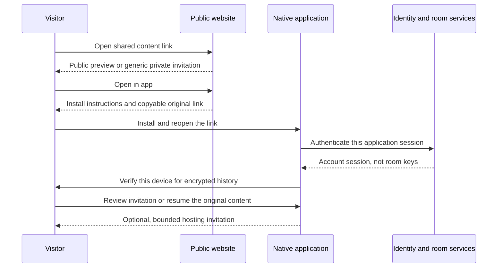
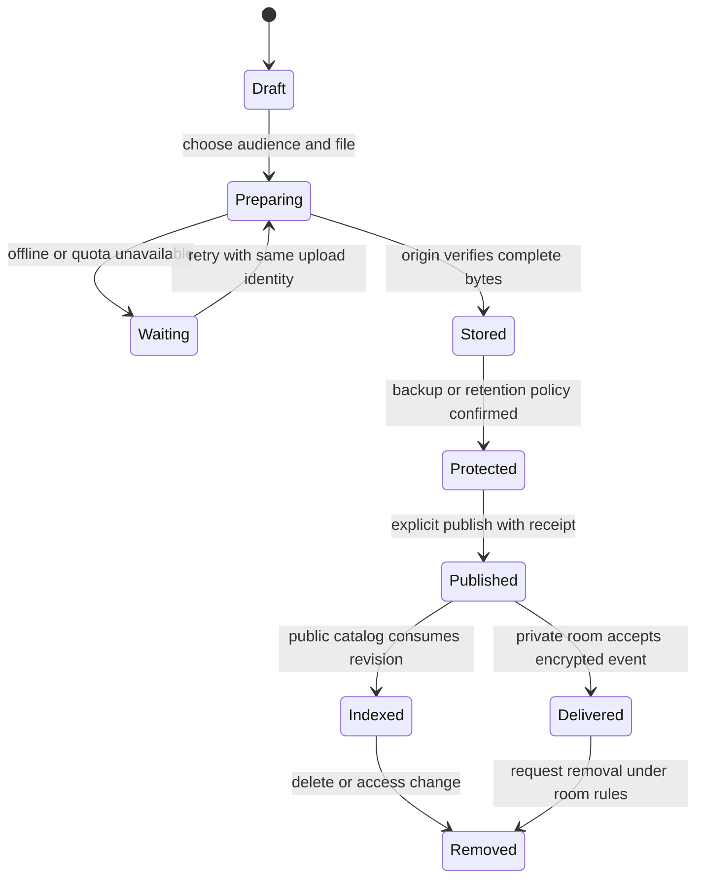
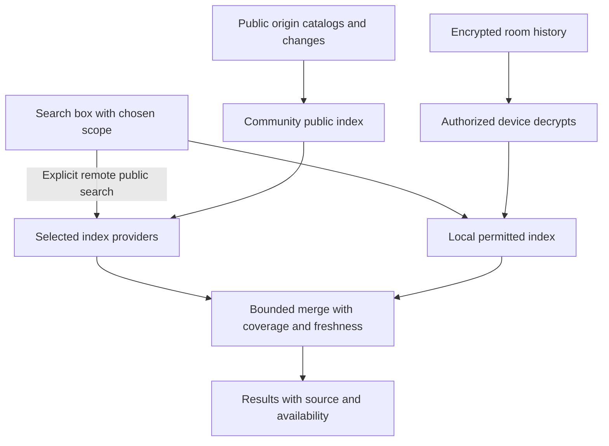

# From a shared link to a network we help keep alive

> [!TIP]
> Let a public link work immediately. Invite people to join with a familiar identity, take their community into a native app, and contribute storage within limits they choose. Keep local discovery available to everyone; make broader public indexes replaceable services that communities can fund or users can subscribe to.

This follows [0498: Two apps, one community network](0498_[_]_TWO_APPS_AND_A_COMMUNITY_SEED_NETWORK.md). That proposal chose two interoperable web starters, durable media origins, and gradual peer assistance. This exploration follows a person through that system, including the reasons they might stop, decline a permission, or leave.

The [interactive journey](web/0499/index.html) is a concept prototype. Its identities, content, posts, permissions, uploads, and indexes are simulated locally. It does not sign anyone in, install software, publish content, move money, or seed files. The document is canonical; the website carries a guided example and the full text.

**Recommendation under review, not an adopted policy:** open public reading with voluntary, prominently invited contribution. The prototype also lets us inspect a strict mandatory-seeding alternative. Revisit December 2 after testing both explanations with prospective community members. Chris decides. A public protocol or revenue policy needs an ADR and a tripwire before adoption; this draft changes neither the charter nor the existing application.

## 1. Start with the thing someone came to see

Someone sends you a garden video. You tap the link, see the creator and caption, and press play. The first screen explains the content. It does not require you to understand federation, install an application, or decide how many gigabytes to donate.

An ordinary HTTPS link is the public entry point. A small server-rendered page exposes public metadata and a player, with a clear content-unavailable state. It works through HTTPS origin/mirror delivery before any peer connection. A quiet **Open in app** action sits beside **Keep watching here**. Later, saving something for offline use or returning to a group gives the installation invitation a concrete purpose.

Public link previews may include the title and thumbnail. A private invitation must not leak its title, participants, thumbnail, or transcript to social preview crawlers. Show a generic invitation card until the visitor proves the required access. An unlisted URL is not a private room: anyone who receives the URL may forward it.

| Arrival                     | First screen                                                                        | Before showing private content                                      |
| --------------------------- | ----------------------------------------------------------------------------------- | ------------------------------------------------------------------- |
| Public post                 | Content, creator, play/read, public comments, share                                 | Nothing; HTTPS viewing is available to guests                       |
| Private item                | Generic invitation or sign-in destination                                           | Authenticate, check membership, verify/decrypt on the device        |
| Approval-required group     | Inviter-approved public description and request action                              | Show pending status; no history while awaiting approval             |
| Missing or unavailable item | Distinguish removed, inaccessible, and temporarily offline where disclosure is safe | Do not reveal a private object's existence to unauthorized visitors |

Public reading has a real hosting cost. Operators can rate-limit abuse, cap preview bandwidth, and set published retention limits. That is more honest than promising that every anonymous visit can be served forever at no cost. An ordinary visitor should not become an uploader without knowing it.

## 2. Should contributing be mandatory?

There are three different requirements hidden inside that question: installing a native client, accepting a future contribution policy, and actually uploading useful bytes right now. None proves the others. A desktop client may have no reachable consumers, be offline, be on a hotspot, or possess only already well-replicated files.

| Policy                                             | What it gains                                            | What it costs                                                                                                            | Recommendation                                              |
| -------------------------------------------------- | -------------------------------------------------------- | ------------------------------------------------------------------------------------------------------------------------ | ----------------------------------------------------------- |
| Seed before viewing                                | Strong participation norm in a closed, managed group     | Breaks public links; excludes many phones and constrained networks; easy to fake contributions; exposes network metadata | Do not use for the public network                           |
| Native app required, help when able                | Easier contribution controls and persistent storage      | Installation wall still interrupts discovery; “when able” needs exceptions                                               | Test only for communities that choose this membership model |
| Public viewing plus an explicit hosting invitation | Links work; contribution is understandable and revocable | Requires funded baseline hosting and active recruitment of dependable hosts                                              | **Default**                                                 |

I would make contribution part of the culture and the native onboarding, with a visible **Not on this device** choice. Do not turn it into a debt meter. An upload/download ratio is a poor measure of value: a new or unpopular file may be worth retaining even when nobody requests it. People who make, curate, translate, or moderate are also contributing.

A private cooperative could agree that certain members operate hosts. That policy should state retention commitments, costs, exceptions, and withdrawal procedures before admission. Keep a person's export and recovery rights outside that bargain. Never force their computer to upload after they pause it, even if the community decides to suspend some service entitlement.

The strict policy in the prototype intentionally shows its consequences: a guest browser cannot view, and a member on battery loses access when mandatory seeding pauses. This is a comparison model, not the recommended product behavior. A softer “contribute when able” requirement is closer to the voluntary model once it handles those cases honestly.

## 3. Join without starting over

The person clicks **Follow** or writes a comment. Ask for an account at that moment, preserve the pending intent, and return to the same post after sign-in. Resume a draft comment, but let the person press **Post publicly** themselves. Do not turn an authentication callback into an accidental publication.

Use one stable application account ID with separately verified login methods. Display names, email addresses, social handles, devices, and encryption keys are different things. Linking two providers requires proving control of both; matching email text must not silently merge accounts.

| Sign-in choice     | Proposed implementation                                                                                                  | What it must not imply                                                                  |
| ------------------ | ------------------------------------------------------------------------------------------------------------------------ | --------------------------------------------------------------------------------------- |
| Bluesky            | AT Protocol OAuth using a maintained SDK; retain the DID as the provider subject and resolve the current handle          | No automatic import, follow, post, or access to private messaging keys                  |
| Google             | OpenID Connect with validated issuer, audience, subject, state, and nonce as appropriate to the flow                     | No Gmail, contacts, or Drive access                                                     |
| X / Twitter        | Provider adapter using its supported user authorization flow and minimum working scopes                                  | No promise of free API access, universal OIDC compatibility, or automatic cross-posting |
| Email and password | A maintained authentication service, verified email, abuse limits, secure password storage, reset and session management | A password reset is not recovery of encrypted history                                   |

Google documents OpenID Connect login. AT Protocol has its own OAuth profile, including distributed provider discovery and proof-of-possession behavior; it should not be treated as a generic OIDC button. X documents authorization-code flow with PKCE. Each provider needs configured redirects and an independently tested adapter. [Google OIDC](https://developers.google.com/identity/openid-connect/openid-connect), [AT OAuth patterns](https://atproto.com/guides/oauth-patterns), [X authorization code flow](https://docs.x.com/fundamentals/authentication/oauth-2-0/authorization-code).

Implement Bluesky and a provider-independent account option first; add Google and X behind capability checks. Do not show working-looking buttons for unconfigured providers. The journey prototype shows all four as **simulated choices**, not a claim that those integrations ship.

For native apps, authorize in the system browser with PKCE and validated callbacks. Bind the callback to a short-lived initiating transaction. Keep provider tokens out of shared URLs, logs, renderer-wide state, and ordinary exports. [OAuth for native apps, RFC 8252](https://www.rfc-editor.org/info/rfc8252/).

Offer a second recovery method after the first useful interaction. If a provider closes an account or is unavailable, people with another method should still reach their application account. Explain separately how to verify a new device and restore encryption keys. Reconnecting Google or Bluesky does not recreate lost private keys.

## 4. Social actions need audiences and receipts

Use **Follow** for creator updates, **Support** for voluntary funding, and **Subscribe to search** for a paid service. The word “subscribe” should not ambiguously authorize payment, storage, or public social disclosure.

| Action                         | Default audience                            | Behavior                                                                          |
| ------------------------------ | ------------------------------------------- | --------------------------------------------------------------------------------- |
| Save                           | Private to the person                       | Store a reference in their collection; download is a separate choice              |
| Like a public post             | Clearly labeled by the platform's policy    | Make public visibility explicit; never also turn on seeding                       |
| Comment on a public post       | Public                                      | Label the composer and final action; offer edit/delete and report/block           |
| Follow                         | Explain whether the social record is public | Update a feed preference; no automatic upload commitment or DM access             |
| Send in a chat                 | Named conversation                          | Resolve access before sending; offer reference, permitted copy, or request access |
| React inside an encrypted room | That room                                   | Use the room protocol; do not forward the reaction into a public social graph     |

An optimistic UI can show a pending like or message immediately, but it needs a receipt before claiming the service accepted it. Use idempotency/event identities for retries. If a write fails, retain the draft and show the failure. Offline actions stay queued; they are not public merely because a local icon changed.

Where a public action is written to AT Protocol, its record follows that protocol's visibility and persistence rules. Do not label it private because the current Bluesky client hides a particular list. During the first MVP, retain the native record identity from whichever service owns the action, as 0498 proposes. Cross-posting is a separate consented write with a separate receipt.

Messaging starts with requests, membership checks, and blocking. A public handle or a follow is not permission to open an unrestricted private channel. Defaults should keep low-stakes encouragement easy without making the recipient's inbox an unbounded queue.

## 5. Install because it helps, and arrive where you left off

The installation prompt should explain a benefit the person has just asked for: keep a collection offline, get reliable desktop notifications, use a local agent, or help retain community media. Avoid repeated takeover banners.

Use verified HTTPS app/universal links where supported, plus a copyable link fallback. A first installation may not retain the original browser context, so explicitly keep the invitation page available and offer **Copy link to reopen**. Do not assume app-store installation transfers cookies or device keys.

Store only the pending destination and permitted invitation context, with expiry and replay protection where a link carries a capability. Never put account tokens or decryption keys into an analytics redirect. Validate destinations against known resource types; a link must not become an arbitrary command or filesystem path. A private invitation can expire while someone installs: keep the destination visible and offer a safe way to request a new invitation.

Notifications, device-key recovery, file access for local agents, and hosting are separate permissions. Declining one should not make the rest of onboarding appear broken. On desktop, acknowledge laptop battery and hotspot usage just as seriously as phone constraints.

## 6. Contribute within the limits of this device

The first hosting screen can say: **“Help keep this community available.”** Explain what can be stored, how much space and traffic it can use, whether peers can learn a network address, and how to pause or remove copies. Show actual usage later, not an invented reputation score.

| Device        | Proposed default                             | Eligible contribution                                                                                                      | Never promise                                                                           |
| ------------- | -------------------------------------------- | -------------------------------------------------------------------------------------------------------------------------- | --------------------------------------------------------------------------------------- |
| Guest browser | HTTPS viewing; no uploads                    | Optional foreground peer assistance only after consent in a later pass                                                     | Background availability after the tab closes                                            |
| Desktop       | Hosting off until chosen                     | Selected public/community content; pause on battery, metered or unknown network, low disk, cap exhaustion, or manual pause | That every installed app is online, safe to consume bandwidth, or an independent backup |
| Phone/tablet  | Hosting off; normal viewing, upload and sync | A later opt-in experiment while foregrounded, charging, and on a user-approved unmetered network                           | Permanent background peer serving or that Wi-Fi means unlimited data                    |
| Home server   | Explicit enrollment and resource budget      | Renewable retention commitments and monitored availability                                                                 | Unlimited storage or trust just because it runs continuously                            |

The numeric presets in the prototype—10 GB storage, a 10 GB monthly upload budget, and a 1 Mb/s upload ceiling—are design examples. Validate them on actual hardware and networks. A monthly cap counts relay traffic and protocol overhead where measurable; show uncertainty rather than pretending the OS provides perfect usage data. If network cost cannot be determined, pause until the person approves that network.

On iOS, the system schedules background processing; a task request is not a permanent listener. Apple's APIs can require external power. Android WorkManager supports charging, network, battery, and storage constraints and may stop work when constraints are no longer satisfied. Those facilities help schedule finite work; they do not guarantee always-on peer service. [Apple background strategies](https://developer.apple.com/documentation/backgroundtasks/choosing-background-strategies-for-your-app), [Apple external-power constraint](https://developer.apple.com/documentation/backgroundtasks/bgprocessingtaskrequest/requiresexternalpower), [Android work constraints](https://developer.android.com/develop/background-work/background-tasks/persistent/getting-started/define-work).

Use resumable native upload/download APIs for finite transfers where appropriate. Do not misuse audio, location, or push notifications to keep seeding alive. Native background notifications may also depend on platform push services; describing the product as decentralized does not remove that dependency.

The contribution settings apply to both **retention** and **serving**. Pause stops new transfers immediately while preserving existing bytes until the person chooses to remove them. Withdrawal should give the network a chance to replace retained copies, but must not trap the device. If it held the last reachable copy, show that fact and preserve the user's right to stop.

A friend group may agree to store encrypted copies for each other. Scope access to that circle and authenticate every transfer path. Storage eligibility does not confer decryption rights. Avoid public advertisements of private object identifiers or friend relationships. Encryption protects content, not every timing, size, or address signal.

## 7. Create and publish with honest stages

Creation can begin in either app: take a photo, upload a short film, compose a post, or make something with an agent. Agents use the same scoped operations and receipts as the interface. Access to a local folder or private messages is separately granted; content being edited cannot grant itself more permissions.

Choose the audience **before** processing/upload. Public videos can use an isolated server transcoder. Private attachments should be prepared and encrypted by an authorized endpoint using the chosen messaging SDK; remote processing would be a new plaintext disclosure. For the MVP, keep private video small and use the established whole-file attachment flow from 0498.

“Saved on this device,” “uploading,” “stored,” “published,” and “searchable” are different states. A publisher closing their laptop should not silently destroy a post that the UI called durably hosted. Reserve storage and enforce quota before accepting that promise. An origin acknowledgment alone does not prove an independent backup exists.

For the public MVP, a publish receipt points to a stable content record after the origin and configured backup policy succeed. Wider indexing is asynchronous. Say **Published · not yet in community search** until an index confirms that revision. If quota or backup fails, keep the work as a draft and explain the next step. A future temporary, creator-seeded sharing mode can use a weaker, clearly named availability promise.

After publication, the replica scheduler from 0498 prioritizes missing baseline copies, then surplus demand. Hosting popularity must not determine whose work is accepted into an index or recommended. A new creator receives an admission/retention budget rather than an instruction to become famous first.

Private publication sends an encrypted room event and an encrypted attachment reference. Public catalogs, thumbnails, autocomplete, and recommendation candidates must not include it. Removing access stops future authorized reads and key distribution where the protocol supports that; it cannot revoke every copy or old key already obtained by a recipient.

## 8. Search has scopes, not a magical view of everything

The network needs discovery, but no open network can promise a complete, current index of every server, offline device, encrypted room, and deleted record. **Show what was searched and how fresh it is.** A remote service outage and a genuine empty result must look different.

“Near me” should mean a chosen social neighborhood—my follows, my groups, and content shared with me. It must not mean that being on the same Wi-Fi, living nearby, or being a friend of a friend grants access. Physical proximity is neither identity nor consent.

| Search scope         | Corpus and location                                                                               | Privacy and limitations                                                                      |
| -------------------- | ------------------------------------------------------------------------------------------------- | -------------------------------------------------------------------------------------------- |
| On this device       | Locally indexed saved/followed public material and authorized decrypted items                     | Offline; limited to what has been indexed here; private keys and plaintext stay local        |
| My communities       | Public catalogs of subscribed hosts; private groups only through the authorized local/device path | Coverage and freshness are explicit; remote public queries can reveal interests to operators |
| Wider public network | Public catalogs crawled by one or more chosen index services                                      | Partial coverage, policy exclusions, freshness lag, possible cost; no private-message search |

Do not send the same query to every index as the person types. Local suggestions can be immediate. Choosing **Search wider** discloses the query to the selected provider; explain that boundary and preserve it when adding an AI assistant. Avoid sending private room names, private snippets, or account-wide tokens along with a public search.

PeerTube already distinguishes platform-known results, an external global index, and direct URL/handle lookup. AT Protocol separates hosting from aggregated application views, feeds, and search. These are useful precedents for selectable services; neither makes indexing cost-free or end-device P2P. [PeerTube search](https://docs.joinpeertube.org/use/search), [AT Protocol overview](https://atproto.com/guides/overview).

Start with the existing browser text-indexing approach for the small web prototype, evaluate SQLite FTS5 for native local indexes, and use Postgres full-text search for the initial community public catalog. Keep a provider interface so larger installations can choose another engine later. [SQLite FTS5](https://www.sqlite.org/fts5.html), [Postgres full-text search](https://www.postgresql.org/docs/current/textsearch.html).

An index provider should publish the hosts it covers, crawl policy, supported fields, maximum lag target, language/tokenization choices, moderation policy, query logging policy, and limits. A proposed response includes `provider`, `asOf`, `coverage`, `partial`, `unavailableSources`, and an opaque cursor alongside results. These are contracts to implement, not an existing xNet endpoint.

Crawl accepted public feeds using stable IDs, revisions, checkpoints, backpressure, and deletion/access-change events. Deduplicate by canonical resource identity, not captions or filenames. Recheck authorization at fetch time. Expire cached descriptors; apply removal events locally; never expose private IDs, counts, snippets, or timing as a side channel in a public index. Public-to-private changes cannot retract prior public copies, but our indexes should stop serving them promptly.

A device can exchange bounded public catalog snapshots or explicit private group updates with trusted peers. It cannot safely broadcast arbitrary private search queries to strangers. Distributing a global inverted index across volunteers adds shard placement, churn, query routing, abuse resistance, and privacy work. Defer that research until local and federated search are useful. A DHT mapping file hashes to peers is not a full-text search engine.

## 9. Recommendations people can understand and change

Start with **Following, newest first**, a finite page with a clear end. Offer **Discover** as a separate view using selected public communities and topics. Show why an item appeared, which service supplied candidates, and what changing that service would do.

A simple first recommendation pass can gather candidates from public subscribed catalogs, filter blocked/hidden items, enforce author diversity, and reserve some candidate slots for recent work from creators the person has not seen. A local ranker can use explicit follows and chosen topics without exporting private reading history. The discovery share and ranking weights are design choices to test, not proven improvements.

Availability is a useful playback signal, but it must not make under-seeded work permanently invisible. Show a safe preview and a recovery/retention state where possible; fund baseline retention separately. Do not let donated storage, subscription status, or seed ratio buy preferential ranking. A user's content preferences can guide hosting within its budget; they should not silently become a public profile of their behavior.

For wider recommendation providers, default to public topics and coarse context chosen by the user. Keep private history local. Downloading public candidates and ranking on the device is one way to preserve this boundary; it uses more bandwidth and still needs a funded candidate service. “Why this?” must describe the actual implemented rule, not invented model reasoning.

Moderation is a service choice with safety defaults, source transparency, reporting, blocking, and appeals. It is not a hidden universal truth. Separate public content ordering from ranking people by worth or popularity. The existing charter's restrictions on public scoreboards remain in force; this exploration does not authorize a new reputation leaderboard.

## 10. What can run peer-to-peer, and what needs a host?

| Capability                        | P2P/local path                                 | Practical MVP dependency                                                         |
| --------------------------------- | ---------------------------------------------- | -------------------------------------------------------------------------------- |
| Open a public link                | Later peer assistance for active viewers       | Public domain, reachable metadata/player, HTTPS media fallback                   |
| Sign in with an existing identity | Locally retained session/keys after login      | That provider and application account service for initial authentication         |
| Like/comment/follow               | Queue local intent                             | An authoritative service accepts and propagates the write                        |
| Private chat                      | Direct device delivery when both are available | Durable encrypted mailbox/homeserver for offline recipients and recovery support |
| Local search/recommendations      | On-device index and ranking                    | Only the data already present; initial/resumed sync needs sources                |
| Community catalog                 | Peer copies of bounded approved snapshots      | At least one maintained source for fresh public catalogs and write receipts      |
| Wider public discovery            | Technically distributable over time            | A funded crawler/index/API initially; possibly several federated providers       |
| Durable public media              | Opted-in retained copies                       | Baseline origin, backup, monitoring, and connectivity fallback                   |

Federation does not require one company to own every role. A community can run its account service, index, and media mirror together, or choose separate operators. Standard discovery documents can advertise endpoints and capabilities. Authenticate federation, constrain remote URLs and responses, and treat every service as an independent trust boundary.

When an index goes away, direct public links, local search, and existing chats should continue within their own availability limits. If the only content host goes away, changing the search provider cannot restore its bytes. If the identity provider disappears before recovery methods are set up, software cannot fabricate control of that identity. These limits belong in the UX and the recovery tests.

## 11. Funding discovery without charging rent on relationships

A wider index has ongoing costs: crawling, storage, text processing, moderation, operations, and query serving. It is reasonable to sell that work. A user's own messages, existing contacts, local index, exports, and open public links should not require a paid discovery subscription.

| Model                        | Pays for                                                                   | Tradeoff                                                                                  |
| ---------------------------- | -------------------------------------------------------------------------- | ----------------------------------------------------------------------------------------- |
| Community donations          | A shared catalog and public query allowance                                | Variable income; needs transparent budgets and sustainable limits                         |
| Optional search subscription | Broader coverage, frequent refresh, advanced queries, or higher API limits | Must remain replaceable; an expired plan cannot lock the underlying account or local data |
| Operator self-hosting        | The operator's infrastructure and labor                                    | Real operational work; requires usable deployment, export and repair tools                |
| Contributor service credits  | A possible future discount for accepted hosting work                       | Fraud/accounting complexity and pressure on constrained users; defer                      |

Apply the [charter's Commons tests](../CHARTER.md#no-ground-rent) before adopting any paid lane:

| Test        | Requirement for a discovery service                                                                                                                                           |
| ----------- | ----------------------------------------------------------------------------------------------------------------------------------------------------------------------------- |
| Improvement | Charge for maintained coverage, compute, moderation and operations; not permission to access someone's own data                                                               |
| BATNA       | Publish the API and self-hostable index pipeline; preserve direct lookup, local search, export, and alternative providers without artificial degradation                      |
| Vanish      | Accounts, source records, memberships and saved references survive our service; derived rankings can be rebuilt elsewhere, with rebuilding cost stated honestly               |
| Sleep       | An open-source competitor can copy the software; reliability, useful maintained coverage, support and community stewardship must justify ongoing payment                      |
| Rust        | Not yet passed for this MVP: no proven funding lane. These refusals are on borrowed time until a donation-funded pilot or operated-search experiment sustains measured costs. |

The first three are the fairness boundary; the last two force an honest business test. Donations are not guaranteed revenue. A community budget should show the cost categories and the reserves needed to keep public links available when donations dip. Charging creators for visibility or requiring seed credits to export would fail this recommendation.

Before choosing a subscription price, measure a representative corpus: indexed bytes, update rate, transcription policy, query traffic, operational hours, and recovery cost. Metadata and supplied captions are cheaper to index than generating transcripts for every video. Public transcripts may be an opt-in processing feature; private transcription stays on an authorized endpoint unless separately disclosed.

When a plan expires, explain the narrower coverage and offer another provider. Keep saved records and on-device search. Rate limits and deliberate feature tiers should be transparent. Paid query service can stop; deleting a person's local data to enforce payment is not part of the design.

## 12. Ground this in the repository and ship a narrow journey

| Existing seam                                                                | What inspection supports                                                   | What it does not establish                                         |
| ---------------------------------------------------------------------------- | -------------------------------------------------------------------------- | ------------------------------------------------------------------ |
| [0488 onboarding exploration](0488_[_]_INVITATION_LED_DESKTOP_ONBOARDING.md) | Destination-preserving invitation journey                                  | This new media/browser journey being implemented                   |
| [Shared onboarding types](../../apps/electron/src/shared/onboarding.ts)      | Pending invitations and a Bluesky social identity in the desktop prototype | Working Google, X, or email/password adapters                      |
| [Desktop Bluesky OAuth](../../apps/electron/src/main/onboarding/bluesky.ts)  | SDK use, native callback handling, short-lived sign-in state               | Universal identity federation or private-key recovery              |
| [Join page](../../site/src/pages/join.astro)                                 | Existing website entry point to inspect when implementing link handoff     | Reliable install handoff on every mobile platform                  |
| [Query search index](../../packages/query/src/search/index.ts)               | MiniSearch-based document indexing with moderation signals                 | A network-wide media index or an authorization boundary            |
| [Hub search extraction](../../packages/hub/src/services/search-indexer.ts)   | Searchable text extraction for database rows                               | Public-corpus crawling, all-network coverage, or ciphertext search |

Build the first real journey around one public community and one private group. Web covers reading, sign-in, social actions, and small uploads. Desktop adds bounded hosting. Phone is a viewer/uploader first. Keep the wider index operated and replaceable; postponing distributed search avoids making global discovery the prerequisite for a useful friend group.

Implementation checklist:

- [ ] Preserve one content/invitation destination across guest view, sign-in, install and app launch; validate expiry and unsafe redirects.
- [ ] Ship two verified login methods, account-link proof, session revocation, and separate encrypted-history recovery UX.
- [ ] Implement public save/like/comment/follow with explicit audiences, retry identities, pending/error states, and no implicit cross-posting.
- [ ] Add a desktop contribution screen with explicit opt-in, storage/rate/traffic caps, network approval, pause, removal, and withdrawal behavior.
- [ ] Keep mobile background seeding out of the first release; test finite transfers and OS interruption before any later peer experiment.
- [ ] Implement upload stages with actual receipts for durable storage, publication, and index visibility; preserve failed drafts.
- [ ] Deliver local and community search with coverage/freshness states, private/public separation, removals, and bounded direct-link resolution.
- [ ] Add one replaceable wider public index and a transparent local recommendation baseline.
- [ ] Measure the cost of maintained discovery; review all five Commons tests before adopting a paid lane.

Validation checklist:

- [ ] An anonymous visitor can watch public content without installation, login, or peer uploads; a private link leaks no private preview metadata.
- [ ] Sign-in returns to the same destination; cancel/retry works; matching email alone cannot merge accounts.
- [ ] A new social login cannot decrypt a private room without the separate device/key ceremony.
- [ ] Battery, metered/unknown network, pause, storage exhaustion and transfer caps stop optional hosting without disabling normal reading.
- [ ] A phone forced into background and a desktop losing power produce honest pending/paused states and resumable transfers.
- [ ] Publication is not marked durable before the configured retention policy succeeds; private content never enters the public index.
- [ ] Remote queries require the selected scope; provider downtime and incomplete coverage are distinct from zero results.
- [ ] Expiring a discovery subscription preserves local search, own data, direct links and exports; switching providers does not transfer private tokens.
- [ ] Removing a host, index or login provider exercises the corresponding recovery path rather than a blanket claim that decentralization makes everything survive.
- [ ] Test the journey with a new creator, a phone-only reader, and someone on a metered connection; use their failures to narrow the MVP further.

The next implementation milestone is one person opening a link, joining, participating, and publishing successfully across the two apps. Hosting and wider discovery should enrich that journey while leaving the person's choices legible and reversible.
