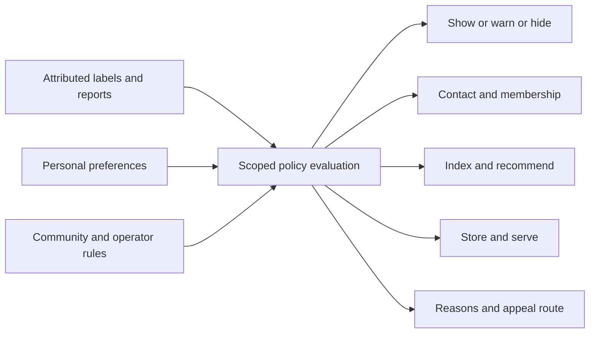
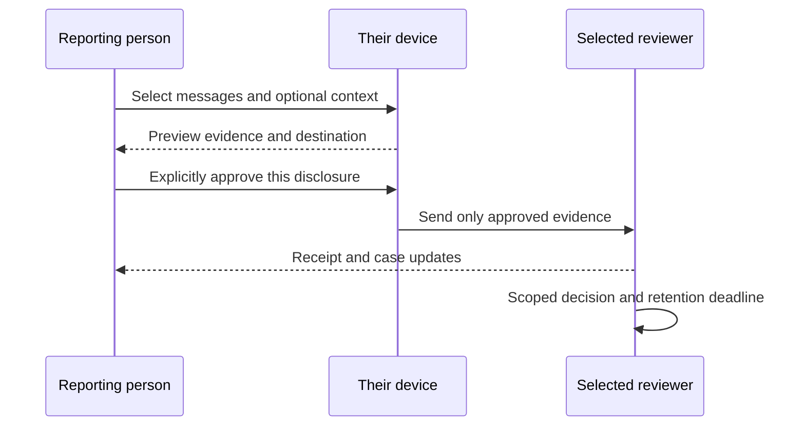
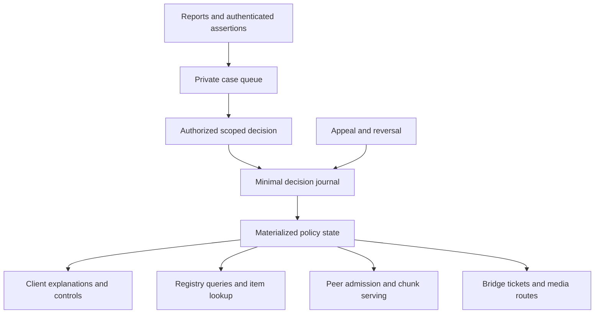
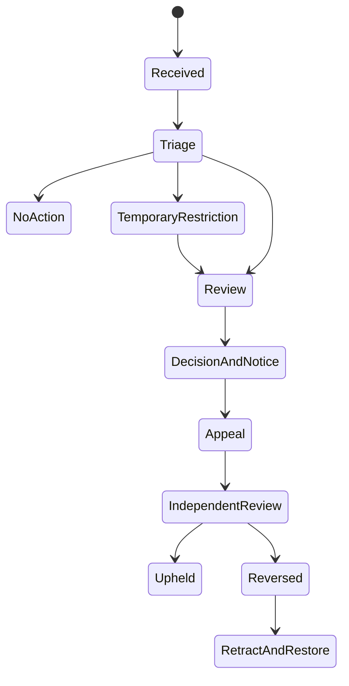

# Moderation with agency

> [!TIP]
> Build a network where people can speak, find their people, and decide what reaches them. Separate personal filters, community rules, discovery policies, and hosting decisions. Give every consequential restriction a reason, a scope, and a way to challenge it.

This is a research proposal for the new Rust/Tauri experiment, not a description of moderation it already provides. The [interactive website](web/0500/index.html) renders this document and adds two fictional, local-only simulations. Published platform documentation was checked on November 2, 2026. Recommendations below are our design judgments; published features are not evidence that a platform executes them well in every case.

Chris should re-decide this proposal on December 2, or before opening the prototype to strangers, whichever comes first. The next decision is whether to implement a small accountable moderation system—not whether to adopt a permanent network constitution. Public protocol and privacy commitments will need their own ADRs and tripwires before implementation.

## The question worth answering

How can a broadly permissive network make people feel welcome without giving either its operator or its loudest users unlimited power over everyone else?

“Allow all content, then add filters” leaves out the people receiving threats, maintaining servers, or involuntarily distributing files. “Let one central service decide everything” leaves out cultural differences, mistakes, and the ability to leave. Neither adequately protects expression.

A better starting point is **many spaces, explicit boundaries, and accountable power**. A person can publish a lawful unpopular opinion without being entitled to appear in every recommendation feed. A reader can refuse contact without trying to erase that person from the internet. A group can stay focused on making games without treating every off-topic post as misconduct.

For xNet, this matters especially because people contribute their own devices and bandwidth. Joining a participating network must not mean agreeing to store every file another participant supplies. The requirement to contribute capacity needs a clear permitted-content scope, budgets, and an emergency pause. A pause may also suspend network consumption under the participation rule; it must never prevent blocking someone or leaving a room.

## What the major platforms actually separate

| Platform    | Main layers                                                                          | Useful lesson                                                       | Main limit for xNet                                                                     |
| ----------- | ------------------------------------------------------------------------------------ | ------------------------------------------------------------------- | --------------------------------------------------------------------------------------- |
| YouTube     | Platform rules, contextual review, channel moderation, monetization rules            | Context and channel-level controls matter                           | A central operator still owns the enforcement path                                      |
| X / Twitter | Account and post enforcement, reach restrictions, personal controls, Community Notes | Removal, distribution, and corrective context are different actions | Public visibility survives some personal blocks; notes are not a complete safety system |
| Reddit      | Platform administrators, volunteer community moderators, queues and posting guidance | Communities need their own norms and low-cost ways to teach them    | Volunteer labor, inconsistent enforcement, and capture remain governance problems       |
| Bluesky     | Service takedowns, moderation labels, optional labelers, personal preferences        | Portable assertions can support multiple interpretations            | Optional labels do not override a service's mandatory decisions                         |

### YouTube: context, platform rules, and channel boundaries

YouTube describes automated detection, human reporting, review, and exceptions for educational, documentary, scientific, or artistic context. Its monetization standards are a separate layer from whether content may remain available. Channel owners also have controls over their own conversations. That separation is more useful to borrow than a single “safe/unsafe” flag. [YouTube policies](https://www.youtube.com/howyoutubeworks/our-commitments/managing-harmful-content/)

Its Community Guidelines apply to private and unlisted content too. Private visibility on a centrally hosted video service therefore does not mean the operator cannot moderate the upload. [Guidelines overview](https://support.google.com/youtube/answer/9288567?hl=en)

Creators can appeal removals and strikes; review can restore content, keep the decision, or change its treatment. Channel chat tools include moderators, message removal, timeouts, and hiding users. These operate at different scopes from a platform-wide suspension. [Appeals](https://support.google.com/youtube/answer/185111?hl=en), [live-chat moderation](https://support.google.com/youtube/answer/10888907?hl=en)

**For xNet:** preserve context during review, offer temporary restrictions, and keep community powers distinct from operator powers. Prefer an understandable notice over a mysterious disappearance. An abuse-resistant exception may hide some enforcement details, but should not become the default explanation for every restriction.

### X / Twitter: distribution is a moderation surface

X documents a range of actions: labels, reduced reach, interaction restrictions, required removal, and account suspension. A post can remain accessible while being excluded from particular discovery surfaces. Appeals exist for multiple kinds of enforcement. Treating all of these as simply “removed” would hide important consequences. [Enforcement options](https://help.x.com/en/rules-and-policies/enforcement-options)

Blocking illustrates another distinction: blocked accounts can still view public posts, although they cannot engage with them through the blocked account. A public post does not become confidential because its author blocks someone. [Blocking behavior](https://help.x.com/en/using-x/blocking-and-unblocking-accounts)

Community Notes adds corrective context using contributor ratings and a ranking method that seeks agreement across people who previously rated notes differently. This is not a simple majority vote, nor does it make the resulting judgment infallible. [Ranking notes](https://communitynotes.x.com/guide/en/under-the-hood/ranking-notes)

**For xNet:** consider contextual notes later, especially for disputed claims. Do not make a small network's initial safety depend on having a large, diverse rating population. A note is not a substitute for stopping unwanted contact, handling threats, or reviewing sensitive evidence. Explain recommendation exclusion separately from deletion.

### Reddit: communities are institutions, not just feeds

Reddit's volunteer moderators set and enforce community rules within platform-wide requirements. Their authority is local to communities; platform administrators have different powers. This is a useful social model for xNet's private rooms and public interest groups. [What moderators do](https://support.reddithelp.com/hc/en-us/articles/204533859-What-s-a-moderator)

Crowd Control can collapse or filter contributions from accounts a community does not yet trust. That can absorb a sudden influx without immediately banning everyone involved, but newcomer filtering deserves scrutiny: joining a new community should not itself become evidence of bad intent. [Crowd Control](https://support.reddithelp.com/hc/en-us/articles/15484545006996-Crowd-Control)

Reddit also supports guidance while someone writes a post or comment. This moves some moderation before publication: explain the norm while the person can still easily comply. Its current AutoModerator documentation includes a significant transition: certain enforcement actions are unavailable for newly created communities or ones that had not used AutoModerator, directing them toward Rules and Automation. Old setup tutorials may no longer describe a new community's options. [Posting guidance](https://support.reddithelp.com/hc/en-us/articles/17625458521748-Automations-Post-Comment-Guidance-Set-Up), [AutoModerator](https://support.reddithelp.com/hc/en-us/articles/15484574206484-Automoderator)

**For xNet:** give groups visible, short rules; offer slow mode, newcomer review, and timeouts; provide a manageable queue. Make these rules available before someone contributes. Do not turn local reputation into a network-wide social score.

### Bluesky: labels are claims, policies decide what to do

Bluesky combines service-level takedowns, moderation-service labels, and personal controls. Its official client includes Bluesky moderation alongside optional labelers. User choice operates within that service boundary; it does not restore material removed from its APIs. An unauthenticated-view restriction is also not a confidentiality guarantee. [Moderation architecture](https://github.com/bluesky-social/bsky-docs/blob/main/docs/advanced-guides/moderation.md)

AT Protocol labels carry an issuer, subject, value, timestamps, and optionally a content version, expiry, and signature. Negating a label retracts an assertion; it does not prove the opposite. Authenticating a label establishes who issued it, not whether they are right. [Label specification](https://atproto.com/specs/label)

**For xNet:** borrow attributable, retractable claims and selectable providers. A community could trust a film-spoiler labeler while another trusts a graphic-content reviewer. Keep operator restrictions visibly separate. Do not promise AT Protocol compatibility merely because an internal structure resembles its labels: identifiers, signatures, feeds, and service semantics need a real adapter.

## Open tools worth borrowing from

No single tool provides policy, contextual judgment, staffing, privacy, appeals, and peer-serving enforcement. The useful open ecosystem is a set of components.

| Tool or project        | Useful capability                                                      | Fit for this prototype                                                            |
| ---------------------- | ---------------------------------------------------------------------- | --------------------------------------------------------------------------------- |
| Ozone                  | Reports, triage, escalation, investigation and action history          | Study its console; use it directly when integrating actual AT Protocol moderation |
| Mastodon               | Personal filters and reports; account, server and media restrictions   | Borrow explicit scopes and report destinations                                    |
| PeerTube               | Video reports, upload quarantine, quotas and instance-level moderation | Closest operational comparison for a community media host                         |
| Draupnir / Matrix      | Shared policy lists, room protections, management workflows            | Borrow trusted-list subscriptions and deliberate escalation                       |
| ThreatExchange tooling | Known-image/video similarity matching components                       | Later specialist component, not the MVP's moderation brain                        |

**Ozone** is a particularly useful reference for moderator workflow. Its repository documents a console connected to a moderation service; that does not make it a backend for arbitrary xNet records or encrypted rooms. The repository offers MIT or Apache-2.0 licensing subject to noted exceptions. Inspect dependencies and exceptions before copying code. [Ozone](https://github.com/bluesky-social/ozone), [license](https://github.com/bluesky-social/ozone/blob/main/LICENSE)

**Mastodon** separates a person's filters, mutes, blocks, and reports from server actions such as limiting accounts, suspending domains, or rejecting remote media. Reports can include selected posts and can be forwarded to the remote server. Domain-wide restrictions have collateral effects; defederating does not erase remote copies. [Personal controls](https://docs.joinmastodon.org/user/moderating/), [operator controls](https://docs.joinmastodon.org/admin/moderation/)

**PeerTube** provides upload quarantine, reporting, quotas, watched-word policies, and moderator roles. Its moderators can access private and unlisted videos: that is a different privacy contract from end-to-end encryption. Separately, following another instance for discovery and hosting redundant copies are distinct operations, with their own controls. [Moderation](https://docs.joinpeertube.org/admin/moderation), [following and redundancy](https://docs.joinpeertube.org/admin/following-instances)

**Draupnir** helps Matrix communities apply shared policies and configurable protections. A local ban can be deliberately escalated into a shared policy. Its protections can support simulated actions—a valuable pattern for showing the effects of a new rule before enabling it. Importing a list should not silently delegate every administrative capability to its author. [Draupnir](https://github.com/the-draupnir-project/Draupnir), [protection configuration](https://the-draupnir-project.github.io/draupnir-documentation/protections/configuring-protections)

**ThreatExchange** contains image/video similarity tooling and integrations. HMA targets AWS; its repository describes Open Media Match as a cloud-agnostic successor under construction. Source availability does not grant access to trusted hash datasets. Similarity matching is neither a complete classifier nor proof of a violation. Its BSD licensing includes component exceptions. [Tools](https://github.com/meta/ThreatExchange), [license](https://github.com/meta/ThreatExchange/blob/main/LICENSE)

Our initial recommendation is to build a small xNet-specific enforcement and case layer, study these workflows, and add adapters only when needed. This fits the goal of a self-hostable Rust service without adopting an entire social server or cloud-specific matching stack.

## What good moderation can be judged by

The strongest design principles here are procedural: clear rules, appropriate context, limited powers, notices, review, and correction. The Santa Clara Principles argue for transparency, cultural and linguistic competence, understandable notices, and meaningful appeals, including review independent of the initial decision-maker. They are governance recommendations, not evidence that adding an appeal button guarantees fairness. [Santa Clara Principles](https://santaclaraprinciples.org/)

There is also evidence that moderation can help people participate. A randomized field experiment across 2,190 r/science discussions found that displaying community norms improved compliance and newcomer participation. That result concerns one specific community and intervention; it is a reason to test visible norms, not a predicted effect size for xNet. [Matias, PNAS, 2019](https://pmc.ncbi.nlm.nih.gov/articles/PMC6525516/)

For xNet, “best” should mean people can understand and influence the rules, legitimate participation survives errors, and abuse becomes less costly to escape. Measure those outcomes rather than the number of posts removed.

| Question                          | Useful signal                                                    | What it does not prove                             |
| --------------------------------- | ---------------------------------------------------------------- | -------------------------------------------------- |
| Can people stop unwanted contact? | Repeat contact after a block, including alternate routes         | An account block stops every determined person     |
| Are restrictions understandable?  | Users can identify who acted, why, and where to appeal           | A notice alone is fair process                     |
| Can mistakes be corrected?        | Appeal delay, reinstatement and label retraction propagation     | Appeal reversal rate is classifier accuracy        |
| Are communities welcoming?        | Newcomer participation and reported comfort, by context          | More engagement always means a healthier space     |
| Can moderators sustain the work?  | Queue age, time per case, repeated exposure, volunteer retention | Faster decisions are necessarily better            |
| Does privacy survive reporting?   | Unselected evidence never leaves the device                      | Consent to one report authorizes future monitoring |

Prefer minimal, aggregated measurement. Private-message contents should not become analytics. Any exposure denominator or language audit needs an explicit collection design; do not invent precise safety statistics from incomplete telemetry.

## Five powers, five understandable decisions

> [!IMPORTANT]
> “Hidden from you,” “removed from this group,” “not listed here,” and “your device stopped sharing it” are different outcomes. The interface and the API must preserve that distinction.

| Power                   | Who has it?                                          | Example                                      | Boundary                                                |
| ----------------------- | ---------------------------------------------------- | -------------------------------------------- | ------------------------------------------------------- |
| See                     | The reader, within the chosen service and age policy | Warn me before graphic news                  | Does not order someone else's service to restore a file |
| Contact and participate | Recipient and community administrators               | Friends-only DMs; temporary room timeout     | Public posts remain public unless access itself changes |
| Index and recommend     | Each registry or discovery operator                  | List a work but omit it from recommendations | Does not delete the original or bind other registries   |
| Store and serve         | Each device or hosting operator                      | Stop seeding a file or refuse a category     | Does not erase another person's retained copy           |
| Review and appeal       | The authority that made the decision                 | Challenge a room ban with its moderators     | A labeler cannot reverse a separate registry removal    |

Communities additionally decide what contributions belong in their space. That is a scoped participation decision, not ownership of every copy of a member's work.



### Different problems deserve different controls

**Taste and attention:** spoilers, topics, frequency, styles, and ordinary disagreement usually belong in personal filters. Offer mute, show less, and undo without making someone file an abuse report.

**Audience and context:** adult art or graphic reporting may need warnings and audience restrictions. Treat a label as a contextual claim, not a moral judgment about the creator. Adult preferences do not override a protected youth account's policy.

**Behavior:** harassment, spam, repeated unwanted contact, and coordinated disruption need contact limits, rate controls, and community enforcement. Hiding one offensive word will not solve a campaign against someone.

**Operator prohibitions:** operators need a published baseline for serious abuse and prohibited material, with specialist escalation where necessary. Known child sexual abuse material, non-consensual intimate imagery, and credible threats cannot be treated as just another “show me everything” preference. Exact legal duties differ by operator and jurisdiction and need separate qualified review before public operation; this proposal does not claim to settle them.

Disagreement, criticism, and low popularity are not sufficient reasons to classify content as abuse. Conversely, calling something “speech” does not entitle it to another person's inbox, storage, or recommendation feed.

### A compact user experience

The everyday menu should start with **Hide this**, **Mute this topic**, **Block contact**, and **Report a problem**. Keep these distinct. Explain “mute” as a reversible personal choice. Let a report start with plain language: “Someone won't leave me alone,” “This exposes private information,” or “This breaks this group's rules.”

A filtered item can show a small receipt: “Graphic news · warned by Documentary Review · your preference.” A group restriction should instead name the group rule and show its appeal route. Optional labels can be overridden by eligible adults; mandatory operator decisions should say which service restricted access. Do not suggest a button can override someone else's authority.

Offer presets such as Quiet, Standard, and More open, but expand them into real settings. “More open” must never secretly enable stranger DMs, public profile fields, or file seeding. A new rule should have a dry-run view: what it would affect, whose decisions it trusts, and how to undo it.

## Public media and the seeding contract

A shared public URL is not a promise of universal hosting. A registry publishes its own index; devices accept specific hosting responsibilities. Keep discovery, viewing, caching, retaining, and serving independently expressible, even when a user chooses a convenient preset combining them.

The current product direction requires active contribution to consume network content. Preserve that experiment, but define contribution as capacity within a user's approved hosting policy. **A like is not permission to persistently seed a file.** A subscription can propose a retention rule; the user should see its storage budget, audience, and exclusions before enabling it.

| Situation                                     | Proposed behavior                                                                                                       |
| --------------------------------------------- | ----------------------------------------------------------------------------------------------------------------------- |
| You mute a creator                            | Hide their work from your feed; leave hosting policy unchanged unless you choose otherwise                              |
| You decline to host adult media               | Do not acquire or serve it under that policy; viewing policy remains separate                                           |
| A file has not been classified                | Do not treat absence of labels as proof it is safe; require explicit retention or an approved conservative hosting rule |
| A trusted operator confirms a prohibited file | Stop advertising and serving it through that operator's participating services; notify affected retainers               |
| A decision is reversed                        | Retract the relevant restriction and recompute decisions; do not silently download the file again                       |
| A peer ignores a restriction                  | Stop dealing with that peer where policy requires it; do not promise remote erasure                                     |

Serving refusal must be checked in Rust when issuing a stream ticket and when serving ranges or chunks—not only when drawing the feed. A previously issued ticket must not provide a permanent bypass. Cancel in-flight transfers where feasible; bytes already delivered cannot be recalled. Cache removal, user-retained originals, and evidence preservation are separate operations with distinct permissions and retention rules.

For private media, encrypting bytes before replication can let authorized friends help with availability while keeping decryption keys with recipients. It still exposes some access patterns and consumes storage. A removed member may retain old plaintext or keys. Future-access revocation needs key rotation and membership changes; transport encryption alone does not provide that property.

## Private rooms without invisible surveillance

Private spaces need moderation too: invitations, role boundaries, slow mode, blocks, removal, and an escape route when the owner is the problem. They do not need an undisclosed reader of every conversation.

Matrix's E2EE model keeps message and attachment keys at endpoints. A bot given keys becomes another recipient. Draupnir documents an additional limit: a malicious sender can share keys with some participants while withholding them from moderator devices, defeating content-based inspection. Adding a moderation bot cannot guarantee complete visibility. [Matrix E2EE](https://www.matrix.org/docs/matrix-concepts/end-to-end-encryption/), [Draupnir encrypted rooms](https://the-draupnir-project.github.io/draupnir-documentation/moderator/managing-protected-rooms#protecting-encrypted-rooms)

The proposed report flow is **select, preview, choose a recipient, disclose**. The user can add context, but the default must not export the whole room. Clearly list the exact messages, attached files, identities, timestamps, and destination. A message author may be identifiable from the excerpt even if a display name is omitted. Avoid promising anonymity merely because the reporter's name is hidden in the moderator queue.



Draupnir's report integration describes limits on extracting event information, including witnessed, unencrypted, non-redacted events. xNet will need its own deliberate evidence flow for E2EE rather than assuming a server report API can read private messages. [Draupnir reporting](https://the-draupnir-project.github.io/draupnir-documentation/bot/homeserver-administration)

A community moderator normally receives community-rule reports. A service operator can receive reports about its own services. If the room owner is the subject, offer another available authority and explain what that authority can actually do. Offline, blocking and leaving must still work; remote reports can remain visibly queued rather than appearing submitted.

Keep evidence encrypted at rest with case-specific access, retention limits, and access logs. Public transparency can contain counts and redacted decisions, not private quotes, reporter identities, or harmful files. An immutable audit trail is not a reason to retain every piece of private evidence forever. Signing public posts also does not settle the tradeoff between report authenticity and deniability in a future private messaging protocol.

### Younger users need a different default

For a future youth offering, use closed contact defaults, limited discovery, reporting accessible without adult technical vocabulary, and no adult-content override. Do not publish birth dates as an age-control mechanism. A child's safety and a parent's or institution's surveillance preferences are not automatically the same thing.

Start moderation trials with a bounded adult community. An 8–12 product and a 16–25 community are not the same policy problem. Youth access needs its own consent, age-assurance, safeguarding, and jurisdiction review before making promises. The website's teen scenario is an illustrative policy difference, not an implemented age-verification system.

## A small architecture with room to grow

Use a Rust decision module with explicit inputs and bounded work. Separate detections from decisions, and decisions from their execution. SQLite is sufficient for a local case log and materialized views; a hosted registry can move that store to Postgres when its actual load requires it. CRDTs do not resolve a dispute about who is authorized to ban whom.



<details>
<summary>Proposed data contracts and security boundaries</summary>

These are conceptual shapes, not a frozen public API.

```rust
struct Decision {
    display: DisplayAction,       // show, warn, hide, unavailable
    contact: ContactAction,       // allow, request, deny
    index: IndexAction,           // list, omit, quarantine
    serve: ServeAction,           // allow, deny, explicit_consent_required
    reasons: Vec<Reason>,        // issuer, policy version, scope, appeal route
}

// Evaluate already-authenticated, bounded facts. No network requests or plugins.
fn evaluate(input: &PolicyInput) -> Result<Decision, PolicyError>;
```

Keep distinct records for **LabelAssertion**, **PolicySubscription**, **CommunityRole**, **Report**, **CaseDecision**, **Appeal**, and **HostingPreference**. An assertion targets a stable subject and, where relevant, a content hash/version. A decision records the actual authority, scope, policy version, expiry, and superseded decision. Reports are evidence and allegations; they are not automatically labels or bans.

Verify signatures, authority scope, issuer subscriptions, size limits, and freshness before evaluation. A valid signature does not grant moderator powers. Bound report attachments and policy-list sizes. An untrusted list must never be able to execute code or silently become an administrator.

Do not resolve membership and moderator authority with an unconstrained last-writer-wins field. Start with a clear room authority and ordered membership epochs. Revocation changes future access; future E2EE also needs corresponding key updates. Offline clients may retain old views, but cannot invent new grants from stale authority.

Optional expired labels should lose their power to create new restrictions; show their stale state where relevant. A confirmed operator restriction should persist until an authorized reversal or its defined expiry—not disappear because a label service timed out. A freshness failure should be an explicit state with a documented policy, never silently mean “safe.”

Maintain small append-only decision records, but keep deletable sensitive evidence in a separate store. Restrict evidence viewers, blur distressing material by default, prevent autoplay, and isolate media parsing. Role changes and bulk actions need auditability; large-impact operations can require a second reviewer when staffing permits.

</details>

### Where this fits the code that exists

The new prototype already has signed records, a registry, peer transfer, and public/private room routes. It does **not** yet have the controls proposed here. Its private rooms use authenticated encrypted transport with owner-hosted history; they are not an MLS/Signal-style E2EE group implementation. [Prototype README](../../experiments/community-network/README.md)

| Seam                                                                                 | Current responsibility                          | Proposed addition                                                     | Status      |
| ------------------------------------------------------------------------------------ | ----------------------------------------------- | --------------------------------------------------------------------- | ----------- |
| [model.rs](../../experiments/community-network/crates/network/src/model.rs)          | Records, announcements and peer requests        | Typed subjects, scoped moderation records and policy versions         | ⬜ Proposed |
| [registry.rs](../../experiments/community-network/crates/network/src/registry.rs)    | Announce, catalog and direct item lookup        | Consistent decisions across search, pages, replies and direct IDs     | ⬜ Proposed |
| [peer.rs](../../experiments/community-network/crates/network/src/peer.rs)            | Retain, announce, chunks and room authorization | Serving refusal, provider withdrawal, membership revocation           | ⬜ Proposed |
| [bridge.rs](../../experiments/community-network/crates/network/src/bridge.rs)        | Local commands, stream tickets and media ranges | Apply policy at ticket creation and subsequent serving                | ⬜ Proposed |
| [store.rs](../../experiments/community-network/crates/network/src/store.rs)          | Local persistent state                          | Private case store and rebuildable decision views                     | ⬜ Proposed |
| [PublicFeed.tsx](../../experiments/community-network/apps/desktop/ui/PublicFeed.tsx) | Public posts and replies                        | Mute, block, report, decision receipts and appeals                    | ⬜ Proposed |
| [registry.js](../../experiments/community-network/web/registry.js)                   | Public landing and content pages                | Avoid leaking restricted bodies through link previews or direct pages | ⬜ Proposed |

A registry stores public post bodies as well as metadata, while media is served by peers. “We only host an index” is not an accurate description of every current data path. A fresh device key and display name are not a scarce human identity, so free key generation also cannot be the basis of an abuse-resistant reputation system.

## Human review, automation, and appeals

Give moderators a queue with a reason for priority, related reports, the relevant policy, and the smallest useful context. Deduplicate campaigns without making report volume a vote. Show provisional actions separately from confirmed findings. Let reviewers recuse themselves, hand off distressing cases, and record uncertainty.



A notice should state what changed, which authority acted, the applicable rule, duration, and appeal route. Preserve appeal access after a suspension. Sometimes identifying evidence or a reporter would create risk; explain the decision without exposing them. Where possible, another reviewer handles the appeal. A two-person community cannot honestly promise institutional independence—offer recusal and an external escalation route only if one actually exists.

AI can help deduplicate reports, translate, suggest relevant rules, or draft a notice for review. It should not decide that a political view is false because a language model says so. Treat reported content as hostile input: no executing its instructions, following arbitrary links, or giving it case-system credentials. Sending private evidence to a hosted model changes who receives it and requires an explicit approved arrangement; it must not happen merely because the user connected Codex or Claude elsewhere in the app.

At larger scale, specialized classifiers and trusted known-content hashes can triage material, with audited thresholds and human escalation. Separate exact byte matches, perceptual similarity, and inferred meaning. Each has different evasion and false-positive properties. Neither open model weights nor a high confidence score settles context or policy.

Moderation also has a labor budget. An illustrative 50 cases a day at six minutes each is five reviewer-hours, before appeals, coordination, and specialist incidents. Those are planning assumptions, not measured xNet costs. Cheap metadata hosting does not make a public network free to operate responsibly.

## Options and the recommended first release

| Direction                               | Benefit                                          | Cost                                                                    | Recommendation                                   |
| --------------------------------------- | ------------------------------------------------ | ----------------------------------------------------------------------- | ------------------------------------------------ |
| Only personal filters                   | Very simple; strong immediate reader control     | Cannot address unwanted contact, operator duties or involuntary hosting | Include, but insufficient alone                  |
| One global moderation service           | Consistent starting point and clear operator     | Central dependency and one cultural/political bottleneck                | Use only for the first operator's own scope      |
| Community rules plus optional labelers  | Local autonomy and portable specialist judgments | Trust, freshness, onboarding and appeal complexity                      | Target architecture; introduce gradually         |
| AI-only decisions                       | Low apparent review cost                         | Context errors, manipulation, privacy risk, weak accountability         | Do not adopt                                     |
| A complete imported moderation platform | Mature workflows in its native ecosystem         | Identity/protocol mismatch; still needs local enforcement               | Borrow patterns, then integrate where compatible |

**Recommendation:** start with a clearly accountable registry operator and small invited communities. Build personal controls and scoped enforcement first. Add shared labels when more than one operator actually needs them. Preserve the ability to move to another registry without pretending a new registry can override a private room's membership or require an unwilling peer to host a file.

This is consistent with sovereignty: power is explicit, bounded, and replaceable. It is also consistent with a pleasant social product. A person should be able to say “less of this,” find friends, and get help without learning the federation architecture.

### Stage 1: make the first community manageable

- [ ] Publish short operator and community rules, including what remains a personal preference.
- [ ] Add local mute, topic filtering, block-contact and report actions with clear scopes.
- [ ] Implement report receipts, a private queue, temporary actions, notices and appeals.
- [ ] Enforce restrictions in catalog queries, direct record lookup, peer serving and bridge ranges.
- [ ] Add hosting policies, explicit retention approval and an emergency contribution pause.
- [ ] Support room removal, role changes and invitation rotation; accurately describe current privacy.
- [ ] Assign an actual operator and reviewer before onboarding strangers; define incident escalation.

### Stage 2: let communities govern themselves

- [ ] Add visible room rules, newcomer review, slow mode and time-limited restrictions.
- [ ] Offer selective private-evidence disclosure with recipient preview and retention controls.
- [ ] Add dry-run policy changes and correction propagation across local materialized views.
- [ ] Test owner-abuse reporting and appeal conflicts with a second real community.

### Stage 3: connect independent services

- [ ] Define authenticated label assertions, subscriptions, retractions and freshness semantics.
- [ ] Build a real AT Protocol adapter if Bluesky labels are needed; do not claim compatibility early.
- [ ] Add transparent operator-to-operator notices without forcing shared rules on every host.
- [ ] Evaluate specialist classifiers or hash tools against measured queue needs and dataset access.
- [ ] Commission the private messaging and youth-access designs separately before promising them.

## Tests that could change this recommendation

These are product acceptance checks for future implementation. The website model is a smaller illustration and does not establish network security.

- [ ] A personal filter hides a post without banning its author or changing another person's feed.
- [ ] An optional labeler's action cannot grant itself registry, room or hosting authority.
- [ ] A user cannot override another operator's removal by selecting “show.”
- [ ] Quoted abuse, reclaimed language, political criticism and graphic news receive context-sensitive review.
- [ ] A coordinated report campaign cannot turn report count alone into a confirmed violation.
- [ ] A revoked room member cannot receive future protected content; old-copy limits are explained.
- [ ] A private report sends exactly the selected evidence and no unapproved attachments or history.
- [ ] Direct IDs, previews, old stream tickets and chunk requests cannot bypass the relevant enforcement.
- [ ] Expired assertions, forged moderator keys and unavailable services produce explicit correct states.
- [ ] An appeal reversal propagates without leaving a permanent misleading label or silently restarting downloads.
- [ ] Blocking, leaving, reporting and appeal notices work with keyboard and assistive technology.
- [ ] Two independently operated registries can disagree without leaking private content or forcing replication.

Reopen the architecture if most useful moderation turns out to require centralized private plaintext, if ordinary users cannot understand the separate scopes, or if the staffing burden makes an open public launch unsustainable. Those are reasons to narrow the product or change its boundaries, not to hide the cost in defaults.

## Reading map and research limits

For **platform behavior**, start with [YouTube policies](https://www.youtube.com/howyoutubeworks/our-commitments/managing-harmful-content/), [X enforcement](https://help.x.com/en/rules-and-policies/enforcement-options), [Reddit community moderation](https://support.reddithelp.com/hc/en-us/articles/204533859-What-s-a-moderator), and [Bluesky architecture](https://github.com/bluesky-social/bsky-docs/blob/main/docs/advanced-guides/moderation.md).

For **an implementation reference**, start with [Ozone](https://github.com/bluesky-social/ozone), [PeerTube](https://docs.joinpeertube.org/admin/moderation), [Mastodon](https://docs.joinmastodon.org/admin/moderation), and [Draupnir](https://github.com/the-draupnir-project/Draupnir). For **fair process and evidence**, read the [Santa Clara Principles](https://santaclaraprinciples.org/) and the [community-norms field experiment](https://pmc.ncbi.nlm.nih.gov/articles/PMC6525516/).

This review examines published capabilities and one bounded empirical result. It does not audit platform enforcement accuracy, resolve jurisdiction-specific legal obligations, establish classifier benchmarks, or certify any proposed encryption protocol. Those are separate investigations. The concrete next step is the Stage 1 pilot, with people able to challenge the rules and with enough observability to discover where our assumptions fail.
