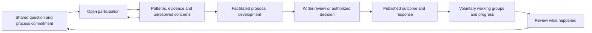
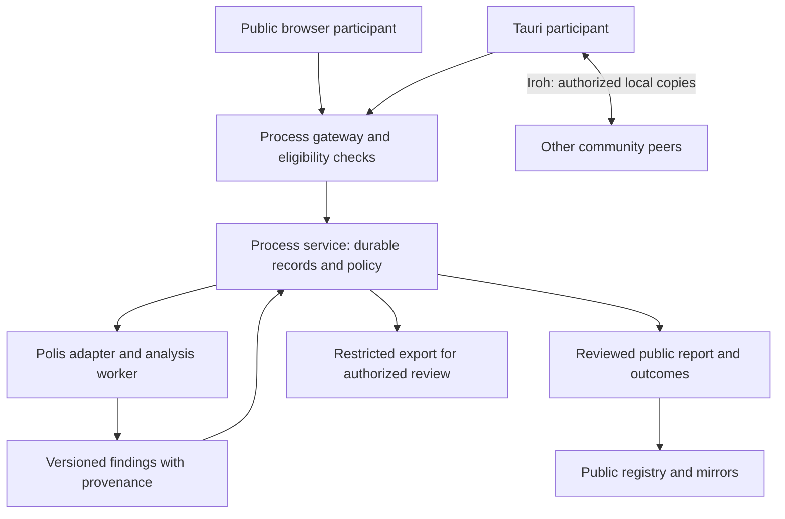
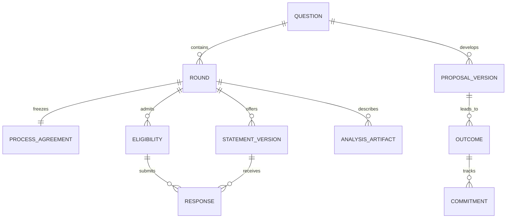

# Collective sensemaking at community scale

> [!TIP]
> Build a public deliberation layer into xNet: people can raise a shared question, contribute perspectives, understand disagreement, develop proposals, and track what happens next. Use Polis as the first serious integration for large-group opinion mapping, with explicit decision rules and follow-through around it.

This is a general-purpose product capability for large communities and collective political action. It is not limited to decisions about xNet. The starting scale is hundreds to tens of thousands of participants, with larger deployments treated as a measured engineering goal.

[Read the website edition](web/0501/index.html). This Markdown is canonical; the website is a reading interface, not a working product feature. The original research was checked November 4, 2026. The [coordination and epistemics field guide](#field-guide-to-coordination-and-epistemics) was added November 11. Revisit November 18 after a bounded Polis integration investigation and feedback from an experienced facilitator; that is a decision checkpoint, not a delivery promise.

## 1. The opportunity: a social space that can arrive somewhere

A large conversation can produce thousands of messages without producing a usable shared understanding. A poll can produce a winner without revealing why people disagree. An AI summary can sound coherent while omitting the objection that matters most.

xNet could connect these activities into a process people can follow. A question begins in a community, a public post, a video discussion, or an organizing group. It gets its own address and a clear invitation to participate. People can contribute without reading every reply. The result preserves areas of agreement, important disagreements, missing evidence, and a record of who is responsible for the next step.

The distinctive opportunity is the connection between **public discussion, collective understanding, authorized decisions, and continued collaboration**. A community should be able to stay together after the consultation closes.

Consider three independent uses:

| Community                          | Shared question                                                      | What success could mean                                                                           |
| ---------------------------------- | -------------------------------------------------------------------- | ------------------------------------------------------------------------------------------------- |
| Thousands of residents             | Which changes would improve access to local public services?         | A documented set of priorities, dissent and a published response from the responsible body        |
| A large cooperative or association | What should our next annual plan prioritize?                         | Broad input followed by a member decision under its existing rules                                |
| A civic coalition                  | Which shared demands and voluntary projects can we support together? | A public platform with explicit endorsements, separate opt-in working groups and progress updates |

These require different authority and eligibility arrangements. A single interface can support them if it makes those arrangements visible. An open discussion of a policy is not a representative sample, a member ballot, or permission to act in every participant's name.

**Proposed product language:** use **Questions** as the persistent object and **Start a discussion** as its entry action. Within a question, show **Overview · Participate · Findings · Proposals · Outcomes** as those stages become relevant. “Assembly” can name a recurring community institution later. Avoid making people learn deliberative theory before contributing.

## 2. What to borrow from existing tools

### Polis: make many perspectives legible

Polis collects participant-written statements and agree/disagree/pass responses, then identifies patterns in those responses. It can surface statements supported across different opinion groups. Its structured response format lets people contribute without writing an argument or entering a reply battle. [Polis overview](https://compdemocracy.org/polis/)

The underlying data is a sparse participant-by-statement matrix; most people do not respond to most statements. The classic method uses dimensionality reduction and clustering. These are models of observed response patterns, not natural political categories or tests of factual truth. [Opinion matrix](https://compdemocracy.org/polis-opinion-matrix/), [methods paper, Small et al., 2021](https://www.demdis.sk/content/files/2022/11/Polis-manusript.pdf)

Polis is especially relevant to the larger scale requested here. Its own FAQ cautions against using it for groups below roughly 50–100 people. That is a product guideline, not a statistical guarantee once the counter reaches 100. Representation, response overlap and the diversity of participation still matter. [Polis FAQ](https://compdemocracy.org/faq/)

**Borrow:** low-friction statements, cross-group agreement, and visibility into disagreement. Keep ordinary chat alongside the exercise rather than turning every statement into an endless nested thread.

### Loomio: make the decision process explicit

Loomio distinguishes advice, sense checks, consent and consensus, with proposals embedded in discussions. Its outcome record connects a proposal to what the group will do next. Those distinctions would help xNet avoid interpreting every positive response as a binding vote. [Proposal types](https://www.loomio.com/docs/en/user_manual/polls/proposals), [outcomes](https://www.loomio.com/docs/en/user_manual/polls/outcomes)

Consent is useful for a bounded experiment when the group has agreed how to address material objections. It is not a universal solution for a public audience of ten thousand people. Large groups also need a legitimate way to decide who examines objections and how that judgment can be challenged. [Loomio consent process](https://www.loomio.com/docs/en/guides/making_decisions/consent_process)

**Borrow:** a declared decision procedure, proposal revisions and an accountable outcome. Begin with advisory consultations; add consequential voting only with a defined electorate and a validated voting system.

### Decidim: connect participation to institutions and delivery

Decidim separates participatory processes from assemblies and provides components for proposals, debates and results. Its accountability component tracks implementation through milestones and change history. [Features](https://decidim.org/features), [accountability](https://docs.decidim.org/en/develop/admin/components/accountability.html)

**Borrow:** the promise made before participation, the institution responsible for answering, and the public record afterward. A beautifully rendered consultation with no response is an unfinished experience.

### vTaiwan: the software sits inside a human process

vTaiwan describes a process involving stakeholder engagement, online consultation and facilitated meetings. Its examples place Polis within that wider sequence. This supports using a map to prepare a productive discussion rather than expecting a map to decide a policy. The project's site reports its own outcomes; those accounts are not independent causal evidence that a particular algorithm produced them. [vTaiwan](https://info.vtaiwan.tw/)

**Borrow:** move between broad participation and smaller, facilitated work, then return the resulting proposals to the wider group.

### Kialo and Community Notes: useful adjacent patterns

Kialo's claim trees make supporting and opposing reasons navigable. That is useful when a disputed claim needs evidence, although requiring an argument map for every contribution would raise the participation burden. [Kialo introduction](https://support.kialo-edu.com/en/hc/getting-started-with-kialo-for-educators/)

Community Notes seeks support across differing rating patterns and publishes its scoring approach. It illustrates why cross-perspective support can be more useful than raw popularity, but its objective is note helpfulness, not authorization to make collective decisions. [Ranking documentation](https://communitynotes.x.com/guide/en/under-the-hood/ranking-notes)

**Borrow:** evidence links, identifiable unresolved claims and support that crosses disagreement. Do not import a single global credibility score for people.

### Evidence that should temper our confidence

A 2026 preprint examines 119 Polis conversations with at least 100 participants. It reports that developer choices, conveners and participation patterns shape results, and raises reproducibility concerns with exported clustering because of warm-path computation. This is one observational preprint, not a definitive verdict on every deployment. It is a strong reason to record analysis versions and test reproducibility rather than assuming an export is enough. [Gelauff, August 2026](https://arxiv.org/abs/2608.28368)

The OECD's guidance for representative deliberative processes emphasizes inclusive recruitment, appropriate evidence, facilitation and a public response to recommendations. Open online participation and a representative citizens' panel are different methods. Combining them can be valuable, but their results should remain distinguishable. [OECD principles](https://www.oecd.org/en/publications/evaluation-guidelines-for-representative-deliberative-processes_10ccbfcb-en/full-report/component-9.html)

## Field guide to coordination and epistemics

Suppose a city can fund one new late-night bus route. A nurse at the hospital wants a departure after the last shift. A warehouse worker wants a connection to the first morning train. Before anyone votes, the city has two questions to answer. **What do residents need?** And **what evidence would tell us which route will serve them?** These questions call for different tools.

### Coordination tools

**Hear the room.** With **Polis**, residents write statements in their own words and respond to one another’s statements. Clusters form from patterns of agreement and disagreement. An organizer can see whether “I need a safe place to wait after midnight” finds support across groups, then invite people to explain what a safe stop means on their route. [Polis](https://compdemocracy.org/polis/)

If the city already has hundreds of written comments or interview transcripts, **Talk to the City** offers another starting point. Its open-source software groups related arguments into a report and lets readers trace a theme back to the voices behind it. That matters when a summary like “later service” hides two incompatible timetables. [Talk to the City project](https://ai.objectives.institute/talk-to-the-city-1)

| When people are contributing | Tool and method |
| --- | --- |
| Neighbors can sit around a table | **Cortico** records small-group conversations. Organizers and participants can listen back to excerpts and draw out themes across groups. [Cortico](https://cortico.ai/) |
| Many tables are talking at once | **Dembrane** lets each group record its discussion on a phone. Facilitators can bring an emerging theme back into the room for correction before writing the report. [How Dembrane works](https://www.dembrane.com/faq) · [Participant walkthrough](https://docs.dembrane.com/users/participant/what-to-expect.html) |
| People need a fair turn to speak on video | Stanford’s **Deliberative Democracy Lab Online Deliberation Platform** manages a speaking queue and timed turns in small groups. A large event can run many such groups in parallel. [Stanford’s platform](https://deliberation.stanford.edu/tools-resources/online-deliberation-platform) |
| A research team wants fast feedback from a large group | **Remesh** runs moderated online conversations where people answer prompts and evaluate others’ responses. Its market and employee research practice is useful to study for rapid comparison of open-ended answers. [Remesh](https://www.remesh.ai/) |
| Participants have different schedules or need follow-up questions | **Harmonica** conducts individual AI-facilitated conversations and synthesizes recurring themes and tensions. Someone coming off a late shift can contribute on their own time. [Harmonica](https://harmonica.chat/) |

**Draft common ground.** In Google DeepMind’s **Habermas Machine** study, participants wrote their views, rated candidate group statements and critiqued the wording. The mediator used that feedback to produce another draft. An xNet exercise could show the most-endorsed wording beside an objection it still leaves open. A participant should be able to recognize both. [Original study](https://deepmind.google/research/publications/65220/)

**Choose priorities.** **Basalt** explored liquid democracy for crowdsourcing priorities across a network. People could delegate judgment to someone whose expertise they trusted. For a transport decision, it would matter whether someone delegated on route planning alone or on the whole budget. The contributed notes describe Basalt as inactive. Its designer’s archived interface is available to inspect. [Basalt design](https://dribbble.com/shots/10006291-Basalt-Web-App)

### Epistemics tools

Turn a contested prediction into a question somebody can settle. For the bus proposal, the city could ask, “Will the pilot average at least 80 boardings per service night in its first eight full weeks?” Publish the dates, the source of the counts and what happens if the pilot is cancelled. Residents can then record their estimates before the first bus runs.

| What the group wants to do | Tools to explore |
| --- | --- |
| Pool forecasts | **Metaculus** aggregates probability estimates submitted by forecasters. **Polymarket**, **Manifold** and **Kalshi** show prices formed by people trading on outcomes. On either kind of platform, read the exact resolution criteria before comparing numbers. [Metaculus FAQ](https://www.metaculus.com/faq/) · [Polymarket](https://docs.polymarket.com/) · [Manifold](https://manifold.markets/) · [Kalshi](https://kalshi.com/) |
| Inspect the case for a claim | **Rootclaim** lays out competing explanations for contested questions and assesses how evidence changes their relative likelihood. **Epistemic Check** is described in the contributed notes as an AI bot prototype that weighs pros and cons and produces a confidence score. For either approach, show which piece of evidence would change the conclusion. [Rootclaim](https://www.rootclaim.com/) |
| Model uncertainty | **Squiggle** is a programming language for estimates expressed as distributions. A planner could model a range of night-shift workers and a range of likely uptake. **Estimaker** was designed to show a chain of assumptions as a probability tree. Nathan Young’s tree with Katja Grace makes the individual assumptions in an AI forecast inspectable. [Squiggle](https://www.squiggle-language.com/) · [Estimaker project notes](https://manifund.org/projects/new-forecasting-tools) · [Katja Grace example and interview notes](https://www.lesswrong.com/posts/mZ46CJQvgiTgaNwDm/ai-probability-trees-katja-grace) |
| Learn from past estimates | Two projects from **Sage** support different habits. **Fatebook** records a prediction so the group can resolve it later. **Quantified Intuitions** offers exercises for practicing forecasting and calibration, including whether events assigned 70% confidence happen about seven times in ten. [Fatebook](https://fatebook.io/) · [Quantified Intuitions](https://www.quantifiedintuitions.org/) · [Sage](https://sage-future.org/) |

The contributed list also names **Futur**. A similarly named prediction market, **Futuur**, publishes an explanation of its markets. The intended reference is unconfirmed. [Futuur’s market guide](https://futuur.com/i/how-it-works/)

### What to carry into xNet

On the bus question page, give residents three things they can come back to. **What we heard** includes the shift workers’ original words where they consent to share them. **What we expect** records the ridership forecast, its reasoning and its resolution date. **What we decided** names who chose the route, why, and when they owe residents the actual counts. If ridership comes in below forecast but the pilot provides the only accessible ride home for one neighborhood, people can revisit both the evidence and the value they place on that service. Both belong in the record.

## 3. A complete large-group journey



### Arrive through an ordinary link

The page first answers: what is the question, who convened it, who can participate, what is private, when does it close, and what will happen with the results? Show the sponsor or funder, moderators, decision owner and declared conflicts. If nobody has committed to respond, label it an **open discussion**, not an official consultation.

A short, accessible brief holds the question, constraints, competing explanations and evidence sources. Participants can flag an omission in the brief. Audio and video can supplement text, but participation must work without playing media.

**A consequential product recommendation:** allow browser participation without installing the desktop app or donating bandwidth. The current contribution requirement would exclude people using shared devices, limited data, constrained networks or unsupported hardware. Desktop hosting can be a voluntary contribution with transparent limits. This explicitly reopens the earlier mandatory-seeding idea for civic participation; it does not change that rule in the current application.

If the requirement is retained, describe the audience as participating xNet users, not the wider community. A technical access rule changes who gets heard.

### Contribute in a few minutes, return when useful

The initial activity is simple: read a statement; agree, disagree, or pass; optionally write one perspective the discussion is missing. Explain that pass is a response and that an unseen statement has no response. Let people revise their own responses while the round is open.

Give people a natural stopping point: “You have responded to 12 statements. You can stop here and return later.” The number is a proposed session length to test, not a reward or obligation. No streaks, public participation rankings, or pressure to respond to everything.

Offer clarification and evidence separately. A participant can say a statement is unclear without treating it as abusive. A link or chat discussion can explain a perspective, while the rated statement remains concise and versioned.

### Understand the landscape

The default findings page should be a readable account with source links:

- Areas of support across observed groups.
- Points of disagreement, with their strongest submitted reasons.
- Important concerns with little exposure or little support.
- Questions where people frequently pass or request clarification.
- Who participated, which audience was invited, and what is missing.

An opinion map is an optional view with a text/table equivalent. Avoid a permanent dot labeled with each person's identity. Groups can change between rounds; they should not become factions, profile attributes or targeting audiences.

A local hide or mute should protect a reader without silently altering the published aggregate. If a person hides a statement, show that something is omitted from their view and allow inspection of the common report. Personal preferences and the shared analytical dataset are separate controls.

### Develop proposals and test the tradeoffs

A facilitator, working group or participant can draft a proposal linked to the statements and evidence it addresses. Show which objections it accommodates and which remain. Participants can challenge a summary or offer an alternative proposal.

Smaller working groups can explore competing paths. Their composition and mandate are visible. A self-selected working group does not automatically speak for the public; a representative panel needs its own recruitment and facilitation process.

Revisions need a new version and a new response opportunity. A vote on “try this for six weeks” must never carry forward automatically to “adopt this permanently.”

### Decide, explain, act, and revisit

Every process declares one of three initial modes:

| Mode                  | What participation authorizes                   | Required outcome                                                                       |
| --------------------- | ----------------------------------------------- | -------------------------------------------------------------------------------------- |
| Open exploration      | Learning about participating perspectives       | A findings report, including disagreement and limitations                              |
| Advisory consultation | Advice to a named person or body                | Their response: accepted, modified, declined or awaiting action, with reasons          |
| Member decision       | A decision under an organization's agreed rules | A validated decision record with electorate, rule, turnout, objections and review path |

For member decisions, refer consequential ballots to an appropriate integrated system until xNet has a separately reviewed voting design. A response matrix is not an election system.

For political action, an outcome can connect to public event pages, project tasks, local discussions and voluntary working groups. Endorsing a statement does **not** enroll someone in an organization, subscribe them to campaign messages, disclose their contact details, or authorize action in their name. Each commitment requires its own explicit opt-in.

The outcome remains attached to its question: who will do what, by when, with what resources, and when the group will review it. Missing the response date should produce a visible “Response overdue,” not a silent archive.

## 4. Governance belongs in the product model

Before opening a round, save a readable **process agreement**:

| Field                                      | Why it matters                                                            |
| ------------------------------------------ | ------------------------------------------------------------------------- |
| Question and scope                         | Prevent a narrow consultation from becoming a mandate on unrelated issues |
| Convener, funder and decision owner        | Reveal who frames the process and who can act                             |
| Audience and eligibility                   | Distinguish open public input from residents, members or a selected panel |
| Dates, late submissions and outage policy  | Prevent a convenient closing time from silently changing the result       |
| Moderation rubric and review route         | Make exclusion and editorial choices contestable                          |
| Data visibility, retention and exports     | Explain who can access responses and how they may be reused               |
| Analytical method and publication rules    | Prevent selective presentation of favorable findings                      |
| Decision procedure and response commitment | Establish what the result means before it is known                        |

Freeze the applicable version when a round opens. Material changes pause or restart the round with a notice. Editing a description typo and changing voter eligibility are different operations.

**Separate roles:** convener, facilitator, moderator, eligibility steward, analyst and decision owner. One person may hold multiple roles in a small pilot, but show that concentration rather than hiding it. A device hosting the process is not automatically authorized to rewrite its rules.

Disagreement alone is not grounds for exclusion. A clear conduct rule can still prohibit harassment or disclosure of private information. Moderation changes the analytical dataset, so record exclusion counts and reasons, support appeals and flag an outcome that depends on a contested exclusion. Public records need not reproduce harmful content or identify reporters.

If removing a member changes eligibility or a result, stop finalization pending the defined review. Do not silently shrink the denominator until a preferred answer wins. Urgent safety restrictions can protect a room immediately while the process separately addresses their decision consequences.

There must be a legitimate **no decision** state: insufficient participation, unresolved objections, a faulty process, or no authorized body willing to act. Producing closure at any cost is not success.

## 5. What the mathematics can and cannot say

### Keep the denominators visible

Suppose an eligible group contains 1,000 people. For one statement, 80 agree, 20 disagree, 100 pass and 800 have not responded.

| Measure                                          | Value             | Interpretation                                            |
| ------------------------------------------------ | ----------------- | --------------------------------------------------------- |
| Agreement among agree/disagree responses         | 80 / 100 = 80%    | Support among people who expressed one of those positions |
| Agreement among all responses including pass     | 80 / 200 = 40%    | A different denominator, explicitly labeled               |
| Response coverage of the eligible group          | 200 / 1,000 = 20% | How much of this electorate responded to this statement   |
| Observed agreement as a share of eligible people | 80 / 1,000 = 8%   | Not an estimate of the opinions of the missing 800        |

Do not headline this “80% of the community agrees.” In an open public consultation, there may be no known eligible denominator at all. Report participating accounts and response counts; do not manufacture turnout.

Likewise, “not responded” does not prove “not seen.” Record exposures only if required for a declared routing audit, with limited retention; otherwise use the honest label. Preserve pass separately from missing data even if a particular analysis maps both into internal numerical representations.

### Cross-group support is a useful signal, not a mandate

The classic Polis approach groups similar response patterns and looks for statements with support across those groups. Its documentation describes clustering choices, including selecting a group count. That model should stay inspectable and replaceable. [Opinion groups](https://compdemocracy.org/opinion-groups/)

A statement accepted across groups may be vague, easy to agree with, or based on shared misinformation. A minority objection may reveal a severe consequence that aggregate support misses. Present evidence, specificity, feasibility and affected perspectives alongside support; keep those judgments distinct.

Do not invent our own “consensus score” for the first integration. Import the chosen engine's results with method/version metadata. Use plain counts where the engine cannot produce a defensible map. Show “Not enough information to map perspectives” for sparse or unstable data; a scatterplot is not a required success screen.

Minimum cohort size, overlap, uncertainty and stability checks must be validated on real fixtures. A proposed starting rule such as “at least 100 participants” can trigger an analysis attempt, but cannot certify validity. Any thresholds for suppressing small groups must also account for repeated releases and differencing attacks; a minimum count alone does not establish anonymity.

### Exposure and moderation are part of the analysis

Statement selection affects what participants can respond to. Polis documents routing that favors informative statements rather than simple uniform selection. [Routing](https://compdemocracy.org/semi-randomly/)

For xNet, record the routing method, changes and aggregate exposure coverage. Check whether late statements, minority concerns and different languages receive enough opportunities to be assessed. Avoid showing only already-popular ideas. Keep the analysis role distinct from a recommendation feed optimized for engagement.

Moderators may remove spam or redundant statements, but a near-duplicate can contain a crucial distinction. Preserve separate versions and authorship; never transfer votes from a merged or rewritten statement. Polis's own guidance shows how editorial choices shape the statement set. [Moderation guidance](https://compdemocracy.org/moderation/)

### Reproducible findings, with privacy limits

A frozen report should identify its input cutoff, accepted record set, exclusion policy, engine revision, configuration, random seeds and any required warm state. Recompute from that declared state, or explicitly label an imported report as not independently reproduced.

For public data, publish enough to permit the agreed audit. For restricted responses, reproducibility may be available only to authorized independent reviewers. Do not publish a person-by-statement matrix merely to make an attractive “open data” claim. Even without names, political responses can be identifiable.

Historical reports are artifacts of what was published at that point, not current aggregate truth. Live counts remain derived views; record correction notices and superseding reports when inputs change.

## 6. Participation, privacy and political safety

The current prototype has device keys and display names. A key proves control of a key. It does not prove a unique human, membership, residency or a right to vote. A Bluesky or Google sign-in would not establish those things either.

Use distinct participation modes:

| Mode                            | Useful for                                              | What we can honestly claim                                                                |
| ------------------------------- | ------------------------------------------------------- | ----------------------------------------------------------------------------------------- |
| Open participation              | Discovery and broad public input                        | Accounts contributed; duplication and selection bias remain possible                      |
| Verified member/resident access | A defined community consultation                        | A configured issuer checked a declared eligibility condition                              |
| Recruited panel                 | Deliberation with a designed recruitment process        | The reported recruitment method, participation and attrition—not automatic representation |
| Secret or consequential ballot  | Formal member decisions, elections or sensitive choices | Only the guarantees of a separately reviewed ballot system                                |

An eligibility steward can issue a process-scoped credential and maintain a separate identity register. Keep one active credential per eligible participant, support revocation/recovery and prevent duplicate enrollment across providers. This is a future mechanism, not something the existing device identity implements. The steward still sees identifying data; ordinary tokens are not cryptographic anonymity.

Prefer process-specific pseudonyms over a universal political profile. Show precisely who can see raw responses. Distinguish “other participants cannot see your name” from “the operator cannot identify you.” Host-visible timestamps, network addresses, invitation records and writing style can also identify participants.

Public, member-visible and restricted material need independent access checks. Publication is a deliberate export with a preview of the report and its audience. An aggregate can still reveal something sensitive about a small group. Changing a question from private to public must not retroactively expose its raw records.

The prototype's room owner can read private chats. Do not label a private consultation end-to-end encrypted or suitable for high-risk organizing on that basis. Private political participation needs a dedicated threat model before deployment: coercion, employer or state surveillance, insider access, device compromise, metadata and retained copies. Signing and hash chains do not solve these problems.

Youth participation deserves a separate policy: understandable consent, protected identity, accessible language and safeguards against coercion. Avoid permanent opinion profiles and public rankings. Eligibility, guardian involvement and institutional obligations vary by setting; this exploration does not establish compliance or authorize deployment to minors.

**Exit and correction:** people can withdraw a response while a round is open. Explain retention before submission, including what happens after publication. Restricted raw records should have a deletion schedule and auditable cleanup. Cryptographic commitments should not contain predictable low-entropy answers that an observer could guess. An archive that cannot forget anyone's political views is a cost, not an inherent benefit of decentralization.

## 7. AI as a facilitator with bounded authority

Agents can make participation easier: explain the process, translate with the original alongside it, suggest a clearer statement, find relevant sources, draft a summary, and organize proposed follow-up tasks.

Keep the person in charge of what they contribute. Translation can change meaning; edits and summaries remain reviewable. A draft statement needs author approval before joining the rated set. Material edits create a new statement version.

An AI synthesis should link each claim to statements and evidence, show contradictory material and identify what it cannot establish. A separate “What is missing or misrepresented?” action lets participants propose corrections. Preserve those challenges alongside the accepted report.

| Agent action                                            | Proposed authority                                                  |
| ------------------------------------------------------- | ------------------------------------------------------------------- |
| Read a public brief or report                           | Ordinary public read access                                         |
| Read restricted responses                               | Explicit, bounded authorization and declared processing destination |
| Draft statements, proposals or summaries                | Draft only; attributable model/run provenance                       |
| Publish a synthesis                                     | Human review under the process's publication policy                 |
| Cast responses or votes as a participant                | No agent authority in the initial design                            |
| Change eligibility, close a round or enforce an outcome | No agent authority in the initial design                            |

A local coding agent may call a remote model. “Running on your computer” does not guarantee that deliberation data stays there. Show the actual destination before sharing restricted material. Treat submitted statements, URLs and imported reports as untrusted content, never as instructions granting the agent tools or access.

Do not generate fake participants or apparent public support. Keep opinion clusters out of political persuasion targeting. Political action features should support transparent, voluntary coordination; analytics should describe a process, not build individual persuasion profiles.

AI is optional. The core participation, counts, procedure and outcome must remain usable if the agent is unavailable or the community declines model access.

## 8. Integration choices

| Approach                              | Benefits                                                                      | Costs and limits                                                                          | Recommendation                                                                         |
| ------------------------------------- | ----------------------------------------------------------------------------- | ----------------------------------------------------------------------------------------- | -------------------------------------------------------------------------------------- |
| Link to a Polis conversation          | Fastest honest trial; existing participation experience                       | Separate navigation and identity; metadata/results integration still needed               | First technical investigation and facilitator trial                                    |
| Integrate a self-hosted Polis service | Native question context, control of hosting, proven analytical starting point | Operate an additional service; verify authentication, exports, privacy and upgrades       | Preferred route for a large-group pilot                                                |
| Write a Polis-like Rust engine now    | One runtime and freedom to redesign                                           | Numerical, methodological and social validity become our responsibility                   | Defer until a measured limitation justifies it                                         |
| Adopt an entire civic platform        | Rich governance and workflow infrastructure                                   | Larger operational footprint and overlapping social UX                                    | Offer links/adapters; use Decidim directly when an institution needs its full workflow |
| AI-only chat summarization            | Low implementation effort                                                     | Cannot establish participation, procedural legitimacy or reliable minority representation | Optional aid, insufficient foundation                                                  |

The Polis repository is AGPLv3 with an additional section-7 permission and contains a multi-service deployment. Inspect the exact license and component dependencies before incorporating or distributing code. Its current edge README describes a Python math worker; older documentation describes a Clojure math service. Pin a tested revision and deployment configuration rather than assuming a stable runtime or client SDK. [Repository](https://github.com/compdemocracy/polis), [edge setup](https://github.com/compdemocracy/polis/blob/edge/README.md), [license](https://github.com/compdemocracy/polis/blob/edge/LICENSE)

**Recommendation:** xNet should own the question, process agreement, permissions, social context, proposal links and outcomes. Delegate opinion mapping through an explicit adapter initially. Do not bundle the full Polis deployment into every Tauri client. A community can operate the service itself or choose a host; no xNet-operated hub is inherently required, although an available service is.

Before promising a seamless adapter, verify creation, identity integration, updates, exports and deletion against a pinned deployment. Link-out participation is an acceptable pilot result if the API does not support a trustworthy native flow. No private chat history should be sent to a Polis host by opening a question.

In the first adapter, Polis remains authoritative for its statements and responses; xNet stores the surrounding process and explicitly versioned imports. Avoid dual-writing a response to both systems and hoping they agree. The native commands below describe a later contract, not a second response database to build during the link-out pilot. If upstream cannot provide a verifiable cutoff or receipt, disclose that limitation on the imported report; do not present it as a transactionally verified final decision.

## 9. Architecture for the new application

### Existing seams, inspected November 4

The relevant code is the independent Rust/Tauri experiment, not the legacy CRDT package stack.

| Existing file                                                         | Available foundation                                                             | Missing for this feature                                                              |
| --------------------------------------------------------------------- | -------------------------------------------------------------------------------- | ------------------------------------------------------------------------------------- |
| `experiments/community-network/crates/network/src/model.rs`           | Signed records, room membership and simple messages                              | Questions, statement versions, process rules, eligibility, responses and outcomes     |
| `experiments/community-network/crates/network/src/peer.rs`            | Authenticated Iroh requests and owner-hosted room history                        | Deliberation synchronization, large result pagination and public participant access   |
| `experiments/community-network/crates/network/src/moderation_peer.rs` | Scoped moderator actions, notices and appeals                                    | Deliberation-specific exclusion reasons and review consequences                       |
| `experiments/community-network/crates/network/src/store.rs`           | SQLite, transactions available through its connection, protected report evidence | Normalized deliberation tables, retention jobs, analytical exports and recovery tests |
| `experiments/community-network/crates/network/src/registry.rs`        | Public metadata/posts and policy enforcement                                     | Public question pages, search by question and restricted publication workflow         |
| `experiments/community-network/crates/network/src/bridge.rs`          | Typed local control commands                                                     | Narrow question/response/proposal commands and agent capabilities                     |
| `experiments/community-network/apps/desktop/ui/main.tsx`              | Navigation and chat entry points                                                 | Question cards, participation view, findings and outcomes                             |
| `experiments/community-network/apps/desktop/ui/Moderation.tsx`        | Case workflow and explicit evidence disclosure                                   | Deliberation review states and independent process reviewers                          |

No collective sensemaking feature exists in these files today. The product still has owner-online room dependency, device-only identities, limited history, no general browser participant client and no production federation. The preceding [moderation exploration](0500_[_]_MODERATION_WITH_AGENCY.md) supplies useful boundaries, not a ready-made governance engine.

### Put an available service behind a portable process



For a large consultation, choose one declared coordinator for acceptance, ordering and close-of-round cutoffs. Run it on community infrastructure rather than depending on a laptop remaining open. Separate the public gateway, eligibility register, raw response store, analyst access and public report.

SQLite can support a bounded single-host pilot. A busy multi-worker service should use a transactional database such as PostgreSQL and measured limits. This is a proposed evolution; the experiment does not have that service or migration today. Keep analytical computation out of the UI thread and submission transaction.

Public briefs and reviewed reports can be cached or mirrored. Restricted responses should not be seeded to arbitrary peers. Federation can publish questions and outcomes between communities while keeping separate credentials, policies and electorates. A fork creates a new process; it cannot claim the original participants endorsed a changed question.

**Peer-to-peer benefit:** authorized offline reading, locally retained public records, portable community ownership, and optional distribution of public artifacts. **Service benefit:** durable acceptance, recoverable deadlines, browser access, moderation operations and consistent results. Pure peer replication neither supplies a legitimate electorate nor resolves two competing final decisions.

### Proposed records and commands



These are conceptual records, not an accepted public API. Give every mutation its process/round scope, actor capability, operation ID and expected version. Keep an explicit statement-content hash on each response.

```text
create_question(draft, audience, process_agreement)
open_round(question_id, expected_version)
submit_statement(round_id, text, sources, operation_id)
respond(round_id, statement_version, choice, previous_revision, operation_id)
withdraw_response(round_id, statement_version, previous_revision, operation_id)
review_statement(round_id, statement_version, reason, action)
close_round(round_id, expected_version)
import_analysis(round_id, cutoff, method_manifest, restricted_artifact)
publish_findings(round_id, reviewed_export, expected_version)
propose(question_id, text, supporting_refs, unresolved_concerns)
record_outcome(proposal_version, authority, rationale, commitments, review_date)
```

One active response per participant credential and statement version. A unique operation ID makes retries idempotent. Compare-and-set revisions resolve two devices attempting to change the same response; return a visible conflict rather than silently picking a timestamp winner. Device linking and participant credentials need to exist before claiming multi-device support.

The coordinator accepts or rejects a mutation in a transaction and issues a scoped receipt. Local drafts can be offline, but a pending response is not counted until acknowledged. Closing a round atomically establishes the accepted sequence cutoff. A response queued before the deadline but received afterward follows the published late-arrival rule; client clocks do not decide acceptance.

Publish a signed close record, and make interrupted or disputed closure visible. Do not automatically finalize while the coordinator is unavailable. Replicated receipt and close records can help reveal inconsistency; signatures alone cannot prevent operator omissions, selective denial or equivocation. Recovery, independent audit and a challenge period are part of consequential use.

CRDTs could later help collaboratively edit a brief or proposal draft. They should not decide eligibility, vote validity or finality. Signed revisions and durable transactions provide the useful initial boundaries without reintroducing the entire legacy data stack.

### Capacity and operating costs

An illustrative workload of 100,000 participants giving 40 responses each contains four million response records. At an assumed 0.5–1.5 KB per accepted record, that is about 2–6 GB before indexes, revisions, logs, backups or analysis copies. These are planning assumptions, not benchmarks or a price quote. Updates and withdrawal history can increase the total materially.

If all four million responses arrived within an hour, average acceptance would be about 1,111 responses/second, before burst allowance. Test the intended peak explicitly. Avoid rebuilding a dense participant-by-statement matrix on every write; batch analytics and publish a visible input cutoff and update time.

Moderation and facilitation can dominate the cost even when text storage is cheap. Rate limits, statement budgets and routing need a transparent policy; a flood of generated statements should not consume the whole group's attention. Restrict automated submissions and test limits against newcomers and multilingual participants.

Proposed pilot acceptance targets, to validate on a named machine: 1,000 concurrent participant sessions, 100 accepted responses/second for 30 minutes, p95 acknowledgment under one second, no lost acknowledged responses after restart, and a full reconciliation report. This first test is intentionally below the illustrative 100,000-person surge. Do not advertise that larger capacity until its own benchmark and operational rehearsal pass.

Scale separately: static public reading, transactional participation, analysis workers and human review. Avoid an expensive all-or-nothing deployment just to show a question card in chat.

## 10. A staged path to a credible product

### Stage A — establish a real Polis boundary

- [ ] Pin a Polis revision; inspect license/dependency obligations and reproduce its deployment, including the math worker.
- [ ] Verify supported authentication, participant IDs, response updates, exports and deletion; record unsupported operations honestly.
- [ ] Create a public xNet question page with process agreement and explicit participation destination.
- [ ] Link or embed a test Polis conversation without passing private chat content or xNet control credentials.
- [ ] Import a frozen report with method metadata and mark any unverified reproduction limits.
- [ ] Have a facilitator review the process, not just the software screens.

### Stage B — integrated public consultation

- [ ] Add browser participation and decide explicitly how civic access relates to the contribution requirement.
- [ ] Implement process-scoped permissions, retention, statement review and participant correction requests.
- [ ] Add Findings, proposal revisions, response commitments and an outcome record inside xNet.
- [ ] Provide accessible text equivalents, language review and low-bandwidth participation.
- [ ] Run a nonbinding pilot with several hundred participants recruited through an openly documented process.
- [ ] Publish who participated, known selection limits, moderation effects and what the organizers did with the result.

### Stage C — larger and more consequential processes

- [ ] Benchmark the declared workload, burst behavior, worker failures, backup restore and duplicate-delivery handling.
- [ ] Add eligibility adapters, independent audit roles and a tested challenge/appeal procedure.
- [ ] Integrate a reviewed voting system where an actual member ballot is needed.
- [ ] Exercise sponsor/operator conflicts, disputed exclusions, hostile submissions and coordinator outages.
- [ ] Evaluate independent hosting, public report federation and privacy-preserving export options.
- [ ] Consider a native analytical engine only after an observed limitation and a conformance/validation plan.

These stages do not authorize product implementation or a live political consultation in this turn. There is no new revenue model or accepted wire-format decision here. A stable protocol, licensing choice or consequential voting guarantee would require a separate ADR with a tripwire.

## 11. Validation: participation that changes something

Test with organizers, participants who speak often, people who rarely speak, and people who disagree with the majority. Record recruitment and attrition; do not generalize a convenience pilot to a whole population.

| Dimension         | Evidence to seek                                                                    | A misleading substitute   |
| ----------------- | ----------------------------------------------------------------------------------- | ------------------------- |
| Comprehension     | People can explain what their response will and will not authorize                  | High click-through        |
| Inclusion         | Known participation gaps and barriers are identified and reduced                    | A large raw account count |
| Minority fidelity | Participants recognize their concerns in the report, including unsupported concerns | A polished summary        |
| Procedural trust  | People can identify the rules, decision owner and appeal path                       | An attractive opinion map |
| Integrity         | Replays, late writes, exclusions and amendments produce the declared result         | A signed JSON blob        |
| Accountability    | A public response and later evidence of action or a reasoned refusal                | Closing the poll          |
| Portability       | Another authorized host can reconstruct the process and export boundaries           | Downloading screenshots   |

- [ ] A user can reach the question, understand the invitation and contribute with a keyboard and screen reader.
- [ ] A reader can distinguish disagreement, pass, missing responses and unknown population coverage.
- [ ] Sparse, unstable or one-sided data produces an honest limited report rather than fabricated groups.
- [ ] Changed statements cannot inherit old responses; duplicate operations cannot add extra responses.
- [ ] Concurrent updates, revocation, deadline races and coordinator restart have explicit tested outcomes.
- [ ] No new device, linked social account or automated agent silently creates an additional eligible person.
- [ ] Restricted responses never appear in public search, mirrors, browser extension APIs or unapproved model calls.
- [ ] Removing a statement or changing eligibility exposes its effect on the analysis and finalization.
- [ ] A report can be challenged, corrected and superseded without silently rewriting its history.
- [ ] Analysis reproduction is verified from a declared input/method bundle, or its limits are visible.
- [ ] A participant can decline follow-up organizing without losing their ability to take part in the consultation.
- [ ] The group receives the promised response, including when the result is inconvenient to the convener.

## 12. Recommendation and unresolved decisions

The strongest product direction is **a place where a large community can turn conversation into shared understanding and accountable action**. People enter through familiar social interactions; a question gives their contributions a durable structure; Polis helps reveal patterns; explicit institutions and procedures determine what follows.

Start with a self-hostable Polis integration and a well-designed public question page. Add proposals and outcomes around it. Preserve competing interpretations and the ability to say that no decision was reached. This is a more credible initial contribution than inventing another consensus algorithm or calling an AI summary collective intelligence.

Before implementation, resolve five product choices:

1. Whether browser participation can be independent of desktop hosting. Recommended: yes, for public deliberation.
2. Whether the first release is explicitly advisory. Recommended: yes; formal ballots remain a separate integration.
3. Who operates the first process and responds to it. Require a named convener and a published commitment; do not default xNet into that authority.
4. Which raw records are visible to whom. Default to minimal public data and an explicit analysis/export agreement, not universal replication.
5. Whether the first adapter is a link, embed or native participant interface. Decide after verifying a pinned Polis deployment; favor a truthful link-out over a misleading seamless surface.

<details>
<summary>Source and scope notes</summary>

Project descriptions link to primary sources where available. The field guide labels details supplied only in the contributed notes. Sources describe different versions and contexts. In particular, older Polis identity/math documentation must not be treated as a current integration contract. No live Polis service was deployed or benchmarked for this exploration.

The architecture, product names, participation rules, scale estimates and proposed validation targets are design recommendations. They are not features already implemented in xNet or empirical claims about political outcomes. Existing code was read in the local `codex/community-network-tauri` worktree; no application code was changed.

</details>
