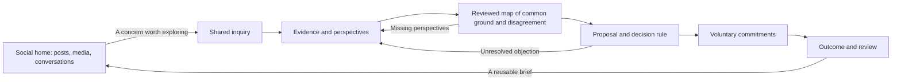
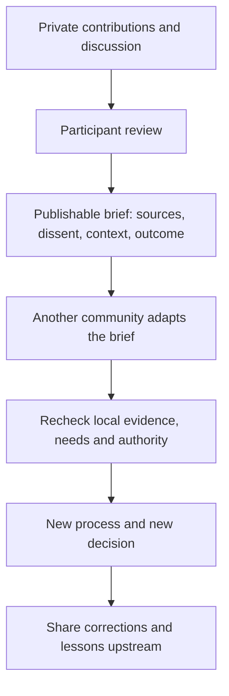
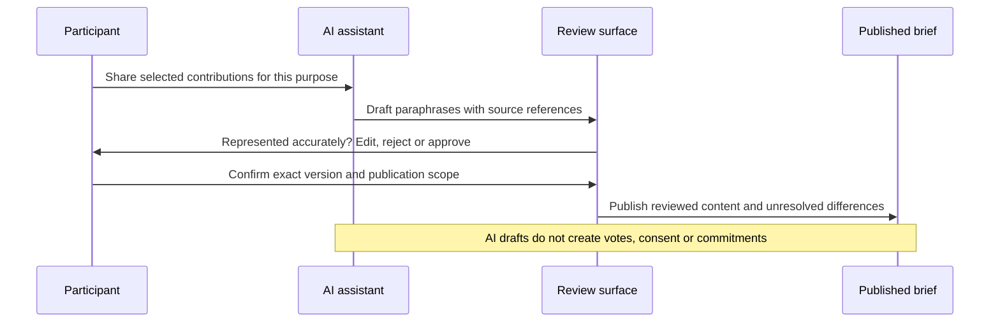

# From attention to shared agency

> [!TIP]
> Build a place where people can turn a concern into shared understanding, a proposal, and a voluntary next step. Start with one complete conversation-to-action cycle. Keep the social network and the deliberation tools connected through portable records, without making either wait for the other.

**An exploration for Chris and Nikki · November 6, 2026.** [Read the illustrated website](web/0502/index.html). This is a synthesis and design proposal, not a product announcement or a record of unanimous agreement.

The primary source is the November 6 Granola conversation titled [Nicki](https://notes.granola.ai/d/37fc3f25-f26e-4b5c-8ed7-df8d07a2e4a0). Its fourteen transcript chunks were read, with timestamps used below. Nikki is the spelling used in this conversation with the assistant. Personal check-in details are kept out of this shareable synthesis; their design implications—pace, trust, boundaries, and feeling received—remain. No raw transcript is embedded in the website.

The review date is a chance to decide whether to prototype after Chris and Nikki have corrected this interpretation and tried a simple facilitated session. It is not a shipping deadline. No permanent protocol, product name, or business model is being adopted here.

## 1. The question underneath the product

People can recognize the same problem, care about one another, and still struggle to act together. A stream makes it easy to express a reaction. A chat makes it possible to discuss it. Neither necessarily helps a group retain what it learned, discover what remains contested, or organize what happens next.

The conversation repeatedly returned to this gap. At 25:33–28:37, Nikki described a place where a concern could become constructive dialogue and then a decision or action. At 50:12–55:26, the discussion turned to people with similar hopes who still cannot find a workable mechanism for coordinating. At 69:19–70:58, the test became whether anything actually follows the discourse.

The product question is therefore: **what would help a person leave a conversation with more understanding, more choice, and a next step they can genuinely consent to?**

This is a hypothesis about useful software. It does not establish that everyone agrees about a problem, that agreement causes action, or that one platform can reconcile every conflict.

## 2. What the conversation adds

| Thread in the conversation                                                                         | Design implication                                                           | Still unresolved                                                          |
| -------------------------------------------------------------------------------------------------- | ---------------------------------------------------------------------------- | ------------------------------------------------------------------------- |
| A slower, less judgmental exchange made room to think. Opening check-in, 0:00–15:37.               | Let people pause, return later, and correct how their words are represented. | How to carry that quality into a busy public space.                       |
| The underlying incentives matter. 18:12–24:42.                                                     | Let users inspect and choose the feed; evaluate benefit beyond time spent.   | How to fund and govern the service without recreating attention pressure. |
| An alternative social platform and a collective-action tool are related but distinct. 26:42–28:37. | Build two connected surfaces with a small common data contract.              | Which surface earns regular use first.                                    |
| Positions can conceal shared interests or needs. 37:21–39:01.                                      | Offer an optional way to explain what a position protects.                   | Whether the extra structure helps or feels intrusive.                     |
| The experience must be attractive and enjoyable. 31:04–33:12; 40:22–41:19.                         | Make understanding and contribution satisfying, with clear stopping points.  | How to avoid rewarding conformity or compulsive checking.                 |
| Another community should be able to reuse what a group learned. 33:46–35:38.                       | Publish a portable brief with evidence, uncertainty, and local context.      | What can transfer across places without misleading people.                |
| A gift shelf made giving possible by giving it a place. 57:29–59:29.                               | Make offers, needs, and acceptance concrete.                                 | How to sustain care work and handle unequal capacity.                     |
| Try something useful for two people, then a few more. 64:21–68:54.                                 | Validate the interaction in a small circle before a larger pilot.            | What changes when participation becomes public and contested.             |

These are paraphrases of the conversation. The feature choices below are proposals derived from them, not commitments made by either participant.

## 3. Two projects, one relationship

**The social home** helps people discover ideas, share media, talk, and build relationships. **The shared inquiry** gives a particular question a beginning, a process, and a traceable outcome. A conversation can invite people into an inquiry; an inquiry can return a useful brief or a project to the community.

Neither surface has to consume the other. The social home can remain playful and open-ended. An inquiry should not require every casual conversation to become a formal process. Equally, a group should be able to run an inquiry from a shared browser link without migrating its whole social life.

Earlier exploration [0501](0501_[_]_COLLECTIVE_SENSEMAKING_AT_COMMUNITY_SCALE.md) considered large-community deliberation. This document adds a more intimate entry point and a clearer connection to action. The destination remains large communities and civic coordination; a seven-person pilot tests usefulness, not democratic legitimacy or representativeness.

Polis came up in the call as prior art. Choosing or integrating Polis is not part of this proposal. Community Archive is also a separate integration: archived public posts may supply source material, but never count as participation, consent, or current votes.

## 4. Go beneath positions without reading people’s minds

Nikki's mediation insight is useful because two people can oppose the same proposal for different reasons, or support different proposals to protect something they both value. Sometimes their values also differ. The interface should help discover this rather than assume harmony is hiding underneath every dispute.

Start with a simple contribution. Offer optional prompts:

- What are you proposing or concerned about?
- What matters to you here?
- What experience or evidence informs this?
- What would change your mind, or make this safe enough to try?

A person can answer one question, all four, or none. An AI may suggest a paraphrase or a possible relationship between contributions, but the person must be able to accept, edit, or reject it. **An inferred need is a draft, not a fact about its author.**

The Center for Nonviolent Communication describes honest expression, empathic listening, attention to needs, and requests that can be declined. That offers a useful design reference; it is not evidence that adding four fields to an app will resolve conflict. [CNVC principles and process](https://www.cnvc.org/about/purpose-of-nvc)

**Illustrative example, not a real consultation:** a community is considering a large computing facility. One contribution asks for investment; another asks for limits on resource use. People might identify livelihoods, reliable services, environmental care, and local control as relevant concerns. Whether those concerns are shared must be asked. Claims about jobs, water, energy, and local rules need actual evidence specific to the place.

The interface should distinguish a lived experience, a factual claim, a value, and a proposal. A citation can support a claim; it cannot prove what a community ought to value. Popularity cannot substitute for either.

## 5. Make the map explain itself

A cloud of dots can look authoritative while telling someone very little. The first view should be a readable account of the question:

1. **What people are trying to protect.** Participant-confirmed concerns, not hidden psychological profiles.
2. **Where responses overlap.** Exact statements, response options, counts, and the denominator.
3. **What remains contested.** Specific objections, tradeoffs, and alternative proposals.
4. **What we do not know.** Missing evidence and missing perspectives.
5. **What could happen next.** A small reversible experiment, a request for a decision, or an explicit pause.

A visual map can sit beside this account. Selecting a connection should reveal the contributions and method behind it. The same information needs a list or table alternative, keyboard access, and descriptions that do not rely on color.

Do not label opinion clusters as permanent kinds of people. Do not turn a participant's position on one question into a general trust score. If an analysis changes when its method or sample changes, that uncertainty belongs in the report.

> [!IMPORTANT]
> **Common ground is not a mandate.** Silence is not agreement. Agreement is not a commitment to do the work. A consultation result is not an election or a binding public decision.

## 6. The gift shelf is a product clue

_AI-generated conceptual illustration; not a photograph of Nikki's home._

Nikki's gift-shelf example is the most concrete product lesson in the call. The shelf made a useful behavior visible and easy. It created somewhere to offer and receive without requiring a complete theory of a new economy first.

A digital equivalent could attach a small **offers and needs** area to a proposal:

| Offer or need                        | Useful structure                                            |
| ------------------------------------ | ----------------------------------------------------------- |
| I can help review the evidence.      | Scope, available time, audience, expiry.                    |
| We need an accessible meeting space. | Location, requirements, who can respond.                    |
| I can host one session.              | A bounded offer that can be accepted or withdrawn.          |
| This work needs ongoing support.     | Visible workload and a named conversation about resourcing. |

An offer is not a task assignment. Acceptance should create a separate agreement between the people involved. A missed commitment invites clarification, not a public shame score. Contributing money or bandwidth must not buy extra weight in a community's deliberation.

This makes the open-source metaphor more concrete: share a usable pattern, preserve its history, and let another group adapt it. The goal is not to force every social relationship into a project-management system.

## 7. Delight that preserves choice

The conversation's desire for something nourishing should become testable interaction choices, rather than a claim that software treats or regulates a nervous system.

| Design choice                                                     | Intended benefit                                 | Failure to watch for                                       |
| ----------------------------------------------------------------- | ------------------------------------------------ | ---------------------------------------------------------- |
| A small confirmation when someone says a summary represents them. | Feeling understood.                              | Pressuring people to accept a tidy summary.                |
| An animated connection between two confirmed concerns.            | Making a relationship legible.                   | Suggesting that overlap resolves the disagreement.         |
| A finite reading queue and an obvious stopping point.             | Making participation manageable.                 | Hiding important late contributions.                       |
| User-chosen digests and quiet hours.                              | Supporting return without constant interruption. | Facilitators mistaking quiet people for disengaged people. |
| Thanks for a correction or a useful objection.                    | Valuing clarity as well as agreement.            | Turning helpfulness into a popularity contest.             |

Avoid agreement streaks, public harmony leaderboards, urgency manufactured by notifications, and rewards tied to ideological alignment. People must be able to disagree, decline, or leave without being framed as the problem. Reduced motion, muted sound by default, and a readable text view are part of the design.

## 8. Knowledge another community can use

Nikki imagined a group learning from another group's work instead of starting over. The reusable object should be a **community brief**, not just a transcript or a triumphant summary.

It would carry the question; scope and place; dates; who participated and who was missing; supporting and conflicting sources; proposals considered; unresolved objections; the decision rule and responsible authority, if any; actions attempted; and what happened afterward. Private contributions stay out unless their authors specifically approve publication.

Reusing the brief never transfers the original participants' votes, consent, or authority to the new group. Evidence that depended on local law or conditions needs review. Sharing the pattern should preserve the ability to disagree with the original conclusion.

This is where the earlier xNet essays become practical. [Data as soil](https://xnet.fyi/blog/data-should-work-like-soil) suggests knowledge that can support later uses. [Clutch Power](https://xnet.fyi/blog/clutch-power) suggests interfaces that connect and can also come apart. [An Internet We Can Change](../../site/src/pages/blog/an-internet-we-can-change.astro) brings those ideas back to friends shaping the tools they live with. These are design influences, not proof that the current prototype implements their full architecture.

## 9. Prior art worth borrowing

| Reference                                                                                          | What it contributes                                                                                         | What it does not establish                                                                                  |
| -------------------------------------------------------------------------------------------------- | ----------------------------------------------------------------------------------------------------------- | ----------------------------------------------------------------------------------------------------------- |
| [vTaiwan](https://info.vtaiwan.tw/)                                                                | Online consultation linked to stakeholder engagement and facilitated offline discussion.                    | A visualization alone can make decisions legitimate. Its overview includes historical, self-reported cases. |
| [Loomio proposals](https://www.loomio.com/docs/en/user_manual/polls/proposals)                     | Different response structures for advice, sense checks, consent, and consensus; an explicit outcome record. | Every group should use the same decision rule.                                                              |
| [Decidim accountability](https://docs.decidim.org/en/develop/admin/components/accountability.html) | Tracking the implementation of proposals through results, milestones, and change history.                   | Publishing a progress indicator guarantees delivery.                                                        |
| [CNVC](https://www.cnvc.org/learn/what-is-nvc)                                                     | A vocabulary for distinguishing needs and requests from judgments.                                          | Software can infer a person's inner life or replace a facilitator.                                          |
| [Ink & Switch: Malleable Software](https://www.inkandswitch.com/essay/malleable-software/)         | Software that people can adapt to the work and communities around them.                                     | Generated modifications are safe without review and access controls.                                        |

These references support separable parts of the design. None validates the complete proposed product. Nikki also mentioned a list of coordination tools in Obsidian/Telegram around 71:12–72:36; that list was not supplied here and has not been reviewed.

## 10. Start small; design for a larger public

The smallest useful experience is one complete cycle: bring in a concern, contribute, review the map, choose a bounded next step, and return to see what happened. Use two people for correcting the basic model, then five to seven for a facilitated usability trial. Neither trial can establish broad public agreement.

For a larger process, the organizer must publish its purpose, participant eligibility, recruitment, moderation rules, authority, and intended use of results. A public invitation produces a self-selected group; label findings accordingly. Device keys and social logins are useful authentication tools, not proof of one human or a representative population.

Separate public pseudonyms from any private eligibility checks. Prefer collecting the least identifying information the process needs. Use rate limits, abuse review, and scoped membership, and make disputed exclusions appealable. Trust invitations can help a small group but can also exclude outsiders and affected people.

Broad participation needs language access, low-bandwidth pages, keyboard and screen-reader access, asynchronous contribution, and a way to include people who cannot install the desktop app. A browser participation route would be a deliberate exception to earlier installation/seeding ideas, not an assumed change to today's prototype. Contributing infrastructure and having a civic voice are different relationships.

At community or political scale, include a human facilitator and a named recipient for the outcome. If no institution has agreed to respond, say so. A voluntary action group can still be valuable without pretending to speak for an entire town or constituency.

## 11. Where AI belongs

AI can help people read a large conversation, notice duplicated ideas, draft a brief, suggest missing questions, and compare proposal versions. It should work on explicitly selected material and leave a trace back to the sources.

A source link must point to material the reader can access; a restricted source needs a visible access limitation. Track who approved a summary, the underlying contribution versions, the model/run, and later corrections. Private needs or feelings should not quietly become recommendation features.

Do not have agents impersonate absent people, infer votes from archived tweets, optimize persuasion for a participant's vulnerabilities, or send commitments on someone's behalf. Model output is a proposed interpretation. Participants and the process's legitimate decision makers retain authority.

## 12. What xNet already provides—and what it does not

The current relevant code is the independent [Rust/Tauri experiment](../../experiments/community-network/README.md), not the older Electron application. Repository inspection on November 6 found:

| Area                                  | Current state                                                                                                                         | Relevance                                                                                                 |
| ------------------------------------- | ------------------------------------------------------------------------------------------------------------------------------------- | --------------------------------------------------------------------------------------------------------- |
| Desktop and local storage             | 🧪 Tauri shell, Rust services, SQLite, device identities.                                                                             | A place to keep a local working copy and render an inquiry.                                               |
| Public feed                           | 🧪 Signed short posts, search, reply threads in [PublicFeed.tsx](../../experiments/community-network/apps/desktop/ui/PublicFeed.tsx). | Entry points into questions; no external archive adapter or large local index yet.                        |
| Group conversation                    | 🧪 Owner-hosted rooms and encrypted peer transport.                                                                                   | An initial discussion surface; not end-to-end encryption with forward secrecy or leaderless offline sync. |
| Moderation                            | 🧪 Personal filters, room roles, scoped decisions and appeals.                                                                        | Useful foundations for participation boundaries, not a staffed public service.                            |
| Transport and registry                | 🧪 Direct Iroh and a bounded metadata/public-post registry.                                                                           | No verified wide-area scaling, production relay, or large deliberation deployment.                        |
| Inquiry records and review            | ⬜ Not implemented.                                                                                                                   | Needs explicit statements, proposal versions, source links, review, and outcomes.                         |
| AI facilitation and civic eligibility | ⬜ Not implemented in this experiment.                                                                                                | Earlier agent work is not automatically inherited by the new application.                                 |

The smallest implementation can use SQLite tables for inquiries, contribution versions, source references, approvals, proposals, offers, commitments, and outcomes. Keep recorded responses attached to the exact proposal version. Use ordinary transactions for accepted changes; reserve CRDTs for a demonstrated collaborative-editing need.

For large inquiries, an available coordinator service can receive submissions and maintain the authoritative process record. Participants can retain and export authorized copies. Peer transport can help distribute public briefs, but cannot by itself determine who is eligible or when a decision is final. This is a proposed architecture, not an existing wire protocol.

## 13. Three possible first products

| Option                                   | Immediate value                                                   | Cost and limitation                                                                      | Recommendation                                            |
| ---------------------------------------- | ----------------------------------------------------------------- | ---------------------------------------------------------------------------------------- | --------------------------------------------------------- |
| A. Conversation reflection               | A reviewed map of one conversation, with sources and corrections. | Easy to demonstrate; may stop at attractive summaries.                                   | Use as the first interaction inside B.                    |
| B. A question with follow-through        | A reviewable inquiry, a proposal, bounded offers, and an outcome. | Requires facilitation and an explicit process, but tests the missing link to action.     | **Recommended first product slice.**                      |
| C. A complete alternative social network | Discovery, media, chat, custom feeds, and inquiries in one home.  | Broad operational and adoption burden; can postpone learning about the core interaction. | Continue as a related platform track, not a prerequisite. |

Start with **B**, using **A** to make the experience useful quickly. Let **C** host and discover these inquiries over time. This is a scope recommendation, not a request to stop the existing network prototype.

No new revenue lane is selected here. Operating costs and facilitation labor still need an honest owner and budget. A later funding proposal should be tested against the repository's [charter](../CHARTER.md), including the ability to leave with one's work and the effect of the provider disappearing.

## 14. A first experiment we can learn from

Use an actual question Chris and Nikki care about; the AI discussion suggested in the call is one candidate, not a predetermined campaign. Choose a bounded question and explicitly state whether the session is exploratory, advisory, or making a decision within the group's own authority.

**Session one:** participants contribute a position and optionally explain what matters to them. A facilitator or AI drafts a map. Each person can correct their representation, including rejecting the map entirely.

**Session two:** people examine missing perspectives and evidence, then form one reversible proposal. Record objections and unresolved questions. Anyone who wants to contribute offers a limited amount of time, a resource, or a task; acceptance is explicit.

**Follow-up:** return at a date the group chooses. Record what happened, what was harder than expected, who carried the work, and whether to continue, revise, or stop. Publish a brief only with the agreed audience and reviewed material.

Success is not a high agreement percentage or long session time. Ask whether participants can explain the live disagreement accurately, recognize their own view in the record, locate the evidence, decline safely, and identify a feasible next step. At follow-up, ask what actually happened and whether participation was worth their time.

Questions that could change the recommendation

- Does an explicit needs layer help, or does it feel like compulsory therapy?
- Does seeing other people's responses change a participant's answer through understanding, pressure, or both?
- Can a facilitator describe a principled disagreement without treating it as a defect to remove?
- Would a reusable brief save another group work after accounting for local differences?
- Does a small offer lead to shared work, or does a few people's unpaid labor carry the experience?
- Is a good facilitated document enough? If so, improve that before building a network around it.
- What authority or institutional relationship is missing when a large group wants political action?

### Proposed implementation checklist

- [ ] Review this synthesis with Chris and Nikki; record corrections and choose one question.
- [ ] Prototype contribution, optional concerns, exact-version review, and a readable map.
- [ ] Add source references, explicit uncertainty, and visible unresolved objections.
- [ ] Add one proposal with a declared decision rule and an explicit no-decision outcome.
- [ ] Add bounded offers, separate acceptance, and a follow-up outcome record.
- [ ] Export a brief with provenance, context, publication scope, and revision history.
- [ ] Decide whether a browser entry route is part of the pilot; keep participation separate from hosting.
- [ ] Run the small facilitated trial before choosing a large-group analysis engine or public deployment.

### Proposed validation checklist

- [ ] Every participant can correct or reject an AI paraphrase without losing their original contribution.
- [ ] A minority objection remains visible in the map and the export.
- [ ] Changed proposal wording requires a new response; abstention is never counted as support.
- [ ] An offer never becomes a commitment without the offerer's acceptance of the exact scope.
- [ ] Private source material cannot enter a public brief through AI generation or export.
- [ ] Keyboard, screen-reader, narrow-screen, and reduced-motion use all preserve the process.
- [ ] A duplicate identity, replayed action, unauthorized participant, and abusive submission are handled explicitly.
- [ ] The group records an outcome at follow-up, including failure or a decision to stop.
- [ ] A second group can reuse a brief while retaining its own context, decision rule, and dissent.

## 15. Source notes and next conversation

The [Granola conversation](https://notes.granola.ai/d/37fc3f25-f26e-4b5c-8ed7-df8d07a2e4a0) is the source for the themes and timestamped paraphrases. The website's concept walkthrough contains invented example content, not participant responses or measured consensus. External references were checked November 6, 2026. The source discussion contains broad claims about attention, technology, health, and politics; this document treats them as motivations and questions, not established clinical, scientific, or legal findings.

The next useful conversation is concrete: **which question would be worth trying this with, what would a helpful result look like, and what is each person willing to try before meeting again?** A good first artifact may be a conversation people can recognize themselves in, and one small piece of shared work that would not otherwise have happened.
