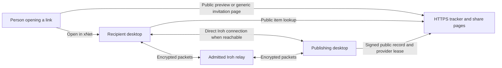

# A public tracker and relay for xNet

> [!TIP]
> Give Nikki one HTTPS link. For public media it opens a preview that can find a willing host. For a private chat it opens a generic invitation page and lets her app ask the owner to join. Start with the Rust registry we already have and a separately budgeted Iroh relay. The first milestone is an invitation that works between home Wi-Fi and a phone hotspot.

## What happens when someone opens a link?

| Link | In the browser | In the desktop app |
| --- | --- | --- |
| Public video or music | Show the publisher, title, media type, and an **Open in xNet** button. A preview remains useful after the last host signs off. | Resolve a few recent providers. Ask one for the manifest and content, verify the signed record and chunk hashes, and retry another eligible host if the first disappears. |
| Private room | Show **Open invitation** and an install option. Keep the room name, members and secret off the public page. Someone who installs can reopen the same link or paste it in the app. | Show who is inviting the recipient when that identity is verified. Ask before joining. The owner admits the authenticated device, applies any approval rule, or returns a pending state. |
| Private recording shared with a group | Use the same generic landing page. Ordinary link-preview crawlers get no title or thumbnail. | Present the recipient’s grant before disclosing providers. The serving device checks access again before sending bytes. This requires a new private-media path. |

Use a stable, operator-owned HTTPS origin, for example `share.xnet.fyi`. Keep the existing public paths such as `/watch/<id>`, including for music. Give private links a path such as `/join#<ticket>`. A URL fragment stays out of the HTTP request but is readable by page code and by whoever receives the full link. Keep the page first-party, omit analytics and third-party scripts, avoid logging the full URL on desktop, and have **Open in xNet** pass the ticket only after a click. Keep manual paste for fresh installations. Verify both cold launch and delivery into an already running app on each OS. [URI fragment semantics](https://www.rfc-editor.org/rfc/rfc3986#section-3.5) · [Tauri deep linking](https://v2.tauri.app/plugin/deep-linking/)

## What already works?

| Component | Observed in the prototype | Design consequence |
| --- | --- | --- |
| Rust registry | Axum and SQLite already serve catalog, item and announcement routes. Announcements verify the publisher signature and provider signature. The provider table keys each offer by item and peer. [Registry](../../experiments/community-network/crates/network/src/registry.rs) · [Record and announcement types](../../experiments/community-network/crates/network/src/model.rs) | Extend this service and keep existing public records and links readable. |
| Provider refresh | Every minute each active desktop sends a fresh announcement for each published record it still offers, with a 180-second lease. The endpoint address and full signed record travel on each renewal. A desktop verifies a full copy before offering to seed it. [Peer implementation](../../experiments/community-network/crates/network/src/peer.rs) | A lease is a recent claim of availability. Only a successful fetch proves a peer is reachable now. |
| Tauri invites | The default URL uses loopback. The UI requires a matching registry origin. The private ticket contains the room, owner endpoint address and a bearer secret. The owner checks the joining device. The browser registry presently handles public paths. [Desktop startup](../../experiments/community-network/apps/desktop/src-tauri/src/main.rs) · [Link handler](../../experiments/community-network/apps/desktop/ui/main.tsx) · [Browser page](../../experiments/community-network/web/registry.js) | Ship the real default origin, an installed-app handoff and relay-capable peer addresses together. Preserve old local invitations in their existing profile. |
| Relay | The older Electron experiment already packaged upstream Iroh behind an invitation-gated gateway with persistent quotas. On November 11, the deployed health endpoint returned HTTP 200 and reported invite-only access. Its capabilities endpoint returned 404. Tauri uses Iroh’s Minimal preset with no configured relay. [Relay deployment and limits](../../deploy/iroh-relay/README.md) · [Tauri beta evidence](../../experiments/community-network/VERIFICATION.md) | Reuse the relay work. Verify admission and a forced relay message with the packaged Tauri client before advertising WAN support. A healthy process alone cannot prove either. |

## What the hub needs to know

The tracker answers **“Who recently offered this public item?”** The relay answers **“Can these two endpoints exchange encrypted packets?”** Running both under one operator gives friends a single setup step. Separate processes, origins and resource limits let an operator add relay capacity without moving the catalog.

**Public inventory.** Store the signed public catalog record durably. Store the time-limited association between content, an opted-in provider key, and its allowed dial information separately. On publish, send the record once. On renewal, send a signed bounded batch of item IDs with the provider’s current endpoint reference, expiry and version. Authorize updates per provider and preserve the original signed record. Reject stale updates and replays that would undo a withdrawal. Apply inventory deltas idempotently and require periodic reconciliation so a device that stopped sharing one file cannot accidentally keep its old offer alive. Preserve the current per-item lease contract until both client versions have been exercised together.

Return a small, rotating set of eligible candidates, for example four, with an expiry. Filter paused, expired and restricted entries. Avoid listing private interface addresses in a public directory. Publish an explicitly opted-in public route or an endpoint ID and relay address, then let Iroh negotiate a direct path. Race a bounded number of candidates and back off after failures. If all copies go offline, the public page can still say **No hosts available**. Distinguish a confirmed empty result from a failed tracker request. BitTorrent’s announce/reply exchange is a useful precedent for returning peers; xNet also needs signed publishers, policy and recipient authorization. [BitTorrent protocol](https://www.bittorrent.org/beps/bep_0003.html) · [Iroh connection paths](https://www.iroh.computer/blog/iroh-on-QUIC-multipath)

**Private routing.** For the friends beta, put the owner endpoint and an approved relay hint in the invitation. The app can contact that endpoint without asking a public tracker whether the room exists. The owner checks the invitation and current membership, including removal and approval rules. For an owner-created share link, prefer a fresh, expiring, revocable invitation. A link anyone may redeem and a grant bound to Nikki’s device are different sharing options. A first-time guest can request approval before the owner binds access to her newly created key. Someone who lacks membership cannot fetch private history or file contents.

Give the owner a stable device key and an admitted home relay. A recipient can reach that key through the relay after an IP change, and Iroh can upgrade to a direct connection when it finds one. Treat addresses embedded at invitation time as hints. If the home relay changes too, accept a short-lived replacement route signed by the owner through an invitation-scoped rendezvous, or ask the owner to share a fresh link. A public redirect must never be able to substitute a different owner key.

Add a private provider directory when a second authorized device must serve a recording while the owner is away. Give a recipient a random lookup handle and an owner-signed, expiring grant scoped to that handle, the recipient device and a read operation. Require proof of device-key possession. The directory checks scope and revocation before returning an eligible host, and gives the same public-facing answer for an unknown handle and an unauthorized request. The host independently enforces the grant and verifies its current permission version before transfer. Use fresh authorization for resumed transfers and bound how long a running transfer can continue on an old grant. If the authority is unreachable, choose explicitly between failing closed and a published maximum revocation delay. Previously received copies remain with their recipients. Start with owner-only serving while private replication and revocation are untested.

Keep private recordings out of the public chunk handler and the public content-hash index, including when the exact same bytes occur in both settings. If volunteers may host a private recording without being allowed to view it, encrypt it before replication and deliver its decryption key only to authorized readers. An encrypted transport by itself still gives the storage host plaintext.

**The connection graph.** Offer two distinct views. A device can show its owner the peers it is currently transferring to or from and the route it is using. A community status page can show aggregate active hosts, public items with recent offers, sampled direct/relayed transfer rates and relay load. Opt in to aggregate client reports, since the hub cannot observe every direct transfer. A global history of who talks to whom adds little routing value and exposes private relationships. Relays still observe endpoint connections, timing and volume. Minimize retention and keep raw identifiers, search queries, tickets and content IDs out of metrics labels. Public offers necessarily reveal that a willing peer hosts an item.

## A small deployment that can grow

Begin with one Rust tracker using Axum, Tokio and SQLite in WAL mode on a persistent local disk. Serve the landing assets through a cache. Cache public metadata briefly with invalidation for moderation, and fetch provider availability separately. Signed private requests and lookup results use private, non-stored responses. Operate an upstream Iroh relay as a second service with its own queues and egress allowance. The existing TypeScript/Node gateway can continue handling relay admission where it already enforces quotas. Both processes can run on one small VM for the pilot or on separate hosts. One VM shares a failure domain.

| Design choice | When it earns its cost |
| --- | --- |
| Existing Rust registry and SQLite | Available today, one deployable application, shared signature and validation code with Tauri. Use a bounded writer queue or blocking DB worker, short transactions and indexed lookups. A synchronous SQLite call made while holding the current store mutex can hold up other requests. |
| TypeScript tracker | Sensible for an operator whose team knows Node and has an existing service stack. It would require porting or binding the Rust validation and moderation rules. The current evidence points first to database work and repeated announcements. We have no Rust-versus-TypeScript throughput comparison for this workload. |
| PostgreSQL with additional API instances | Introduce when a measured single writer misses the lookup/renewal objectives, or when maintenance must allow uninterrupted writes. Partition or shard provider records only when a measured workload justifies it. Multiple replicas must enforce shared revocations and relay admission budgets consistently. |
| Independent community trackers | Let links identify their issuing origin. Federate signed public records and opted-in public offers with expiry, provenance and local moderation. Keep invitations and private grants scoped to their issuer. Require explicit trust when opening links from a new operator. |

Protect interactive lookups from bulk announcements and searches. Set body and batch limits, per-device and aggregate quotas, bounded queues and backoff with jitter. Do public search with an index such as SQLite FTS5 once substring scans show up in traces. Avoid sending chunk manifests in search results. In the existing handler, at 64 provider rows even an existing provider renewal can hit the cap. Renewals should succeed at capacity, while registration of a new provider follows a defined replacement rule. Move catalog inserts and lease changes that must agree into one transaction. [SQLite WAL and its single-writer constraint](https://www.sqlite.org/wal.html) · [SQLite FTS5](https://www.sqlite.org/fts5.html)

Back up the signed catalog, moderation state, durable grants/revocations and service identity together. Test a restore, including whether withdrawn grants can reappear from an old backup. Keep sensitive signing material protected separately from public data. Provider presence can be rebuilt by renewals. After an outage, return availability as unknown until peers check in again. Existing direct private chats can continue while their owner is reachable. Current public playback also depends on a fresh moderation policy, so a registry outage can stop new public transfers. An offline room owner still needs an authorized replica or mailbox for offline delivery, which is a separate feature.

## Where performance and money go

In a local SQL microbenchmark I populated the existing provider table shape with 10,000 public items and ten peers each. A warm lookup for ten peers had a p95 of **0.011 ms**. The existing cleanup query, run on every announcement, took **7.219 ms p95** even when nothing had expired. With an index on expiry, the same cleanup took **0.003 ms p95**. Move cleanup out of the hot path, index expiry and delete in bounded batches. Measure the full HTTP service under simultaneous reads and renewals before choosing a larger database.

SQL measurement conditions

Apple silicon Mac, Python sqlite3 with SQLite 3.45.1, temporary file in WAL mode, one connection, no competing traffic. Rows had 64-character item and peer IDs and a short placeholder address. Timed the current provider lookup with limit 64 over 250 warm randomly selected items, and 100 warm zero-match deletes in autocommit mode per configuration. The query plan changed from a table scan to an indexed range search on expiry. Results exclude network, signature checks, JSON, contention, real expired-row deletions and cloud storage latency.

For planning, **1,000 online desktops × 100 public items ÷ 60 seconds is about 1,667 item announcements per second** with the present client. One signed batch per desktop per minute would average about 17 HTTP requests per second if 100 IDs fit the agreed byte limit. Rewriting all 100,000 leases every minute would still cost database work. Measure rows written separately from request rate. Longer-lived inventory reconciled against a short device heartbeat is a later option if lease writes dominate.

The expensive variable is relayed bytes. At 10,000 plays of 100 MB each, viewers receive roughly 1 TB. If 10% of those bytes traverse our relay, that is about 100 GB outbound before overhead. At Railway’s listed $0.05 per GB, the media egress alone is about **$5**, or **$50** if it all traverses the relay. Add compute, persistent storage, backups, other traffic and the plan minimum. A tracker may fit a small budget. A successful video with unrestricted fallback can spend it quickly. [Railway pricing](https://docs.railway.com/pricing/plans)

For the first deployment, reserve the existing quota-limited relay for the friends chat cohort. Its documented 4 KiB/s per-client limit and 64 MiB daily service budget make it unsuitable for streaming video. At a nominal 4 Mbit/s, one minute of video is roughly 30 MB. Allow media over direct connections first and show a clear retry or alternate-host action if no permitted path works. Implement that policy with distinct transport configuration/identities or verify enforceable path controls in the pinned Iroh version, including path changes during a transfer. A relay forwarding encrypted packets cannot reliably classify a client’s claim that bytes are “chat.” Enforce hard aggregate and device byte limits at the relay; a separate media relay pool can have a separately funded allowance later. Reserve admission before forwarding so concurrent senders cannot multiply the budget.

The older Railway deployment serves HTTPS/WebSockets and disabled UDP QUIC address discovery. A UDP-capable host is worth testing if the relayed share of bytes is high. Availability and cost goals should be based on the observed path mix across real routers. [Iroh’s QUIC address discovery](https://www.iroh.computer/blog/qad) · [Existing relay limits](../../deploy/iroh-relay/relay.toml)

## First release and decision date

Choose the two-device chat milestone first. It tests the hard dependency behind every share link and is cheap enough to exercise with the current relay. Add public media lookup next. Add private replicated media once there is a concrete reason for another device to answer on the owner’s behalf. Revisit November 25 with a cross-network message trace, a restore result and measured relay bytes. These are proposed acceptance criteria, with the wire formats still open for review.

- [ ] Open a private HTTPS invite on an installed desktop and on a clean install. On home Wi-Fi and a cellular hotspot, join and exchange messages both ways. Repeat with direct UDP unavailable, verify the relayed path from endpoint telemetry, and retry after the owner restarts.
- [ ] Admit a fresh device to the gated relay using the supported admission protocol. Exercise exhausted quota, expired invite, revoked invite, missing owner and pending approval. Keep relay admission and room membership independently revocable.
- [ ] Publish a public video and an audio track, verify their preview links from another network, seed a second copy, turn the publisher off and fetch from the remaining peer. Expire the last lease and verify the public page’s availability message.
- [ ] Load-test 100,000 offers, 100 public lookups/s and the 1,000-desktop renewal workload described above with a bounded batch size. Initial targets on a named single-host configuration are p95 below 100 ms for lookup and 250 ms for accepted renewals. Record CPU, queue depth, WAL growth, failures, renewal lag and results during restart bursts.
- [ ] Stop each service independently, restore a backup, and verify moderation, key continuity, revocations, fresh provider registration and relay-budget behavior after restart. Record recovery time before promising uptime.
- [ ] Before enabling private replicas, test access from a stranger, a removed member, an expired grant, a forwarded invite and a valid recipient. Verify private items and handles stay out of the public catalog, previews, caches and logs.
