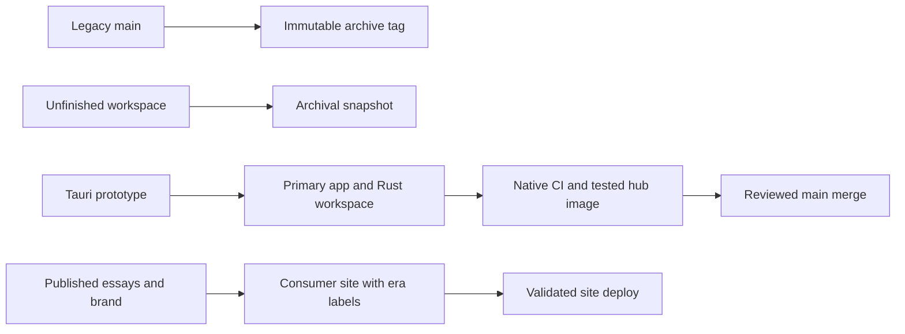

# Primary product migration

This is a repository and website transition, not a wire-format or user-data migration.

- [ ] Verify legacy source snapshots and publish archive refs.
- [x] Promote app, services, extension, and hub without importing local data.
- [x] Preserve every published blog URL and brand asset; retire the developer portal.
- [x] Replace SDK/Electron automation with native, site, and hub checks.
- [ ] Verify local builds, core tests, and native messaging after the move.
- [ ] Pass macOS, Windows, Linux, and hub CI; update required checks.
- [ ] Merge the reviewed transition and verify the deployed consumer site.

Public installer publication and update-feed promotion are separate from this
migration. Existing Windows runtime and signing limitations remain documented.

Railway legacy service `@xnet/hub` was disconnected from the main GitHub source
on November 18. Its deployment and volume remain intact; the new service at
`iroh.xnet.fyi` keeps its independent CLI-staged deployment and persistent volume.
