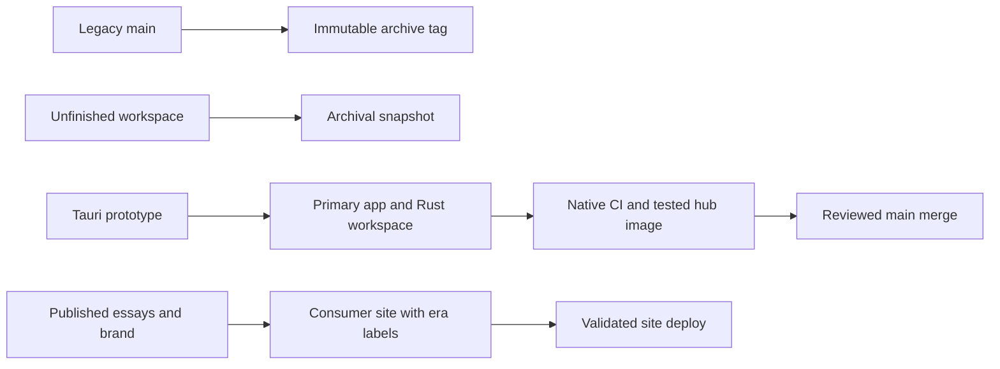

# Primary product migration

This is a repository and website transition, not a wire-format or user-data migration.

- [x] Verify legacy source snapshots and publish archive refs.
- [x] Promote app, services, extension, and hub without importing local data.
- [x] Preserve every published blog URL and brand asset; retire the developer portal.
- [x] Replace SDK/Electron automation with native, site, and hub checks.
- [x] Verify local builds, core tests, and native messaging after the move.
- [ ] Pass macOS, Windows, Linux, and hub CI; update required checks.
- [ ] Merge the reviewed transition and verify the deployed consumer site.

Public installer publication and update-feed promotion are separate from this
migration. Existing Windows runtime and signing limitations remain documented.

Railway legacy service `@xnet/hub` was disconnected from the main GitHub source
on November 18. Its deployment and volume remain intact; the new service at
`iroh.xnet.fyi` keeps its independent CLI-staged deployment and persistent volume.

## Local verification — November 18

- `pnpm lint`, `pnpm build`, and all 11 JavaScript checks passed.
- `cargo test --workspace --locked` passed all 19 Rust checks, including real
  peers, expired permissions, moderation, and replication.
- A native Apple silicon debug bundle built from the new root. Three isolated
  packaged clients exchanged private/group messages, retained identity/history
  across restart, and served member history with the owner offline.
- The static site built 120 pages. Its gate verified all 26 previously published
  essays, 55 unchanged original artwork assets, and archived documentation routes.
- Browser inspection verified the wordmark, essay search, and era/source labels.
- Both repository and site gates passed their in-memory negative controls.
- Gitleaks found no secrets in the archival additions or the staged new tree.
- The archive matches all 237 unfinished source paths; original worktree untouched.

Cross-platform CI and the production site check are still pending. A local Mac
check does not imply Windows or Linux runtime verification.
