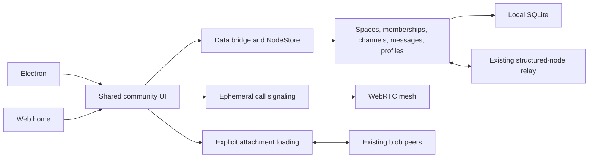

# 0478 — chat-centered application redesign

Status: implemented UX preview; private-community protocol work remains open.
Branch: `codex/chat-first-redesign`. Do not merge without a separate review.

This implements the follow-up request to make conversation the application's
starting point: a minimal black-and-white interface for people, messages,
groups, channels, communities, and organizations. It does not claim completion
of the security checklist in the original private-communities exploration.
The research source is `0478_[_]_PRIVATE_COMMUNITIES_ON_XNET.md` on the
`codex/personal-data-foundation` branch (commit `5d52193c8`).

## The implemented experience

- [x] Share one community shell between desktop and the web home route.
- [x] Create direct messages, groups, communities, organizations, and channels
      using existing schemas; new circles get root Spaces and explicit owner/member edges.
- [x] Persist messages and local drafts; support reply references, removing one's
      own message, chronological history, local search, and shared attachments.
- [x] Add profile names and clearly unverified Bluesky/X profile links.
- [x] Join small voice/video calls through an explicit device-permission step;
      retain calls across conversation navigation and stop tracks on leave.
- [x] Keep old workspace tools reachable, and retain desktop recovery notices,
      Cloud-connect confirmation, document share links, and library capture routing.
- [x] Connect desktop structured-node publishing and shared-room subscriptions.
      Preserve signed change envelopes and defer notifications until state is stored.
- [x] Bound attachment requests; surface peer unavailability instead of a false success.
- [ ] Complete the encrypted membership, key/recovery, admission, revocation,
      history-sharing, and negative-control security work in exploration 0478.
- [ ] Add verified social-account linking and general OAuth/SSO from exploration 0479.
- [ ] Add TURN configuration, multi-network call testing, delivery acknowledgments,
      unread notifications, moderation, and production invitation delivery.

## Architecture

Every visible message is real data. Demo content used during verification lives
only in isolated development profiles. No sample conversations are created for
users. The previous workspace remains a secondary surface to preserve existing
data and features while the new interface grows.

New circles deliberately avoid a parent Space: visual grouping must not
accidentally inherit an organization's access. The current interface represents
requested audiences; the full threat model remains work for 0478. Do not use the
development hub or this preview for sensitive community data.

## Verification and limits

Fresh focused verification on 2026-10-18:

- 29 focused tests: conversation plans and profile URL validation, awareness
  signaling, desktop sync lifecycle, bounded peer-attachment waits, and call
  negotiation (including early ICE and duplicate greetings).
- Seven native desktop storage tests under Electron's Node runtime, including
  remote signed-change replay, notification ordering, and reopening the database.
- Targeted Turbo typecheck completed all 47 scheduled tasks for workbench,
  communications, desktop, and web, including their build dependencies.
- Two separate Electron profiles on one development hub exchanged messages,
  loaded shared history, and transferred an attachment. A reload retained the
  received conversation. This is a transport test, not a private-access audit.
- Two-profile video calling established live remote audio/video tracks. Mute,
  camera toggle, navigation to People, and leave were exercised; retained track
  references reported `ended` after leaving. Media devices were synthetic.

The complete renderer-only TypeScript command also exposes pre-existing errors
in DatabaseView, DocumentHeader, and PluginManager; the normal desktop check
covers the native and spatial projects. Record final verification in the PR.

The shell currently bounds initial lists at 500 channels/spaces/profiles and
2,000 memberships, and message search at 50 results. It is a small-community
preview, not the 100,000-item archive browser. Message history can load older
pages. Global search opens the matching conversation; it does not yet scroll to
an older matching message. Profile names may arrive on room resync because the
existing relay indexes profile changes without broadcasting them live.

Attachments use existing blob storage, not a new encrypted media protocol.
Sending confirms a local save only. Calls use the existing awareness identity
claims, not a new cryptographically bound membership protocol. Social links do
not delegate signing keys. No new public wire format or irreversible identity
migration is accepted by this PR.

## Manual review

Run the Electron preview with a unique `XNET_PROFILE` so it never shares the
profile of another worktree. Follow `apps/electron/AGENTS.md` for provenance and
CDP ports. Use two profiles and the same local hub for the cross-user flow.

1. Set each profile's display name and copy its public xNet identity.
2. Create a group, invite the second identity, and copy the conversation ID.
3. On the second profile, use Settings → Open a shared conversation.
4. Send in both directions, attach a file, open it remotely, and reload.
5. Join a voice/video call from both sides, navigate, mute, and leave.
6. Create a community and a channel; inspect audience and member details.
7. At a narrow viewport, open a conversation and return to the list.
8. Inspect the profile-link disclaimer and the preview privacy notice.

The requested PR remains unmerged. A recorded tour is a local review artifact;
it is not a security or internet-scale performance certification.
