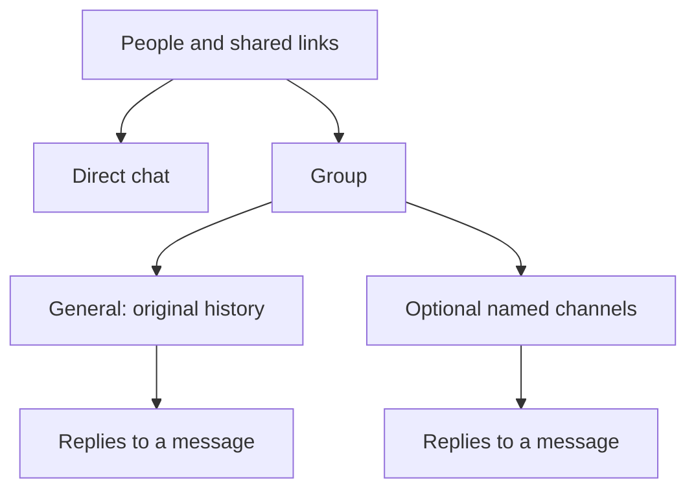

# Chats, channels, threads, and contact links

This local prototype implements the conversation design discussed on 2026-10-23. No commit, push, merge, or production deployment is part of this pass.

A chat is one message history. A direct chat has two participants. A group starts with one chat; adding a channel makes it a community, preserving the original history as General. A thread is a flat set of replies to one message. Channels in this first pass share the group's access and membership; a smaller private audience gets a separate group.

Access presets: invite only, approval required, public. Public viewing and permission to post are distinct. Private history cannot be published by changing a toggle. Signed group manifests authorize each channel; a channel ID or social handle never grants access. Social profiles are discovery hints, not replacements for the pinned xNet identity.

## Implementation

- [x] Extend signed peer groups with access and channels, preserving existing groups.
- [x] Support durable, revocable request links and explicit public reading/joining.
- [x] Unify new chat, invitations, people search, and group details around native peer transport.
- [x] Add channels without moving or republishing the original history.
- [x] Add paginated, virtualized message threads using existing reply relations.
- [x] Integrate social profile discovery with honest verification and connection states.
- [x] Document relay/website compatibility and any remaining rollout requirements.

## Verification

- [x] Exercise signed authorization, cross-channel rejection, link revocation, approval, public read-only access, and restart durability in focused tests.
- [x] Drive multiple actual Electron profiles through creation, invitation, approval, channels, and threads.
- [x] Run affected type checks, lint, production build, and graph update.
- [x] Record evidence and leave the app available for review.

## Evidence and boundaries

[Verification notes and screenshots](../../output/chat-groups-channels/verification.md)
record the two-profile Electron flows, restart delivery, 29 desktop tests and four
relay tests. Desktop/workbench declared typechecks, targeted lint and production
build pass. The separate full renderer check retains four existing errors; it is
not reported as clean.

The hosted relay returned 503 during this pass. Verified app-to-app traffic used
direct connections. The reusable-admission gateway upgrade, invitation website
and packaged OAuth metadata remain local; no production deployment was made.
Bluesky discovery finds an invitation published by a profile, not a verified
global identity binding. Other social services can share links, but do not yet
have handle resolvers. These are rollout boundaries, not completed features.
