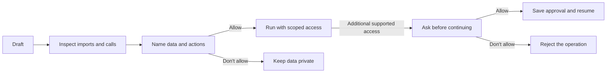

# Extension access flow

Replace the prototype checklist with a host-owned permission request. Source analysis suggests access; only a user's approval grants it. Runtime requests remain bounded by the existing brokers.

- [x] Inspect source without executing it; suggest the smallest useful scope.
- [x] Present named data and actions with Allow / Don't allow. Keep technical details collapsed.
- [x] Pause supported requests for missing permissions, retain the running view, and resume after approval.
- [x] Preserve created tasks and durable limits during permission upgrades. Reject unknown resources and stale approvals.
- [x] Verify the reported to-do extension, refusal, upgrades, revocation, and persistence in Electron; run focused security tests.

Verification: [Electron checks and test results](../../output/extension-access-flow/verification.md).

