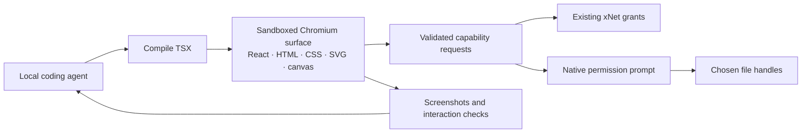

# Real browser extensions with explicit capabilities

Keep this prototype local. No commits, pushes, merges, or deployments.

The browser owns rendering. xNet owns permissions. Generated code and its dependencies are untrusted; an approval grants a narrow operation, never access to Electron IPC or Node.

- [x] Add a separate sandboxed renderer with private ephemeral storage, restrictive network policy, navigation/download/permission blocking, and bounded lifetime.
- [x] Render ordinary React DOM, CSS, SVG and canvas; retain scoped xNet hooks and document access.
- [x] Add opt-in chosen-file read/write/export APIs. Bind handles to the running version, revalidate writes, and revoke on close.
- [x] Embed in the chat preview with trusted controls outside the surface, including stop/revoke.
- [x] Run self-checking against the same renderer with no personal data or native authority.
- [x] Update agent instructions and explain the remaining harness/dependency limitations honestly.
- [x] Test capability denial, forged/cross-session handles, cancellation, navigation/network escape, and teardown; drive the real Electron UI.
- [x] Record verification and the architecture decision with a tripwire.

Evidence and limits: [verification notes](../../output/extension-browser-sandbox/verification.md).
Codex and Claude both generated and visually checked working browser extensions.
The normal user profile remains unverified after the Electron upgrade because macOS
keychain access needs user approval; the saved workspace was left intact. Document
access was checked through the existing broker tests, not a new live editing pass.

No design can promise zero vulnerabilities. This pass must preserve multiple enforcement layers and avoid presenting prompt instructions as isolation. Broad shell access and unrestricted npm lifecycle scripts are not implied by permission to render an extension.
