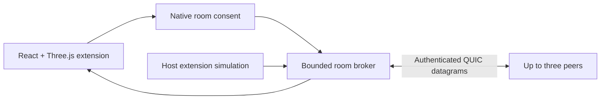

# Multiplayer extension prototype

Local only: no commits, pushes, merges, or deployment.

Start with a four-player, host-authoritative arena using Three.js and Iroh QUIC datagrams. The extension gets a room capability after a native consent prompt, never a socket or arbitrary network access. Invitations authorize participation for one hour and only in the same compiled extension version. Closing the preview revokes its room. No durable chat records carry frame updates.

- [x] Add a version-bound, expiring room protocol and bounded Iroh service; test denial, invalid invitations, frame limits and teardown.
- [x] Wire opt-in room controls into the sandbox, preserve its network isolation, and bundle pinned Three.js.
- [x] Provide a playable arena example with honest connection status, host simulation, client inputs, interpolation and leave controls.
- [x] Teach the local agents the supported API and distinguish visual checks from multiplayer verification.
- [x] Drive two real Electron instances through consent, join, movement, disconnect and revocation; record evidence and limitations.
- [x] Record the architecture decision and user-facing changes; run focused tests, build and graph update.

Host cheating, host migration, public matchmaking, persistent scores, cross-version play and a WebRTC browser adapter are outside this prototype. Direct peers learn network addresses; the native prompt must disclose that approved extension data can be sent to room members. Public relay availability is best-effort, not an uptime promise.

Evidence: [verification notes](../../output/extension-multiplayer/verification.md), including the limits of the same-machine network tests and the existing keychain issue.
