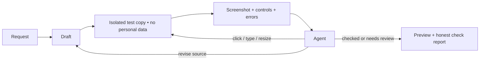

# Extension self-checking

Local prototype. No commits, pushes, merges, or deployment.

- [x] Give the sandbox explicit grid/row layouts and square controls.
- [x] Render test copies in an isolated Electron window using the same host renderer.
- [x] Feed real screenshots, control bounds, and interaction results back to Codex/Claude.
- [x] Bound revisions, actions, runtime, and data access; report incomplete checks honestly.
- [x] Show check progress and results in chat; retain the open draft as explicit edit context.
- [x] Verify tic-tac-toe layout, win/draw/reset, revision recovery, cancellation, and isolation in Electron.

Verified 2026-10-23 in the real Electron app. Evidence and limits: [verification notes](../../output/extension-self-check/verification.md).
