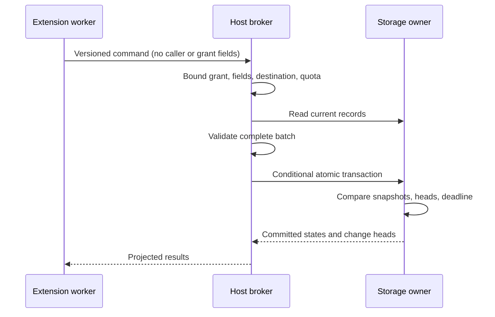

# Scoped chat extensions

The local prototype supports interactive React views over explicitly selected xNet
records. It is an experimental subset of [exploration 0481](../explorations/0481_[-]_THE_FULL_XNET_API_INSIDE_SCOPED_EXTENSIONS.md).
The complete API design is not implemented or independently reviewed.

## Available imports

| Import                                   | Available exports                                                | Authority                                                     |
| ---------------------------------------- | ---------------------------------------------------------------- | ------------------------------------------------------------- |
| `react`, `react/jsx-runtime`             | Pinned React 18 runtime                                          | Worker state, effects, context, JSX                           |
| `@xnetjs/react`, `@xnetjs/react/queries` | `useQuery`, `useMutate`                                          | Scoped DataBridge; no host provider/context                   |
| `@xnetjs/data`                           | `ChannelSchema`, `ChatMessageSchema`, `TaskSchema`, `PageSchema` | Schema definitions only                                       |
| `@xnetjs/extensions/react`               | `useQuery`, `useMutate`, `useDocument`, `useDocumentIds`         | Runtime-only scoped hooks; not a published package            |
| `@xnetjs/extensions/ui`                  | `DocumentView`, `DocumentEditor`                                 | Host-rendered views and separately approved plain-text edits  |
| `@xnetjs/ui`                             | `Badge`, `Button`                                                | Closed host-rendered controls; Button is a restricted adapter |

Other imports fail. New host exports do not automatically become extension APIs.
The [generated inventory](extension-api-inventory.json) classifies runtime exports
from every declared data, React, plugins, SDK, and UI entrypoint, including
Node-only plugin services and stylesheet resources. Extension SDK authors regenerate
it with `node scripts/extensions/inventory.mjs`; `--check` passes only when the
committed inventory matches the current exports. Run `--selftest` to verify that
an export planted only in compiler memory is detected. This is a manual review aid,
not a new CI job or a claim that the listed APIs have all been implemented.

## Data and writes

`useQuery` sees approved conversations and their messages, plus individually
selected personal tasks/pages and approved folders/spaces. Authorization precedes projection and the guest's
filter/sort. It receives only these property fields:

| Schema      | Properties                                            |
| ----------- | ----------------------------------------------------- |
| Task        | `title`, `status`, `completed`, `priority`, `dueDate` |
| Page        | `title`, `icon`                                       |
| Channel     | `name`, `description`                                 |
| ChatMessage | `channel`, `content`, `author`, `createdAt`           |

System IDs, schema IDs, creator, and creation/update times accompany these fields.
Relation targets, attachments, raw timestamps, and store handles are excluded. Page text requires a separate document grant described below. Queries run in the host against approved IDs or conversation predicates before a
page crosses the worker boundary. The default page is 50 records; `limit` or
`page.first` can request 1–100. At most 20 live subscriptions share the worker's
query cache. Only changes to approved selections invalidate those pages.

Use `useQuery(Schema, {where, orderBy, page: {first: 20, after, count: 'none'}})`.
`hasMore` and `pageInfo.endCursor` support forward navigation; omit `after` to
return to the first page. Cursors are opaque, expire after ten minutes, and are
bound to the query and approved host session. Reopening starts new pagination.
Pages are live keyset windows: a row whose sort field changes can move between
pages. Exact totals, nonzero offsets, search and remote sources are unavailable.
`totalCount` is `null`; examples label their counts as records on this page.

The host refreshes query caches and checks current message content before
releasing a page. Concurrent redaction or reparenting fails with a conflict rather
than releasing stale content. Redacted rows never reach the extension. A bounded
scan through redacted rows can fail explicitly rather than report a false empty
result. Each result is limited to 256,000 UTF-8 bytes; request fewer records if it
exceeds that budget.

`useMutate` uses the real hook implementation. The host supports:

- `create(TaskSchema, properties)`: separate creation permission; always private.
- `update(TaskSchema, id, properties)`: separately approved tasks; the five task
  fields above only. Ownership, visibility, relations, and containers cannot change.
- `remove(id)` and `restore(id)`: separate delete/restore permission.
- `mutate(operations)`: at most 20 operations; every operation must pass before any
  change is submitted. A record may appear only once in a batch. The host assigns new task IDs;
  custom/temporary IDs and bulk import are not supported.

Tasks must belong to the current owner and have no space, project, page, canvas,
or parent. A task in a folder also requires approval of that private folder or an
approved ancestor with descendants enabled. Every folder ancestor must remain
private and belong to the current owner. Public/unlisted destinations are refused. These checks deliberately
avoid shared-destination writes; they are not a general audience or E2E-encryption
proof. Community authorization/encryption remains a separate prerequisite.

The storage owner compares the approved structured snapshots and deadline inside
the committing transaction. Raw document-byte guards and databases with active spatial indexes
are refused until they have a compatible conditional path. Undo also checks committed change heads and refuses
to overwrite a later edit. Undo that deletes or restores a task requires the same
explicit delete/restore permission as a direct command.

Approvals now live in device-local storage, bound to owner, conversation, artifact,
and a fresh epoch. Every mutation compares the stored approval in the same atomic
transaction as its record guards. The transaction also writes a receipt containing
host attribution, before/after states, changed fields, and signed change heads.
Retries use an installation/epoch/request identifier and must supply the same
payload. A lost committed response can be recovered without repeating the effect.
Created tasks remain in scope and the last receipt remains available after reopening.
A grant supports up to 1,000 committed commands, then needs a fresh approval.

Revocation persists an inactive approval. Old code and old sessions cannot revive
it. Legacy localStorage grants require fresh approval. Missing policy means no
permission; unreadable or unavailable storage is an error, never an empty grant.
These are device-local guarantees. They do not provide cross-device revocation or
protection against a device owner restoring an old database backup.

## Document access

Select pages and separately approve **reading selected page text**. Up to ten pages
can supply live visible text through `useDocument(pageId)` in
`@xnetjs/extensions/react`. It returns `{nodeId, handle, text, revision, editable, editorText?}`.
Use `useDocumentIds()` to enumerate these exact IDs; a container property query
can return other pages whose text has not been approved.
The host acquires and observes the real xNet document. It checks page ownership,
current grants, and deletion before delivery. Each document is limited to 64 KiB
of visible text, 2,000 visited nodes and 32 levels; the overall dataset limit still
applies. Oversized or unavailable documents fail explicitly.

`<DocumentView handle={document.handle} />` from `@xnetjs/extensions/ui` renders a
host-owned read-only view. Handles are random and session-bound. Embedded records
become a marker; their content is not resolved. URLs, resource attributes, deleted
history, Y.Doc, awareness, editor contexts and persistence methods are not exposed.

### Private page editing

Separately approve **editing selected private page text**, then place
`<DocumentEditor handle={document.handle} />` in the extension layout. The host
owns the textarea, revision check, and Save control. There is no guest document
mutation RPC. Only plain paragraphs are editable: 500 paragraphs and 64,000 UTF-8
bytes. Formatting, attributes, embeds, and other rich structures remain read-only.
A page in a folder also needs that private folder approved; shared and published
destinations are refused.

The save path edits a host-owned clone, then atomically checks the current page,
folder ancestry, approval epoch and local document overlay. It commits a bounded
Yjs overlay, increments the command count, and records attribution in one
conditional transaction. Only an accepted delta reaches the live document.
Concurrent CRDT edits merge; a draft whose live revision changed must reload
before saving. A rejected commit never changes the host document.

Storage merges the durable overlay into reads and subsequent snapshots, so an
older renderer flush cannot erase an accepted edit or bring deleted text back.
The Electron data owner hydrates and broadcasts accepted updates to acquired
views. Closing a view after commit does not undo the save. The device-local overlay
is limited to 128,000 bytes of full Yjs state, including history; exceeding this
budget fails explicitly. Compaction, rich-text editing, shared document writes,
raw update replication and document undo are not implemented. Receipts provide
local attribution, not cryptographic Yjs authorship or remote revocation.

### Folder and space scope

The permission picker supports up to ten folder/space roots and their descendants,
with at most 100 resolved containers, 180 evidence records and 32 ancestor levels.
Queries include future Task/Page records inside those containers and still mask
fields. Page text and all writes require separate exact-record approval.

Private folders require owned, private ancestry. Shared-space reads require a
current role in the selected space or an ancestor. This prototype accepts only
deterministic membership records issued by a space creator or listed owner; it
checks expiry and treats a missing, deleted or invalid edge as no membership.
Space creators can select their own spaces, but another person's records still
require membership. Private records belonging to someone else are excluded.

The broker refreshes membership and ancestry, rechecks records before delivery,
and rejects cached descendants that moved outside the selected root. Its cursors
include selected-container evidence. Changes invalidate affected views; foreground
expiry checks stop the session within the normal 500 ms authority poll. Background
timers may be throttled, and every delivery rechecks expiry. These checks narrow
the existing space policy; they do not broaden core authorization. Private writes
include all relevant container snapshots in the atomic commit. Shared destinations
remain unavailable.

## Runtime and revocation

The host compiles TSX and pins source, compiled code, compiler, and runtime to one
hash. Each new hash needs approval. React mounts in a worker under an opaque-origin
iframe whose CSP blocks network. Remote DOM provides the worker's DOM polyfill;
only validated text/layout/button/text-input snapshots enter the host. No guest
HTML, URL, callback, or arbitrary component property is executed in the host.

Use `<Button onClick={...}>` or `<input value={value}
onInput={event => setValue(event.currentTarget.value)} />`. Catch mutation errors
and display them. Mutation failures preserve `ExtensionAccessError` with a
machine-readable `code`: `denied`, `invalid`, `revoked`, `quota`, `conflict`,
`unsupported`, `cancelled`, `timeout`, or `unavailable`. Unknown host errors are
sanitized; stacks, causes, and host paths never enter this error response. The real
`useQuery` hook currently exposes query failures through its standard `error.message`.

The host permits 20 outstanding calls per port. Every operation has a five-second
deadline, including time queued behind an earlier command. Closing the runtime
cancels pending validation, rejects queued work, and drops late results. A timeout
or cancellation cannot roll back an edit already accepted by storage; its durable
receipt remains recoverable. Refresh before issuing a different request ID.

Hooks can keep state and effects; effects do not confer new
permissions. Complex editors, portals, rich focus behavior, and arbitrary xNet
components have not been verified for this runtime.

Limits: 24,000 source characters, 100,000 compiled characters, 100 selected own records,
20 selected conversations, 100 rows per query page, 256,000 UTF-8 document input bytes, 300 rendered nodes,
12 levels, and 32,000 text characters. Requests are bounded to 16 KiB, 20 operations,
and 200 unique commands per session, with 1,000 committed commands per approval. A foreground heartbeat terminates an
unresponsive worker. Chromium background throttling is not reported as an agent
failure. Workers do not provide a hard heap quota or an OS process boundary.

Revoking access stops admission and data delivery immediately, destroys the worker,
persists revocation, and drains already accepted commits before reporting completion. Foreground sessions poll authority every 500 ms; delivery and commands also recheck it. Background timers may be throttled. It does not undo
committed work. It cannot recall bytes already observed. Closing the panel or
changing source destroys the runtime. New permission approvals never happen in
guest UI, and the worker has no access to the host's saved grants.

## Still unavailable

Raw `useXNet`, `useNodeStore`, host DataBridge, signing keys, Electron IPC, SQL,
filesystem, and sync administration remain host-only. `useNode`, rich document editing,
raw Yjs, assets, database/canvas components, custom schemas/migrations, connectors,
AI calls, durable background jobs, and cross-device delegation still need scoped
implementations. Existing trusted workspace plugin contexts have not been migrated
and must not be exposed to this worker. The expanded boundary still needs an
independent security review before use with sensitive third-party extensions.

## Query performance check

Run `pnpm exec tsx scripts/benchmark-extension-queries.ts` with the native SQLite
module built for Node (`pnpm --filter xnet-desktop run deps:node`). The local
extension runtime performance review consumes this report. It seeds a temporary
100,000-record database, traverses all 250 approved messages without duplicates or
private-channel rows, and reports cold/warm page latency and response bytes. Those
scope and pagination assertions must pass before interpreting timing results.
The script removes its database after the run. This measures the host broker and
native SQLite; it excludes IPC, worker startup, React rendering and encrypted
storage. It is a manual benchmark, not a CI latency gate.
