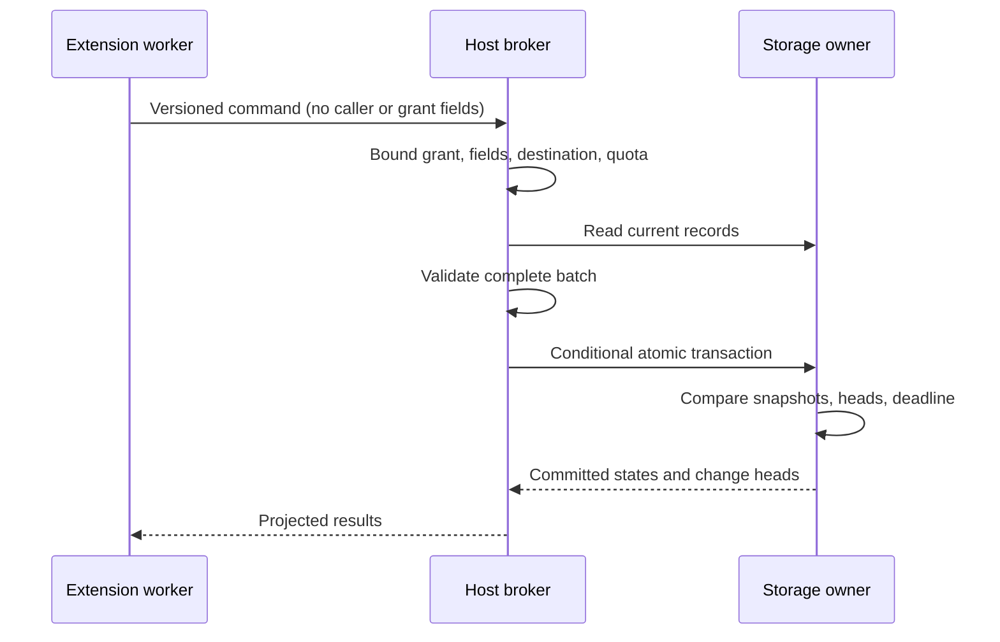

# Scoped chat extensions

The local prototype supports interactive React views over explicitly selected xNet
records. It is an experimental subset of [exploration 0481](../explorations/0481_[-]_THE_FULL_XNET_API_INSIDE_SCOPED_EXTENSIONS.md).
The complete API design is not implemented or independently reviewed.

## Available imports

| Import                                   | Available exports                                                | Authority                                                     |
| ---------------------------------------- | ---------------------------------------------------------------- | ------------------------------------------------------------- |
| `react`, `react/jsx-runtime`             | Pinned React 18 runtime                                          | Worker state, effects, context, JSX                           |
| `@xnetjs/react`, `@xnetjs/react/queries` | `useQuery`, `useMutate`                                          | Scoped DataBridge; no host provider/context                   |
| `@xnetjs/data`                           | `ChannelSchema`, `ChatMessageSchema`, `TaskSchema`, `PageSchema` | Schema definitions only                                       |
| `@xnetjs/extensions/react`               | `useQuery`, `useMutate`, `useDocument`                           | Runtime-only scoped hooks; not a published package            |
| `@xnetjs/extensions/ui`                  | `DocumentView`                                                   | Host-rendered read-only view through a session handle         |
| `@xnetjs/ui`                             | `Badge`, `Button`                                                | Closed host-rendered controls; Button is a restricted adapter |

Other imports fail. New host exports do not automatically become extension APIs.
The [generated inventory](extension-api-inventory.json) classifies runtime exports
from every declared data, React, plugins, SDK, and UI entrypoint, including
Node-only plugin services and stylesheet resources. Extension SDK authors regenerate
it with `node scripts/extensions/inventory.mjs`; `--check` passes only when the
committed inventory matches the current exports. Run `--selftest` to verify that
an export planted only in compiler memory is detected. This is a manual review aid,
not a new CI job or a claim that the listed APIs have all been implemented.

## Data and writes

`useQuery` sees approved conversations and their messages, plus individually
selected personal tasks/pages. Authorization precedes projection and the guest's
filter/sort. It receives only these property fields:

| Schema      | Properties                                            |
| ----------- | ----------------------------------------------------- |
| Task        | `title`, `status`, `completed`, `priority`, `dueDate` |
| Page        | `title`, `icon`                                       |
| Channel     | `name`, `description`                                 |
| ChatMessage | `channel`, `content`, `author`, `createdAt`           |

System IDs, schema IDs, creator, and creation/update times accompany these fields.
Relation targets, attachments, raw timestamps, and store handles are excluded. Page text requires a separate document grant described below. The host refuses oversized selections rather than silently truncating
them. This is a bounded live snapshot, not the planned cursor/pagination API.

`useMutate` uses the real hook implementation. The host supports:

- `create(TaskSchema, properties)`: separate creation permission; always private.
- `update(TaskSchema, id, properties)`: separately approved tasks; the five task
  fields above only. Ownership, visibility, relations, and containers cannot change.
- `remove(id)` and `restore(id)`: separate delete/restore permission.
- `mutate(operations)`: at most 20 operations; every operation must pass before any
  change is submitted. A record may appear only once in a batch. The host assigns new task IDs;
  custom/temporary IDs and bulk import are not supported.

Tasks must belong to the current owner and have no space, project, page, canvas,
folder, or parent. Public/unlisted destinations are refused. These checks deliberately
avoid shared-destination writes; they are not a general audience or E2E-encryption
proof. Community authorization/encryption remains a separate prerequisite.

The storage owner compares the approved structured snapshots and deadline inside
the committing transaction. Document-byte guards and databases with active spatial indexes
are refused until they have a compatible conditional path. Undo also checks committed change heads and refuses
to overwrite a later edit. Undo that deletes or restores a task requires the same
explicit delete/restore permission as a direct command.

Approvals now live in device-local storage, bound to owner, conversation, artifact,
and a fresh epoch. Every mutation compares the stored approval in the same atomic
transaction as its record guards. The transaction also writes a receipt containing
host attribution, before/after states, changed fields, and signed change heads.
Retries use an installation/epoch/request identifier and must supply the same
payload. A lost committed response can be recovered without repeating the effect.
Created tasks remain in scope and the last receipt remains available after reopening.
A grant supports up to 1,000 committed commands, then needs a fresh approval.

Revocation persists an inactive approval. Old code and old sessions cannot revive
it. Legacy localStorage grants require fresh approval. Missing policy means no
permission; unreadable or unavailable storage is an error, never an empty grant.
These are device-local guarantees. They do not provide cross-device revocation or
protection against a device owner restoring an old database backup.

## Document access

Select pages and separately approve **reading selected page text**. Up to ten pages
can supply live visible text through `useDocument(pageId)` in
`@xnetjs/extensions/react`. It returns `{nodeId, handle, text, revision, editable:false}`.
The host acquires and observes the real xNet document. It checks page ownership,
current grants, and deletion before delivery. Each document is limited to 64 KiB
of visible text, 2,000 visited nodes and 32 levels; the overall dataset limit still
applies. Oversized or unavailable documents fail explicitly.

`<DocumentView handle={document.handle} />` from `@xnetjs/extensions/ui` renders a
host-owned read-only view. Handles are random and session-bound. Embedded records
become a marker; their content is not resolved. URLs, resource attributes, deleted
history, Y.Doc, awareness, editor contexts and persistence methods are not exposed.
Document editing requires further integration with the document commit authority.

## Runtime and revocation

The host compiles TSX and pins source, compiled code, compiler, and runtime to one
hash. Each new hash needs approval. React mounts in a worker under an opaque-origin
iframe whose CSP blocks network. Remote DOM provides the worker's DOM polyfill;
only validated text/layout/button/text-input snapshots enter the host. No guest
HTML, URL, callback, or arbitrary component property is executed in the host.

Use `<Button onClick={...}>` or `<input value={value}
onInput={event => setValue(event.currentTarget.value)} />`. Catch mutation errors
and display them. Hooks can keep state and effects; effects do not confer new
permissions. Complex editors, portals, rich focus behavior, and arbitrary xNet
components have not been verified for this runtime.

Limits: 24,000 source characters, 100,000 compiled characters, 200 records per
selection, 500 total records, 256,000 UTF-8 input bytes, 300 rendered nodes,
12 levels, and 32,000 text characters. Requests are bounded to 16 KiB, 20 operations,
and 200 unique commands per session, with 1,000 committed commands per approval. A foreground heartbeat terminates an
unresponsive worker. Chromium background throttling is not reported as an agent
failure. Workers do not provide a hard heap quota or an OS process boundary.

Revoking access stops admission and data delivery immediately, destroys the worker,
persists revocation, and drains already accepted commits before reporting completion. Inactive windows poll authority every 500 ms; data delivery and commands also recheck authority. It does not undo
committed work. It cannot recall bytes already observed. Closing the panel or
changing source destroys the runtime. New permission approvals never happen in
guest UI, and the worker has no access to the host's saved grants.

## Still unavailable

Raw `useXNet`, `useNodeStore`, host DataBridge, signing keys, Electron IPC, SQL,
filesystem, and sync administration remain host-only. `useNode`, document editing,
raw Yjs, assets, database/canvas components, custom schemas/migrations, connectors,
AI calls, durable background jobs, and cross-device delegation still need scoped
implementations. Existing trusted workspace plugin contexts have not been migrated
and must not be exposed to this worker. The expanded boundary still needs an
independent security review before use with sensitive third-party extensions.
