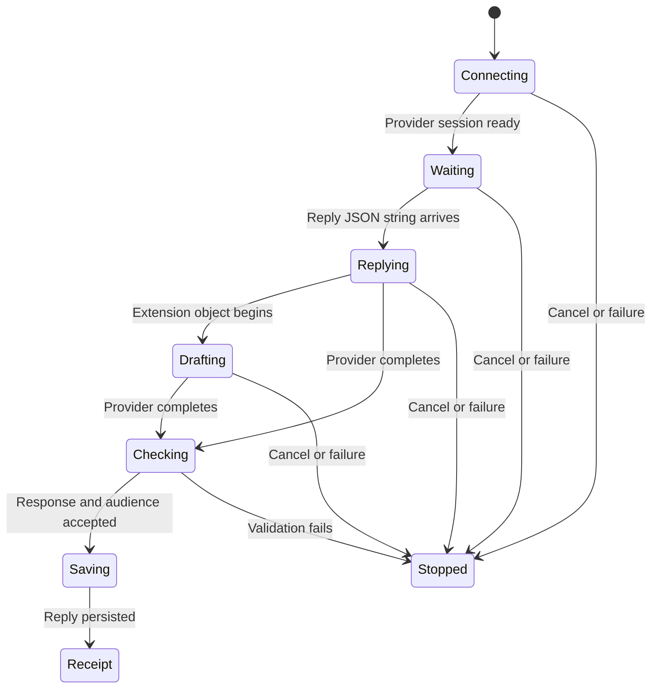

# Agent activity in chat

Research and local prototype, 2026-10-20. Companion to the [inline extension lab](0481-inline-extension-lab.md).

The chat should answer three questions at a glance: is the agent still working, what is it doing, and can I stop it? The answer itself should take most of the space.

## Research and decisions

Microsoft's [agent UX principles](https://microsoft.design/articles/ux-design-for-agents/) recommend visible agent status, user control, concise responses and detail available when needed. Its [human-centered design guidance](https://learn.microsoft.com/en-us/agents/design-guidelines/human-centered-design) also calls for clear capabilities, contextual signals and easy recovery. Applied here: one activity row, expandable steps, Stop, and an explicit retry after an unsuccessful request.

The [WCAG status-message guidance](https://www.w3.org/WAI/WCAG22/Understanding/status-messages.html) calls for status changes to be available to assistive technology without taking focus. Applied here: a persistent polite status region announces phase changes; the elapsed timer and streamed text stay outside it. The [animation guidance](https://www.w3.org/WAI/WCAG22/Understanding/animation-from-interactions.html) supports disabling nonessential motion. The monochrome dots and short entrance transitions respect reduced motion.

These are design principles, not evidence that a particular animation improves this app. The choices below need continued testing with real requests.

| Surface                    | Default                                               | On expansion                                                   |
| -------------------------- | ----------------------------------------------------- | -------------------------------------------------------------- |
| Active request             | Provider, current phase, elapsed time, Stop           | Observed steps, relative timestamps, supplied message count    |
| Finished reply             | Answer and a small duration receipt                   | The same steps and technical details                           |
| Extension draft            | Building phase until output is complete, then Preview | Source and data permissions stay in the existing preview panel |
| Failed/interrupted request | Short cause and Try again                             | Full diagnostic and unfinished reply                           |
| Stopped request            | Explicit confirmation until the next request          | Unfinished reply, retained in activity history                 |

No percentages or rotating invented tasks. No raw reasoning, generated source, provider session IDs or tool payloads in the activity row. The prototype's agent has no web, shell or filesystem tools, so it must not display fictional search or execution steps.

The timeline records only phases actually observed. Providers that buffer or reorder structured output may skip streaming phases. “Checking the response” means output and conversation-boundary validation; it does not mean the extension was compiled or tested. Compilation and data approval happen in the preview panel. “Working on your request” means a provider session exists and no reply has arrived; it makes no claim to reveal the model's internal reasoning.

## Verification

- [x] Real Codex reply: live status, completion receipt, no repeated attribution.
- [x] Real extension request: separate building phase, observed timeline, preview action.
- [x] Stop and retry: confirmation, partial output kept out of published chat, new attempt.
- [x] Expanded details remain usable without pulling the reader back to the bottom.
- [x] Reduced motion, keyboard controls, polite status region and narrow layout inspected.
- [x] Response parser, service lifecycle and activity presentation unit checks pass.
- [x] Affected typechecks and changed-file lint pass; local commit only.

## Electron evidence

Used the real desktop in `codex/chat-first-redesign`, profile `dev-wt-xNet`,
renderer 23060 / CDP 23061. All prompts and data were in the existing synthetic
Extension pagination lab conversation.

| Request                                | Observed result                                                                                                                                                                                       |
| -------------------------------------- | ----------------------------------------------------------------------------------------------------------------------------------------------------------------------------------------------------- |
| `2e055d2d-a504-4162-a2e2-a829168ccfdc` | Ordinary Codex answer, four observed phases, published in about four seconds; one local attribution byline.                                                                                           |
| `0970a42d-1ccb-471b-99cf-08dbca15e170` | Film club pulse generated in 17 seconds. Replying transitioned to building; five phases survived an Electron restart.                                                                                 |
| `508e6891-5db7-4d70-a99f-dad874813a52` | Stopped the next extension build after 12 seconds. No published reply; partial text available only on expansion.                                                                                      |
| `9dab7ffa-1ef8-496d-a4ce-234bfab33818` | Try again created a distinct attempt, completed in 22 seconds and published a revised extension. The stopped attempt remains marked retried in history, with no duplicate inline status card.         |
| `dbce5aa0-361a-4675-8033-7377bc66bf49` | A further revision completed in 21 seconds. Its open timeline stayed in place while streamed content arrived. This draft tested progress and scrolling; its new sort behavior was not preview-tested. |

The revised extension compiled and queried eight actual messages. Verified a
no-match search, Reset search, full-text expansion, page two with eight loaded
messages, return to page one, and revocation removing the running view. The
prototype was not installed; the temporary read grant was revoked afterwards.

The preview pane narrowed the conversation without horizontal overflow: the
viewport, body and root all measured 1,200 CSS pixels. Keyboard Enter opened the
activity disclosure. Focus used the monochrome ring. Reduced-motion emulation
changed the dots' animation name from `agent-dot` to `none`. The live region said
“Codex: Finished.” without timer ticks. No VoiceOver listening test was performed.

Expanding details originally scrolled the outer shell. Disclosure now scrolls
only the message viewport. Keyboard focus exposed a second cause: the outer
shell's hidden overflow was still programmatically scrollable. Using clipped
overflow keeps the header and composer in place. After reloading and opening a
receipt with Enter, the window, body, root and community shell scroll offsets
were all zero; the conversation heading remained at y=81.25 CSS pixels.

Reading an open timeline pauses automatic following. During the final request,
the message viewport's scroll offset stayed at 6,902 while its content height
grew from 7,369 to 7,496 CSS pixels. User-initiated scrolling and sending another
message still work.

The final inspected capture is `output/playwright/agent-ux-final.png` (not
committed). `agent-ux-extension-preview.png` records the earlier functioning
extension preview. Other captures are intermediate evidence: in particular,
`agent-ux-scroll-verified.png` exposed the outer-shell bug and is not a final
layout screenshot.

### Runtime and test conditions

The installed Codex had updated to `0.163.0-alpha.10.2`. The saved older runtime
selection was correctly rejected. Rediscovery, the new binary's feature list,
generated app-server schema, and model catalog were inspected before adding this
exact version to the compatibility list. Connection, reply, extension generation,
cancellation and retry then ran through it. Unknown builds remain rejected. The
existing disabled-tool catalog, disabled feature flags, MCP policy and unexpected
tool-frame abort remain in place. This is compatibility verification, not a new
security certification. Updated Claude `2.1.304` remains unsupported and untested.

macOS occlusion stalled screenshot rendering. The final session used temporary
dev-launch background-rendering flags and CDP focus emulation in the real
Electron renderer. No production window or security settings changed. Screenshots
were checked against the visible DOM rather than accepted after capture alone.

Fresh focused checks: 11 workbench activity tests and 46 Electron response,
service, runtime and policy tests passed. ESLint passed the changed TypeScript
files. No UI test specs were added. Owned Electron/dev servers were stopped and
native dependencies restored to Node before the final commit checks.

Local implementation commit: `a106b39`. Required hooks passed changed-file
ESLint/formatting, related tests, all 102 affected build/typecheck tasks (98
cached on the first successful typecheck run), and 48 changed-file tests across
five files. The final commit reused the successful typecheck cache. A manual
`graphify update .` completed after the last code edit. No push or merge was run.
