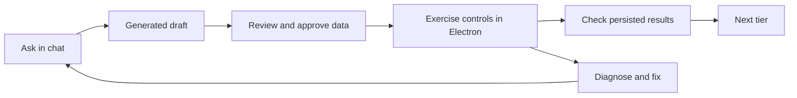

# Inline extension lab — 20 October 2026

Drive the actual Electron app on `codex/chat-first-redesign`. Build each draft by chatting with the locally connected Codex agent. Keep all changes local. Use private test data; inspect generated source only for diagnosis. A tier passes only after its controls and resulting data have been exercised in Electron.

## Test ladder

- [x] **1. Conversation reader:** Ask for a searchable message list. Preview, approve one test conversation, search real messages, and verify loading, empty and permission states.
- [x] **2. Larger live reader:** Ask the agent to add pagination and live updates. Traverse more than one page, add a message outside the extension, and confirm bounded counts and updates.
- [x] **3. Task workspace:** Ask for a task planner. Select private tasks, create and complete a task, verify persistence and undo, and exercise a denied write without permission.
- [x] **4. Document workspace:** Ask for a page reader/editor alongside tasks. Approve text separately, save through the host editor, provoke a stale revision, and verify installation/restart durability and revocation.
- [x] **5. Capability boundary:** Ask for an unsupported integration. Confirm the agent explains the limitation instead of inventing an API or claiming a successful install.

## Evidence and fixes

Record prompts, generated version identifiers, observed behavior, regressions and verification here as the ladder progresses. Screenshots belong in `output/playwright/`.

### Tier 1 — first generated draft

Prompt: “Build a small inline extension named Lab message finder. Show the newest 10 messages in this conversation, a search box that filters only that loaded page, and an honest loaded-message count. Include clear loading, empty and error states. Use real xNet message data, no sample records. Keep each message excerpt at most 120 characters … no pagination or editing.”

- Codex run `bbd923f8-4ed4-433e-8221-f6a36d0e73b7`; preview build `bfa81147fdee3678`.
- Generated TSX used the real message schema and `useQuery`, with a 10-record host page. No manually substituted source.
- Preview displayed ten real records. Searching `fixture 225` displayed exactly one result and retained the honest “10 messages loaded · 1 matching” label.
- Initially the generic permission picker occupied most of the panel before the preview; this led to the compact approved-state layout below.
- Desktop automation note: docked DevTools and a hidden native compositor caused actionability/screenshot timeouts. CDP still reached the actual Electron renderer and native data owner. Do not count stale native screenshots as visual evidence.

- Confirmed empty search state, then revoked access: the running view disappeared and the host reported durable revocation. Repeated after a normal Electron restart.
- Collapsed the approved permission checklist into a scope summary; verified its actual layout in `output/playwright/tier-1-finder.png`. The native screenshot problem was resolved by restarting normally and closing docked DevTools before interaction.

### Tier 2 — pagination exposes a renderer mismatch

Prompt: “Revise Lab message finder into Lab message browser. Add Next page, Previous page, and Newest controls using opaque host cursors … Clear stale rows while a page loads … Keep live updates and the 120-character excerpts.”

- Codex run `8b076935-6abb-4cb7-8aa3-b450d95220cc` returned a complete revision using `useQuery` cursors and a keyed page component.
- First preview failed: its ordinary `<nav>` element was absent from the sandbox allowlist. The error did not name the rejected element, while host status incorrectly continued to say “Live xNet data”.
- Fix: map `nav`, `header` and `footer` to inert host layout stacks; keep external elements and unknown attributes rejected. Name the rejected tag/property in errors. A terminated preview now reports that it stopped.
- Document the supported markup in the Codex instructions so it can avoid unsupported controls. Worker regression tests cover semantic layouts and reject iframe, link and unknown-property negative controls (11 runtime tests passed).

- After the renderer fix, the same generated source loaded. Next/Previous displayed distinct sets of ten records; Previous disabled on page one. A new message sent through the ordinary composer appeared live; Newest returned from page two to page one. Screenshot: `output/playwright/tier-2-browser.png`.

### Tier 3 — task mutations

Prompt: “Create a different inline extension named Lab task desk. Let me search my approved tasks, add a private task with a typed title, mark a task done, reopen it and remove it … five tasks per page … No chat messages.”

- Codex run `135d267a-1292-42e0-8e0e-5533620a7549` generated the task desk.
- Selected two private task fixtures without chat access. A read-only “Mark done” attempt displayed `Save failed: Editing tasks has not been approved.` The native record remained unchanged.
- Approved their private parent folder, editing, creation and deletion. Completing a task persisted `completed: true`; host Undo restored the original field state.
- Created `Tier 3 prepare popcorn` (`cf1a987f-bf85-49d3-9b37-acb5a063628e`). Confirmed removal in both the live query and native store (`deleted: true`), then restored it with host Undo.
- Generated code only changed `completed`; it left `status: todo`. The next chat revision explicitly requests both fields together so other task views agree. This is an agent-contract/documentation gap, not permission bypass.
- UI automation must wait for worker-rendered controls to become enabled after typing; immediately dispatching a click to a disabled button does nothing. Wait for the actual stored result and query invalidation, not just the guest success label.

### Tier 4 — combined task/document workspace

Codex run `127be472-f986-41d5-94c5-92fec7cf5fe3` produced **Lab project workspace** from a chat revision request. No source was substituted manually.

- Folder properties alone: tasks rendered, while the document section explained that no page text was approved.
- Explicit text-read grant: the real page text rendered through `DocumentView`; no editor textarea existed.
- Explicit text-write grant: `DocumentEditor` exposed the host-owned textarea and Save control. Saved two paragraphs; acquiring the real Yjs document confirmed the saved first paragraph.
- Typed an unsaved draft, then applied an outside Yjs edit. The host displayed “This page changed elsewhere. Reload its text before saving.” Save disabled and the unsaved draft remained intact. Reload fetched the concurrent text.
- Retested task completion and reopening against the native store: `{status: 'done', completed: true}` and `{status: 'todo', completed: false}` respectively. Added these conventions to the agent instructions.
- Installed the generated workspace locally. Full restart and revocation checks follow below.

### Tier 5 — unsupported capabilities

Asked for a capability check covering YouTube thumbnails, arbitrary local files, raw NodeStore/Yjs and closed-app background jobs, explicitly without generating a draft.

Codex run `0154b1fd-a663-4c8d-9a52-ee6c26327a3e` correctly explained that all four are unsupported, described the scoped alternatives, and returned `extension: null`. It did not claim to fetch media or install anything.

### Additional negative control and history cleanup

Used the source editor to make one deliberate local failure (`<form>`), separate from the agent-generated test drafts. The preview reported `Unsupported element <form>`, the host status said “Extension stopped”, and no running view remained. This verifies the failure UI rather than relying only on a unit test.

Repeated permission approvals exposed three identical build hashes in history. The host now reuses the current compiled revision when source/runtime are unchanged; approvals still get their own durable authorization epoch. A code/runtime change still creates a separate revision.

Reapproval regression check: the working workspace had three existing entries for build `551c6746`. Approving it again twice kept the count at three. Existing historical duplicates were preserved; new approvals no longer create more.

The outside edit in the conflict test was injected into the live Yjs mirror, not submitted through a second ordinary editor. That test proves conflict detection and draft retention. The restart test separately saves a fresh note through the host editor and verifies that committed text.

### Cold restart and revocation results

- A full Electron restart reopened installed build `551c6746f87a55d4` with its durable two-record/private-folder grants and working host editor. The created task also remained present in the native store.
- The first restart merged the concurrent Yjs insertion with the saved note. After reviewing that reconciled text, saved a new two-paragraph note and restarted Electron again. The editor matched the exact expected text: `Tier 4 durable workspace note.` followed by `Verified after reconciling concurrent changes.`
- Revoked access, closed the panel and reopened the installed version. No running extension or document editor returned; the host required a fresh approval. The installation remains saved for review, with its test grant revoked.
- Screenshots: `output/playwright/tier-4-workspace-restarted.png`, `tier-4-document-editor.png`, and `tier-4-cold-restart.png`. The final images also verify the conversation title remains visible beside the extension.

## What this pass establishes

Four actual Codex-generated drafts progressed from a read-only search to pagination, task mutations and a combined task/document workspace. The latter two use real scoped hooks and native persistence. No generated source was replaced by a hand-written implementation; only the explicitly labelled negative-control draft used the source editor.

This is a bounded prototype exercise, not a security audit or proof of the whole API. Rich-text editing, shared writes, media/network integration, raw storage access and background execution remain unsupported. Shared membership changes, larger permission sets and multi-device editing are useful next-tier tests. The generated explanatory copy is still verbose, and a full workspace would benefit from more space than the current side panel.

## Verification

- Focused extension suite: 78 tests passed across 11 files, including four new semantic-layout/markup rejection cases.
- Changed TypeScript/TSX files: ESLint passed.
- Extension API inventory check passed; AST knowledge graph refreshed.
- Electron agent integration: 42 tests passed across response parsing, runtime, policy and lifecycle suites.
- Local commit hooks passed: lint-staged (including related tests), 102 affected type/build tasks, and 38 changed-code tests across three files. Implementation commit: `b858467c7`.
- All owned Electron/dev listeners were stopped, native modules restored to the Node ABI, and no push or merge was performed.
