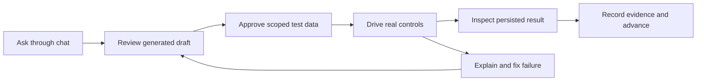

# Inline agent integration passes, round two

Run in the real Electron app on `codex/chat-first-redesign`. Use the existing
private synthetic lab data and locally connected Codex. All source changes,
commits, generated drafts and installations remain local.

## Increasing complexity

- [x] **1. Conversation continuity:** reply, switch conversations while running,
      return to the completed answer, and check the activity receipt and context.
- [x] **2. Revised reader:** run the saved page-sort revision, traverse pages,
      filter, expand text and check that counts and sort scope stay honest.
- [x] **3. Scoped task dashboard:** generate a richer task view, exercise denied
      edits, allow only a private container, create/update/delete and use host Undo.
- [x] **4. Document workflow:** generate a task-and-notes workspace, distinguish
      record access from text access, edit a page and exercise draft/conflict recovery.
- [x] **5. Permission changes:** narrow/revoke/reapprove a running extension's
      grants, check sibling/outside-container isolation and stale controls.
- [x] **6. Version lifecycle:** install a working version, revise via chat,
      compare/reopen older versions and ensure permissions belong to the right build.
- [x] **7. Failure and recovery:** stop a complicated revision, retry it, test
      unsupported operations and verify that errors never look like success.
- [x] **8. Restart durability:** restart Electron, reopen an installed version,
      verify saved edits and permissions, then revoke temporary access and clean up.

Each check needs an observed UI result and, for writes, a persisted result.
Generated source is inspected for diagnosis, never silently replaced to make a
pass green. Label direct fixture setup, injected failures and limitations.

## Evidence

Record request/build identifiers, behavior, fixes and remaining limits here.

### Conversation continuity and reader revision

- Run `e8a87ee8-4a39-4056-8afa-f57bab8fabc5` completed and published while a
  different conversation was open. Its marker appeared only in the correct chat.
  Follow-up `a1c57ccf-e70e-43f4-a79b-5e49b21c5bfc` recalled `NIGHTJAR-47` exactly.
- The prior saved sort revision built as `42bc1c59`: newest/oldest reversed the
  eight loaded records, a marker search found three matches, and page two loaded
  eight different records. Full-text expansion displayed the complete prompt and
  changed its control to Collapse text. Revoking removed the running view.

### Richer task desk

- Generated run `56ace28b-3f35-45ce-9c8e-6a84cded4977`, build `314e1ffb344e5c41`.
- Fixture setup used the host's normal NodeStore API directly: a private root,
  nested folder, outside sibling, seven tasks, an outside canary and two pages.
  This setup is not evidence of a UI creation flow. All extension commands below
  were exercised through the actual Electron controls.
- Root-only approval read nested tasks, excluded the outside canary and refused
  Mark done. Native task 6 remained `todo` / `completed: false`.
- Explicitly approving tasks 5 and 6 plus editing allowed task 6 to become
  `done` / `true`; host Undo restored `todo` / `false`. Priority and rename saved
  as `high` and `Integration 2 projector checked`.
- Add created `e411a853-a037-443f-821f-072a6aa8f7ee` privately. Confirmed removal
  persisted deletion; host Undo restored it. The Done filter on page two showed
  one of two loaded records. Returning to the first page showed the restored task.
- Navigating immediately after Undo used the earlier page boundary (two records
  on page two rather than three). This is consistent with the displayed warning
  that live page boundaries can shift; counts describe the loaded page only.
- Changing the first permission remounted and collapsed the record picker.
  Removed the approval-dependent React key so editing permissions preserves the
  open picker. Retesting from an active approval kept the next checkbox visible;
  later multi-record approvals also worked without reopening the picker.
- Installed the task desk locally for the version lifecycle pass.

### Documents, changing scopes and version history

- Run `8b3c8195-8548-4f2e-bc66-f93740efab67` generated Screening workspace,
  build `2e6b0b43`. Its Tasks and Notes tabs used the real hooks and host editor.
  The new version did not inherit the task desk's grant. Folder-only access
  showed no page text. Text-read approval showed a read-only document and no
  textarea; separate write approval exposed the editor.
- **Found a wrong-document save risk:** typing an unsaved A draft and selecting
  B kept A's text under B's title with Save enabled. No save was attempted.
  Host drafts now use document handles, scoped to a permission session, outside
  the guest layout tree. A and B retained independent drafts across page/tab
  switches, and both saved to their own Yjs documents. Six focused state tests
  cover page isolation, navigation, concurrent revision, pending save, renewed
  authority and paragraph preservation.
- Injected an outside Yjs edit through the live host mirror while A had a draft.
  Save disabled; switching to B and back retained the conflict and draft.
  Reload showed the outside text. This is an injected conflict, not a second-device
  sync test. Afterwards saved a fresh two-paragraph A note through the host UI.
- Removing B's grant immediately removed the active editors. Reapproving only
  A showed no B selector and A's committed text. Unsaved drafts from the old
  approval did not return. The permission picker stayed open during this change.
- Moved the nested fixture folder outside the approved root through NodeStore.
  The task query dropped to zero; an attempted page save was denied because its
  containing folder was no longer approved. The stored A note stayed unchanged.
  Restoring the folder restored the task query. A new future task inside the
  restored folder appeared live without broadening the grant.
- Installed the workspace, reopened the older task desk, and verified its own
  two-task write scope with no document editor. Revoked that old build and reopened
  it: no running view returned. The installed workspace still reopened with its
  distinct one-page approval. This verifies version-specific revocation.

### Atomic batches, cancellation and capability boundaries

- Run `73e643ee-78e5-48a2-8ff9-614b63d6d35d` declined to guess the batch API
  because its instructions omitted the operation shape and atomicity guarantee.
  Added the supported hook-level operations, limits, explicit confirmation and
  uncertain-outcome guidance to the agent instructions, then restarted Electron.
- Stopped request `45ef0a6d-0c46-4118-b068-eb2fcaeccab6` while connecting. It
  became cancelled and did not publish. Try again created a new request,
  `24f6fb16-c655-40b4-93b1-986f6cfc2849`, which completed in 28 seconds and
  produced Screening batch desk, build `d5be74af97497def`. This pass does not
  establish cancellation during partial source generation or an in-flight write.
- The generated desk showed five proposed tasks before confirmation. Approving
  only one of them rejected the batch with an explicit permission error. Native
  reads of all five records matched their pre-submit values: nothing committed.
- Approving all five and confirming changed every task to `done` / `true`.
  Host Undo restored all five to `todo` / `false`, verified with native reads.
- Repeated the batch after refreshing. Injected a separate title edit through
  NodeStore before Undo. Undo rejected the stale batch atomically: all five stayed
  done and the newer title survived. The UI initially exposed an internal IPC
  exception. It now says, “Cannot undo: a task changed after this edit. This undo
  changed no tasks.” Reopened the saved receipt after reloading and verified this
  recovery message in Electron. Unknown failures retain refresh guidance without
  claiming rollback or exposing host paths.
- Capability-only request `1da942e2-f4b0-400a-8edb-fe7071149d26` explained the
  limits on network export, shared-container writes and installing for other
  members. It completed without an extension draft. This checks agent guidance;
  permission and broker tests separately exercise enforcement.

### Restart and local cleanup

- Shut down the first Electron process normally and launched the same worktree
  profile again. Conversation extensions reopened the installed workspace and
  its one-page approval. The saved two-paragraph A note survived. A subsequent
  host-editor save added “Restart verified.”
- Revoked the reader, old task desk, batch desk and installed workspace approvals
  used in this round. Reopening the installed workspace showed no running view.
  Synthetic fixtures and saved versions remain available locally for review.
- Screenshots in `output/playwright/` were inspected visually:
  `integration2-document-restarted.png` and `integration2-batch-conflict.png`.
  They show the installed editor after restart and the final conflict recovery UI.
- Shut down the second Electron process normally. Ports 23060–23063 were closed.
  Restored native modules to the Node ABI with the desktop `deps:node` script.

## Verification and limits

Final focused verification passed 85 extension tests in 12 files and 46 Electron
agent tests in four files. The extension run includes the new draft and error
regressions, permission enforcement, broker transactions, document projection,
pagination, dispatcher and worker runtime checks. Changed TypeScript files passed
ESLint, formatting completed and `git diff --check` was clean.

Local implementation commit: `e6c5dbca1`. Its normal hooks passed lint-staged
(including related tests), 102 affected build/typecheck tasks and 83 changed-file
tests. No test or typecheck hook was bypassed. `graphify update .` completed
separately; its redundant hook was disabled because of the existing graphify hook
compatibility problem. Nothing was pushed or merged.

These passes used real Electron controls and locally connected Codex, with private
synthetic data. Fixture creation, folder moves and concurrent edits were injected
through normal host APIs and are identified above. Generated extension source was
never substituted by hand. This round does not verify a second device, Claude,
network loss during a commit, or a full security audit. An early async polling
check was inconclusive; decisive results were rechecked through settled controls
and persisted records.
