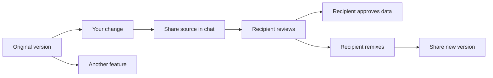

# Inline extensions: complex workflows and remixes

Use the actual Electron app and locally connected Codex. Keep all commits and
synthetic test conversations local. Never substitute generated source to make a
test pass; ask the agent for a revision through the UI.

## Passes

- [x] Generate a combined conversation/task/document review desk with independent
      pagination, local filters and document editing.
- [x] Generate selected-task triage and staged task creation with explicit
      confirmation; test denied writes and duplicate input. Stale-write coverage
      remains in pass two and the broker regression suite.
- [x] Edit a selected older version with Codex, preserving its exact parent.
- [x] Make sibling branches with different features and change notes; switch
      between them without transferring data approvals or changing installation.
- [x] Share through chat, open a signed synthetic peer share, remix and share back.
      Check author attribution and missing-parent behavior. This does not verify
      remote delivery to a second device.
- [x] Manually edit a remix, handle invalid source, and recover to a saved version.
- [x] Test hostile/malformed share envelopes and agent base-selection boundaries.
- [x] Restart, reopen shared/remixed versions, verify ancestry, clean up grants
      and owned processes, and record checks.

## Evidence

Record request IDs, persisted results, screenshots, fixes and test limitations
as each flow is exercised. A saved share is not proof of remote delivery.

### Review cockpit

- Codex request `d8dd227b-bd4b-41c1-a6a7-92398e1b4cfd` generated the combined
  view through chat. Saved version `99b5b489`, local record
  `chat-extension-a3061fa9-55e2-49f0-89ba-7bfe97b58e9a`.
- Approved the synthetic conversation, private Integration 2 root, five exact
  tasks and two exact pages, with separate task and page write permissions.
- Conversation page two loaded four records and expanded full text. Task pages
  used a separate cursor. Selecting two tasks, then filtering one out, still
  showed both exact IDs in the confirmation. Native reads verified both priorities
  changed to high while an unselected task remained medium.
- After a normal Electron restart, the version reopened with its saved grant.
  An unsaved note survived page and tab switches; the other page retained its
  own text. Save persisted two separate Yjs paragraphs. Task page two survived
  visiting Notes and returning. Installed the original locally for branch tests.
- “Edit this version with your agent” showed the selected-title context in the
  composer. Planner request `12b81277-2781-4c6a-94a1-de2f6bfb57be` carried the
  exact local base ID above and parent fingerprint `99b5b489` in the host journal.

### Planner branch

- Planner version `86c408a3` appeared as a child of the original; the original
  remained installed. Duplicate titles (case-insensitive) disabled the preview
  with a specific correction message. Three distinct titles produced an exact
  confirmation list.
- With read-only access, confirmation created zero records. The generated UI
  mislabeled the explicit permission denial as uncertain. With creation approved,
  exactly three tasks were persisted as private, todo and uncompleted, and all
  staged inputs cleared. Unselected existing tasks were untouched.
- Host Undo correctly refused without delete/restore permission. The generated
  success copy had promised Undo too broadly. Asked Codex through “Edit this
  version” to fix both messages. Added public error-code and Undo-grant guidance
  to the host's agent instructions and advance notice in the permission picker.
- Recovery run `61780665-11c4-4d62-84e2-fe65894e69b2`, version `cca9445f`,
  showed a clear pre-commit rejection. Approving creation and delete/restore let
  it create and undo task `6f6313e2-1b76-442e-8734-7b598d444a4b`; native reads
  confirmed its tombstone. A live refresh immediately erased the host's success
  notice. Action notices now have separate state, and Undo disables while pending.

### Comparison and shared remixes

- Run `6ad0e484-24f6-4c50-bd21-a765766d965c`, version `c8de14a5`, explicitly
  used original `99b5b489`, not the newer Planner. History showed two sibling
  branches and the Planner's recovery child; the original stayed installed.
- Compared a two-line page with a one-line page: zero equal positions, two
  differences, and the missing line labeled. Searching `draft` found one matching
  line in each page, with honest line-based counts. Compare stayed read-only.
- Shared Compare through the UI as message `B7yR7LqF_yNHcwDXfFnhr`, containing
  a 15,520-byte source attachment. The stable notice reported local persistence
  without claiming remote delivery.
- Created a **synthetic peer fixture** with a fresh signing key and a self-authored
  profile, “Sam · integration fixture.” Added it to this private synthetic channel.
  Applied its properly signed message changes through `NodeStore.applyRemoteChange`
  and stored the attachment bytes through the normal local blob API. This tests
  recipient UI and signed authorship, not networking between devices. Its source
  is the unchanged Codex-generated Compare source, not a hand-edited replacement.
- Peer share `integration3-peer-share`, version `089510d2`, displayed Sam's name,
  change note and parent. **Found grant reuse:** identical compiled code inherited
  Compare's approval. Approval identity now includes both build and version.
  Retested with Compare approved: saving Sam's review copy produced no running
  view and required its own approval. The reader also refused direct resharing
  under a different author; it offered remixing instead.
- Signed fixtures with a forged payload author and an unexpected permission field
  were rejected in their attachment cards. A valid missing-parent fixture showed
  “parent not available on this device” instead of inventing an ancestor.
- Manually edited Sam's source through the UI. An invalid TSX draft showed a
  compiler error and created zero versions. Restored valid source, personalized
  its heading and saved `0153d6de` with a change note. History attributed this
  child to You under Sam's version. Shared it through the explicit source-sharing
  confirmation. This was the manual-edit test, not a repair substituted into an
  agent-generated draft.
- Asked the agent to remix received version `089510d2`. Run
  `3a75755f-2911-48ca-ae0a-daea46d6f551` produced My capture cockpit, adding
  approved-document TODO capture and atomic task creation. Used the host editor
  to save synthetic TODO lines in both pages, including a duplicate across pages.

### Capture, permission isolation and restart

- Capture version `bbb589c0` is a second child of Sam's `089510d2`, alongside
  manual version `0153d6de`. It loaded four TODO candidates from two approved
  pages, with page IDs and line numbers. Selecting both duplicate titles disabled
  preview with a correction message. Selecting three unique titles showed the
  exact creation list before confirmation.
- Confirmation created exactly three private, todo, uncompleted tasks:
  `8aaaac84-8ce7-472f-8b47-4896a77a3241`,
  `365b8672-5d59-4f69-8256-6a47d9263849`, and
  `512b02bd-f6d2-4d85-8f2b-36e526db6ae9`. Native reads verified their properties.
  Host Undo tombstoned all three; its success notice survived live refresh and
  subsequent UI interactions. Selection cleared after creation.
- Expanded the source comparison against Sam, then shared Capture as message
  `01cK0OH-kVU6C1xA7m4eF`, with a 19,737-byte source attachment. Opening that
  message restored the same saved version without duplicating history.
- Approved Sam separately, revoked it through the UI, and switched to Compare:
  Compare retained its own grant. A fresh normal Electron restart retained all
  seven family rows, the received source, the capture agent's exact parent and
  Capture's approval. Sam still had no running view or selected permissions.
- Found that unapproved history selections carried forward the previous view's
  checked boxes, although execution was blocked. They now start with no checked
  data. Branch notes are limited to two lines in the overview; selecting a version
  shows its complete note and source comparison.
- Installation remained on original `99b5b489` throughout branch browsing,
  generation, sharing and restart. No remix installed itself.
- Revoked Sam, Compare and Capture through the UI. As fixture cleanup, used the
  trusted host transaction API to retire three old build-only grants created
  before the version-bound approval fix. Inspected 14 keys for eight saved
  versions. Removed the synthetic peer's channel membership and tombstoned its
  membership edge. The original installed version reopened without execution and
  asked for approval. Kept the synthetic conversation, source snapshots, shared
  messages, sample pages and initial Planner tasks for review.

Screenshots were inspected locally (ignored output, not release assets):

- `output/playwright/integration3-branch-history-desktop.png`
- `output/playwright/integration3-capture-restarted.png`

### Verification

- `vitest run --project dom` scoped to extension and agent UI logic: **102 tests
  in 14 files passed**. These are logic/runtime tests, not new UI specs.
- `vitest run --project electron` scoped to community-agent and selected-base
  logic: **50 tests in five files passed**.
- `turbo run typecheck --filter=@xnetjs/workbench --filter=xnet-desktop`:
  **43 tasks successful** (includes prerequisite builds).
- ESLint on all changed TypeScript/TSX files: exit zero, no diagnostics.
- Required commit checks passed: lint-staged, **102 affected typecheck/build
  tasks**, and **41 changed-file tests**. Local implementation commit: `2acca0ace`.
- `graphify update .` completed with 64,269 nodes and 106,466 edges (AST only,
  no API cost). HTML generation was skipped by its size limit. Used the existing
  graph-hook override after this successful refresh; lint, types and test hooks
  stayed enabled.
- Stopped the owned Electron/dev processes; ports 23060–23063 were closed.
  `pnpm --filter xnet-desktop run deps:node` restored the native modules to Node
  and invalidated the Electron rebuild stamp.
- Actual Electron, worktree `chat-first-redesign`, scoped profile `dev-wt-xNet`,
  real IPC persistence and local Codex. No auth bypass or replacement of generated
  source to manufacture a pass. The manual edit was tested as its own feature.

This pass does not establish second-device delivery, merged ancestry, automatic
ancestor fetching, Claude support, or an independent sandbox security audit.
Those are explicit limits of the prototype rather than completed checks.
