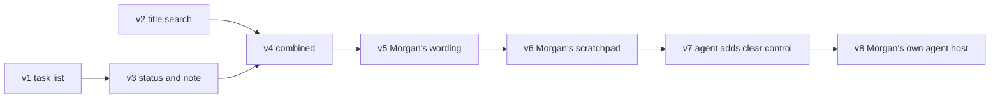

# Shared extension development: local integration pass

Date: October 22, 2026. Branch: `codex/chat-first-redesign`.
This is a local prototype. Nothing was pushed, merged, or submitted to a PR.

## Environment

Two separately running Electron processes used different identities and SQLite
stores. The original profile was `dev-wt-xNet` (renderer 23060 / CDP 23061);
the collaborator was `dev-collab-0482-peer` (23070 / 23071), displayed as
**Morgan Prototype**. Both connected to the local development hub on 23062.
The circle, invitation, project, requests, approvals, code edits, and previews
were driven through the real app UI. No signed peer fixtures were injected.

The local hub explicitly runs with anonymous development authentication and
in-memory storage. This proves transport and application behavior, not encrypted
private networking. Authenticated authorization was tested separately against
the real relay and both Memory and SQLite storage.

Codex: installed `codex-cli 0.163.0-alpha.11.1`, model `gpt-6.1-sol`. Its local
generated app-server protocol was inspected before adding that exact version
to the adapter's tested allowlist. The existing tools-disabled boundary remains.

## Staged walkthrough

| Stage                | Actual action                                                                                  | Observed result                                                                                                                                          |
| -------------------- | ---------------------------------------------------------------------------------------------- | -------------------------------------------------------------------------------------------------------------------------------------------------------- |
| Join                 | Create “Extension Studio 0482,” invite Morgan, open its conversation from the other profile    | Same channel and roster arrive through the hub; separate local stores                                                                                    |
| Project              | Create “Community task board” with a read-only task brief                                      | Shared stable project, brief, conversation, and version area                                                                                             |
| Delegate             | Host explicitly permits Morgan for 20 requests / one hour                                      | Morgan can name that host; no provider credentials move between profiles                                                                                 |
| Queue                | Morgan requests the first board; host requests an independent title-search board while it runs | First request runs, second visibly queues, both complete with distinct source fingerprints                                                               |
| Branch               | Host requests status counts and a local note from v1                                           | v3 explicitly names v1; v2 remains a sibling initial proposal                                                                                            |
| Accept               | Project creator makes v1 current                                                               | Both clients show v1 current; no preview or installation is forced                                                                                       |
| Combine              | Morgan selects v2 and v3 and requests their combined behavior                                  | v4 records both parents and Morgan's request, built by the other profile's Codex                                                                         |
| Preserve input       | Keep v2 open with “keep this unsaved” in its search input while v4 arrives                     | v2 stays selected and the exact text remains after completion                                                                                            |
| Local data           | Original profile approves only three existing synthetic “Integration 3” tasks                  | v4 renders 3 tasks; searching “caption” gives 1/3; no task writes                                                                                        |
| Independent approval | Morgan receives the same source with no task grants                                            | No data is silently granted or installed; denied-schema state is visible when previewing with no records                                                 |
| Manual variation     | Morgan edits v4's note label, compiles it, and publishes it                                    | v5 is attributed to Morgan with parent v4 and a one-line source diff                                                                                     |
| Iteration            | Morgan edits v5 again and publishes v6                                                         | Correct new parent; published edit can be selected as the next agent base; duplicate publish button disappears                                           |
| History              | Open this-update and ancestry views for the combined/manual versions                           | Requests, published responses, source diffs, bases, provider/template metadata, and retained input revisions are available; shared ancestors appear once |
| Offline history      | Close original host and hub, reload Morgan's renderer, open v5 ancestry                        | v1–v5 still assemble from Morgan's local store, in parent-first order                                                                                    |
| Offline cancellation | Send a request while host is offline, then withdraw it                                         | “Waiting for … device,” then “Withdrawn”; host rejects it on reconnect before adding a provider run                                                      |

The project uses real `useQuery(TaskSchema)` hooks through the existing scoped
bridge and sandbox. The three approved tasks were synthetic records from the
earlier integration lab, not fixtures embedded in generated source. Receiving a
version or accepting it never transfers those record grants.

After v6, the original host's Codex built v7 from Morgan's published edit, adding
a button to clear the temporary scratchpad. A new feedback message used by that
run was then removed through the UI. Both profiles' history views replaced its
text with an unavailable entry after the sparse-update relay fix. This does not
erase retained payloads or provider copies.

Morgan then restarted the second Electron process, connected its own local
Codex, enabled hosting, and explicitly selected **Morgan Prototype** as host.
With the original host and hub closed, it produced v8 from v7, changing only
the heading to “My task studio.” Its run and result name Morgan as executor.
This verifies an explicit continuation on a different host, not migration of an
in-flight provider session.

After the original host reopened, it received v8 attributed to Morgan and made
it current. Morgan saw the new shared-current marker; local installation still
required the separate install action. In Morgan's v8 preview, typing a private
scratchpad note and pressing **Clear scratchpad** reset the input to empty.

The five development-run prompts in the original host's local journal were
checked for `PRIVATE OUTSIDE CANARY 2` and the three approved task titles. None
appeared. Preview permission did not silently become model-context permission.



## Bugs found and corrected

- A channel recipient did not receive the community roster needed to authorize
  shared requests. A bounded, membership-gated dependency room now carries only
  the circle and its creator-issued membership records.
- Concurrent duplicate IPC deliveries could both pass admission before either
  run was persisted. Admission is serialized and covered by a concurrent test.
- A remote controlled input snapped back to empty when its update changed only
  an input property. The worker now publishes the committed view after UI events.
- Newly received source incorrectly offered “Publish my edit.” That action now
  requires a compiled local edit, verifies the selected project base, and tracks
  the published revision before another agent iteration.
- History repeated already displayed agent replies and could show a later root
  before the earlier root of a combined branch. Parent-first ordering and input
  deduplication now preserve each iteration's actual relationships.
- Partial message updates omit both schema and channel. The relay previously
  failed to route redactions to the shared channel. It now recovers routing from
  signed author history and backfills updates that arrived before creation.
- Partial roster changes had the same schema issue. Membership expiry is now
  interpreted from signed sparse history. Roster authority uses the pinned
  ownership index, not the lowest submitted Lamport clock.
- Shared activity records cluttered the ordinary conversation with every phase.
  Those internal records now appear through the project's status UI.

## Automated evidence

Run from the worktree, with Node 22 on PATH:

```sh
pnpm exec vitest run --project dom packages/workbench/src/communities/extension-development.test.ts --project electron apps/electron/src/main/community-agent-service.test.ts apps/electron/src/main/community-agent-policy.test.ts apps/electron/src/main/community-agent-runtime.test.ts
```

51 tests passed. They cover record integrity, context digests, forged attribution,
cross-project and private context, branches, missing ancestry, concurrent acceptance
heads, queue deduplication, withdrawal, revocation, limits, expiry, fresh sessions,
crash recovery, and publication revalidation.

The relay integration suite was run using Electron as Node to match the installed
SQLite ABI, without rebuilding native modules underneath running applications:

```sh
ELECTRON_RUN_AS_NODE=1 node_modules/.pnpm/electron@33.4.11/node_modules/electron/dist/Electron.app/Contents/MacOS/Electron node_modules/vitest/vitest.mjs run --config packages/hub/vitest.config.ts packages/hub/test/channel-share-sync.test.ts
```

14 tests passed, seven against each storage backend. Negative cases include an
outsider's self-issued wildcard, forged roster membership, a later ownership claim
with an earlier clock, and message edits arriving before their original record.

Workbench, Electron, and hub typechecks passed. Changed TypeScript files were
linted; `git diff --check` and `graphify update .` were also run. These are targeted
checks, not a claim about the complete monorepo test suite.

## Prototype limits and remaining release evidence

- History is the executor's attributed report, not cryptographic attestation of
  provider execution. Every shared run uses a fresh session and bounded explicit
  input. Attachments, arbitrary external tools, and private-data model access are
  outside this flow.
- Requests freeze selected message digests at submission. Edits while queued
  require a new request; the original can be withdrawn. Automatic private context
  and in-place mutation of a signed request are deliberately unavailable.
- The viewer hides removed/unavailable source messages, including in the expanded
  input view. Retained version payloads and private host journals still contain
  previously received snapshots. There is **no hard-erasure guarantee**, and
  comprehensive removal of derived retained copies is unfinished. Do not use this
  prototype for sensitive conversations that require that guarantee.
- Source sharing outside a project uses the existing source-only envelope. It
  does not export development transcripts or permissions. A general history export
  and separate history audiences are not implemented.
- The project creator curates the current shared version. Other contributors
  publish proposals. Concurrent acceptances from a creator's disconnected devices
  are preserved and resolvable; the conflict path has pure tests, not a real
  partitioned multi-device UI trial yet.
- The UI supports separately authorized hosts and explicitly selecting the
  runtime for each new request. An automatic lease, migration of an in-flight
  provider turn, and globally exactly-once execution are not promised.
- The two clients used different local data approvals. A common shared-data
  fixture, a full private-canary audit of every export/log, and encrypted
  multi-device delivery remain release validation work.
- Native screenshots became unavailable when the Mac locked. Electron UI driving
  and DOM assertions continued over CDP; the earlier preview screenshot is local
  under `output/playwright/0482-peer-preview.png`.

Leave the exploration partially implemented until its broader retention,
encrypted-delivery, partition, and fixture checks have evidence.
