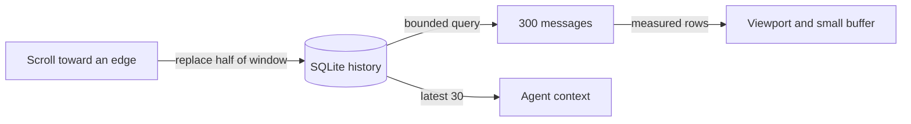

# Chat virtualization verification

Verified locally on October 22, 2026, in the Electron community preview on
`codex/chat-first-redesign`. Nothing was pushed or merged.

The conversation timeline now measures variable-height message rows and renders
the viewport plus six rows of overscan on each side. Database reads use a
300-message window, moving 150 records at a time with overlap. The previous
window remains visible during a read or a failed read. Search uses the same
bounded query path. Agent requests use a separate latest-30-message query, so
reading older history does not change the agent's recent context.

## Electron checks

Used the real renderer and preload over this worktree's CDP endpoint. The
`Long chat scrolling lab` conversation contains 4,000 synthetic signed messages
created through NodeStore transactions, followed by three verification messages.
No message results or provider replies were mocked. Foreground emulation through
CDP was needed because the native window remained hidden after development
reloads; that enabled normal animation frames and Playwright interaction.

| Check                         | Observed result                                                                                                                                                                       |
| ----------------------------- | ------------------------------------------------------------------------------------------------------------------------------------------------------------------------------------- |
| Traverse history              | 25 older-window transitions reached offset 3,750, with 253 messages in the final window. No window exceeded 300 messages; at most 22 message articles were mounted in this traversal. |
| Return through history        | Scrolling down moved offset 450 to 300. Jump to latest returned to offset zero and the newest message.                                                                                |
| New arrival while reading     | The visible anchor `virtual-chat-lab-03519` stayed 12 px from the viewport top before and after insertion. The feed did not jump to the new message.                                  |
| Search outside loaded history | Searching `00042` returned one matching message from the older history. A nonexistent term showed the empty result state; closing search restored the latest window.                  |
| Send through the composer     | A two-line message was saved and displayed at the bottom after browsing history.                                                                                                      |
| Variable attachment height    | Uploaded and opened the repository's `icon.png`. The image appeared without overlap; the end remained within the 80 px follow threshold (24 px of bottom padding remained).           |
| Attachment lifecycle          | Scrolling the image out of the virtual range unmounted it and revoked its object URL. Returning and reopening it produced a new working URL.                                          |
| Real agent reply              | Local Codex completed a five-line response in four seconds. The reply was saved, nine message articles were mounted, and the viewport remained at the end.                            |
| Expanded activity             | The reply's activity receipt expanded to 220 px, showed the real steps and 30-message context count, and stayed inside the chat viewport.                                             |

Attachment previews intentionally unload when their rows leave the virtual
range. Opening them again reloads the local blob. This also stops offscreen
audio/video rather than keeping hidden media elements alive.

## Automated checks

- Two window-policy tests traverse 10,001 records in both directions and check
  overlap, bounded reads, and equal-timestamp ordering.
- The focused query, saved-view, agent-activity, and window suites passed:
  52 tests across four files.
- Turbo typechecks passed for workbench, React, and views with their dependencies
  (41 tasks). Changed TypeScript files passed ESLint and Prettier.

All three packages now resolve the same TanStack Virtual version. The initial
Electron check caught Vite selecting the older React package's virtualizer,
which lacked the end-anchoring API. See the
[TanStack Virtual API](https://tanstack.com/virtual/latest/docs/api/virtualizer)
for stable keys, measurement, and end anchoring.

This bounds the active chat window and its DOM; it does not claim to bound all
application caches or sync storage to 300 records. The existing query cache has
its own eviction policy. Pagination currently uses database offsets, so this
pass does not establish constant-time reads at arbitrarily deep offsets.
