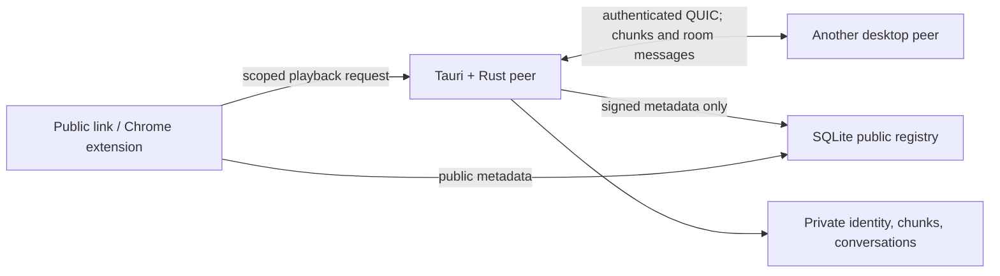

# Community network: first native experiment

Local branch: `codex/community-network-tauri`. No push, PR, deployment, or migration of existing apps.

This is new code in an independent Rust workspace. The existing TypeScript packages and apps remain intact. Shared branding is the only copied asset. The wire format and data schema are experimental and may change; promotion into the main product requires a separate migration decision and ADR.

The user's November 2 decision supersedes 0499's optional-hosting recommendation: native participation is required for network playback and messaging. Hosting still requires explicit consent, has quotas, and can be paused. Pausing gates network consumption rather than secretly continuing uploads. Having an active server is not cryptographic proof of useful bandwidth donation; no client can guarantee that every remote participant runs an honest binary.

## Build and verify

- [x] Independent workspace, Rust core, local SQLite state, stable device identity.
- [x] Metadata-only public registry with bounded signed records, search, and content links.
- [x] Real Iroh peer transfer, chunk integrity, range playback, caching and re-seeding.
- [x] Explicit participation onboarding, pause and storage/transfer limits, payload counters.
- [x] Public rooms and invite-only rooms with authenticated peer access; no private records in the registry.
- [x] Minimal Tauri UI for identity, discovery, publishing, playback, chats and contribution.
- [x] Implement Chrome extension and narrowly scoped native bridge; verify native protocol and range delivery.
- [ ] Verify the extension's actual Chrome playback UI in a normal browser session. The available Chrome session has `--disable-extensions`; native bridge tests are not a substitute.
- [x] Independent profiles: publish, discover, transfer, seed after original host pauses, public and private messages. Native UI uses Maya/Leo; automated network verification adds a third peer.
- [x] Negative tests for tampering, unauthorized rooms, wrong bridge credentials, invalid ranges and paused access.
- [x] Drive the native UI and public registry browser flow; record evidence and limitations in `VERIFICATION.md`.
- [x] Preserve peer ports across same-network restarts; test private chat reconnecting and history remaining intact.
- [x] Test extension request/response boundaries, including forged frames, mismatched IDs and remote media URLs.
- [x] Verify the native bridge denies playback while the desktop UI is paused and serves bytes after resuming.
- [ ] Verify the new player retry UI in Chrome, including unavailable desktop, pause/resume and a late response.

## Prototype boundaries

Start with a device-key account and chosen name. Social OAuth needs configured provider registrations and a separately reviewed account/device recovery flow. Do not pretend provider buttons work. Private rooms use authenticated encrypted peer transport and explicit member admission; this is not Signal's double ratchet or an audited MLS group protocol. Local files are protected by OS permissions, not a new at-rest encryption claim.

The first registry runs locally. No videos, chat bodies, private room descriptors, or private invitation secrets go to it. There are no transcoding workers or public deployments in this pass. Browser/native codec support is reported honestly. A working local peer demo is not proof of WAN/NAT performance or readiness for minors and strangers.

## Sources consulted

- [Iroh 1.4.1](https://docs.rs/iroh/1.4.1/iroh/): authenticated QUIC endpoints and direct/relay addressing.
- [Tauri capabilities](https://v2.tauri.app/security/capabilities/): local window permissions and command exposure.
- [Chrome native messaging](https://developer.chrome.com/docs/extensions/develop/concepts/native-messaging): extension allowlisting, framed control messages; media travels over a scoped loopback URL.
