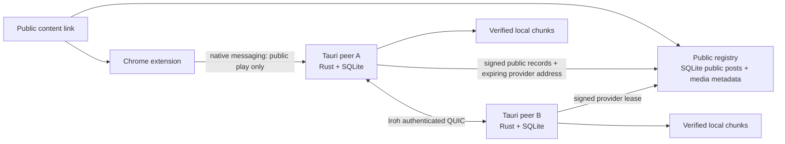

# xNet community network experiment

A separate Rust + Tauri prototype for a community that hosts its own media and conversations. The first slice is intentionally small: two desktops, one public metadata registry, one shared film, and public or invitation-only conversations.

Branch: `codex/community-network-tauri`. Local only. No deployment, GitHub publication, or migration of the existing xNet product.

## Try the current demo

On this Mac, open the generated `.local/xNet Maya.app` and `.local/xNet Leo.app` launchers. Each has an independent identity, database, cache, upload budget and peer endpoint. The registry is at <http://127.0.0.1:4380>.

1. In **Maya**, choose **Share something**, select an MP4 or image, enter a title, and publish. The native picker gives the application access to that file.
2. In **Leo**, refresh **Discover**, open the item and play it. The registry supplies metadata; Maya's peer supplies the bytes. Leo checks and caches the chunks.
3. Choose **Keep a full copy**. Once all chunks verify, Leo advertises its copy too. A third peer can fetch from Leo when Maya pauses.
4. Create a public conversation in Maya. Join it from Leo's discovery page and exchange replies.
5. Create a private conversation, copy **Invite**, and paste it into **Open a link** in Leo. It does not appear in public discovery. Treat the invitation as a bearer secret.
6. Open **Music**, choose **Share music**, and publish an MP3 or WAV. Another peer can listen, keep a full copy, and share the track link just like a video. The demo includes a generated twelve-second **Garden loop**.
7. Open **Posts** to publish a short public update. Open **Reply & discuss** from another profile, reply, and share the `/post/<id>` link. **Open a link** resolves it directly into the conversation.
8. Open **Safety & moderation** for hides, mutes, contact blocks, report status and appeals. Every media item, post and chat message has a **…** menu. **Room settings** holds rules, newcomer approval, slow mode, member roles and room cases.
9. Open **Your contribution** to change storage/upload caps or pause. Pausing stops serving and blocks new network playback and messaging; saved-message safety review, reporting, appeals and leaving remain available; resuming enables them again. Already buffered or previously downloaded information cannot be made unreadable by a client policy.

The supplied film is a six-second generated test pattern, not somebody's uploaded personal media. Both demo names are fictional local profiles. The current demo also contains **Open studio** and **Garden friends** conversations.

## Build from a clean checkout

Requirements: Rust 1.97.1 or a compatible current stable toolchain, Node 22+, pnpm 10+, and the [Tauri platform prerequisites](https://v2.tauri.app/start/prerequisites/). Native UI verification so far is macOS only.

Run from this directory, not the repository root:

```sh
pnpm install --ignore-workspace --frozen-lockfile
pnpm build
cargo +stable build --locked --workspace --features tauri/custom-protocol
python3 scripts/make-demo-apps.py
```

If a shell manager supplies an old `rustc` despite selecting a recent Cargo, set `RUSTC` to `rustup which rustc --toolchain stable` for the build. This machine's terminal ran the x86_64 stable toolchain under Rosetta. These are unoptimized development executables; we have not measured release bundle size or native ARM performance.

Start the metadata registry in a terminal and keep it running while trying the apps:

```sh
./target/debug/community-registry --bind 127.0.0.1:4380 --database .local/registry.sqlite \
  --moderator YOUR_REVIEWER_DEVICE_PUBLIC_KEY
```

The moderator argument is a public 64-character device identity, visible under **Your contribution → Device & prototype details**. Repeat it for up to sixteen reviewers. Omit it to accept reports without granting anyone review authority. It is an operator configuration, not an in-app self-appointment. The local Maya demo is the configured reviewer; these fictional profiles are not production staff.

Then open the two `.app` launchers above in Finder. They use the compiled frontend, so no Vite server is needed. Rebuild after changing UI code. `pnpm dev` serves the frontend for development, but the application needs Tauri IPC and does not function as a standalone browser client.

The main desktop accepts `XNET_COMMUNITY_DATA`, `XNET_COMMUNITY_REGISTRY`, and `XNET_COMMUNITY_LABEL`. The launchers set separate data paths. The profile lock rejects concurrent processes opening one data directory. To stop the demo, quit both desktops and stop the registry with Ctrl+C. There is no login item or background startup service.

## Browser extension

The MV3 extension and native host are implemented for the local registry. **The native protocol and range delivery are verified; actual Chrome playback is not yet verified.** The available Chrome session was launched with `--disable-extensions`: it displayed an “Extension loaded” notification but retained no extension. We did not change that browser's launch configuration or interrupt other browser work.

In a normal Chrome session:

1. Open `chrome://extensions`, enable Developer mode, then **Load unpacked** and select this experiment's `extension/` directory.
2. Copy its extension ID. Start the desktop profile you want to use.
3. Register just that extension against that profile:

```sh
python3 scripts/install-native-host.py --extension-id YOUR_32_LETTER_ID --data .local/leo
```

4. Open a registry `/watch/<content-id>` link. Choose **Watch through desktop**.

The extension's own iframe receives a short-lived playback URL from Chrome native messaging. The webpage does not receive the control credential. The native host allows public playback and a minimal participation status; it rejects chat access, file import, publishing and settings changes. The background worker checks the extension frame and the exact local registry URL. Host permissions are loopback-only because both the registry and the temporary playback port are local in this experiment.

The player has a **Try again** action for unavailable desktops, paused hosting and interrupted playback. A request times out after 30 seconds; retries are explicit, and late replies cannot replace a newer attempt. Its request contract binds the extension frame, parent content page and requested content ID. The response contract accepts only a loopback media URL with a scoped ticket. Those contracts are checked by `pnpm test:extension`; this does not replace an actual Chrome interaction pass.

Remove the native manifest printed by the registration script to disconnect the browser, and remove the unpacked extension in Chrome. Windows registration, production domain allowlisting, installers and automatic pairing remain future work. Browser requests for local-network access must also be handled in the real Chrome verification pass.

## What lives where



| Directory         | Responsibility                                                           |
| ----------------- | ------------------------------------------------------------------------ |
| `crates/network`  | Signed records, local state, peers, media chunks, rooms, loopback bridge |
| `crates/registry` | Public record registry and link/search website                           |
| `crates/node`     | Headless peer, local control client, Chrome native messaging executable  |
| `apps/desktop`    | Tauri shell and React frontend; no legacy xNet package dependency        |
| `web`             | Public metadata pages; no centralized media endpoint                     |
| `extension`       | Browser player connected to the local desktop                            |
| `.local`          | Ignored identities, databases, caches, fixtures and launchers            |

Only existing branding assets were copied. The workspace has its own Cargo and pnpm lockfiles and is outside the root pnpm workspace. It can be evaluated or removed without deprecating the existing apps. Promotion would require an explicit migration plan and ADR; this format is not a new stable xNet protocol.

Branding uses the existing `site/public/wordmark.svg` for the interface and the `apps/electron/build/icon.*` mark exports for native icons. Copies live in this experiment so it remains independently buildable. Tauri bundles and the local macOS launchers both declare the icon; regenerate the launchers after updating its artwork.

## Protocol and limits

- **Identity:** persistent Ed25519 device key plus a chosen display name. Names are not unique or social-account verified. No Bluesky/Google/X OAuth, account recovery, device linking or password UX yet.
- **Participation:** explicit consent, storage cap and persistent upload allowance. A peer must answer an authenticated reverse ping before receiving another peer's data. This proves a reachable cooperating endpoint, not useful contribution, a fair ratio, human identity, or an unmodifiable client. Limits count payload bytes reserved for transfer, not IP/QUIC overhead or receiver-confirmed accounting. There is no rate limit in MB/s, monthly reset, battery detector or cache eviction yet.
- **Media:** MP4, WebM, PNG, JPEG, WebP, MP3 and WAV, at most 100 MB each. Basic file signature checks, SHA-256 content/chunk integrity, 256 KB chunks, HTTP range streaming, verified caching and whole-file re-seeding. Native codecs do the decoding; no arbitrary executables or transcoding. File signatures and hashes do not prove that media is harmless. A production media pipeline still needs decoder hardening and resource testing.
- **Registry:** signed metadata and signed expiring provider leases; refreshed once per minute, expires after three minutes. Up to 10,000 items, 64 providers per item, and 100 search results. Search covers titles and descriptions using SQLite; no global index, recommendation engine or full-text scale claim. Listings indicate advertised hosts, not guaranteed availability. The registry stores public post/reply bodies, but no media bytes, room-chat bodies, private room descriptors or invitation secrets in its public catalog. Explicitly reported private excerpts go into a separate encrypted review store.
- **Public posts:** signed plain-text updates up to 280 Unicode code points, a newest-first root feed, search, and reply threads. Threads show the latest 100 direct replies in chronological order. The UI refreshes every ten seconds. Posting and replies require active desktop participation; public links remain readable in a browser. Replies can target only existing public posts. The registry retains public text independently of provider leases, and the author keeps a local signed copy. This is registry-backed microblogging, not peer-only text replication. No likes, follows, push notifications, author editing or author deletion yet. Scoped moderation can remove a post from this registry and its reply trees; the author’s signed copy remains. Names remain chosen device names, not verified social handles.
- **Transport:** direct Iroh endpoints only. There is no relay configured and no background STUN/discovery service in this slice. Demonstrated on one Mac with independent processes, not across two physical devices or difficult NATs. A relay/discovery design and WAN verification are still required. Peers and the registry can observe advertised network addresses.
- **Conversations:** signed messages over authenticated encrypted peer transport. Public rooms are listed; private rooms admit identities through an invitation. A room owner hosts and sequences its history; members poll and keep local copies. This is not leaderless/offline group synchronization, MLS or Signal's double ratchet. Latest 200 messages shown; up to 10,000 stored messages per profile. Owner availability is required to receive new messages. Profiles retain their UDP ports, and same-network owner restart is tested. If the network address changes, recipients may still need a fresh invitation/link; private address recovery is not implemented.
- **Privacy:** private history stays with participants, but their machines can read it. Directory/file permissions protect local state; no whole-chat at-rest encryption, forward secrecy, disappearing-message guarantee or remote deletion promise. Do not use this experiment for sensitive real conversations.
- **Local boundary:** the control bridge binds only to `127.0.0.1`, requires a random owner-only credential, validates Host, and rejects browser Origin headers. Playback uses scoped ten-minute tickets with no-store responses. Tauri exposes two host commands; it has no remote frontend or general filesystem/shell plugin.

The registry is intentionally loopback-only by default. Before offering it publicly, add service-level abuse/rate controls, staffed incident response, public-service deployment authentication, evidence archival/expiry maintenance, observability, backup/restore, security review and a cost model. A cheap metadata server does not eliminate relay bandwidth, availability or moderation costs. We have not deployed it or estimated a monthly bill from load tests.

## Moderation boundaries

The local implementation follows [exploration 0500](../../docs/explorations/0500_[_]_MODERATION_WITH_AGENCY.md). This remains an experimental protocol, not a production moderation service.

- **Personal:** hides, author mutes, phrase filters and contact blocks persist on this device and can be undone. A block refuses direct join/send requests to a room you host and hides that person’s messages for you in shared rooms. It does not evict them from someone else’s room, erase copies or stop hosting their media; hosting is a separate choice.
- **Public registry:** signed, single-use requests are bound to its persistent authority key. Only configured reviewer identities can restrict content or authors. Reports never automatically become removals. Catalog results, direct lookups and reply ancestors obey the same policy. An author restriction also prevents that identity from advertising or serving other people’s public media through a conforming peer.
- **Peer enforcement:** clients pin the registry key on first use and refuse an unexpected replacement. Signed policy expires after 60 seconds and is refreshed after five seconds of reuse. New playback, range requests and each chunk recheck policy. Fresh policy failure stops public media access; private rooms do not require registry availability. A public-room registry restriction delists that room; its room owner still governs peer admission. This is not a promise to erase independent copies or force modified clients to comply.
- **Hosting:** publishing and **Keep a full copy / Approve hosting** grant per-file permission. Watching does not. Old playback caches migrate to stored-only; own published files remain approved. **Stop sharing** refuses chunks immediately and withdraws the provider lease. If the registry is offline, local refusal still applies and its old lease expires within three minutes. Restoring a moderation decision does not start downloads or override a hosting refusal.
- **Private rooms:** the host enforces rules, moderator roles, new-member approval, slow mode and membership. Removal records a case, rotates invitations and refuses subsequent reads/writes. Former members retain their own notices, reports and appeals. An offline leave stops participation locally and explains that the host was not notified; it is not a queued delivery guarantee.
- **Evidence:** select up to five already received messages, preview the recipient and exact excerpts, then confirm. Altering the evidence or destination invalidates confirmation. No attachments, additional history, roster or decryption key is sent. Cases use AES-256-GCM with an independent owner-only key beside the database; this is not hardware-backed protection from a compromised host. Evidence expires after 30 days and is scrubbed on the next case access. Backups, recipient copies and already disclosed material are not remotely erased. Decisions and appeal history remain; reviewers must avoid putting identifying evidence into public reasons.
- **Review:** restrictions carry scope, rule, reason, reviewer, time and optional expiry. Affected people see evidence-free notices; reporters see their own cases. Reversal affects only that case, preserving other restrictions. Review pages are bounded by count and bytes; this prototype caps each scope at 1,000 cases (100 slots reserved for operator membership actions), ten new reports per identity per hour, 50 decisions per case and 64 KB per disclosure. There is no case archive UI or Sybil-resistant anti-abuse service yet.
- **Not included:** independent label subscriptions, AT Protocol moderation adapters, automatic classifiers, dry-run policy editing, independent-review assignment, a second staffed community, youth onboarding or a new E2EE group protocol. Keyboard/native accessibility trees were checked; VoiceOver and formal accessibility conformance were not verified.

## Verification

```sh
cargo +stable test -p community-network -p community-node -- --nocapture
pnpm build
cargo +stable build --workspace --features tauri/custom-protocol
pnpm test:extension
python3 scripts/check-native-host.py --data .local/leo --media CONTENT_ID_FROM_DEMO
```

For the contribution-denial check, pause the selected profile in the desktop UI and run the native-host check with `--expect-paused`. It must report inactive status and reject playback without issuing a ticket. Resume in the UI and rerun without that flag; it validates the real response against the extension contract and reads a byte range through the desktop.

The network integration tests start three independent Iroh endpoints and a temporary registry. It covers publication/search, real chunk transfer, verified re-seeding from the second peer after the first pauses, public/private messages, an uninvited reader, bad invitations, forged sender signatures, tampered registry records, corrupted chunks, bridge authorization, HTTP ranges and paused access. The music/post test covers audio re-seeding and range delivery, public reply validation, Unicode length limits, tampering, record persistence, and the additive registry migration. Loopback-only test bindings keep these same-machine checks independent of host VPN/LAN routes. Unit tests also verify that pre-replies records retain their exact signed bytes. Other unit tests cover signature/range boundaries, profile locking, persistent identities/records, corruption handling and truncated native framing.

The native UI pass created two accounts, published and played the generated MP4, exchanged public and private messages and exercised invitations. An initial cold integration run hit a peer timeout; subsequent runs passed without a proven root-cause fix. Keep that startup reliability issue open rather than treating local success as proof of WAN readiness.

See [PLAN.md](PLAN.md) for the scoped checklist and [VERIFICATION.md](VERIFICATION.md) for the current run's evidence and remaining checks.
